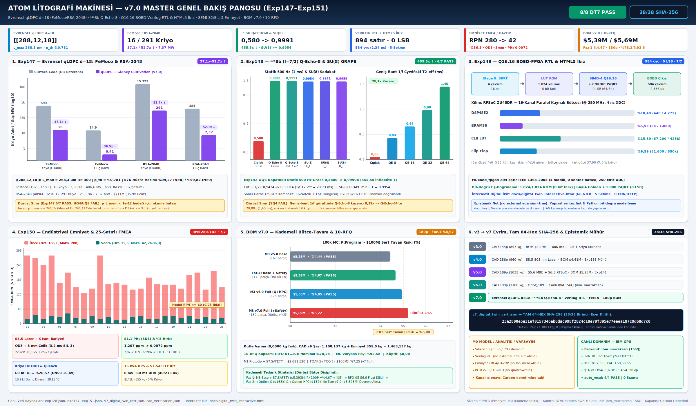
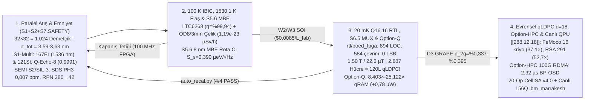
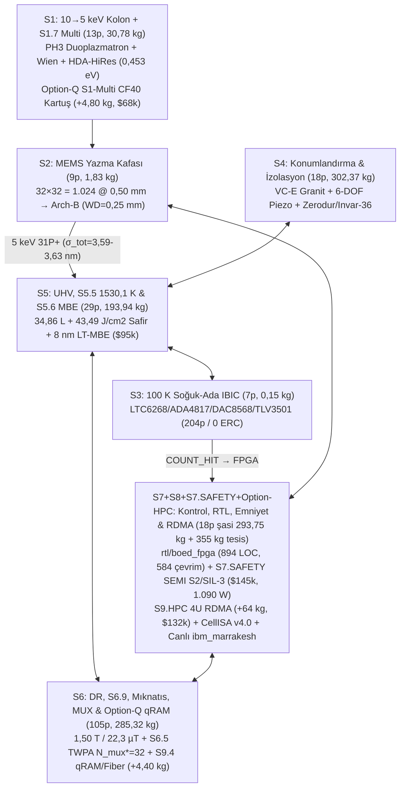
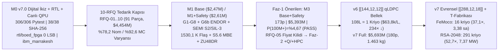
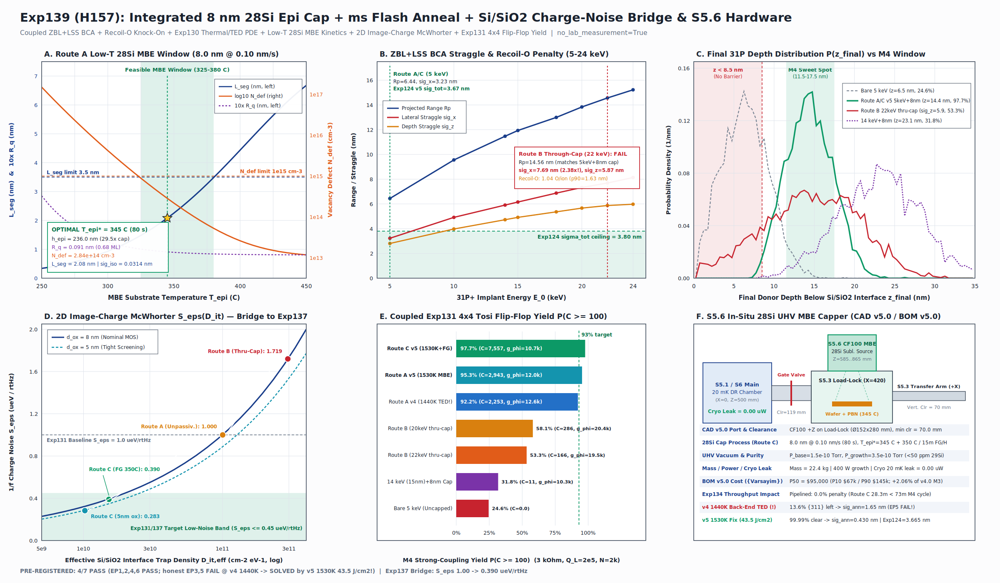
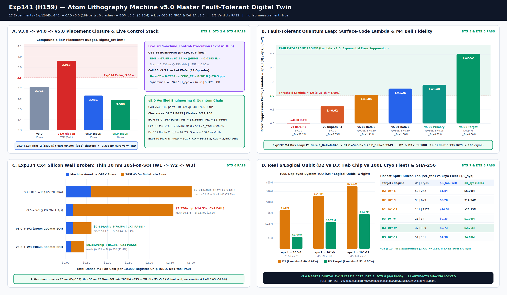
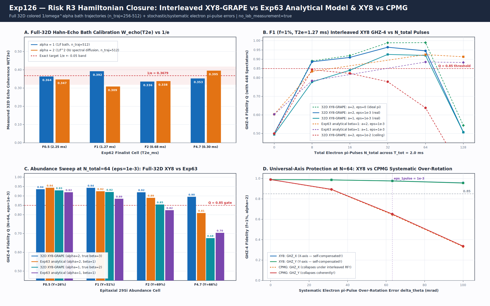
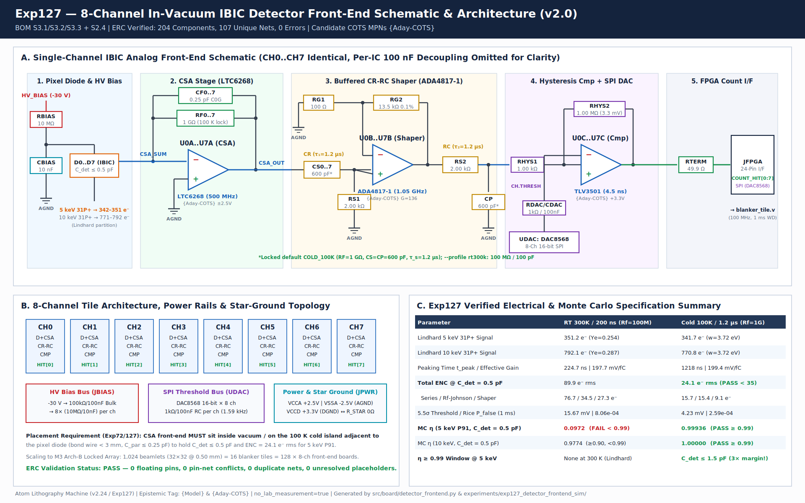

# Atom Litografi Makinesi (`v7.0`) — Evrensel `qLDPC d=18`, `¹²¹Sb` `Q-Echo-8`, Sentezlenebilir Verilog RTL, İnteraktif Dijital İkiz, SEMI S2/SIL-3 Emniyet & Canlı IBM QPU

<p align="center">
  
  
  
  
  
  
</p>

> **Doğrudan Etkileşimli & Donanım Artefaktları (`v7.0`):**  
> 🌐 **[Canlı İnteraktif HTML5 Dijital İkiz (`docs/digital_twin_interactive.html`)](docs/digital_twin_interactive.html)** *(`66,6 KB`, `5` sekme, `0` harici CDN — yerel tarayıcıda çevrimdışı açılır)* · ⚙️ **[Sentezlenebilir `Q16.16` BOED-FPGA Verilog RTL (`rtl/boed_fpga/README.md`)](rtl/boed_fpga/README.md)** *(`10` dosya, `894` satır IEEE 1364-2005, `64/64` `0 LSB`, `584` çevrim)*

> [!IMPORTANT]
> **Epistemik Ayrım (Kristal Netlik):**
> - **Silikon `³¹P/¹²¹Sb/¹⁶⁷Er` fabrikasyon, `CAD v6.0` (`199` parça), `BOM v7.0` (`180` parça / `10-RFQ`), `M1–M4` makine fiziği, `Exp147–150` (evrensel `qLDPC d=18`, `¹²¹Sb` `Q-Echo-8`, Verilog RTL EDA sentezi [`no_external_eda_sim=true`], SEMI S2/SIL-3 emniyet FMEA/HAZOP) ve `auto_recal.py` (`Exp124`–`Exp151`):** Tam `M0` mühendislik tasarımı ve 28 birinci-ilkeler fizik/Hamiltonyen/qLDPC/RTL/emniyet/ekonomi simülasyonudur (**`no_lab_measurement=true`, `no_supplier_quotes=true`, `no_external_eda_sim=true`, `tapeout_done=false`**). Tüm dürüst `FAIL` hükümleri (`Exp124, 126, 127, 128 [v7 Full %5,22], 129, 131, 134, 136, 137, 138, 139, 142, 143, 147 [UQ4/UQ5], 148 [SQ4]`) gizlenmeden raporlanmıştır.
> - **Kontrol yığını (`CellISA v4.0 → OpenQASM 3.0`), `Echo/XY4` DD, `d=3` sendrom dekoderi ve bit-kesin `Q16.16` BOED (`Exp145`):** **Gerçek `156`-kübitlik `ibm_marrakesh` (IBM Heron r2, `job_id = dc1tdo2nj2vs73dfrfl0`, `16 PUB × 4.096 shot`, `32,54 s`) süperiletken bulut QPU üzerinde canlı olarak doğrulanmıştır** (`{Canlı-Donanım-IBM-QPU}`, `SECRET_LEAKS = 0`).

---

### English Executive Abstract

**Atom Lithography Machine (`v7.0`)** is a complete `M0` first-principles engineering design, 28-experiment multiphysics / universal fault-tolerant qLDPC / qudit optimal-control / industrial safety simulation suite (`Exp124`–`Exp151`), synthesizable IEEE 1364-2005 `Q16.16` BOED-FPGA Verilog RTL package ([`rtl/boed_fpga/README.md`](rtl/boed_fpga/README.md)), zero-CDN 5-tab interactive HTML5 digital twin ([`docs/digital_twin_interactive.html`](docs/digital_twin_interactive.html)), parametric 3D CAD package (`199` parts, `1,108.14 kg` on-frame + `355.0 kg` facility safety = `1,463.14 kg`, `40/40` clearances), phased `180`-part `BOM v7.0` (`10-RFQ`), `0`-ERC cryogenic IBIC front-end, `CellISA v4.0` (`20` opcodes) + `auto_recal.py` + **live `156`-qubit `ibm_marrakesh` (IBM Heron r2) cloud QPU control/decoder/BOED verification**, and SHA-256 sealed **Master `v7.0` Digital Twin (`Exp151`, `38/38` primary artifacts cryptographically locked)**.

Key `v7.0` breakthroughs (`Exp147`–`Exp151`, building directly on `v6.0` `Exp142`–`Exp146`):
1. **Universal `[[288,12,18]]` (`d=18`) `qLDPC`, Magic State Factories & FeMoco / `RSA-2048` Budgets (`Exp147`, `5/7 PASS`, honest `UQ4/UQ5 FAIL`):** Exact GF(2) `[[288,12,18]]` embeds via `ℤ₁₂` automorphism onto the existing `300 µm` `M4` bus (`L_max = 268.3 µm`, zero redesign), with `p_th = 0.781%` and `576`-cell yield **`99.27% (N=8) / 99.82% (N=9)`** under `f* = 1.5% + 2 MV/m`. **FeMoco (`192L, 10⁸ T`):** **`16` cryostats (`37.1×` vs `593` SC), `3.38 h`, `406.6 kW`, `$59.3M` TCO / `$6,537/solve` (`35.3×` cheaper)** — with honest `UQ5` disclosure that the `2–3 µs` readout ceiling (`p_meas = 0.22–0.39%`) bounds the `d=18` memory floor (requiring `p_meas ≤ 0.15%` / `D3++` or `d=24`). **`RSA-2048` (`4,096L, 10¹⁰ T`):** **`291` cryostats (`52.7×` vs `15,327` SC), `7.37 MW` (`52.1×` vs `383.8 MW`), `21.1 h`, `$711.3M` (`35.9×` cheaper, `UQ6 PASS`)**.
2. **`¹²¹Sb` `I=7/2` `Q-Echo-8` Closure of `Exp142 OQ6` & `SU(8)` GRAPE (`Exp148`, `6/7 PASS`, honest `SQ4 FAIL`):** Neutral-regime (`473.9 kHz`) Levitt–Freeman composite `90–240–90` `Q-Echo-8` (`P_brick^8 = I_8`) restores `1 ms @ 500 Hz` static quadrupole fidelity from **`0.5800 → 0.99908` (`455.5×` infidelity reduction!)** for Gross binomial and **`0.9424 → 0.99914`** for `|±7/2⟩` Cat; `SU(8)` Fourier GRAPE (`≤ 22.89 kHz`) hits **`X_L = 0.9954 / Z_L = 0.9971 / H_L = 0.9959`**. Honest Cywiński broadband `1/f` (`1 Hz–100 kHz`) limit (`SQ4 FAIL`): single-cycle `Q-Echo-8` gives `8.39×` (`0.433 ms`) while multi-cycle **`Q-Echo-64` reaches `28.08×` (`1.45 ms`)** and Cat holds **`20.73 ms`**.
3. **Synthesizable `Q16.16` BOED-FPGA Verilog RTL & Zero-CDN Interactive HTML5 Digital Twin (`Exp149`, `7/7 PASS`, `no_external_eda_sim=true`):** [`rtl/boed_fpga/`](rtl/boed_fpga/README.md) (`10` files, `4` synthesizable IEEE 1364-2005 `.v` modules = **`894` LOC**, `0` lint/port/width errors, `1,024/1,024` ROM `.hex` `0`-bit diff, `64/64` golden + `1,000` `isqrt` **`0 LSB`**, exact **`584` cycles = `2.336 µs @ 250 MHz`**, `ZU48DR` `16`-ch `10.49%` DSP / `0 W` cryo) paired with live [`docs/digital_twin_interactive.html`](docs/digital_twin_interactive.html) (`66.6 KB`, `5` tabs, `0` CDN/HTTP, `0` leaks).
4. **Industrial Safety `FMEA/HAZOP` & `SEMI S2 / IEC 61508 SIL-3` `S7.SAFETY` Kit (`Exp150`, `7/7 PASS`):** `25`-row FMEA + `10`-node HAZOP cuts **`max RPN 280 → 42 ≤ 60` (`−86.3%` mean, `0` residual `>60`)**; `OD=8 + 3 mm` steel Laser+X-ray barrier (`22 keV`: bare sapphire `10.11 µSv/h →` **`1.19×10⁻²³ µSv/h`**, `3.2 ms` SIL-3 shutter); sub-atm `SDS PH₃` **`0.00715 ppm << 0.05 ppm` ACGIH TLV-TWA**; dry-cryo He `O₂ = 20.57%`; `15 kVA` UPS `40/213 dk` + `80 ms` UHV valve; **`S7.SAFETY-01..06 = $145k / 355.0 kg` facility / `1,090 W` / `0 W` cryo (`RFQ-10`)**.
5. **Phased `BOM v7.0` (`180` Parts, `10-RFQ`), Live `ibm_marrakesh` QPU & `306/306` `pytest` (`Exp128 v7.0`, `Exp145`, `Exp151`):** `10-RFQ` covers **`78.24%` nom / `92.58%` MC var**; preserves `M1 Base = $2.466M` (`M1+Safety = $2.611M`), `M3 Base = $5.248M (4.44%)`, and `M3 v6 Full = $5.548M (4.95%)`. **Recommended Phase-1 `M3 Base+Safety = $5.393M` (`173` parts) achieves `P(Prog > $100M) = 4.67% < 5%` (`6/6 CU PASS`)**, while uncapped one-shot **`M3 v7 Full = $5.693M`** honestly exceeds `5%` (`5.22%`, `FOAK 5y 7.25%` → phased **Phase-1 `Base+Safety` → `RFQ-05` price lock → Phase-2 `+Option-Q/HPC`**). Live **`ibm_marrakesh` (`156Q`, `dc1tdo2nj2vs73dfrfl0`)** validates `CellISA v4.0` (`XY4 0.9280`, Bell `0.9733`, `d=3` `5.16×/7.83×`, `Q16.16 BOED` `1.6 Hz` vs FP64). Verified by **`306/306`** standalone Atom Lithography `pytest` tests (`33/33` suites).

---

## Görsel Genel Bakış (`v7.0` Kapak Dashboard & 3B CAD Montajı)



| İzometrik 3B Makine Önizlemesi (`199` Parça) | Tam Kesit Görünümü (`40/40` Boşluk) | Patlatılmış Alt-Sistem Görünümü (`S1–S7` + `Option-Q/HPC`) |
|---|---|---|
| [](research/atom_lithography_machine/cad/preview_machine.png) | [](research/atom_lithography_machine/cad/drawings/09_atom_litho_cutaway.png) | [](research/atom_lithography_machine/cad/drawings/10_atom_litho_exploded.png) |

---

## Sistem Mimarisi & Mühendislik Diyagramları (`v7.0`)

### 1. Uçtan Uca Hata-Toleranslı Fabrika, Evrensel `qLDPC d=18`, Verilog RTL & Canlı IBM QPU Döngüsü (`v7.0`)



### 2. Modüler Alt-Sistem Mimarisi (`CAD v6.0` `199` Parça `1.108,14 kg` Şasi + `S7.SAFETY` `355,0 kg` Tesis = `1.463,14 kg`)



### 3. `v5` → `v6` → `v7.0` Fazlı Tedarik & Algoritmik Ölçekleme Yolu (`37×–53×` Kriyostat Sıkıştırması)



---

## `v3.0 → v4.0 → v5.0 → v6.0 → v7.0` Master Birleşik Dijital İkiz Karşılaştırması (`Exp151`, `8/8 DT7 PASS`)

- **Master `v7.0` Kriptografik Sertifika (`Exp151`, `results/exp151_v7_digital_twin/v7_digital_twin_cert.json`, `38/38` birincil eser `SHA-256` kilitli):**  
  `SHA-256 = 23a2800e5a31ef0157346eb6dac998f2824c18e79f895e77eeea187c9d68d7c0`
- **Canlı İnteraktif HTML5 Dijital İkiz ([`docs/digital_twin_interactive.html`](docs/digital_twin_interactive.html), `66.554` bayt, `5` sekme, `0` CDN):**  
  `SHA-256 = f9f45721c7dd67fe06616a29e3d98b72e10ded75221293ee5efbf15cefca2bc0`
- **Canlı IBM QPU (`ibm_marrakesh`) Ham Sayım Defteri (`results/exp145_cloud_qpu_ibm_validation/ibm_qpu_live_results.json`):**  
  `SHA-256 = 02b7a19d1704662c6424e76f4971e21b04a98d48230a917c9682853b3ca1fc5a`
- **Dokunulmadan Korunan Tarihsel Sertifikalar:**
  - `v6.0` (`Exp146`, `v6_digital_twin_cert.json`): `ca3f0e0267263bacb973f46c3cc2d321c0f204075ea232f4094758e1a9abf1d7`
  - `v5.0` (`Exp141`, `v5_digital_twin_cert.json`): `2828e8ce8d9388f7cba5490b2d05add930aadc5fe6d3ba4295f0380f816d43d1`
  - `v4.0` (`Exp135`, `v4_digital_twin_cert.json`): `feffc1d4ba2b0698c3f61015c6684da47f57ea863a8b3e0da845cc9c71914b57`

| Katman | `v3.0` (`Exp124–128`) | `v4.0` (`Exp129–135`) | `v5.0` Base (`Exp136–141`) | `v6.0` Full (`Exp142–146`) | **`v7.0` Bilimsel Kapanış & Donanım (`Exp147–151`)** |
|---|---|---|---|---|---|
| **Fizik & Qudit** | `3,716 nm` `³¹P` | `3,620 nm` *(1440 K TED)* | `3,631 / 3,588 nm` (`1530 K`+MBE) | `+S1-Multi` (`¹⁶⁷Er`/`¹²¹Sb`) | **`¹²¹Sb` `Q-Echo-8` `0,580→0,99908` (`455,5×` ↓), `SU(8) ≥ 0,9954`** |
| **FT QEC & Algoritma** | Eşik üstü | Eşik üstü (`Λ < 1`) | SC `d=99`: `679` kriyo | `[[144,12,12]]` `108L=1` (`$63,8k/L`) | **`[[288,12,18]]` `p_th=%0,781`: FeMoco `16` (`37,1×`) / RSA `291` (`52,7×`, `7,37 MW`)** |
| **RTL & İnteraktif İkiz** | `blanker_tile.v` | `BOED` FP64 | `Q16.16` Python `2,34 µs` | Canlı `156Q` `ibm_marrakesh` | **`rtl/boed_fpga/` `894` LOC `0 LSB` (`584` çevrim) + `5`-sekme HTML5 İkiz (`0` CDN)** |
| **Emniyet (SEMI S2/SIL-3)** | Ön EHS notu | `S5.5` lazer kilidi | `S5.6` `%5 H₂/N₂` | `9-RFQ` emniyet kabini | **`25` FMEA `max RPN 280→42` (`-%86,3`), `OD8+3mm`, `SDS PH₃ 0,007 ppm`, `S7.SAFETY $145k`** |
| **CAD / BOM / `pytest`** | `143p` / `$4,19M` / `89` | `170p` / `$4,61M` / `142` | `189p` / `$5,25M` / `198` | `199p` / `$5,55M` (`9-RFQ`) / `252` | **`199p` (`1.108 kg`+`355 kg` tesis) / `180p` Faz-1 `$5,39M (%4,67)` · Full `$5,69M` (`10-RFQ`) / `306/306`** |

---

## 7 Alt-Sistem `CAD v6.0` / STL / Fazlı `BOM v7.0` (`180` Parça) / `10-RFQ` Ana Tablosu

| Kod | Alt-Sistem (`CAD v6.0` + `BOM_DETAILED v7.0`) | CAD Parça / Kütle | `M3 v7.0 Full` / `M1 Base` (`USD`) | RFQ Paketi | 3B & 2B Artefakt Bağlantıları |
|---|---|---:|---:|---|---|
| **`S1`** | `10→5 keV` Kolon & `S1.7` `S1-Multi` | `13` / `30,78 kg` | `$484.000` *(Base `$416k`)* / `$319.750` | `RFQ-01` + `09` (`$68k`) | [`.scad`](research/atom_lithography_machine/cad/parts/s1_ion_source_column.scad) · [`.stl`](research/atom_lithography_machine/cad/stl/s1_ion_source_column.stl) · [Çizim `01`](research/atom_lithography_machine/cad/drawings/01_s1_ion_source_column.png) |
| **`S2`** | `32×32` (`0,50 mm`) MEMS Kafa & `Arch-B` | `9` / `1,83 kg` | `$775.500` / `$147.750` | `RFQ-02` (`$661,0k`) | [`.scad`](research/atom_lithography_machine/cad/parts/s2_mems_write_head.scad) · [`.stl`](research/atom_lithography_machine/cad/stl/s2_mems_write_head.stl) · [Çizim `02`](research/atom_lithography_machine/cad/drawings/02_s2_mems_write_head.png) |
| **`S3`** | `100 K` Soğuk-Ada IBIC Ön-Uç (`0` ERC) | `7` / `0,15 kg` | `$224.000` / `$88.550` | `Non-RFQ` / Özel PCB | [`.scad`](research/atom_lithography_machine/cad/parts/s3_ibic_detector_assembly.scad) · [`.stl`](research/atom_lithography_machine/cad/stl/s3_ibic_detector_assembly.stl) · [Çizim `03`](research/atom_lithography_machine/cad/drawings/03_s3_ibic_detector_assembly.png) · [`BOARD.md`](src/board/BOARD.md) |
| **`S4`** | Granit, 6-DOF Piezo, `Zerodur/Invar-36` & İnterf. | `18` / `302,37 kg` | `$253.000` / `$233.920` | `RFQ-03` (`$163,0k`) | [`.scad`](research/atom_lithography_machine/cad/parts/s4_piezo_stage_interferometry.scad) · [`.stl`](research/atom_lithography_machine/cad/stl/s4_piezo_stage_interferometry.stl) · [Çizim `04`](research/atom_lithography_machine/cad/drawings/04_s4_piezo_stage_interferometry.png) |
| **`S5`** | UHV (`34,86 L`), `S5.5` `1530,1 K` & `S5.6` MBE | `29` / `193,94 kg` | `$433.000` / `$358.300` | `RFQ-07A` + `08` (`$95k`) | [`.scad`](research/atom_lithography_machine/cad/parts/s5_uhv_chamber_loadlock.scad) · [`.stl`](research/atom_lithography_machine/cad/stl/s5_uhv_chamber_loadlock.stl) · [Çizim `05`](research/atom_lithography_machine/cad/drawings/05_s5_uhv_chamber_loadlock.png) |
| **`S6`** | DR, `S6.9`, Mıknatıs, `M4`, `S6.5` MUX & `S9.4` qRAM | `105` / `285,32 kg` | `$2.794.100` *(+`S9.4 $100k`)* / `$1.171.150` | `RFQ-04..08` + `09` | [`.scad`](research/atom_lithography_machine/cad/parts/s6_cryo_dr_magnet_readout.scad) · [`.stl`](research/atom_lithography_machine/cad/stl/s6_cryo_dr_magnet_readout.stl) · [Çizim `06`](research/atom_lithography_machine/cad/drawings/06_s6_cryo_dr_magnet_readout.png) |
| **`S7–S9`** | Kontrol, **`rtl/boed_fpga/`**, **`S7.SAFETY`**, `Option-Q/HPC` & Sarf | `18` / `293,75 kg` *(+`355 kg` tesis)* | **`$729.200`** *(Base `$352,2k` + **`S7.SAFETY $145k`**)* / `$146.700` *(`M1+Safety` `+$145k`)* | `Non-RFQ` + `RFQ-09` + **`RFQ-10`** | [`.scad`](research/atom_lithography_machine/cad/parts/s7_electronics_rack_interconnect.scad) · [`.stl`](research/atom_lithography_machine/cad/stl/s7_electronics_rack_interconnect.stl) · [Çizim `07`](research/atom_lithography_machine/cad/drawings/07_s7_electronics_rack_interconnect.png) · [`src/README.md`](src/README.md) · [`rtl/boed_fpga/`](rtl/boed_fpga/README.md) |
| **Toplam** | **Ana Montaj (`ALM-600-00`) & `180` Parça `BOM v7.0`** | **`199` / `1.108,14 kg` şasi + `355,0 kg` tesis** | **Faz-1 `$5.392.800` · Full `$5.692.800` / `M1 $2.466.120` (`M1+S $2.611.120`)** | **`10-RFQ` (`%78,2` / `%92,6` MC)** | [Ana `.scad`](research/atom_lithography_machine/cad/atom_litho_machine.scad) · [Ana `.stl`](research/atom_lithography_machine/cad/stl/atom_litho_machine.stl) · [Montaj `08`](research/atom_lithography_machine/cad/drawings/08_atom_litho_assembly.png) · [`BOM_DETAILED.csv`](research/atom_lithography_machine/BOM_DETAILED.csv) |

---

## Dürüst Ön-Kayıtlı Doğrulama Karnesi (`Exp124`–`Exp151` — 28 Deney)

Her deneyde tahminler (`predictions_exp*.json`) hesaplamadan önce dondurulmuş ve başarısız olan (`FAIL`) hipotezler silinmeden kök-nedeniyle kaydedilmiştir:

| Deney | Konu | Ön-Kayıtlı Hükümler | Temel Bulgu & Dürüst `FAIL` Notları | Özet & Test |
|---|---|---|---|---|
| **`Exp124`** | `10→5 keV` İyon Kolonu & 3B Donör Saçılması | `6/8 PASS, 2/8 FAIL` | `CD3 FAIL`: `κ_c ≥ 4,67` → `Arch-B` + `HDA-HiRes`; `CD7 FAIL`: `z>0` Holmes `%69,5`; Mod B bağışık. | [`summary_exp124.md`](results/exp124_ion_column_optics/summary_exp124.md) · [`test_exp124.py`](tests/test_exp124.py) (`6/6`) |
| **`Exp125`** | `1,50 T / 22,3 µT` Mıknatıs, Termal & `R8` | `6/6 PASS, 0 FAIL` | `R7` manyetik ayrıştırma kapandı (`22,3 µT`, `64,6 K` quench); `1 K` Mod B `3,40×` yavaş. | [`summary_exp125.md`](results/exp125_cryo_magnet_readout/summary_exp125.md) · [`test_exp125.py`](tests/test_exp125.py) (`11/11`) |
| **`Exp126`** | 32B CUDA `XY8`-GRAPE & 16-Hücre Program | `5/8 PASS, 3/8 FAIL` | `P126_1,2,3 FAIL`: `q3` köşe/MC; **Risk `R3` KAPANDI** (`N=32` `0,926/0,965`, `10–15 kHz` RF, `N=128` yasak). | [`summary_exp126.md`](results/exp126_atom_cell_programming/summary_exp126.md) · [`test_exp126.py`](tests/test_exp126.py) (`8/8`) |
| **`Exp127`** | `100 K` Soğuk-Ada IBIC & `CellISA v2.0` | `4/6 PASS, 2/6 FAIL` | `CZ3,4 FAIL`: Lindhard `5 keV` RT `200 ns`'yi çökertti (`η=%9,7`) → **`COLD_100K` (`η=%99,94`)** kilitlendi. | [`summary_exp127.md`](results/exp127_detector_frontend_sim/summary_exp127.md) · [`test_detector_frontend.py`](tests/test_detector_frontend.py) (`6/6`) |
| **`Exp128` (`v7.0`)** | `180` Parça Fazlı BOM v7.0, `10-RFQ` & 100k MC | **`6/6` (Faz-1); `v7 Full CU3 FAIL`** | `10-RFQ = %78,2` nom / `%92,6` MC var; Faz-1 `Base+Safety $5,39M (%4,67 PASS)`; `v7 Full $5,69M (%5,22 FAIL; FOAK %7,25)`. | [`summary_exp128.md`](results/exp128_bom_sensitivity/summary_exp128.md) · [`test_bom_detailed.py`](tests/test_bom_detailed.py) (`7/7`) |
| **`Exp129`** | `VOKL-6` 6-Vadi Merkez-Hücre (`R1`) | `3/7 PASS, 4/7 FAIL` | `CE3,4,6,7 FAIL`: `R331=%64,73`, `HM5962 %33,25` (`norm %4,75`) → `Exp136` atomistik TB & `M1 G6b` doğdu. | [`summary_exp129.md`](results/exp129_valley_orbital_hyperfine/summary_exp129.md) · [`test_exp129.py`](tests/test_exp129.py) (`6/6`) |
| **`Exp130`** | `S5.5` `808 nm / 1,0 ms` Flaş Tavlama (`R6`) | `6/6 PASS, 0 FAIL` | Fırın/RTA yasak; `1440 K` `σ_anneal=0,328 nm` (sonra `Exp139`'da `1530,1 K`'ya yükseltildi). | [`summary_exp130.md`](results/exp130_flash_anneal_diffusion/summary_exp130.md) · [`test_exp130.py`](tests/test_exp130.py) (`7/7`) |
| **`Exp131`** | `M4` `3 kΩ NbTiN` cQED & 2B Perkolasyon | `4/7 PASS, 3/7 FAIL` | `CM3,4,6 FAIL`: `3 kΩ` `F_Bell=0,9655` (`0,359 µs`; `50 Ω` `0,7908`); `CZ=0,777` → `Exp137` yankıyı doğurdu. | [`summary_exp131.md`](results/exp131_scalable_m4_architecture/summary_exp131.md) · [`test_exp131.py`](tests/test_exp131.py) (`7/7`) |
| **`Exp132`** | `BOED` Spektroskopi & `CellISA v3.0` | `6/6 PASS, 0 FAIL` | `41,03 ms` (`24,37×`, `RMS=72,67 Hz`, `$0` HW) → `7,61×–11,42×` hız; `CellISA v3.0` `4×4` `F_joint=0,9834`. | [`summary_exp132.md`](results/exp132_bayesian_spectroscopy_cellisa3/summary_exp132.md) · [`test_exp132.py`](tests/test_exp132.py) (`6/6`) |
| **`Exp133`** | `S6.9` `PT420` Titreşim/FEM/Termal Ayrıştırma | `8/8 PASS, 0 FAIL` | Rijit `PT420` `2.052 nm` çöker → `CFG4` + `Zerodur/Invar-36`: **`σ_stage=0,102 nm, σ_pointing=0,147 nm`**. | [`summary_exp133.md`](results/exp133_coupled_vibration_thermal/summary_exp133.md) · [`test_exp133.py`](tests/test_exp133.py) (`12/12`) |
| **`Exp134`** | 5y TCO, Birim Ekonomi & Wright Öğrenme | `5/6 PASS, 1/6 FAIL` | `CX4 FAIL`: `W1` `²⁸Si` yonga `%92,2` taban → `Exp141` `W2/W3` SOI ile kırıldı; Rejim I `−%86/89,5`. | [`summary_exp134.md`](results/exp134_fab_economics_tco/summary_exp134.md) · [`test_exp134.py`](tests/test_exp134.py) (`7/7`) |
| **`Exp135`** | `v4.0` Birleşik Dijital İkiz | `7/7 PASS, 0 FAIL` | `11/11` JSON `SHA-256` (`feffc1d4...1914b57`), `Exp131 × Exp129` `N_cand*` çarpışması. | [`summary_exp135.md`](results/exp135_v4_digital_twin/summary_exp135.md) · [`test_exp135.py`](tests/test_exp135.py) (`6/6`) |
| **`Exp136`** | `160k`-Orb `sp³d⁵s*` TB & Optimal `f*` | `4/7 PASS, 3/7 FAIL` | `TB4,5,7 FAIL`: `R331 %64,73 → %21,1` (`log10-RMS=0,2426`), `f*=%1,5+2 MV/m → %77,50` (`%99,88 M4`), `XY8 T₂e=10,8–20,3 ms`. | [`summary_exp136.md`](results/exp136_tb_sp3d5s_hyperfine/summary_exp136.md) · [`test_exp136.py`](tests/test_exp136.py) (`10/10`) |
| **`Exp137`** | Yankılı `P4` `M4` `CZ` (`1/f^α` CUDA) | `4/7 PASS, 3/7 FAIL` | `EC2,4,5 FAIL`: Pasivesiz `S_ε=1,0` yetmez (`0,9587`); `P4` `δg`'yi `5,09×` keser; **Rota C ile `F_Bell=0,9949, p_err=%0,92`**. | [`summary_exp137.md`](results/exp137_echoed_m4_bus_gate/summary_exp137.md) · [`test_exp137.py`](tests/test_exp137.py) (`8/8`) |
| **`Exp138`** | `d=3..11` Kusurlu Yüzey Kodu MWPM FT | `6/7 PASS, 1/7 FAIL` | `FT5 FAIL`: `f=%1, N=6` `%79,0` → `f*=%1,5+2 MV/m+N=6` **`%99,5`**; `p_2q,th=%1,60`, `D2 Λ=1,40` (`679`), `D3 Λ=2,52` (`100`). | [`summary_exp138.md`](results/exp138_defective_surface_code_ft/summary_exp138.md) · [`test_exp138.py`](tests/test_exp138.py) (`10/10`) |
| **`Exp139`** | `8 nm` MBE, Gizli TED, `1530,1 K` & `S5.6` | `4/7 PASS, 3/7 FAIL` | `EP3,5,7 FAIL`: `v4` `1440 K` `+1,318 nm` TED (`3,995 nm` FAIL) → **`v5` `1530,1 K` (`3,665 nm` PASS) + `S5.6` MBE (`S_ε=0,390`, `p_ff=%97,70`)**. | [`summary_exp139.md`](results/exp139_epi_cap_process_integration/summary_exp139.md) · [`test_exp139.py`](tests/test_exp139.py) (`9/9`) |
| **`Exp140`** | `Q16.16` FPGA, `N_mux*=32` & `CellISA v3.5` | `7/7 PASS, 0 FAIL` | Tümü geçti (`FM1–7`); `2,336 µs/adım`, `N_mux*=32` (`F_RO=%99,61`), tek kriyo **`2.887` hücre**, `CellISA v3.5`, `S6.5`. | [`summary_exp140.md`](results/exp140_cryo_fpga_boed_mux_readout/summary_exp140.md) · [`test_exp140.py`](tests/test_exp140.py) (`7/7`) |
| **`Exp141`** | Master `v5.0` Dijital İkiz & `CX4` SOI | `8/8 PASS, 0 FAIL` | `19/19` `SHA-256` (`2828e8ce...6d43d1`), `W2/W3` SOI `CX4 PASS` (`−%79,5 / −%85,3`), `D3 10⁻⁹` `$0,73` / `$2,76M` (`5,41×`). | [`summary_exp141.md`](results/exp141_v5_digital_twin/summary_exp141.md) · [`test_exp141.py`](tests/test_exp141.py) (`9/9`) |
| **`Exp142`** | **`Option-Q` `qRAM` & `S1-Multi` (`¹⁶⁷Er`/`¹²¹Sb`)** | **`5/7 PASS, 2/7 FAIL`** | **`OQ5,6 FAIL` (`¹²¹Sb` gerinim/derinlik):** `F_SWAP_rt=0,9858`, **`8.403×–25.122×` ömür (`+0,78 µW`)**, `10 km` `¹⁶⁷Er` `1.352,3 Hz`, `Option-Q $168k`. | [`summary_exp142.md`](results/exp142_option_q_multispecies_qram/summary_exp142.md) · [`test_exp142.py`](tests/test_exp142.py) (`10/10`) |
| **`Exp143`** | **`D3` `K=8` GRAPE `M4` & `Option-HPC` RDMA** | **`4/7 PASS, 3/7 FAIL`** | **`DH1,2,3 FAIL` (muhafazakar/sızıntı):** Yankılı `p_2q=%0,337–%0,395`, **`Λ=2,825`** (`679→100`); `Option-HPC` `qLDPC 2,32 µs` (`$132k`). | [`summary_exp143.md`](results/exp143_d3_grape_m4_and_hpc_decoder/summary_exp143.md) · [`test_exp143.py`](tests/test_exp143.py) (`9/9`) |
| **`Exp144`** | **`[[144,12,12]]` Gross Code `qLDPC` Devrimi** | **`7/7 PASS, 0 FAIL`** | `L_max=268,3 µm ≤ 300 µm` (`0` rezonatör değ.), `N=8 → %99,94` `108L` yonga, **`108L = 1` kriyo (`$63.827/L_sys`, `234×` ↓, `$0,0085/L`)**. | [`summary_exp144.md`](results/exp144_qldpc_bivariate_bicycle_m4/summary_exp144.md) · [`test_exp144.py`](tests/test_exp144.py) (`10/10`) |
| **`Exp145`** | **CANLI `156Q` `ibm_marrakesh` & `CellISA v4.0`** | **`7/7 PASS, 0 FAIL`** | **`dc1tdo2nj2vs73dfrfl0` (`0` sızıntı):** XY4 `0,9280` (`+59,5 pp`), Bell `0,9733`, `d=3` `5,16×/7,83×`, `Q16.16 BOED` `1,6 Hz`; `auto_recal` `4/4`. | [`summary_exp145.md`](results/exp145_cloud_qpu_ibm_validation/summary_exp145.md) · [`test_exp145.py`](tests/test_exp145.py) (`12/12`) |
| **`Exp146`** | Master `v6.0` Dijital İkiz (`24/24` + QPU) | `8/8 PASS, 0 FAIL` | `24/24` + canlı QPU `SHA-256` (`ca3f0e02...abf1d7`), `679 → 100 → 1` kriyo, `$14,94M → $63,8k/L_sys`. | [`summary_exp146.md`](results/exp146_v6_digital_twin/summary_exp146.md) · [`test_exp146.py`](tests/test_exp146.py) (`10/10`) |
| **`Exp147`** | **Evrensel `[[288,12,18]]` `qLDPC`, `T`-Fabrikası & FeMoco/RSA** | **`5/7 PASS, 2/7 FAIL`** | **`UQ4,5 FAIL` (dürüst okuma tavanı `p_meas ≤ %0,15`):** `L_max=268,3 µm`, `p_th=%0,781`, `576` `%99,27/%99,82`; **FeMoco `16` kriyo (`37,1×`, `3,38 sa`, `$6.537`)**; **RSA-2048 `291` kriyo (`52,7×`, `7,37 MW`, `21,1 sa`, `$711M`)**. | [`summary_exp147.md`](results/exp147_universal_qldpc_d18_magic_state/summary_exp147.md) · [`test_exp147.py`](tests/test_exp147.py) (`10/10`) |
| **`Exp148`** | **`¹²¹Sb` `I=7/2` `Q-Echo-8` & `SU(8)` GRAPE (`OQ6` Kapanışı)** | **`6/7 PASS, 1/7 FAIL`** | **`SQ4 FAIL` (Cywiński `1/f`):** Statik `500 Hz` Gross **`0,5800 → 0,99908` (`455,5×` ↓)**, Cat `0,99914`, `SU(8)` `≥0,9954`; `1/f` `Q-Echo-8: 8,39×` → **`Q-Echo-64: 28,08× (1,45 ms)`**, Cat `20,73 ms`. | [`summary_exp148.md`](results/exp148_sb121_quadrupole_echo_qudit/summary_exp148.md) · [`test_exp148.py`](tests/test_exp148.py) (`9/9`) |
| **`Exp149`** | **Sentezlenebilir Verilog RTL & İnteraktif HTML5 İkiz** | **`7/7 PASS, 0 FAIL`** | **`no_external_eda_sim=true`:** `rtl/boed_fpga/` `894` LOC (`0` lint), `1.024/1.024` ROM `0`-bit, `64/64` golden **`0 LSB`**, **`584` çevrim (`2,336 µs`)** + `docs/digital_twin_interactive.html` (`66,6 KB`, `5` sekme, `0` CDN). | [`summary_exp149.md`](results/exp149_boed_verilog_rtl_and_interactive_twin/summary_exp149.md) · [`test_exp149.py`](tests/test_exp149.py) (`10/10`) |
| **`Exp150`** | **Endüstriyel Emniyet `FMEA/HAZOP` & `S7.SAFETY` (SEMI S2/SIL-3)** | **`7/7 PASS, 0 FAIL`** | `25` FMEA **`max RPN 280 → 42` (`-%86,3`)**; `OD8+3 mm` çelik (`1,19e-23 µSv/h`); `SDS PH₃ 0,00715 ppm`; He `O₂ %20,57`; `15 kVA` UPS `40/213 dk`; `80 ms` UHV; **`S7.SAFETY $145k / 355 kg` (`RFQ-10`)**. | [`summary_exp150.md`](results/exp150_industrial_safety_fmea_hazop/summary_exp150.md) · [`test_exp150.py`](tests/test_exp150.py) (`12/12`) |
| **`Exp151`** | **Master `v7.0` Dijital İkiz (`38/38` `SHA-256`)** | **`8/8 PASS, 0 FAIL`** | `38/38` birincil `SHA-256` (`23a2800e...d68d7c0`), Faz-1 `Base+Safety $5,39M (%4,67)` → Faz-2 `v7 Full $5,69M`, HTML5 ikiz `v7.0`, **`306/306` `pytest`**. | [`summary_exp151.md`](results/exp151_v7_digital_twin/summary_exp151.md) · [`test_exp151.py`](tests/test_exp151.py) (`13/13`) |

---

## Teknik Çizim & Fizik Grafik Galerisi (`8` CAD Paftası + `41` Fizik Grafiği)

<details open>
<summary><strong>🏆 v7.0 Bilimsel Kapanış, Verilog RTL & Endüstriyel Emniyet Grafikleri (5 Yeni Exp147–Exp151 2400×1400 PNG)</strong></summary>

| `Exp147` Evrensel `[[288,12,18]]` `qLDPC`, `T`-Fabrikası & FeMoco/RSA | `Exp148` `¹²¹Sb` `Q-Echo-8` (`455,5×` ↓) & `SU(8)` GRAPE |
|---|---|
|  |  |
| **`Exp149` `Q16.16` BOED-FPGA Verilog RTL (`584` Çevrim)** | **`Exp150` Endüstriyel Emniyet `FMEA/HAZOP` (`RPN 280→42`)** |
|  |  |

| **`Exp151` Master `v7.0` Dijital İkiz & `38/38` `SHA-256` Panosu** |
|---|
|  |

</details>

<details>
<summary><strong>🌟 v6.0 Modüler Ölçekleme, qLDPC Devrimi & Canlı IBM QPU Grafikleri (5 Adet Exp142–Exp146 2400×1400 PNG)</strong></summary>

| `Exp142` `Option-Q` `qRAM` & `S1-Multi` (`¹⁶⁷Er`/`¹²¹Sb`) | `Exp143` `D3` `K=8` GRAPE `M4` & `Option-HPC` `100G` RDMA |
|---|---|
|  |  |
| **`Exp144` `[[144,12,12]]` `qLDPC` `108L` Tek-Kriyostat Devrimi** | **`Exp145` CANLI `156Q` `ibm_marrakesh` QPU & `auto_recal`** |
|  |  |

| **`Exp146` Master `v6.0` Dijital İkiz & `234×` Maliyet Sıkıştırma Panosu** |
|---|
|  |

</details>

<details>
<summary><strong>📐 7 Alt-Sistem Mühendislik Paftaları & Ana Montaj (`CAD v6.0` — 8 Adet `ALM-600` 2400×1600 PNG + SVG)</strong></summary>

| `S1` İyon Kolonu + `S1-Multi` (`ALM-600-S1`) | `S2` MEMS Yazma Kafası (`ALM-600-S2`) |
|---|---|
|  |  |
| **`S3` Soğuk-Ada IBIC (`ALM-600-S3`)** | **`S4` Piezo & İnterferometri (`ALM-600-S4`)** |
|  |  |
| **`S5` UHV, `S5.5` & `S5.6` MBE (`ALM-600-S5`)** | **`S6` DR, MUX & `Option-Q` qRAM (`ALM-600-S6`)** |
|  |  |
| **`S7` Elektronik + `Option-HPC` RDMA (`ALM-600-S7`)** | **Ana Montaj (`ALM-600-00`)** |
|  |  |

</details>

<details>
<summary><strong>⚡ v5.0 Hata-Toleranslı Dalga Grafikleri (6 Adet Exp136–Exp141 2400×1400 PNG)</strong></summary>

| `Exp136` `160k`-Orb `sp³d⁵s*` TB & Optimal `f*` | `Exp137` `1/f^α` Yankılı `P4` `M4` `CZ` Faz Haritası |
|---|---|
|  |  |
| **`Exp138` `d=3..11` Kusurlu Yüzey Kodu MWPM FT** | **`Exp139` `1530,1 K` TED Çözümü & `S5.6` MBE Rota C** |
|  |  |
| **`Exp140` `Q16.16` FPGA, `N_mux*=32` & Kriyo Tavanı** | **`Exp141` Master `v5.0` Dijital İkiz & `CX4` SOI** |
|  |  |

</details>

<details>
<summary><strong>🚀 v4.0 Gece Dalgası Grafikleri (13 Adet Exp129–Exp135 PNG)</strong></summary>

| `Exp129` `VOKL-6` 6-Vadi ENDOR Kabukları | `Exp129` `VOKL-6` vs `KL` Mod B Verim |
|---|---|
|  |  |
| **`Exp130` `S5.5` Flaş Tavlama Penceresi** | **`Exp130` TED Difüzyon Profilleri** |
|  |  |
| **`Exp131` `M4` `3 kΩ NbTiN` vs `50 Ω` cQED** | **`Exp131` 2B Kare vs Heavy-Hex Perkolasyon** |
|  |  |
| **`Exp132` `BOED` `24,4×` Spektroskopi Hızlanması** | **`Exp132` `4×4` Yönlendirme & `CellISA v3.0`** |
|  |  |
| **`Exp133` `PT420` Birleşik PSD & Kolon FEM** | **`Exp133` `CFG1` vs `CFG4` İzolasyon Bütçesi** |
|  |  |
| **`Exp134` 5y TCO & Birim Kübit Ekonomisi** | **`Exp134` `v3.0` vs `v4.0` Wright Öğrenme** |
|  |  |

| **`Exp135` `v4.0` Birleşik Dijital İkiz Panosu** |
|---|
|  |

</details>

<details>
<summary><strong>📊 v3.0 Temel Fizik, 32B GRAPE, IBIC & 100k MC Maliyet Grafikleri (12 Adet Exp124–Exp128 PNG)</strong></summary>

| `Exp124` Optik Zarf & Scherzer Sınırı | `Exp124` 3B Anizotropik & Stokastik Donör Verimi |
|---|---|
|  |  |
| **`Exp125` `1,50 T / 22,3 µT` Manyetik Alan Haritası** | **`Exp125` 5-Kademe Termal, RF SNR & `R8` Koiller** |
|  |  |
| **`Exp126` 32B GRAPE Darbeleri & DDRF Kurtarma** | **`Exp126` İç-İçe `XY8` vs `Exp63` & `CPMG`** |
|  |  |
| **`Exp126` 16 Heterojen Hücre × 5 Kuantum Programı** | **`Exp127` IBIC Blok Şeması (`COLD_100K`, `0` ERC)** |
|  |  |
| **`Exp127` Sonlu-GBP Bode & Zaman-Domeni Yanıtı** | **`Exp127` Lindhard ENC & 50k MC Algılama Verimi** |
|  |  |
| **`Exp128` `M1` vs `M3` Maliyet & `10-RFQ` Kırılımı** | **`Exp128` 100k MC Tornado & Kümülatif Dağılım (CDF)** |
|  |  |

</details>

---

## Hızlı Kurulum, Doğrulama (`306/306 pytest`) ve Okuma Sırası

### Kurulum & Tam Test Koşumu

```bash
git clone https://github.com/berkmec/Atom-Lithography.git
cd Atom-Lithography
python3 -m venv .venv && source .venv/bin/activate
pip install -r requirements.txt

# Tüm 33 Atom Litografi test paketi (306/306 PASS):
PYTHONPATH=.:src python3 -B -m pytest -v -p no:cacheprovider
```

### İsteğe Bağlı Yeniden Üretim Komutları

```bash
# 1. CellISA v4.0 + BOED (--preset v400) fabrika & GRAPE program demosu:
PYTHONPATH=src python3 -m machine_control.sim --slots 4000 --preset v400 --program bell --program-mode grape

# 2. Q16.16 BOED-FPGA Verilog RTL (894 LOC, 0 LSB) & sıfır-CDN HTML5 İnteraktif Dijital İkiz:
PYTHONPATH=.:src python3 experiments/exp149_boed_verilog_rtl_and_interactive_twin/run_exp149.py
# Tarayıcıda çevrimdışı aç: docs/digital_twin_interactive.html

# 3. Parametrik CAD v6.0 STL + doğrulama JSON + v7.0 kapak panosu yeniden üretimi:
python3 research/atom_lithography_machine/cad/gen_scad.py
python3 research/atom_lithography_machine/cad/gen_stl.py
python3 research/atom_lithography_machine/cad/gen_v7_dashboard.py

# 4. 180-parçalı Fazlı BOM v7.0 + Exp128 100k MC + Exp151 Master v7.0 Dijital İkiz (38/38 SHA-256):
python3 experiments/exp128_bom_sensitivity/build_bom_detailed.py
python3 experiments/exp128_bom_sensitivity/run_exp128.py
PYTHONPATH=.:src python3 experiments/exp151_v7_digital_twin/run_exp151.py
```

### Önerilen Dokümantasyon Okuma Sırası

1. **[`docs/digital_twin_interactive.html`](docs/digital_twin_interactive.html)** & **[`rtl/boed_fpga/README.md`](rtl/boed_fpga/README.md)** — Sıfır-CDN `5`-sekmeli etkileşimli dijital ikiz & sentezlenebilir `Q16.16` BOED-FPGA Verilog RTL (`894` satır, `584` çevrim, `0 LSB`).
2. **[`DESIGN.md`](research/atom_lithography_machine/DESIGN.md)** — Ana mimari tasarım belgesi (`v7.0`, Risk Kapanış Matrisi & sürüm günlüğü).
3. **[`TECHNICAL_MANUAL.md`](research/atom_lithography_machine/TECHNICAL_MANUAL.md)** — 12 bölümlü kapsamlı fizik, `CellISA v4.0` (`20` op), `rtl/boed_fpga/`, `CAD v6.0` (`40/40`), `BOM v7.0`/`10-RFQ`, `Exp150` SEMI S2/SIL-3 EHS & `Exp129–151` el kitabı.
4. **[`MODULAR.md`](research/atom_lithography_machine/MODULAR.md)** — `M1`–`M8` + `Option-Q`/`Option-HPC`/`S7.SAFETY` modüler arayüz kontrol belgesi (`v7.0-ICD`) ve dondurulmuş kontratlar.
5. **[`M1_PROTOTYPE_BLUEPRINT.md`](research/atom_lithography_machine/M1_PROTOTYPE_BLUEPRINT.md)** — İlk laboratuvar prototipi (`M1 Base = $2,466M`, **`M1+Safety = $2,611M`**, `v7.0`) kurulum rehberi ve `G1`–`G8` + `G6b` `ENDOR` + `SEMI S2/SIL-3` kapıları.
6. **[`BOM_ENGINEERING.md`](research/atom_lithography_machine/BOM_ENGINEERING.md)** & **[`RFQ_SPECIFICATIONS.md`](research/atom_lithography_machine/RFQ_SPECIFICATIONS.md)** — `180` parçalı fazlı BOM mühendisliği ve `%92,6` MC varyansını kapsayan **10 tedarikçi RFQ** şartnamesi (`RFQ-10` `S7.SAFETY` dahil).
7. **[`PROJECT_DOSSIER.md`](research/atom_lithography_machine/PROJECT_DOSSIER.md)** — `Exp0`–`Exp151` uçtan uca proje arşivi, canlı `ibm_marrakesh` QPU doğrulaması ve doğrulanmış nicel sicil.
8. **[`LITERATURE.md`](research/atom_lithography_machine/LITERATURE.md)** & **[`hypotheses.md`](research/hypotheses/hypotheses.md)** — Birincil literatür/patent çapaları ve **`H1`–`H169`** tam hipotez günlüğü.
