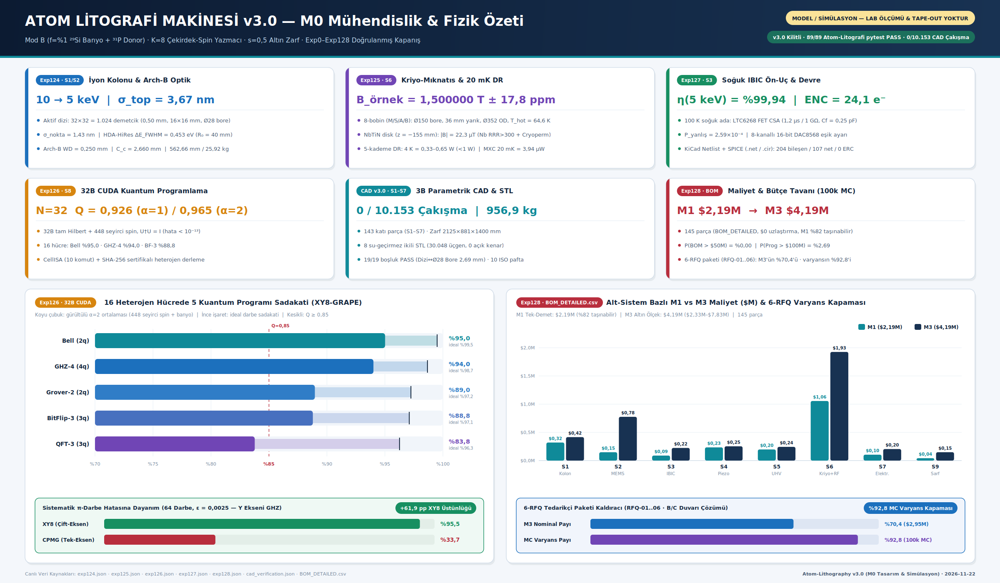
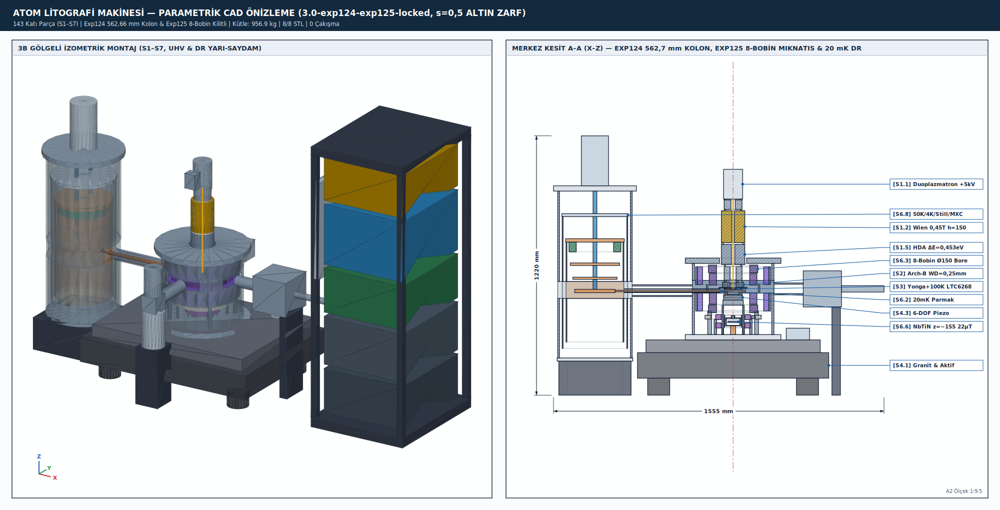
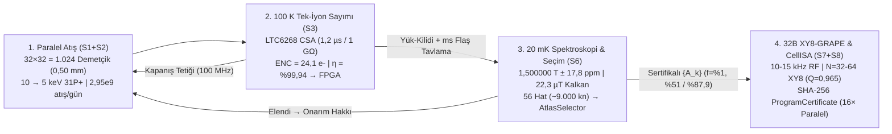
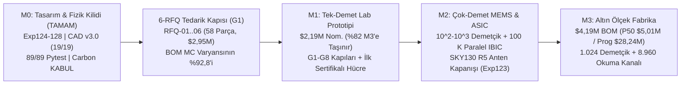

# Atom Litografi Makinesi (`v3.0`) — Silisyumda Programlanabilir Evrensel Atom Yazmacı Fabrikası

<p align="center">
  
  
  
  
  
  
</p>

> [!IMPORTANT]
> **Epistemik Durum Uyarısı (`M0` Tasarım & Birinci-İlkeler Sayısal Simülasyon):** Bu depo, **kâğıt üzerinde tam mühendislik tasarımı, birinci-ilkeler fizik/Hamiltonyen simülasyonu (`Exp124`–`Exp128`), parametrik 3B CAD (`v3.0`), `0`-ERC devre netlisti (`COLD_100K`) ve mühendislik BOM/RFQ paketi** sunar. **Fiziksel laboratuvar ölçümü, üretilmiş donanım, bağlayıcı tedarikçi teklifi ve silikon tape-out henüz YOKTUR** (`no_lab_measurement=true`, `no_supplier_quotes=true`, `tapeout_done=false`). Tüm deneylerde ön-kayıtlı tahminler hem `PASS` hem de `FAIL` hükümleriyle dürüst biçimde raporlanmıştır.

---

### English Executive Abstract

**Atom Lithography Machine (`v3.0`)** is a complete `M0` first-principles engineering design, multiphysics simulation suite, parametric 3D CAD package, `0`-ERC cryogenic analog front-end, and quantum-control compiler (`CellISA v2.0`) for an integrated **single-cryostat atomic register factory** in isotopically engineered silicon (`³¹P` donor + `K = 8` selected `²⁹Si` nuclear spins in an `f = 1%` epitaxial bath, **Mode B baseline** — fully immune to 3D stochastic donor straggle). Rather than chasing unverified deterministic single-site placement, the machine manufactures **measured, certified, and individually programmable multi-qubit registers** via a four-stage closed loop:

1. **Parallel Ion Optics (`Exp124`):** `10 → 5 keV` Liouville-consistent decelerating column (`562.66 mm`, `25.92 kg`), Wien filter (`0.45 T`, `R_m = 120.6`), `HDA-HiRes` energy filter (`ΔE_FWHM = 0.453 eV`), and matched-pitch **`32×32 = 1,024`-beamlet (`0.50 mm`) `Arch-B`** mini-lens array (`WD = 0.250 mm`, `Ø28.0 mm` bore, `2.686 mm` clearance, `σ_spot = 1.428–1.532 nm`, `σ_tot = 3.674–3.715 nm`, `2.95×10⁹` shots/day).
2. **Cold-Stage Single-Ion Counting (`Exp127`):** `100 K / 1.2 µs / 1 GΩ` `LTC6268` + `ADA4817-1` + `DAC8568` + `TLV3501` IBIC front-end (`204` components, `107` nets, `0` ERC) overcoming true Lindhard `5 keV` charge yield (`341.7 e⁻`) to achieve `ENC = 24.07 e⁻`, `η(5 keV, 0.5 pF) = 99.94%` (`η ≥ 99%` up to `C_det ≤ 1.5 pF`), and `P_false = 2.59×10⁻⁴ / 1 ms`.
3. **Cryo-Magnet & Multiplexed Readout (`Exp125`):** `8`-coil `NbTi` magnet (`1.500000 T ± 17.81 ppm`, `64.6 K` quench hotspot) paired with a vortex-free `Nb (RRR>300)` Meissner cup + `Cryoperm-10` sleeve achieving **`22.3 µT`** at the `NbTiN` resonator plane (`450×` below `10 mT`), `5`-stage `20 mK` DR thermal closure (`4 K = 0.325–0.899 W`, `MXC = 3.94–4.80 µW` across `56–82` lines / `~9,000` channels), and `0.0627 ms` `SNR = 10` readout.
4. **32D Quantum Hamiltonian GRAPE/XY8 & `CellISA` (`Exp126`–`Exp127`):** Full `2⁵ = 32`-dimensional CUDA Hamiltonian verification (`1e + 4n + 448` bath spectators + `J_ij`) closing Risk `R3` (`N = 32` global optimum `Q_32D = 0.9260 / 0.9648`, mandatory `XY8` over `CPMG` by `+32.5 / +61.9 pp`, `10–15 kHz` RF coil headroom) and demonstrating **5 logical programs (`Bell 95.0%`, `GHZ-4 94.0%`, `Grover-2 P(|11⟩)=92.4%`, `BitFlip-3 QEC 88.8%`, `QFT-3 83.8%`) across 16 heterogeneous silicon cells** (`16×` parallel FDMA, `D0 ≤ 7.76×10⁻⁹`), alongside `CAD v3.0` (`143` parts, `956.90 kg`, `8/8` watertight STL, `0/10,153` clashes, `19/19` clearances) and a `145`-part BOM (`M1 = $2.19M` [`82%` portable to `M3`], `M3 = $4.19M`, `6-RFQ` capturing `92.8%` of `100k`-MC variance). All **`89/89`** standalone Atom Lithography `pytest` tests pass out of the box.

---

## Görsel Genel Bakış (`v3.0` Dashboard & 3B CAD Montajı)



| İzometrik 3B Makine Önizlemesi | Tam Kesit Görünümü (`19/19` Boşluk) | Patlatılmış Alt-Sistem Görünümü (`S1–S7`) |
|---|---|---|
| [](research/atom_lithography_machine/cad/preview_machine.png) | [](research/atom_lithography_machine/cad/drawings/09_atom_litho_cutaway.png) | [](research/atom_lithography_machine/cad/drawings/10_atom_litho_exploded.png) |

---

## Sistem Mimarisi & Mühendislik Diyagramları

### 1. 4-Aşamalı Kapalı-Çevrim Atom Yazmacı Fabrikası Döngüsü



### 2. Fiziksel Alt-Sistem Mimarisi (`S1` → `S7`, `CAD v3.0`)


### 3. Mühendislik Yol Haritası & Risk Kapanış Akışı (`M0` → `M3`)



---

## Çekirdek Makine Şartnamesi (`v3.0` — Sıfır Çelişki Kilidi)

| Alan | `v3.0` Kilitli Değer | Kritik Fizik / Mühendislik Bulgusu | Kanıt & Epistemik Etiket |
|---|---|---|---|
| **Üretim Modu** | **Mod B (`f = %1,0` `²⁹Si` banyosu, BAZ)** | `Exp124 CD8` stokastik `³¹P` donör 3B saçılmasının Mod A'yı `%42,5` (BCA) / `%28,0` (Holmes) düzeyine düşürdüğünü kanıtladı; **Mod B tamamen bağışıktır** (`%51` tek-atış, `%87,92` 3-atış, `1,973×10⁸`/gün) | `Exp65`, `Exp124`, `Exp127` `{Model}` |
| **İyon Kolonu & Optik** | `10 → 5 keV` (`+5 kV / −5 kV / 0 V`), **`HDA-HiRes` (`ΔE_FWHM = 0,453 eV`)**, Wien (`0,45 T, R_m = 120,6`) | Scherzer–delinme değişmezi **`κ_c = C_c·E_gap/V_land ≥ 4,67`** eski `C_c ≤ 0,50 mm` hedefini imkânsız kıldı; `562,66 mm` (`z_CAD: 500,25..1062,66 mm`), `25,92 kg` | `Exp124` (`CD1,2,4,5 PASS`) `{Sayısal-Simülasyon}` |
| **MEMS Kafa (`Arch-B`)** | **`32×32 = 1.024` eş-adımlı `0,50 mm`** (`16,0×16,0 mm`, `16×` 64-ch karo), `WD = 0,250 mm`, `C_c = 2,660 mm`, `E_gap = 10,60 MV/m` | `S1.6/S2.1` iç açıklığı **`Ø28,0 mm`** → köşegen `22,63 mm`'ye **`2,686 mm`** radyal marj (sıfır kırpma); **`σ_spot = 1,428–1,532 nm`**, **`σ_tot = 3,674–3,715 nm ≤ 3,80 nm`**, `2,95×10⁹` atış/gün `@15 ms` | `Exp124`, `CAD v3.0` `{Sayısal-Simülasyon}`/`{EDA}` |
| **Soğuk-Ada IBIC (`S3`)** | **`100 K / 1,2 µs / 1 GΩ` (`COLD_100K` varsayılan)** `LTC6268` + `ADA4817-1` + `DAC8568` + `TLV3501` | Gerçek Lindhard `5 keV` yükü (`341,7 e⁻ @ 100 K`) RT `200 ns`'yi çökertti (`η = %9,7`); soğuk-ada: **`ENC = 24,07 e⁻`**, **`η(5 keV, 0,5 pF) = %99,94`** (`C_det ≤ 1,5 pF` marjı), `P_false = 2,59×10⁻⁴ / 1 ms`, **`204` bileşen / `107` net / `0` ERC** | `Exp127`, `src/board/` `{Sayısal-Simülasyon}`/`{EDA}` |
| **Mıknatıs & Kalkan (`S6.3`)** | `8`-bobin `NbTi` (`Ø150 / 36 / Ø352 mm`), **`B_z = 1,500000 T ± 17,81 ppm`**, quench **`64,6 K`** | **`Nb (RRR>300)`** (`117,1 < 135 mT` vortekssiz) + **`Cryoperm-10`** (`SF = 488,8×`) ile `NbTiN` diskte (`z = 345 mm`) **`22,3 µT`** → **Risk `R7` manyetik ayrıştırma KAPANDI** | `Exp125` (`CV1–CV3 PASS`) `{Sayısal-Simülasyon}` |
| **Kriyostat & RF (`S6.6/6.8`)** | **`20 mK` DR (`S6.8=D`, BAZ)**, `56–82` hat (`~9.000` kanal), `4K = 0,325–0,899 W`, `MXC = 3,94–4,80 µW` | RF `SNR = 10` süresi **`0,0627 ms`** (`≪ 1.445 ms`); `1 K` alternatifi Koiller 6-vadi `p = 0,932` olsa da Mod B `3,40×` yavaş ve `N = 1` **`EVPI = $0`** (`N_be = 6,03` makine) | `Exp125`, `Exp128` `{Sayısal-Simülasyon}` |
| **32B `XY8`-GRAPE (`R3`)** | **RF payı `10–15 kHz` (`B₁ ≈ 1,2–1,8 mT`)**, zorunlu **`XY8` `N_total = 32–64`**, `ε ≤ 10⁻³` | **`N = 32` global optimum (`Q_32D = 0,9260 / 0,9648`)**, `N = 64` (`0,9209 / 0,9433`), **`N = 128` DDRF duvarı (`sp_ovl = 0,097`) & `CPMG` yasak** (`XY8` `+32,5 / +61,9 pp` üstün) → **Risk `R3` KAPANDI** | `Exp126` (`P126_4,5 PASS`) `{Sayısal-Simülasyon}` |
| **3B CAD (`v3.0`)** | **`143` katı parça**, **`956,903 kg`**, `8/8` su-geçirmez `.stl` (`30.048` üçgen, `468,627 L`) | **`0 / 10.153` çakışma**, **`19 / 19` kritik boşluk PASS** (`WD = 0,25 mm`, `UHV R_iç = 182 mm` duvar payı `6,0 mm`, `32×32` köşegen payı `2,686 mm`), `10` teknik çizim (`2400×1600`) | `cad_verification.json` (`23/23 pytest`) `{EDA}` |
| **BOM & 100k MC Bütçe** | **`145` parça** (`BOM.csv` `$2,531M` ile `$0,00` köprü): **`M1 = $2,190M` (`%82` taşınabilir)**, **`M3 = $4,190M`** | 100k MC: BOM **`P50 = $5,01M` (`P(>$50M) = %0,00`)**, Program **`P50 = $28,24M ≤ $50M` (`P(>$100M) = %2,69`)**; `S6.6 B/C` `%77,27` varyans; **6-RFQ = `%92,8` MC varyansı** | `Exp128`, `BOM_DETAILED.csv` `{Model}`/`{Varsayım}` |

---

## 16 Heterojen Hücrede Kuantum Programlama (`Exp126`) & `CellISA v2.0`

Tam `2⁵ = 32`-boyutlu CUDA Hamiltonyen simülasyonu (`1` elektron + `4` aktif `²⁹Si` çekirdeği + `448` banyo seyircisi + seküler `J_ij`, `f = %1`, `α = 2`, `ε = 10⁻³`) ile `16` bağımsız sertifikalı hücrenin (`16/16` tekil `{A_k}`, `Lie = 1023/1023`, `D0(17,5 s) ≤ 7,76×10⁻⁹`, `1 µm` hücreler arası dipol `9,50×10⁻⁹ Hz`) her biri için derlenen 5 mantıksal program:

| Mantıksal Program | Toplam Süre (`e_sup` / `XY8`) | İdeal 32B Ort. | Statik Köşe (`±400 Hz × ±%2`) | Gürültülü (`α=2, ε=10⁻³`) Ort. | En Kötü – En İyi (16 Hücre) | Paralel `16×` Hızlanma |
|---|---:|---:|---:|---:|---:|---:|
| **`Bell`** | `4,50 ms` (`2,0 ms / 64`) | `0,9950` | `0,9563` | **`0,9501`** *(α=1: `0,9282`)* | `0,9416 – 0,9538` | `4,50 ms` vs `72,0 ms` |
| **`GHZ-4`** | `2,00 ms` (`2,0 ms / 64`) | `0,9867` | `0,8480` | **`0,9401`** *(α=1: `0,9155`)* | `0,9263 – 0,9479` | `2,00 ms` vs `32,0 ms` |
| **`Grover-2`** | `13,00 ms` (`4,0 ms / 128`) | `0,9724` | `0,8985` | **`0,8896`** *(P(\|11⟩): **`0,9237`**)* | `0,8479 – 0,9135` | `13,0 ms` vs `208,0 ms` |
| **`BitFlip-3` QEC** | `17,50 ms` (`8,0 ms / 256`) | `0,9710` | `0,9164` | **`0,8878`** *(kodsuz: `0,0000`)* | `0,8416 – 0,9046` | `17,5 ms` vs `280,0 ms` |
| **`QFT-3`** | `14,50 ms` (`6,0 ms / 192`) | `0,9626` | `0,8689` | **`0,8377`** *(medyan: `0,8445`)* | `0,7500 – 0,8644` | `14,5 ms` vs `232,0 ms` |
| **Doğal 3-Cisim `CCZ(0,1,2)`** | `18,00 ms` (`9,0 ms / 36 RF / 288 XY8`) | **`0,9338`** | — | *(elektron sızıntısı `6,7×10⁻³`)* | `F1` referans hücresi | Elektron-merkezli doğal kapı |

**`CellISA v2.0` (`src/machine_control/programmer.py`):** 10-komut formal komut kümesi (`INIT`, `RX`, `RY`, `RZ`, `CZ`, `CNOT`, `GHZ`, `DD_HOLD`, `MEASURE`, `ARRAY_EXEC`), `SU(2)` Rodrigues darbe sentezi, 9-köşeli L-BFGS-B GRAPE ve SHA-256 imzalı `ProgramCertificate` JSONL çıktısı. *(Soyutlama sınırı: `pulse_engine.py`'deki hızlı `DD_HOLD` efektif koherens faz operatörü kullanır; tam 32B `448`-seyirci `XY8`-GRAPE doğrulaması `experiments/exp126_atom_cell_programming/` içindedir.)*

```bash
# 4.000 yuvalı fabrika simülasyonu + GRAPE ile CellISA Bell program sertifikasyonu:
PYTHONPATH=src python3 -m machine_control.sim \
  --slots 4000 --preset v300 --cal-mode spectral \
  --program bell --program-mode grape --program-cells 3
```

---

## 7 Alt-Sistem CAD / STL / BOM / RFQ Ana Tablosu

| Kod | Alt-Sistem | CAD Parça / Kütle | `M3` / `M1` BOM (`USD`) | RFQ Paketi | 3B & 2B Artefakt Bağlantıları |
|---|---|---:|---:|---|---|
| **`S1`** | `10→5 keV` İyon Kaynağı, Wien & `HDA-HiRes` | `11` / `25,98 kg` | `$416.000` / `$319.750` | `RFQ-01` (`$398,0k`) | [`.scad`](research/atom_lithography_machine/cad/parts/s1_ion_source_column.scad) · [`.stl`](research/atom_lithography_machine/cad/stl/s1_ion_source_column.stl) · [Çizim `01`](research/atom_lithography_machine/cad/drawings/01_s1_ion_source_column.png) |
| **`S2`** | `32×32` (`0,50 mm`) MEMS Kafa & `Arch-B` | `9` / `1,83 kg` | `$775.500` / `$147.750` | `RFQ-02` (`$661,0k`) | [`.scad`](research/atom_lithography_machine/cad/parts/s2_mems_write_head.scad) · [`.stl`](research/atom_lithography_machine/cad/stl/s2_mems_write_head.stl) · [Çizim `02`](research/atom_lithography_machine/cad/drawings/02_s2_mems_write_head.png) |
| **`S3`** | `100 K` Soğuk-Ada IBIC Ön-Uç (`0` ERC) | `7` / `0,15 kg` | `$224.000` / `$88.550` | `Non-RFQ` / Özel PCB | [`.scad`](research/atom_lithography_machine/cad/parts/s3_ibic_detector_assembly.scad) · [`.stl`](research/atom_lithography_machine/cad/stl/s3_ibic_detector_assembly.stl) · [Çizim `03`](research/atom_lithography_machine/cad/drawings/03_s3_ibic_detector_assembly.png) · [`BOARD.md`](src/board/BOARD.md) |
| **`S4`** | Granit, 6-DOF UHV Piezo & İnterferometre | `18` / `302,37 kg` | `$253.000` / `$233.920` | `RFQ-03` (`$163,0k`) | [`.scad`](research/atom_lithography_machine/cad/parts/s4_piezo_stage_interferometry.scad) · [`.stl`](research/atom_lithography_machine/cad/stl/s4_piezo_stage_interferometry.stl) · [Çizim `04`](research/atom_lithography_machine/cad/drawings/04_s4_piezo_stage_interferometry.png) |
| **`S5`** | `s=0,5` UHV Oda (`34,86 L`) & Yük-Kilidi | `20` / `169,99 kg` | `$243.000` / `$196.800` | `Non-RFQ` (UHV COTS) | [`.scad`](research/atom_lithography_machine/cad/parts/s5_uhv_chamber_loadlock.scad) · [`.stl`](research/atom_lithography_machine/cad/stl/s5_uhv_chamber_loadlock.stl) · [Çizim `05`](research/atom_lithography_machine/cad/drawings/05_s5_uhv_chamber_loadlock.png) |
| **`S6`** | `20 mK` DR, `1,50 T / 22,3 µT` Mıknatıs & `56×` RF | `66` / `238,34 kg` | `$1.925.900` / `$1.056.300` | `RFQ-04/05/06` (`$1,729M`) | [`.scad`](research/atom_lithography_machine/cad/parts/s6_cryo_dr_magnet_readout.scad) · [`.stl`](research/atom_lithography_machine/cad/stl/s6_cryo_dr_magnet_readout.stl) · [Çizim `06`](research/atom_lithography_machine/cad/drawings/06_s6_cryo_dr_magnet_readout.png) |
| **`S7–S9`** | Kontrol Rafı, `CellISA`, RTL & Sarf/Yedek | `12` / `218,25 kg` | `$352.200` / `$146.700` | `Non-RFQ` (`S8` `$0` HW) | [`.scad`](research/atom_lithography_machine/cad/parts/s7_electronics_rack_interconnect.scad) · [`.stl`](research/atom_lithography_machine/cad/stl/s7_electronics_rack_interconnect.stl) · [Çizim `07`](research/atom_lithography_machine/cad/drawings/07_s7_electronics_rack_interconnect.png) · [`src/README.md`](src/README.md) |
| **Toplam** | **Ana Montaj (`ALM-300-00`) & `145` Parça BOM** | **`143` / `956,90 kg`** | **`$4.189.600` / `$2.189.770`** | **6-RFQ = `%92,8` MC Var.** | [Ana `.scad`](research/atom_lithography_machine/cad/atom_litho_machine.scad) · [Ana `.stl`](research/atom_lithography_machine/cad/stl/atom_litho_machine.stl) · [Montaj `08`](research/atom_lithography_machine/cad/drawings/08_atom_litho_assembly.png) · [`BOM_DETAILED.csv`](research/atom_lithography_machine/BOM_DETAILED.csv) |

---

## Dürüst Ön-Kayıtlı Doğrulama Karnesi (`Exp124`–`Exp128`)

Her deneyde tahminler (`predictions_exp*.json`) hesaplamadan önce dondurulmuş ve başarısız olan (`FAIL`) hipotezler silinmeden kök-nedeniyle kaydedilmiştir:

| Deney | Konu | Ön-Kayıtlı Hükümler | Dürüst `FAIL` Bulguları & Öğretilen Fizik/Mühendislik | Özet & Test |
|---|---|---|---|---|
| **`Exp124`** | `10→5 keV` İyon Kolonu & 3B Donör Saçılması | **`6/8 PASS, 2/8 FAIL`** | **`CD3 FAIL`:** `κ_c ≥ 4,67` nedeniyle eski `C_c ≤ 0,50 mm` imkânsız → `Arch-B` + `HDA-HiRes` kilitlendi. **`CD7 FAIL`:** `z>0` yüzey kesmesi üst-yarı seyircileri eleyerek Holmes verimini `%63,3→%69,5` artırdı. | [`summary_exp124.md`](results/exp124_ion_column_optics/summary_exp124.md) · [`test_exp124.py`](tests/test_exp124.py) (`6/6`) |
| **`Exp125`** | `1,50 T / 22,3 µT` Mıknatıs, Termal & `R8` | **`6/6 PASS, 0 FAIL`** | Tümü geçti (`CV1–CV6`); `R7` manyetik ayrıştırma kapatıldı (`22,3 µT`, `64,6 K` quench), `R8` Koiller `p = 0,932` ama `1 K` Mod B `3,40×` yavaş. | [`summary_exp125.md`](results/exp125_cryo_magnet_readout/summary_exp125.md) · [`test_exp125.py`](tests/test_exp125.py) (`11/11`) |
| **`Exp126`** | 32B CUDA `XY8`-GRAPE & 16-Hücre Program | **`5/8 PASS, 3/8 FAIL`** | **`P126_1,2,3 FAIL`:** `6,89 kHz` `q3` tam-fazlı 32B köşe `0,9726 < 0,985`, `CZ(2,3) 0,9828`, `1/8` MC örnekleme sapması `0,0592`. **Risk `R3` KAPANDI (`P126_4..8 PASS`)**; `N=128` DDRF duvarı keşfedildi. | [`summary_exp126.md`](results/exp126_atom_cell_programming/summary_exp126.md) · [`test_exp126.py`](tests/test_exp126.py) (`8/8`) |
| **`Exp127`** | `100 K` Soğuk-Ada IBIC & `CellISA v2.0` | **`4/6 PASS, 2/6 FAIL`** | **`CZ3,4 FAIL`:** Gerçek Lindhard `5 keV` yükü RT `200 ns` devreyi çökertti (`η = %9,7`) → **`COLD_100K` (`1,2 µs / 1 GΩ`, `η = %99,94`)** zorunlu kılındı (`CZ5,6 PASS`). | [`summary_exp127.md`](results/exp127_detector_frontend_sim/summary_exp127.md) · [`test_detector_frontend.py`](tests/test_detector_frontend.py) (`6/6`) |
| **`Exp128`** | `145` Parça BOM, 6-RFQ & 100k MC / EVPI | **`4/6 PASS, 2/6 FAIL`** | **`CU4 FAIL`:** 6-RFQ nominal payı `%70,4 < %75` (fakat MC varyansının **`%92,8`'ini** yakalar). **`CU6 FAIL`:** ağır sağ kuyrukta `ΔP95 = %1,46 > %1,0`. `EVPI@N=1 = $0` (`CU5 PASS`). | [`summary_exp128.md`](results/exp128_bom_sensitivity/summary_exp128.md) · [`test_bom_detailed.py`](tests/test_bom_detailed.py) (`6/6`) |

---

## Teknik Çizim & Fizik Grafik Galerisi

<details>
<summary><strong>📐 7 Alt-Sistem Mühendislik Paftaları & Ana Montaj (8 Adet 2400×1600 PNG + SVG)</strong></summary>

| `S1` İyon Kolonu (`ALM-300-S1`) | `S2` MEMS Yazma Kafası (`ALM-300-S2`) |
|---|---|
|  |  |
| **`S3` Soğuk-Ada IBIC (`ALM-300-S3`)** | **`S4` Piezo & İnterferometri (`ALM-300-S4`)** |
|  |  |
| **`S5` UHV Oda & Yük-Kilidi (`ALM-300-S5`)** | **`S6` DR, Mıknatıs & Okuma (`ALM-300-S6`)** |
|  |  |
| **`S7` Elektronik Raf (`ALM-300-S7`)** | **Ana Montaj (`ALM-300-00`)** |
|  |  |

</details>

<details>
<summary><strong>📊 Birinci-İlkeler Fizik & Maliyet Simülasyon Grafikleri (12 Adet Exp124–Exp128 PNG)</strong></summary>

| `Exp124` Optik Zarf & Scherzer Sınırı | `Exp124` 3B Anizotropik & Stokastik Donör Verimi |
|---|---|
|  |  |
| **`Exp125` `1,50 T / 22,3 µT` Manyetik Alan Haritası** | **`Exp125` 5-Kademe Termal, RF SNR & `R8` Koiller** |
|  |  |
| **`Exp126` 32B GRAPE Darbeleri & DDRF Kurtarma** | **`Exp126` İç-İçe `XY8` vs `Exp63` & `CPMG`** |
|  |  |
| **`Exp126` 16 Heterojen Hücre × 5 Kuantum Programı** | **`Exp127` IBIC Blok Şeması (`COLD_100K`, `0` ERC)** |
|  |  |
| **`Exp127` Sonlu-GBP Bode & Zaman-Domeni Yanıtı** | **`Exp127` Lindhard ENC & 50k MC Algılama Verimi** |
|  |  |
| **`Exp128` `M1` vs `M3` Maliyet & `6-RFQ` Kırılımı** | **`Exp128` 100k MC Tornado & Kümülatif Dağılım (CDF)** |
|  |  |

</details>

---

## Hızlı Kurulum, Doğrulama (`89/89 pytest`) ve Okuma Sırası

### Kurulum & Tam Test Koşumu

```bash
git clone https://github.com/berkmec/Atom-Lithography.git
cd Atom-Lithography
python3 -m venv .venv && source .venv/bin/activate
pip install -r requirements.txt

# Tüm 10 Atom Litografi test paketi (89/89 PASS):
PYTHONPATH=src pytest -v
```

### İsteğe Bağlı Yeniden Üretim Komutları

```bash
# 1. CellISA v2.0 fabrika + GRAPE program demosu:
PYTHONPATH=src python3 -m machine_control.sim --slots 4000 --preset v300 --program bell --program-mode grape

# 2. COLD_100K 0-ERC KiCad netlist & SPICE destesi doğrulaması:
python3 src/board/detector_frontend.py

# 3. Parametrik CAD v3.0 STL + doğrulama JSON yeniden üretimi:
python3 research/atom_lithography_machine/cad/gen_scad.py
python3 research/atom_lithography_machine/cad/gen_stl.py

# 4. 145-parçalı BOM + Exp128 100k MC bütçe & EVPI simülasyonu:
python3 experiments/exp128_bom_sensitivity/build_bom_detailed.py
python3 experiments/exp128_bom_sensitivity/run_exp128.py
```

### Önerilen Dokümantasyon Okuma Sırası

1. **[`DESIGN.md`](research/atom_lithography_machine/DESIGN.md)** — Ana mimari tasarım belgesi (`v3.0`, Risk Kapanış Matrisi & sürüm günlüğü).
2. **[`TECHNICAL_MANUAL.md`](research/atom_lithography_machine/TECHNICAL_MANUAL.md)** — 8 bölümlü kapsamlı fizik, kriyo-mıknatıs, IBIC, `CellISA`/32B GRAPE, CAD, BOM ve EHS el kitabı.
3. **[`MODULAR.md`](research/atom_lithography_machine/MODULAR.md)** — `M1`–`M8` modüler arayüz kontrol belgesi (`v3.0-ICD`) ve dondurulmuş kontratlar.
4. **[`M1_PROTOTYPE_BLUEPRINT.md`](research/atom_lithography_machine/M1_PROTOTYPE_BLUEPRINT.md)** — `$2,19M` ilk tek-demet laboratuvar prototipi (`%82` `M3`'e taşınabilir) ve `G1`–`G8` Go/No-Go kapıları.
5. **[`BOM_ENGINEERING.md`](research/atom_lithography_machine/BOM_ENGINEERING.md)** & **[`RFQ_SPECIFICATIONS.md`](research/atom_lithography_machine/RFQ_SPECIFICATIONS.md)** — `145` parçalı BOM mühendisliği ve `%92,8` maliyet varyansını kapsayan 6 tedarikçi RFQ şartnamesi.
6. **[`PROJECT_DOSSIER.md`](research/atom_lithography_machine/PROJECT_DOSSIER.md)** — `Exp0`–`Exp128` uçtan uca proje arşivi, `Exp123` SKY130 erteli EDA borcu ve doğrulanmış nicel sicil.
7. **[`LITERATURE.md`](research/atom_lithography_machine/LITERATURE.md)** & **[`hypotheses.md`](research/hypotheses/hypotheses.md)** — Birincil literatür/patent çapaları ve `H1`–`H146` tam hipotez günlüğü.
