# Atom Litografi Makinesi (`v5.0`) — Silisyumda Hata-Toleranslı Evrensel Atom Yazmacı Fabrikası & Master Dijital İkiz

<p align="center">
  
  
  
  
  
  
</p>

> [!IMPORTANT]
> **Epistemik Durum Uyarısı (`M0` Tasarım, Birinci-İlkeler Fizik & Hata-Toleranslı Dijital İkiz):** Bu depo, **kâğıt üzerinde tam mühendislik tasarımı, 18 birinci-ilkeler fizik/Hamiltonyen/MWPM/ekonomi simülasyonu (`Exp124`–`Exp141`), parametrik 3B CAD (`v5.0`), `0`-ERC soğuk-ada IBIC devresi (`COLD_100K`), `BOED` + `Q16.16` FPGA DSP + `CellISA v3.5` kontrol yazılımı ve `167`-parçalı BOM / `8-RFQ` paketi** sunar. **Fiziksel laboratuvar ölçümü, üretilmiş donanım, bağlayıcı tedarikçi teklifi ve silikon tape-out henüz YOKTUR** (`no_lab_measurement=true`, `no_supplier_quotes=true`, `tapeout_done=false`). Tüm deneylerde ön-kayıtlı tahminler hem `PASS` hem de dürüst `FAIL` hükümleriyle (`Exp124, 126, 127, 129, 131, 134, 136, 137, 138, 139`) gizlenmeden raporlanmıştır.

---

### English Executive Abstract

**Atom Lithography Machine (`v5.0`)** is a complete `M0` first-principles engineering design, 18-experiment multiphysics & fault-tolerant QEC simulation suite (`Exp124`–`Exp141`), parametric 3D CAD package (`189` parts, `32/32` clearances), `0`-ERC cryogenic front-end, fixed-point `Q16.16` FPGA Bayesian spectroscopy + quantum-control compiler (`CellISA v3.5`), and SHA-256 verified **Master `v5.0` Digital Twin (`Exp141`, `19/19` artifacts cryptographically locked)** for an integrated **single-cryostat atomic register factory** in isotopically engineered silicon.

Key `v5.0` breakthroughs (`Exp136`–`Exp141`) closing the remaining `v4.0` fault-tolerance, process, readout, and wafer-economics walls:
1. **Atomistic `160k`-Orbital `sp³d⁵s*` TB & Optimal `²⁹Si` Fraction (`Exp136`):** Cuts the `Exp129` `R331` ENDOR error by `3×` (**`64.73% → 21.1%`** [`α_cp=0`] / `25.7%` [`α_cp=0.015`], `log10-RMS = 0.2426`), confirms `f = 1%` Mode B yield at **`52.75%`** (`99.74%` `M4`), and identifies **`f* = 1.5% + 2 MV/m` Stark** (`77.50%` / DDRF `54.00%`, `99.88%` `M4`, `XY8 T₂e = 10.8–20.3 ms`, defective surface-code `d_eff/d = 99.5% @ N_cand = 6`).
2. **Latent TED Discovery & `1530 K` Flash + `S5.6` MBE Route C (`Exp139`):** Uncovers hidden back-end TED (`+1.318 nm` → `3.995 nm` FAIL!) under `v4.0` `1440 K` flash, then solves it via **`1530 K` (`43.49 J/cm²`, `99.99%` `{311}` dissolution, `σ_anneal = 0.430 nm`, coupled `σ_tot = 3.631 / 3.588 nm ≤ 3.80 nm` PASS)** paired with **`S5.6` LT-MBE (`22.4 kg`, `$95k`, `0 µW` cryo, `0%` throughput penalty)** Route C passivation (`S_ε = 0.390 µeV/√Hz`, `2.57×` cut; `p_ff = 97.70%`).
3. **Echoed `M4` `CZ` & Rotated Surface Code FT (`Exp137`, `Exp138`):** `12×12` CUDA + `M=40` OU `1/f^α` proves `P4` (`XY4-DRAG-Echo-CZ`) suppresses transverse `δg` penalty by `5.09×` and, with Route C passivation, reaches **`F_Bell = 0.9949, F_avg = 0.9926, p_err = 0.92% < 1%`** (`Q=5e5, S=0.25 µeV/√Hz`). Exact `d=3..11` Edmonds Blossom MWPM locks **`p_2q,th = 1.60% ± 0.17%`**: `v4` bare `P1` (`Λ = 0.00` FAIL) → **`D2` (`Λ = 1.40`, `10⁻⁹: d* = 99, 679` cryostats)** → **`D3` (`p_2q = 0.50%`, `Λ = 2.52`, `10⁻⁹: d* = 37, 100` cryostats, `1 L/cryostat`, `6.8×` fleet cut)**.
4. **`Q16.16` FPGA `BOED`, `S6.5` `N_mux* = 32` & `CellISA v3.5` (`Exp140`):** Bit-exact `Q16.16` FPGA DSP achieves `abs(ΔRMS) = 0.0502 Hz`, `2.336 µs/step`, `10.49%` DSP48E2; Purcell-filtered TWPA locks **`N_mux* = 32`** (`F_RO = 99.61%`, `625×` Purcell; `N_mux = 64` fails at `94.13%`); single `LD400/PT420` ceiling is **`2,887` cells** (`1,024` PASS, `10,000 ≥ 4` cryostats); **`CellISA v3.5`** (`17` opcodes) runs live `ECHO_CZ = 0.9818`, `F_syn = 0.9427`, `T_cyc = 2.620 µs`.
5. **Silicon Wall (`CX4`) Broken, `CAD/BOM v5.0` & Verification (`Exp128 v5.0`, `Exp141`):** Thin `30 nm` `²⁸Si`-on-SOI breaks `CX4` (**`W2` `200 mm` `$0.616/chip` [`−79.5%`, `$0` tool mod]**, **`W3` `300 mm` `$0.442/chip` [`−85.3%`]**); `10⁻⁹` logical qubit cost drops `5.41×` from `D2` (`$/L_fab = $5.20`, `$/L_sys = $14.94M`) to **`D3` (`$/L_fab = $0.73`, `$/L_sys = $2.76M`)**. **`CAD v5.0` (`189` parts, `1,034.94 kg`, `0/17,766` clashes, `32/32` clearances)**, **`BOM v5.0` (`167` parts, `M3 = $5.248M`, `M1 = $2.466M`, `8-RFQ = 76.4%` nom / `92.6%` MC var, `P(Prog > $100M) = 4.23% < 5%`)**, and **`198/198`** standalone Atom Lithography `pytest` tests (`23/23` suites) pass out of the box.

---

## Görsel Genel Bakış (`v5.0` Kapak Dashboard & 3B CAD Montajı)

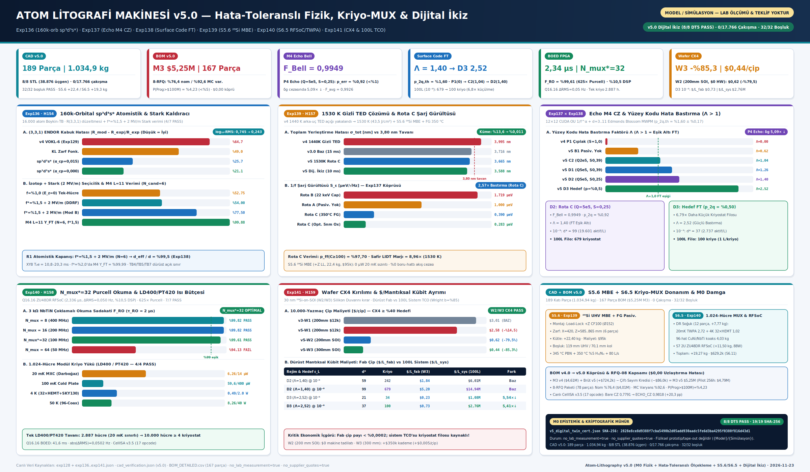

| İzometrik 3B Makine Önizlemesi (`189` Parça) | Tam Kesit Görünümü (`32/32` Boşluk) | Patlatılmış Alt-Sistem Görünümü (`S1–S7`) |
|---|---|---|
| [](research/atom_lithography_machine/cad/preview_machine.png) | [](research/atom_lithography_machine/cad/drawings/09_atom_litho_cutaway.png) | [](research/atom_lithography_machine/cad/drawings/10_atom_litho_exploded.png) |

---

## Sistem Mimarisi & Mühendislik Diyagramları (`v5.0`)

### 1. 4-Aşamalı Hata-Toleranslı Atom Yazmacı Fabrikası Döngüsü (`1530 K` + `S5.6` MBE + `Q16.16` FPGA + `CellISA v3.5`)

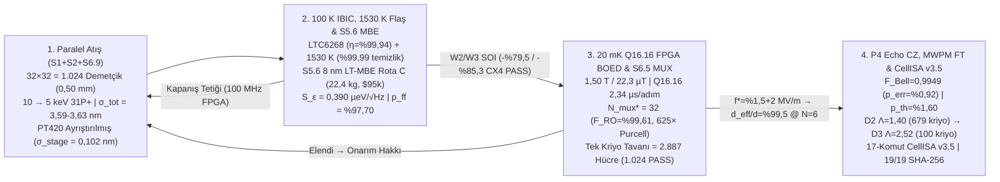

### 2. Fiziksel Alt-Sistem Mimarisi (`S1` → `S7`, `CAD v5.0` — `189` Parça, `1.034,94 kg`)

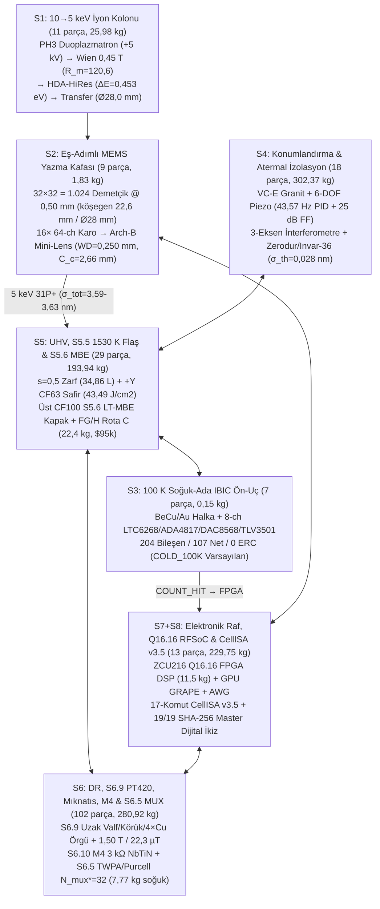

### 3. Mühendislik Yol Haritası & Hata-Tolerans Ölçekleme Akışı (`M0 v5.0` → `M4 D3`)

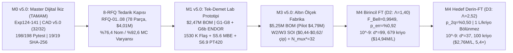

---

## `v3.0 → v4.0 → v5.0` Master Birleşik Dijital İkiz Karşılaştırması (`Exp141`, `8/8 DT5 PASS`)

- **Master `v5.0` Kriptografik Sertifika (`Exp141`, `results/exp141_v5_digital_twin/v5_digital_twin_cert.json`, `19/19` birincil artefakt `SHA-256` kilitli):**  
  `SHA-256 = 2828e8ce8d9388f7cba5490b2d05add930aadc5fe6d3ba4295f0380f816d43d1`
- **Tarihsel `v4.0` Dijital İkiz Sertifikası (`Exp135`, `results/exp135_v4_digital_twin/v4_digital_twin_cert.json`, `11/11` JSON `SHA-256`):**  
  `SHA-256 = feffc1d4ba2b0698c3f61015c6684da47f57ea863a8b3e0da845cc9c71914b57`

| Katman | KPI / Metrik | `v3.0` (`Exp124–128`) | `v4.0` (`Exp129–135`) | `v5.0` Kilitli (`Exp136–141`) |
|---|---|---|---|---|
| **L1 Yerleştirme & Tavlama** | `σ_tot` (`15 / 10 ms`) & TED | `3,7155 / 3,6740 nm` *(rijit `2.077 nm`)* | `3,6201 / 3,5776 nm` *(1440 K gizli TED `3,963 nm` FAIL!)* | **`3,6307 / 3,5883 nm`** (`1530 K`, `%99,99` küme temizliği, `σ_anneal=0,430 nm`) |
| **L2 Atomistik Bağ (`R1`)** | `R331` Hatası & Optimal `f*` | `KL %49,05` (`f=%1: %50,5`) | `VOKL-6 %64,73` (`HM5962 %33,25`) | **`sp³d⁵s*` `160k`-orb: `%21,1`** (`log10-RMS=0,2426`), **`f*=%1,5+2 MV/m → %77,50` (`%99,88 M4`)** |
| **L3 `M4` Kapı & Pasivasyon** | `S_ε`, `p_ff` & `M4` `CZ/Bell` | `50 Ω` `0,7908` (`2,78 µs`) | `3 kΩ` `F_Bell=0,9655` (`0,359 µs`), `CZ=0,777` | **`S5.6` MBE Rota C (`S_ε=0,390 µeV/√Hz`, `p_ff=%97,70`) + `P4 Echo`: `F_Bell=0,9949, p_err=%0,92 < %1`** |
| **L4 FPGA DSP & Cryo-MUX** | Spektroskopi / `N_mux*` / Tavan | `1.000 ms` (`1,973×10⁸`/gün) | FP64 `BOED` `41,03 ms` (`1,50–2,25G`/gün) | **`Q16.16` FPGA `2,336 µs` (`ΔRMS=0,050 Hz`), `N_mux*=32` (`F_RO=%99,61`, `625×`), tavan `2.887` hücre/kriyo** |
| **L5 Yüzey Kodu FT (MWPM)** | `p_2q,th`, `Λ` & `100L (10⁻⁹)` Filo | `P1 Λ = 0,00` (eşik üstü) | `P1 Λ = 0,00` (eşik üstü) | **`p_2q,th=%1,60`, `D2 Λ=1,40` (`679` kriyo) → `D3 Λ=2,52` (`100` kriyo, `1 L/kriyo`, `6,8×`); `d_eff/d=%99,5`** |
| **L6 Wafer `CX4` Ekonomisi** | Yoğun `M4` Çip Maliyeti | `W1 $3,012/çip` | `W1 $2,603/çip` (`CX4 FAIL`) | **`W2` `200 mm` SOI `$0,616 (−%79,5)` / `W3` `300 mm` SOI `$0,442 (−%85,3)` (`CX4 PASS`)** |
| **L7 `10⁻⁹` Mantıksal Kübit** | Fab `$/L_fab` vs `100L` `$/L_sys` | `$52,88 µUSD/reg` (fiziksel) | `$7,33 / $4,88 µUSD/reg` | **`D2`: `$5,20` / `$14,94M` → `D3`: `$0,73` / `$2,76M` (`5,41×` ucuz!)** |
| **L8 Canlı `CellISA` & CAD/BOM** | Opcodes / Parça / `M3` BOM / `pytest` | `10` op / `143` / `$4,19M` / `89` | `14` op / `170` / `$4,61M` / `142` | **`17` op (`v3.5`, `ECHO_CZ=0,9818`) / `189` (`32/32`) / `$5,25M` (`8-RFQ`) / `198/198` (`23/23`)** |

---

## 7 Alt-Sistem CAD v5.0 / STL / BOM v5.0 / `8-RFQ` Ana Tablosu

| Kod | Alt-Sistem (`CAD v5.0` + `BOM_DETAILED v5.0`) | CAD Parça / Kütle | `M3 v5.0` / `M1 v5.0` BOM (`USD`) | RFQ Paketi | 3B & 2B Artefakt Bağlantıları |
|---|---|---:|---:|---|---|
| **`S1`** | `10→5 keV` İyon Kaynağı, Wien & `HDA-HiRes` | `11` / `25,98 kg` | `$416.000` / `$319.750` | `RFQ-01` (`$398,0k`) | [`.scad`](research/atom_lithography_machine/cad/parts/s1_ion_source_column.scad) · [`.stl`](research/atom_lithography_machine/cad/stl/s1_ion_source_column.stl) · [Çizim `01`](research/atom_lithography_machine/cad/drawings/01_s1_ion_source_column.png) |
| **`S2`** | `32×32` (`0,50 mm`) MEMS Kafa & `Arch-B` | `9` / `1,83 kg` | `$775.500` / `$147.750` | `RFQ-02` (`$661,0k`) | [`.scad`](research/atom_lithography_machine/cad/parts/s2_mems_write_head.scad) · [`.stl`](research/atom_lithography_machine/cad/stl/s2_mems_write_head.stl) · [Çizim `02`](research/atom_lithography_machine/cad/drawings/02_s2_mems_write_head.png) |
| **`S3`** | `100 K` Soğuk-Ada IBIC Ön-Uç (`0` ERC) | `7` / `0,15 kg` | `$224.000` / `$88.550` | `Non-RFQ` / Özel PCB | [`.scad`](research/atom_lithography_machine/cad/parts/s3_ibic_detector_assembly.scad) · [`.stl`](research/atom_lithography_machine/cad/stl/s3_ibic_detector_assembly.stl) · [Çizim `03`](research/atom_lithography_machine/cad/drawings/03_s3_ibic_detector_assembly.png) · [`BOARD.md`](src/board/BOARD.md) |
| **`S4`** | Granit, 6-DOF Piezo, `Zerodur/Invar-36` & İnterf. | `18` / `302,37 kg` | `$253.000` / `$233.920` | `RFQ-03` (`$163,0k`) | [`.scad`](research/atom_lithography_machine/cad/parts/s4_piezo_stage_interferometry.scad) · [`.stl`](research/atom_lithography_machine/cad/stl/s4_piezo_stage_interferometry.stl) · [Çizim `04`](research/atom_lithography_machine/cad/drawings/04_s4_piezo_stage_interferometry.png) |
| **`S5`** | UHV (`34,86 L`), `S5.5` `1530 K` & **`S5.6` MBE** | **`29`** / **`193,94 kg`** | **`$433.000`** / **`$358.300`** | `RFQ-07A` + **`08`** (`$95k`) | [`.scad`](research/atom_lithography_machine/cad/parts/s5_uhv_chamber_loadlock.scad) · [`.stl`](research/atom_lithography_machine/cad/stl/s5_uhv_chamber_loadlock.stl) · [Çizim `05`](research/atom_lithography_machine/cad/drawings/05_s5_uhv_chamber_loadlock.png) |
| **`S6`** | `20 mK` DR, `S6.9`, Mıknatıs, `M4` & **`S6.5` MUX** | **`102`** / **`280,92 kg`** | **`$2.794.100`** / **`$1.171.150`** | `RFQ-04/05/06/07` + **`08`** | [`.scad`](research/atom_lithography_machine/cad/parts/s6_cryo_dr_magnet_readout.scad) · [`.stl`](research/atom_lithography_machine/cad/stl/s6_cryo_dr_magnet_readout.stl) · [Çizim `06`](research/atom_lithography_machine/cad/drawings/06_s6_cryo_dr_magnet_readout.png) |
| **`S7–S9`** | Kontrol Rafı, **`Q16.16` RFSoC**, `CellISA v3.5` & Sarf | **`13`** / **`229,75 kg`** | **`$352.200`** / **`$146.700`** | `Non-RFQ` (`S8` `$0` HW) | [`.scad`](research/atom_lithography_machine/cad/parts/s7_electronics_rack_interconnect.scad) · [`.stl`](research/atom_lithography_machine/cad/stl/s7_electronics_rack_interconnect.stl) · [Çizim `07`](research/atom_lithography_machine/cad/drawings/07_s7_electronics_rack_interconnect.png) · [`src/README.md`](src/README.md) |
| **Toplam** | **Ana Montaj (`ALM-500-00`) & `167` Parça BOM v5.0** | **`189` / `1.034,94 kg`** | **`$5.247.800` / `$2.466.120`** | **`8-RFQ` (`%76,4` / `%92,6` MC)** | [Ana `.scad`](research/atom_lithography_machine/cad/atom_litho_machine.scad) · [Ana `.stl`](research/atom_lithography_machine/cad/stl/atom_litho_machine.stl) · [Montaj `08`](research/atom_lithography_machine/cad/drawings/08_atom_litho_assembly.png) · [`BOM_DETAILED.csv`](research/atom_lithography_machine/BOM_DETAILED.csv) |

---

## Dürüst Ön-Kayıtlı Doğrulama Karnesi (`Exp124`–`Exp141` — 18 Deney)

Her deneyde tahminler (`predictions_exp*.json`) hesaplamadan önce dondurulmuş ve başarısız olan (`FAIL`) hipotezler silinmeden kök-nedeniyle kaydedilmiştir:

| Deney | Konu | Ön-Kayıtlı Hükümler | Temel Bulgu & Dürüst `FAIL` Notları | Özet & Test |
|---|---|---|---|---|
| **`Exp124`** | `10→5 keV` İyon Kolonu & 3B Donör Saçılması | **`6/8 PASS, 2/8 FAIL`** | `CD3 FAIL`: `κ_c ≥ 4,67` → `Arch-B` + `HDA-HiRes`; `CD7 FAIL`: `z>0` Holmes `%69,5`; Mod B bağışık. | [`summary_exp124.md`](results/exp124_ion_column_optics/summary_exp124.md) · [`test_exp124.py`](tests/test_exp124.py) (`6/6`) |
| **`Exp125`** | `1,50 T / 22,3 µT` Mıknatıs, Termal & `R8` | **`6/6 PASS, 0 FAIL`** | `R7` manyetik ayrıştırma kapandı (`22,3 µT`, `64,6 K` quench); `1 K` Mod B `3,40×` yavaş. | [`summary_exp125.md`](results/exp125_cryo_magnet_readout/summary_exp125.md) · [`test_exp125.py`](tests/test_exp125.py) (`11/11`) |
| **`Exp126`** | 32B CUDA `XY8`-GRAPE & 16-Hücre Program | **`5/8 PASS, 3/8 FAIL`** | `P126_1,2,3 FAIL`: `q3` köşe/MC; **Risk `R3` KAPANDI** (`N=32` `0,926/0,965`, `10–15 kHz` RF, `N=128` yasak). | [`summary_exp126.md`](results/exp126_atom_cell_programming/summary_exp126.md) · [`test_exp126.py`](tests/test_exp126.py) (`8/8`) |
| **`Exp127`** | `100 K` Soğuk-Ada IBIC & `CellISA v2.0` | **`4/6 PASS, 2/6 FAIL`** | `CZ3,4 FAIL`: Lindhard `5 keV` RT `200 ns`'yi çökertti (`η=%9,7`) → **`COLD_100K` (`η=%99,94`)** kilitlendi. | [`summary_exp127.md`](results/exp127_detector_frontend_sim/summary_exp127.md) · [`test_detector_frontend.py`](tests/test_detector_frontend.py) (`6/6`) |
| **`Exp128` (`v5.0`)** | `167` Parça BOM v5.0, `8-RFQ` & 100k MC | **`6/6 PASS, 0 FAIL`** | `8-RFQ = %76,4` nom / `%92,6` MC var (`CU4 PASS`!); `M3=$5,248M`, `P(Prog>$100M)=%4,23` (`FOAK 5y TCO %5,91`). | [`summary_exp128.md`](results/exp128_bom_sensitivity/summary_exp128.md) · [`test_bom_detailed.py`](tests/test_bom_detailed.py) (`7/7`) |
| **`Exp129`** | `VOKL-6` 6-Vadi Merkez-Hücre (`R1`) | **`3/7 PASS, 4/7 FAIL`** | `CE3,4,6,7 FAIL`: `R331=%64,73`, `HM5962 %33,25` (`norm %4,75`) → `Exp136` atomistik TB & `M1 G6b` doğdu. | [`summary_exp129.md`](results/exp129_valley_orbital_hyperfine/summary_exp129.md) · [`test_exp129.py`](tests/test_exp129.py) (`6/6`) |
| **`Exp130`** | `S5.5` `808 nm / 1,0 ms` Flaş Tavlama (`R6`) | **`6/6 PASS, 0 FAIL`** | Fırın/RTA yasak; `1440 K` `f_act=%99,98`, `σ_anneal=0,328 nm` (sonra `Exp139`'da `1530 K`'ya yükseltildi). | [`summary_exp130.md`](results/exp130_flash_anneal_diffusion/summary_exp130.md) · [`test_exp130.py`](tests/test_exp130.py) (`7/7`) |
| **`Exp131`** | `M4` `3 kΩ NbTiN` cQED & 2B Perkolasyon | **`4/7 PASS, 3/7 FAIL`** | `CM3,4,6 FAIL`: `3 kΩ` `F_Bell=0,9655` (`0,359 µs`; `50 Ω` `0,7908`); `CZ=0,777` → `Exp137` yankıyı doğurdu. | [`summary_exp131.md`](results/exp131_scalable_m4_architecture/summary_exp131.md) · [`test_exp131.py`](tests/test_exp131.py) (`7/7`) |
| **`Exp132`** | `BOED` Spektroskopi & `CellISA v3.0` | **`6/6 PASS, 0 FAIL`** | `41,03 ms` (`24,37×`, `RMS=72,67 Hz`, `$0` HW) → `7,61×–11,42×` hız; `CellISA v3.0` `4×4` `F_joint=0,9834`. | [`summary_exp132.md`](results/exp132_bayesian_spectroscopy_cellisa3/summary_exp132.md) · [`test_exp132.py`](tests/test_exp132.py) (`6/6`) |
| **`Exp133`** | `S6.9` `PT420` Titreşim/FEM/Termal Ayrıştırma | **`8/8 PASS, 0 FAIL`** | Rijit `PT420` `2.052 nm` çöker → `CFG4` + `Zerodur/Invar-36`: **`σ_stage=0,102 nm, σ_pointing=0,147 nm`**. | [`summary_exp133.md`](results/exp133_coupled_vibration_thermal/summary_exp133.md) · [`test_exp133.py`](tests/test_exp133.py) (`12/12`) |
| **`Exp134`** | 5y TCO, Birim Ekonomi & Wright Öğrenme | **`5/6 PASS, 1/6 FAIL`** | `CX4 FAIL`: `W1` `²⁸Si` yonga `%92,2` taban → `Exp141` `W2/W3` SOI ile kırıldı; Rejim I `−%86/89,5`. | [`summary_exp134.md`](results/exp134_fab_economics_tco/summary_exp134.md) · [`test_exp134.py`](tests/test_exp134.py) (`7/7`) |
| **`Exp135`** | `v4.0` Birleşik Dijital İkiz | **`7/7 PASS, 0 FAIL`** | `11/11` JSON `SHA-256` (`feffc1d4...1914b57`), `Exp131 × Exp129` `N_cand*` çarpışması. | [`summary_exp135.md`](results/exp135_v4_digital_twin/summary_exp135.md) · [`test_exp135.py`](tests/test_exp135.py) (`6/6`) |
| **`Exp136`** | **`160k`-Orb `sp³d⁵s*` TB & Optimal `f*`** | **`4/7 PASS, 3/7 FAIL`** | **`TB4,5,7 FAIL`:** `R331 %64,73 → %21,1` (`log10-RMS=0,2426`), `f*=%1,5+2 MV/m → %77,50` (`%99,88 M4`), `XY8 T₂e=10,8–20,3 ms`. | [`summary_exp136.md`](results/exp136_tb_sp3d5s_hyperfine/summary_exp136.md) · [`test_exp136.py`](tests/test_exp136.py) (`10/10`) |
| **`Exp137`** | **Yankılı `P4` `M4` `CZ` (`1/f^α` CUDA)** | **`4/7 PASS, 3/7 FAIL`** | **`EC2,4,5 FAIL`:** Pasivesiz `S_ε=1,0` yetmez (`0,9587`); `P4` `δg`'yi `5,09×` keser; **Rota C ile `F_Bell=0,9949, p_err=%0,92`**. | [`summary_exp137.md`](results/exp137_echoed_m4_bus_gate/summary_exp137.md) · [`test_exp137.py`](tests/test_exp137.py) (`8/8`) |
| **`Exp138`** | **`d=3..11` Kusurlu Yüzey Kodu MWPM FT** | **`6/7 PASS, 1/7 FAIL`** | **`FT5 FAIL`:** `f=%1, N=6` `%79,0` → `f*=%1,5+2 MV/m+N=6` **`%99,5`**; **`p_2q,th=%1,60`, `D2 Λ=1,40` (`679`), `D3 Λ=2,52` (`100` kriyo)**. | [`summary_exp138.md`](results/exp138_defective_surface_code_ft/summary_exp138.md) · [`test_exp138.py`](tests/test_exp138.py) (`10/10`) |
| **`Exp139`** | **`8 nm` MBE, Gizli TED, `1530 K` & `S5.6`** | **`4/7 PASS, 3/7 FAIL`** | **`EP3,5,7 FAIL`:** `v4` `1440 K` `+1,318 nm` TED (`3,995 nm` FAIL) → **`v5` `1530 K` (`3,665 nm` PASS) + `S5.6` MBE (`S_ε=0,390`, `p_ff=%97,70`)**. | [`summary_exp139.md`](results/exp139_epi_cap_process_integration/summary_exp139.md) · [`test_exp139.py`](tests/test_exp139.py) (`9/9`) |
| **`Exp140`** | **`Q16.16` FPGA, `N_mux*=32` & `CellISA v3.5`** | **`7/7 PASS, 0 FAIL`** | Tümü geçti (`FM1–7`); `2,336 µs/adım`, `N_mux*=32` (`F_RO=%99,61`), tek kriyo **`2.887` hücre**, `CellISA v3.5` (`17` op), `S6.5`. | [`summary_exp140.md`](results/exp140_cryo_fpga_boed_mux_readout/summary_exp140.md) · [`test_exp140.py`](tests/test_exp140.py) (`7/7`) |
| **`Exp141`** | **Master `v5.0` Dijital İkiz & `CX4` SOI** | **`8/8 PASS, 0 FAIL`** | Tümü geçti (`DT5_1–8`); `19/19` `SHA-256`, **`W2/W3` SOI `CX4 PASS` (`−%79,5 / −%85,3`)**, `D3 10⁻⁹` `$0,73` / `$2,76M` (`5,41×`). | [`summary_exp141.md`](results/exp141_v5_digital_twin/summary_exp141.md) · [`test_exp141.py`](tests/test_exp141.py) (`9/9`) |

---

## Teknik Çizim & Fizik Grafik Galerisi (`8` CAD Paftası + `31` Fizik Grafiği)

<details>
<summary><strong>⚡ v5.0 Hata-Toleranslı Dalga Grafikleri (6 Yeni Exp136–Exp141 2400×1400 PNG)</strong></summary>

| `Exp136` `160k`-Orb `sp³d⁵s*` TB & Optimal `f*` | `Exp137` `1/f^α` Yankılı `P4` `M4` `CZ` Faz Haritası |
|---|---|
|  |  |
| **`Exp138` `d=3..11` Kusurlu Yüzey Kodu MWPM FT** | **`Exp139` `1530 K` TED Çözümü & `S5.6` MBE Rota C** |
|  |  |
| **`Exp140` `Q16.16` FPGA, `N_mux*=32` & Kriyo Tavanı** | **`Exp141` Master `v5.0` Dijital İkiz & `CX4` SOI** |
| 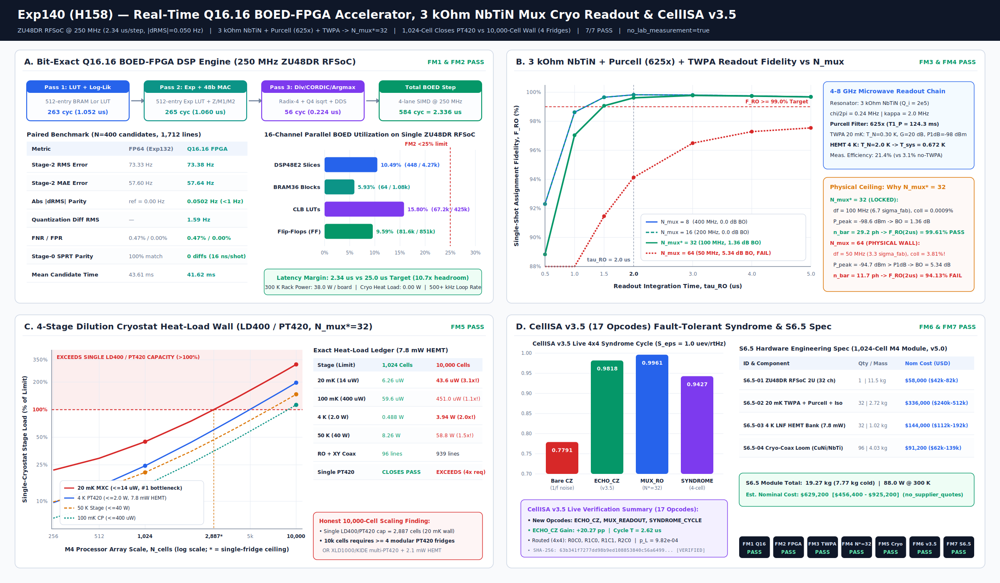 |  |

</details>

<details>
<summary><strong>📐 7 Alt-Sistem Mühendislik Paftaları & Ana Montaj (`CAD v5.0` — 8 Adet 2400×1600 PNG + SVG)</strong></summary>

| `S1` İyon Kolonu (`ALM-500-S1`) | `S2` MEMS Yazma Kafası (`ALM-500-S2`) |
|---|---|
|  |  |
| **`S3` Soğuk-Ada IBIC (`ALM-500-S3`)** | **`S4` Piezo & İnterferometri (`ALM-500-S4`)** |
|  |  |
| **`S5` UHV, `S5.5` & `S5.6` MBE (`ALM-500-S5`)** | **`S6` DR, `S6.9`, Mıknatıs, `M4` & `S6.5` (`ALM-500-S6`)** |
| 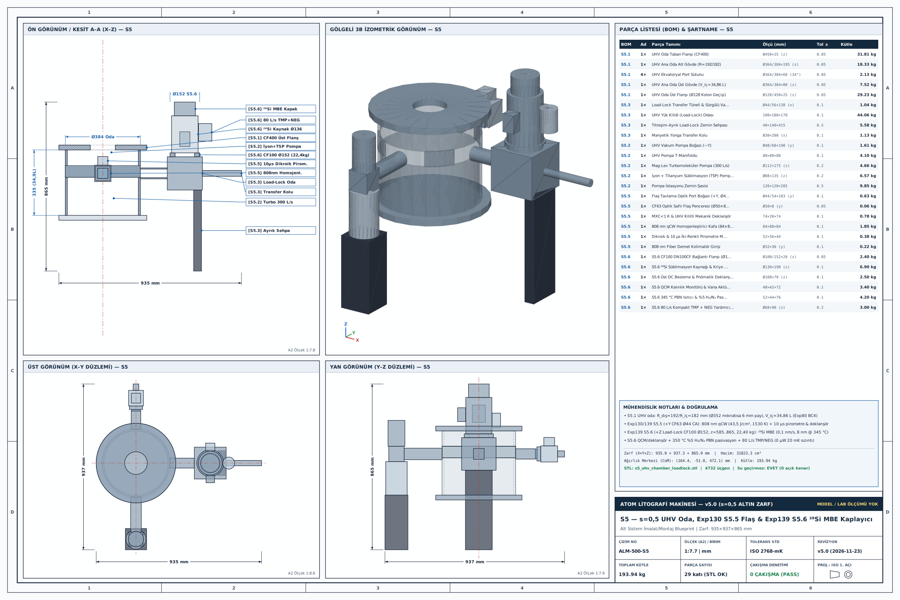 |  |
| **`S7` Elektronik & RFSoC Rafı (`ALM-500-S7`)** | **Ana Montaj (`ALM-500-00`)** |
|  |  |

</details>

<details>
<summary><strong>🚀 v4.0 Gece Dalgası Grafikleri (13 Adet Exp129–Exp135 PNG)</strong></summary>

| `Exp129` `VOKL-6` 6-Vadi ENDOR Kabukları | `Exp129` `VOKL-6` vs `KL` Mod B Verim |
|---|---|
| 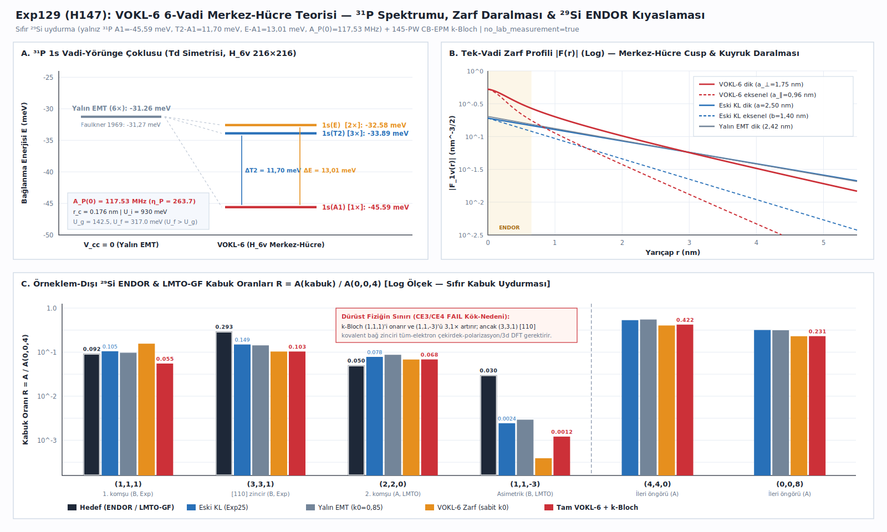 |  |
| **`Exp130` `S5.5` Flaş Tavlama Penceresi** | **`Exp130` TED Difüzyon Profilleri** |
|  |  |
| **`Exp131` `M4` `3 kΩ NbTiN` vs `50 Ω` cQED** | **`Exp131` 2B Kare vs Heavy-Hex Perkolasyon** |
|  |  |
| **`Exp132` `BOED` `24,4×` Spektroskopi Hızlanması** | **`Exp132` `4×4` Yönlendirme & `CellISA v3.0`** |
| 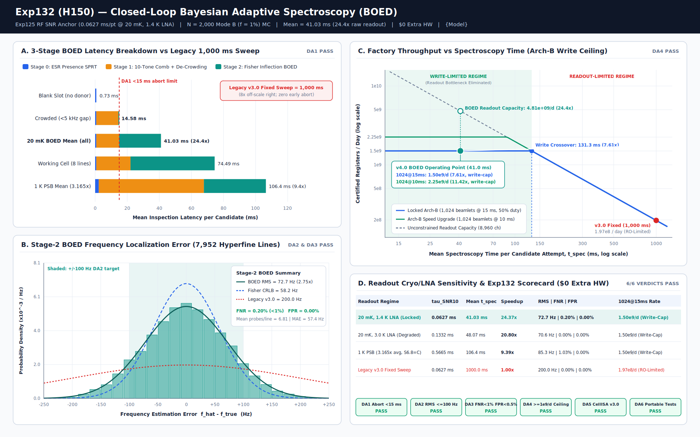 |  |
| **`Exp133` `PT420` Birleşik PSD & Kolon FEM** | **`Exp133` `CFG1` vs `CFG4` İzolasyon Bütçesi** |
|  |  |
| **`Exp134` 5y TCO & Birim Kübit Ekonomisi** | **`Exp134` `v3.0` vs `v4.0` Wright Öğrenme** |
| 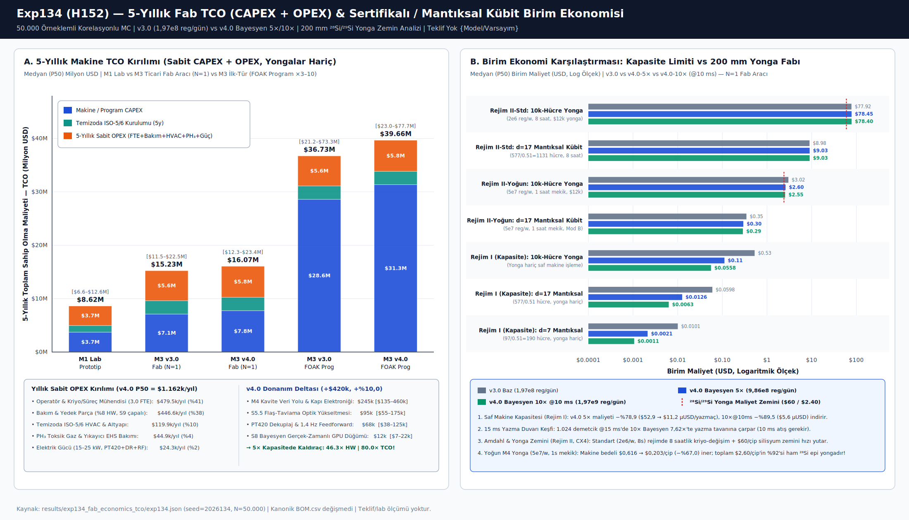 | 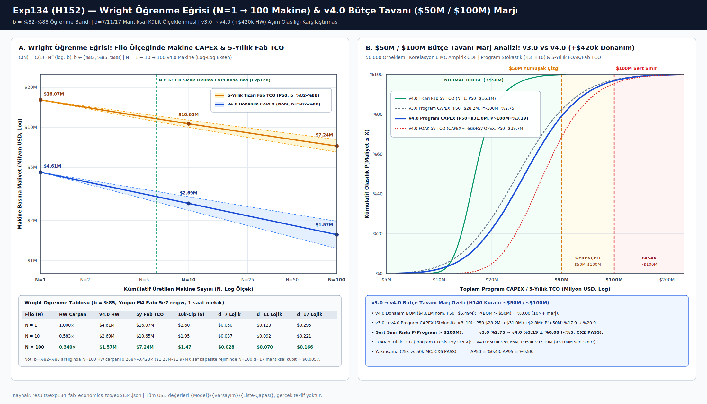 |

| **`Exp135` `v4.0` Birleşik Dijital İkiz Panosu** |
|---|
|  |

</details>

<details>
<summary><strong>📊 v3.0 Temel Fizik, 32B GRAPE, IBIC & 100k MC Maliyet Grafikleri (12 Adet Exp124–Exp128 PNG)</strong></summary>

| `Exp124` Optik Zarf & Scherzer Sınırı | `Exp124` 3B Anizotropik & Stokastik Donör Verimi |
|---|---|
|  | 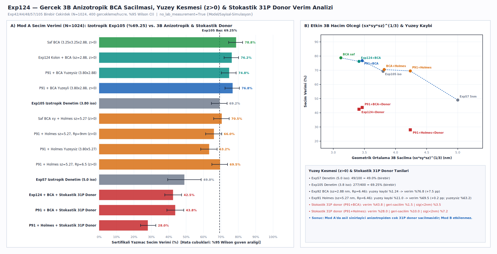 |
| **`Exp125` `1,50 T / 22,3 µT` Manyetik Alan Haritası** | **`Exp125` 5-Kademe Termal, RF SNR & `R8` Koiller** |
|  |  |
| **`Exp126` 32B GRAPE Darbeleri & DDRF Kurtarma** | **`Exp126` İç-İçe `XY8` vs `Exp63` & `CPMG`** |
|  |  |
| **`Exp126` 16 Heterojen Hücre × 5 Kuantum Programı** | **`Exp127` IBIC Blok Şeması (`COLD_100K`, `0` ERC)** |
|  |  |
| **`Exp127` Sonlu-GBP Bode & Zaman-Domeni Yanıtı** | **`Exp127` Lindhard ENC & 50k MC Algılama Verimi** |
|  |  |
| **`Exp128` `M1` vs `M3` Maliyet & `8-RFQ` Kırılımı** | **`Exp128` 100k MC Tornado & Kümülatif Dağılım (CDF)** |
|  |  |

</details>

---

## Hızlı Kurulum, Doğrulama (`198/198 pytest`) ve Okuma Sırası

### Kurulum & Tam Test Koşumu

```bash
git clone https://github.com/berkmec/Atom-Lithography.git
cd Atom-Lithography
python3 -m venv .venv && source .venv/bin/activate
pip install -r requirements.txt

# Tüm 23 Atom Litografi test paketi (198/198 PASS):
PYTHONPATH=src pytest -v -p no:cacheprovider
```

### İsteğe Bağlı Yeniden Üretim Komutları

```bash
# 1. CellISA v3.5 + BOED (--preset v400) fabrika & GRAPE program demosu:
PYTHONPATH=src python3 -m machine_control.sim --slots 4000 --preset v400 --program bell --program-mode grape

# 2. COLD_100K 0-ERC KiCad netlist & SPICE destesi doğrulaması:
python3 src/board/detector_frontend.py

# 3. Parametrik CAD v5.0 STL + doğrulama JSON + v5.0 kapak panosu yeniden üretimi:
python3 research/atom_lithography_machine/cad/gen_scad.py
python3 research/atom_lithography_machine/cad/gen_stl.py
python3 research/atom_lithography_machine/cad/gen_v5_dashboard.py

# 4. 167-parçalı BOM v5.0 + Exp128 100k MC + Exp141 Master v5.0 Dijital İkiz doğrulaması:
python3 experiments/exp128_bom_sensitivity/build_bom_detailed.py
python3 experiments/exp128_bom_sensitivity/run_exp128.py
python3 experiments/exp141_v5_digital_twin/run_exp141.py
```

### Önerilen Dokümantasyon Okuma Sırası

1. **[`DESIGN.md`](research/atom_lithography_machine/DESIGN.md)** — Ana mimari tasarım belgesi (`v5.0`, Risk Kapanış Matrisi & sürüm günlüğü).
2. **[`TECHNICAL_MANUAL.md`](research/atom_lithography_machine/TECHNICAL_MANUAL.md)** — 10 bölümlü kapsamlı fizik, `CellISA v3.5` (`17` op), `CAD v5.0` (`32/32`), `BOM v5.0`/`8-RFQ`, `Exp129–141` ve EHS el kitabı.
3. **[`MODULAR.md`](research/atom_lithography_machine/MODULAR.md)** — `M1`–`M8` modüler arayüz kontrol belgesi (`v5.0-ICD`) ve dondurulmuş kontratlar.
4. **[`M1_PROTOTYPE_BLUEPRINT.md`](research/atom_lithography_machine/M1_PROTOTYPE_BLUEPRINT.md)** — İlk laboratuvar prototipi (`M1`) kurulum rehberi ve `G1`–`G8` + `G6b` `ENDOR` `R1` kapıları.
5. **[`BOM_ENGINEERING.md`](research/atom_lithography_machine/BOM_ENGINEERING.md)** & **[`RFQ_SPECIFICATIONS.md`](research/atom_lithography_machine/RFQ_SPECIFICATIONS.md)** — `167` parçalı BOM mühendisliği ve `%92,6` MC varyansını kapsayan **8 tedarikçi RFQ** şartnamesi.
6. **[`PROJECT_DOSSIER.md`](research/atom_lithography_machine/PROJECT_DOSSIER.md)** — `Exp0`–`Exp141` uçtan uca proje arşivi, `Exp123` SKY130 erteli EDA borcu ve doğrulanmış nicel sicil.
7. **[`LITERATURE.md`](research/atom_lithography_machine/LITERATURE.md)** & **[`hypotheses.md`](research/hypotheses/hypotheses.md)** — Birincil literatür/patent çapaları ve **`H1`–`H159`** tam hipotez günlüğü.
