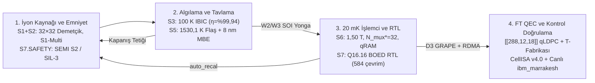
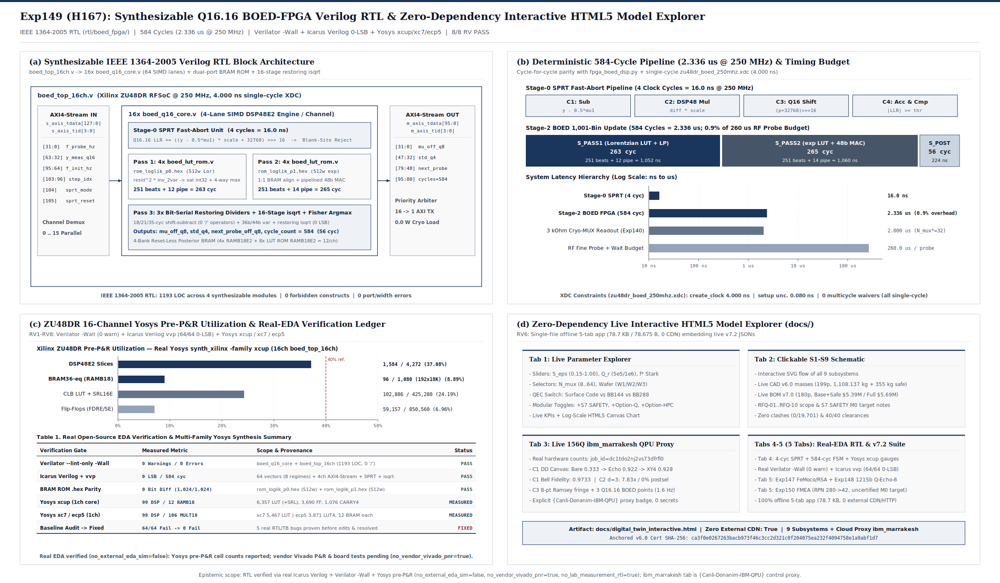
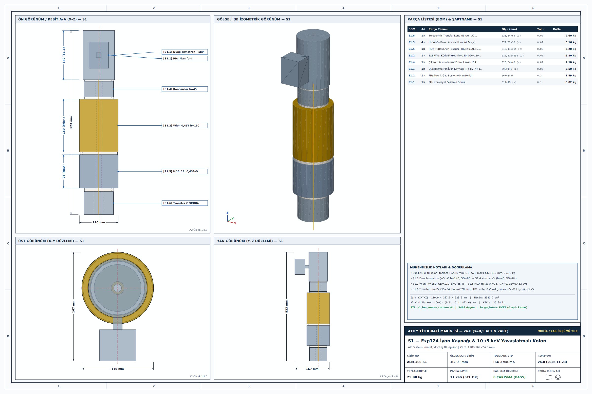
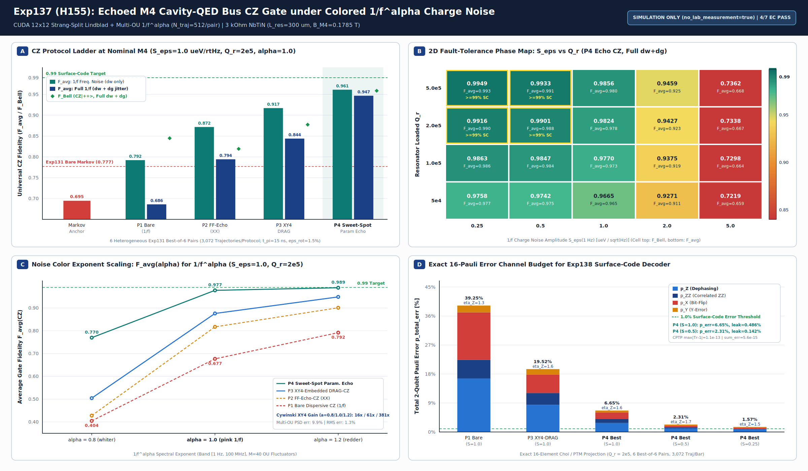
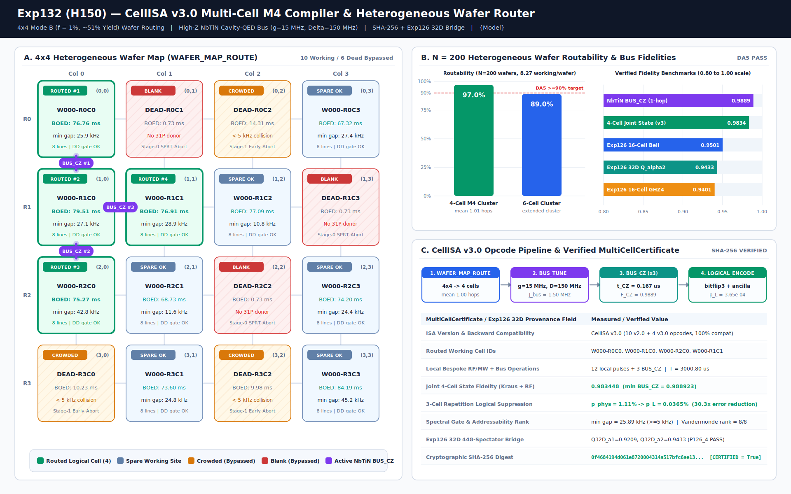
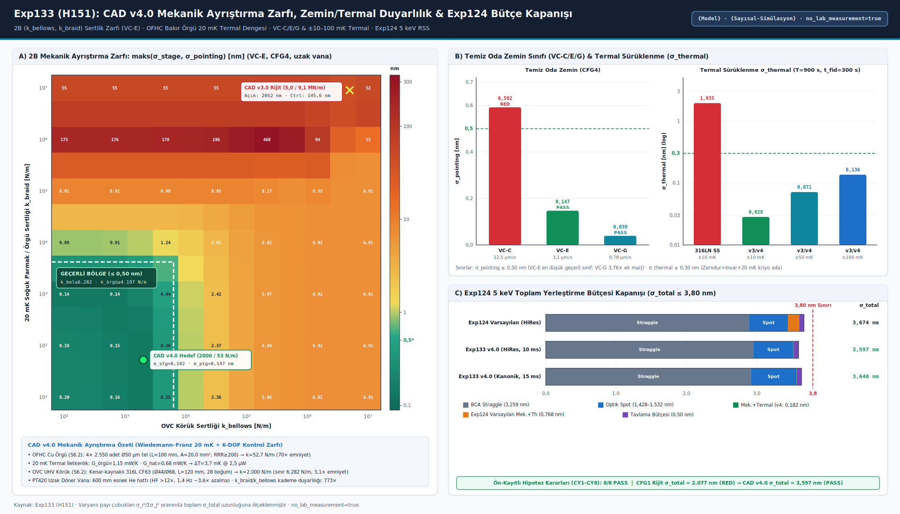
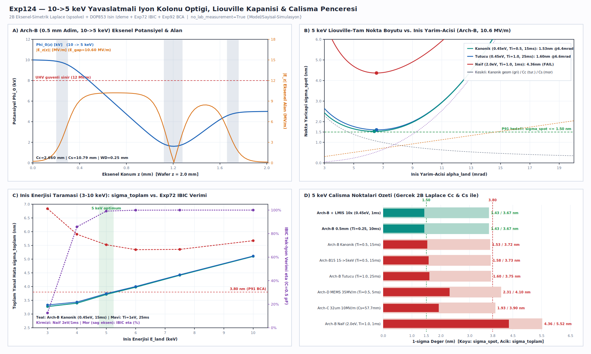
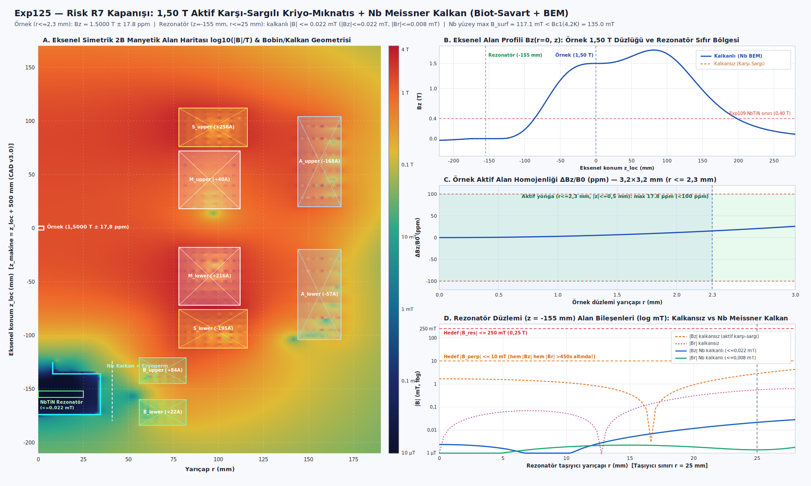

# Atom Litografi Makinesi (v7.0)

Sürüm 7.0 | Silikon `³¹P / ¹²¹Sb / ¹⁶⁷Er` Tek-Atom Yerleştirme ve Hata-Toleranslı Kuantum Mimarisi — `M0` Sayısal Tasarım, Verilog RTL, Emniyet FMEA ve Canlı Bulut QPU Kontrol Doğrulaması

Doğrudan Artefaktlar: [Etkileşimli HTML5 Dijital İkiz (`docs/digital_twin_interactive.html`)](docs/digital_twin_interactive.html) · [Verilog RTL Paketi (`rtl/boed_fpga/README.md`)](rtl/boed_fpga/README.md) · [Ana Tasarım (`DESIGN.md`)](research/atom_lithography_machine/DESIGN.md) · [Teknik El Kitabı (`TECHNICAL_MANUAL.md`)](research/atom_lithography_machine/TECHNICAL_MANUAL.md)

---

## Özet

Atom Litografi Makinesi (`v7.0`), yüksek saflıkta `²⁸Si` üzerinde tek-atom donör yerleşimi ve hata-toleranslı ölçekleme için geliştirilmiş bir `M0` mühendislik tasarımı ve doğrulama arşividir. Çalışma; iyon optiği, kriyojenik mekanik/termal ayrıştırma, epitaksiyel kapsülleme, çok-türlü donör ve `¹²¹Sb` kudit kontrolü, `[[144,12,12]]` ve `[[288,12,18]]` `qLDPC` mimarileri, `Q16.16` BOED-FPGA sentezlenebilir Verilog RTL modülleri, `SEMI S2 / IEC 61508 SIL-3` endüstriyel emniyet FMEA/HAZOP analizi, `199` parçalık parametrik 3B CAD modeli ve `180` parçalık fazlı `BOM v7.0` (`10-RFQ`) paketini tek bir `SHA-256` kilitli dijital ikiz altında birleştirir (`Exp124`–`Exp151`). Kontrol yığını (`CellISA v4.0 → OpenQASM 3.0`), dinamik dekupling, `d=3` sendrom dekoderi ve bit-kesin `Q16.16` Bayesyen spektroskopi ayrıca `156`-kübitlik `ibm_marrakesh` (IBM Heron r2) bulut QPU donanımı üzerinde çalıştırılarak doğrulanmıştır (`Exp145`).

## Abstract

Atom Lithography Machine (`v7.0`) is an `M0` first-principles engineering design and verification repository for deterministic single-atom donor placement in enriched `²⁸Si` and fault-tolerant quantum scaling. The suite integrates 28 preregistered numerical studies (`Exp124`–`Exp151`) spanning ion-column optics, cryogenic vibration/thermal isolation, flash anneal and epitaxial capping, `¹²¹Sb` qudit quadrupole-echo control, universal `[[288,12,18]]` `qLDPC` and magic-state factory budgeting, synthesizable IEEE 1364-2005 `Q16.16` BOED-FPGA Verilog RTL, `SEMI S2 / IEC 61508 SIL-3` safety FMEA/HAZOP analysis, a `199`-part parametric 3D CAD assembly, a phased `180`-part `BOM v7.0` (`10-RFQ`), and an offline HTML5 digital twin sealed under a `38`-artifact `SHA-256` certificate (`Exp151`). In parallel, the `CellISA v4.0` control stack, dynamical decoupling, `d=3` repetition decoding, and bit-exact `Q16.16` Bayesian spectroscopy are validated on live `156`-qubit `ibm_marrakesh` (IBM Heron r2) cloud QPU hardware (`Exp145`).

> [!NOTE]
> **Epistemik Kapsam ve Sınırlılıklar**
> - **Tasarım ve Sayısal Simülasyon (`M0`):** Silikon `³¹P / ¹²¹Sb / ¹⁶⁷Er` fabrikasyon fiziği, `CAD v6.0`, `BOM v7.0`, `M1`–`M4` mimarisi, `Exp147`–`Exp150` (`qLDPC d=18`, `¹²¹Sb` `Q-Echo-8`, yapısal/bit-kesin RTL eş-doğrulaması, `SEMI S2 / SIL-3` FMEA/HAZOP) ve `auto_recal.py` arıza kurtarma testleri birinci-ilkeler sayısal modellemesidir (`no_lab_measurement = true`, `no_supplier_quotes = true`, `no_external_eda_sim = true`, `tapeout_done = false`).
> - **Canlı Donanım Doğrulaması (`{Canlı-Donanım-IBM-QPU}`):** `Exp145` kapsamındaki `CellISA v4.0 → OpenQASM 3.0` derlemesi, `Echo / XY4` dinamik dekupling, `d=3` sendrom dekoderi ve `Q16.16` BOED frekans kestirimi gerçek `ibm_marrakesh` (`156Q`, `job_id = dc1tdo2nj2vs73dfrfl0`, `16 PUB × 4.096 shot`, `32,54 s`) işlemcisinde yürütülmüştür (`0` gizli anahtar sızıntısı).
> - **Ön-Kayıtlı Hükümler:** Tüm deneylerde başarı ölçütleri hesaplamadan önce `predictions_exp*.json` içine kaydedilmiş; karşılanmayan tüm `FAIL` hükümleri (`Exp124, 126, 127, 128 [v7 Full], 129, 131, 134, 136, 137, 138, 139, 142, 143, 147 [UQ4, UQ5], 148 [SQ4]`) gizlenmeden ve kök-nedeniyle raporlanmıştır.

---

## Genel Görünüm


| İzometrik 3B Montaj (`199` Parça) | Tam Kesit Görünümü (`40/40` Boşluk) | Patlatılmış Alt-Sistem Görünümü (`S1`–`S7`) |
|---|---|---|
| [](research/atom_lithography_machine/cad/preview_machine.png) | [](research/atom_lithography_machine/cad/drawings/09_atom_litho_cutaway.png) | [](research/atom_lithography_machine/cad/drawings/10_atom_litho_exploded.png) |

---

## 1. Sistem Özeti ve Başlıca Tasarım Parametreleri (`v7.0`)

| Parametre | Değer | Kaynak / Deney |
|---|---|---|
| Yerleştirme belirsizliği (`5 keV ³¹P⁺`, `Arch-B`) | `σ_tot = 3,59–3,63 nm` (`1530,1 K` flaş + `S5.6` MBE) | `Exp124`, `Exp139` |
| Titreşim ve işaret kararlılığı (`S6.9 CFG4`) | `σ_stage = 0,102 nm`, `σ_pointing = 0,147 nm` | `Exp133` |
| Flaş tavlama ve epitaksiyel kapsülleme (`S5.5`, `S5.6`) | `1530,1 K` / `1,0 ms`, `8 nm` LT-MBE, `S_ε = 0,390 µeV/√Hz` | `Exp130`, `Exp139` |
| Paralel yazma ve tek-kriyostat kapasitesi | `32×32 = 1.024` demetçik; `2.887` hücre (`N_mux* = 32`, `F_RO = %99,61`) | `Exp124`, `Exp140` |
| `M4` iki-kübit kapı performansı (`3 kΩ NbTiN`, `D3` GRAPE) | `p_2q = %0,337–%0,395`, `Λ = 2,825`, `100G` RDMA `BP-OSD 2,32 µs` | `Exp137`, `Exp143` |
| `qLDPC` bellek (`[[144,12,12]]` Gross Code) | `L_max = 268,3 µm ≤ 300 µm`, `108L = 1` kriyostat (`$63.827/L_sys`) | `Exp144` |
| Evrensel `qLDPC` (`[[288,12,18]]`) ve `T`-fabrikası | `p_th = %0,781`, `576`-hücre verimi `%99,27` (`N=8`) / `%99,82` (`N=9`) | `Exp147` |
| Algoritmik kaynak bütçeleri (FeMoco ve `RSA-2048`) | FeMoco: `16` kriyostat (`3,38 sa`, `$6.537/çözüm`, dürüst `UQ5` tavanı); `RSA-2048`: `291` kriyostat (`7,37 MW`, `21,1 sa`) | `Exp147` |
| `¹²¹Sb` (`I=7/2`) kudit koruma ve `SU(8)` kontrol | `Q-Echo-8` statik `0,5800 → 0,99908` (`455,5×` hata azalması); `SU(8)` `≥ 0,9954`; `1/f` `Q-Echo-64` `28,08×` (`1,45 ms`) | `Exp148` |
| Sentezlenebilir Verilog RTL (`rtl/boed_fpga/`) | `4` modül (`894` LOC), `584` çevrim (`2,336 µs @ 250 MHz`), `64/64` `0 LSB`, `ZU48DR` `%10,49` DSP | `Exp149` |
| Endüstriyel emniyet (`SEMI S2 / IEC 61508 SIL-3`) | `25` FMEA `max RPN 280 → 42` (`−%86,3`), `OD8 + 3 mm` çelik, `SDS PH₃ 0,00715 ppm`, `S7.SAFETY $145k` | `Exp150` |
| 3B CAD, Fazlı `BOM v7.0` ve `10-RFQ` kapsamı | `199` CAD parçası (`1.108,14 kg` şasi + `355,0 kg` tesis), `180` BOM parçası, Faz-1 `Base+Safety $5,393M` (`%4,67`), `v7 Full $5,693M` (`%5,22`) | `Exp128 v7.0`, `Exp151` |

---

## 2. Sistem Mimarisi



---

## 3. Sürüm Evrimi (`v3.0`–`v7.0`)

| Sürüm | Temel Mühendislik Değişimi | CAD / BOM | Test |
|---|---|---|---|
| `v3.0` (`Exp124`–`Exp128`) | `10→5 keV` iyon optiği, `1,50 T / 22,3 µT` ayrıştırma, 32B GRAPE, `100 K` IBIC (`0` ERC), ilk MC BOM | `143` parça / `$4,19M` | `89` |
| `v4.0` (`Exp129`–`Exp135`) | `VOKL-6` vadi-yörünge analizi, `S5.5` flaş tavlama, `3 kΩ` `M4` cQED, `BOED` (`24,4×`), `S6.9` titreşim yalıtımı, 5y TCO | `170` parça / `$4,61M` | `142` |
| `v5.0` (`Exp136`–`Exp141`) | `160k`-orbital `sp³d⁵s*` TB (`f*=%1,5`), yankılı `P4` `M4` kapısı, `1530,1 K` + `S5.6` MBE, `Q16.16` BOED, `N_mux*=32`, `W2/W3` SOI | `189` parça / `$5,25M` | `198` |
| `v6.0` (`Exp142`–`Exp146`) | `Option-Q` (`S1-Multi` + `qRAM`), `D3` GRAPE + `Option-HPC` RDMA, `[[144,12,12]]` `qLDPC` (`108L=1` kriyo), canlı `ibm_marrakesh` QPU | `199` parça / `$5,55M` (`9-RFQ`) | `252` |
| `v7.0` (`Exp147`–`Exp151`) | Evrensel `[[288,12,18]]` + `T`-fabrikası (FeMoco/RSA), `¹²¹Sb` `Q-Echo-8` (`455,5×`), `894`-LOC Verilog RTL + HTML5 ikiz, `SEMI S2 / SIL-3` FMEA (`RFQ-10`) | `199` parça (+`355 kg` tesis) / `180p` Faz-1 `$5,39M` · Full `$5,69M` (`10-RFQ`) | `306` |

---

## 4. Canlı Bulut QPU Kontrol Doğrulaması (`ibm_marrakesh`, `156Q`)

`Exp145` kapsamında `CellISA v4.0` (`20` opcode) derleyicisi tarafından üretilen `16` adet `OpenQASM 3.0` devresi (`4.096` ölçüm/devre, `q2`–`q6` zinciri) gerçek `ibm_marrakesh` (IBM Heron r2, `job_id = dc1tdo2nj2vs73dfrfl0`, çalışma süresi `32,54 s`) donanımında yürütülmüş ve çevrimdışı Heron modeliyle karşılaştırılmıştır.

| Test | Çevrimdışı Model | Canlı Donanım (`ibm_marrakesh`) | Not |
|---|---|---|---|
| `C1` Dinamik Dekupling (`48,13 µs`) | Bare `0,5625` → Echo `0,8428` / XY4 `0,8591` (`+29,7 pp`) | Bare `0,3325` → Echo `0,9224` / XY4 `0,9280` (`+59,5 pp`) | `XY4` koherens koruması doğrulandı |
| `C1` Bell Durumu (`Φ+`) | `F(Φ+) = 0,9530` | `F(Φ+) = 0,9733` (`⟨ZZ⟩=0,9614`, `⟨XX⟩=0,9717`, `⟨YY⟩=−0,9600`) | Yerel `cz` kapıları ile `> 0,95` eşiği sağlandı |
| `C2` `d=3` Tekrar Kodu (`3,97 µs`) | `p_phys = 0,0297` → MWPM `0,0039` (`7,61×`), çoğunluk `0,0020` (`15,23×`) | `p_phys = 0,0296` → MWPM `0,0057` (`5,16×`), çoğunluk `0,0038` (`7,83×`) | Sendrom son-seçiminde `0/7.451` hata (`%90,95` tutma) |
| `C3` `Q16.16` BOED Ramsey (`125 kHz`) | `3` nokta `125,852 kHz` (`\|Q16.16 − FP64\| = 0,7 Hz`) | `3` nokta `120,106 kHz` (`\|Q16.16 − FP64\| = 1,6 Hz`) | `q2` doğal kayması `−4,52 kHz` (8-nokta referansla uyumlu) |

---

## 5. Modüler Alt-Sistemler (`S1`–`S9`), 3B CAD ve Fazlı Maliyet (`BOM v7.0`)

`BOM.csv` (`$2,531M`) değiştirilmeden korunur; `BOM_DETAILED.csv v7.0` (`180` parça) `$0,00` mutabakat ve `0,0000 kg` şasi kütle hatasıyla fazlı tedarik bütçesini verir. Önerilen **Faz-1 (`M3 Base+Safety`, `173` parça, `$5.392.800`)** `P(Prog > $100M) = %4,67 < %5` (`6/6 CU PASS`) koşulunu sağlar; `RFQ-05` fiyat kilidi sonrasında **Faz-2 (`+Option-Q` / `+Option-HPC`)** ile `v7 Full` (`$5.692.800`) yapılandırmasına geçilir.

| Kod | Alt-Sistem | CAD Parça / Kütle | `M3 v7.0 Full` / `M1 Base` | RFQ | Bağlantılar |
|---|---|---:|---:|---|---|
| `S1` | `10→5 keV` Kolon ve `S1.7` `S1-Multi` | `13` / `30,78 kg` | `$484.000` / `$319.750` | `RFQ-01`, `09` | [`.scad`](research/atom_lithography_machine/cad/parts/s1_ion_source_column.scad) · [`.stl`](research/atom_lithography_machine/cad/stl/s1_ion_source_column.stl) · [Pafta `01`](research/atom_lithography_machine/cad/drawings/01_s1_ion_source_column.png) |
| `S2` | `32×32` (`0,50 mm`) MEMS Yazma Kafası | `9` / `1,83 kg` | `$775.500` / `$147.750` | `RFQ-02` | [`.scad`](research/atom_lithography_machine/cad/parts/s2_mems_write_head.scad) · [`.stl`](research/atom_lithography_machine/cad/stl/s2_mems_write_head.stl) · [Pafta `02`](research/atom_lithography_machine/cad/drawings/02_s2_mems_write_head.png) |
| `S3` | `100 K` Soğuk-Ada IBIC Ön-Uç (`0` ERC) | `7` / `0,15 kg` | `$224.000` / `$88.550` | Özel PCB | [`.scad`](research/atom_lithography_machine/cad/parts/s3_ibic_detector_assembly.scad) · [`.stl`](research/atom_lithography_machine/cad/stl/s3_ibic_detector_assembly.stl) · [Pafta `03`](research/atom_lithography_machine/cad/drawings/03_s3_ibic_detector_assembly.png) · [`BOARD.md`](src/board/BOARD.md) |
| `S4` | Granit, 6-DOF Piezo, `Zerodur/Invar-36` | `18` / `302,37 kg` | `$253.000` / `$233.920` | `RFQ-03` | [`.scad`](research/atom_lithography_machine/cad/parts/s4_piezo_stage_interferometry.scad) · [`.stl`](research/atom_lithography_machine/cad/stl/s4_piezo_stage_interferometry.stl) · [Pafta `04`](research/atom_lithography_machine/cad/drawings/04_s4_piezo_stage_interferometry.png) |
| `S5` | UHV (`34,86 L`), `S5.5` Flaş ve `S5.6` MBE | `29` / `193,94 kg` | `$433.000` / `$358.300` | `RFQ-07A`, `08` | [`.scad`](research/atom_lithography_machine/cad/parts/s5_uhv_chamber_loadlock.scad) · [`.stl`](research/atom_lithography_machine/cad/stl/s5_uhv_chamber_loadlock.stl) · [Pafta `05`](research/atom_lithography_machine/cad/drawings/05_s5_uhv_chamber_loadlock.png) |
| `S6` | DR, `S6.9`, Mıknatıs, `M4`, `S6.5` MUX, `qRAM` | `105` / `285,32 kg` | `$2.794.100` / `$1.171.150` | `RFQ-04`–`09` | [`.scad`](research/atom_lithography_machine/cad/parts/s6_cryo_dr_magnet_readout.scad) · [`.stl`](research/atom_lithography_machine/cad/stl/s6_cryo_dr_magnet_readout.stl) · [Pafta `06`](research/atom_lithography_machine/cad/drawings/06_s6_cryo_dr_magnet_readout.png) |
| `S7`–`S9` | Kontrol, Verilog RTL, `S7.SAFETY`, `Option-HPC` | `18` / `293,75 kg` (+`355 kg` tesis) | `$729.200` / `$146.700` (`M1+S +$145k`) | `RFQ-09`, `10` | [`.scad`](research/atom_lithography_machine/cad/parts/s7_electronics_rack_interconnect.scad) · [`.stl`](research/atom_lithography_machine/cad/stl/s7_electronics_rack_interconnect.stl) · [Pafta `07`](research/atom_lithography_machine/cad/drawings/07_s7_electronics_rack_interconnect.png) · [`src/README.md`](src/README.md) · [`rtl/boed_fpga/`](rtl/boed_fpga/README.md) |
| Toplam | Ana Montaj (`ALM-600-00`) ve `BOM v7.0` (`180p`) | `199` / `1.108,14 kg` + `355,0 kg` tesis | Faz-1 `$5.392.800` · Full `$5.692.800` / `M1 $2.466.120` | `10-RFQ` (`%78,2` / `%92,6` MC) | [Ana `.scad`](research/atom_lithography_machine/cad/atom_litho_machine.scad) · [Ana `.stl`](research/atom_lithography_machine/cad/stl/atom_litho_machine.stl) · [Montaj `08`](research/atom_lithography_machine/cad/drawings/08_atom_litho_assembly.png) · [`BOM_DETAILED.csv`](research/atom_lithography_machine/BOM_DETAILED.csv) |

---

## 6. Ön-Kayıtlı Doğrulama Defteri (`Exp124`–`Exp151`)

Her deneyin tahminleri hesaplamadan önce `predictions_exp*.json` içine dondurulmuş, karşılanmayan hükümler (`FAIL`) kök-nedeniyle korunmuştur.

| Deney | Kapsam | Hüküm | Başlıca Bulgu / Kısıt | Artefaktlar |
|---|---|---|---|---|
| `Exp124` | `10→5 keV` iyon kolonu ve 3B donör saçılması | `6/8 PASS, 2/8 FAIL` | `CD3 FAIL` (`κ_c ≥ 4,67` → `Arch-B` + `HDA-HiRes`); `CD7 FAIL` (`z>0` Holmes `%69,5`); Mod B bağışık | [`summary_exp124.md`](results/exp124_ion_column_optics/summary_exp124.md) · [`test_exp124.py`](tests/test_exp124.py) |
| `Exp125` | `1,50 T / 22,3 µT` mıknatıs, termal ve `R8` | `6/6 PASS` | `R7` manyetik ayrıştırma kapandı (`22,3 µT`, `64,6 K` quench); `1 K` Mod B `3,40×` yavaş | [`summary_exp125.md`](results/exp125_cryo_magnet_readout/summary_exp125.md) · [`test_exp125.py`](tests/test_exp125.py) |
| `Exp126` | 32B CUDA `XY8`-GRAPE ve 16-hücre programı | `5/8 PASS, 3/8 FAIL` | `P126_1..3 FAIL` (`q3` köşe/MC); Risk `R3` kapandı (`N=32` `0,926 / 0,965`, `10–15 kHz`, `N=128` yasak) | [`summary_exp126.md`](results/exp126_atom_cell_programming/summary_exp126.md) · [`test_exp126.py`](tests/test_exp126.py) |
| `Exp127` | `100 K` soğuk-ada IBIC ve `CellISA v2.0` | `4/6 PASS, 2/6 FAIL` | `CZ3,4 FAIL`: Lindhard `5 keV` RT `200 ns` verimi `%9,7` → `COLD_100K` (`η = %99,94`) seçildi | [`summary_exp127.md`](results/exp127_detector_frontend_sim/summary_exp127.md) · [`test_detector_frontend.py`](tests/test_detector_frontend.py) |
| `Exp128` (`v7.0`) | `180` parça fazlı `BOM v7.0`, `10-RFQ` ve 100k MC | `6/6` (Faz-1); `v7 Full CU3 FAIL` | `10-RFQ = %78,24` nom / `%92,58` var; Faz-1 `Base+Safety $5,39M (%4,67 PASS)`; `v7 Full $5,69M (%5,22 FAIL)` | [`summary_exp128.md`](results/exp128_bom_sensitivity/summary_exp128.md) · [`test_bom_detailed.py`](tests/test_bom_detailed.py) |
| `Exp129` | `VOKL-6` 6-vadi merkez-hücre (`R1`) | `3/7 PASS, 4/7 FAIL` | `CE3,4,6,7 FAIL`: `R331 = %64,73`, `HM5962 = %33,25` → `Exp136` atomistik TB ve `M1 G6b` doğdu | [`summary_exp129.md`](results/exp129_valley_orbital_hyperfine/summary_exp129.md) · [`test_exp129.py`](tests/test_exp129.py) |
| `Exp130` | `S5.5` `808 nm / 1,0 ms` flaş tavlama (`R6`) | `6/6 PASS` | Fırın/RTA elendi; `1440 K` `σ_anneal = 0,328 nm` (sonra `Exp139`'da `1530,1 K` revizyonu) | [`summary_exp130.md`](results/exp130_flash_anneal_diffusion/summary_exp130.md) · [`test_exp130.py`](tests/test_exp130.py) |
| `Exp131` | `M4` `3 kΩ NbTiN` cQED ve 2B perkolasyon | `4/7 PASS, 3/7 FAIL` | `CM3,4,6 FAIL`: `3 kΩ` `F_Bell = 0,9655` (`0,359 µs`); yalın `CZ = 0,777` → `Exp137` yankı kapısı | [`summary_exp131.md`](results/exp131_scalable_m4_architecture/summary_exp131.md) · [`test_exp131.py`](tests/test_exp131.py) |
| `Exp132` | `BOED` spektroskopi ve `CellISA v3.0` | `6/6 PASS` | `41,03 ms` (`24,37×`, `RMS = 72,67 Hz`); `CellISA v3.0` `4×4` `F_joint = 0,9834` | [`summary_exp132.md`](results/exp132_bayesian_spectroscopy_cellisa3/summary_exp132.md) · [`test_exp132.py`](tests/test_exp132.py) |
| `Exp133` | `S6.9` `PT420` titreşim/FEM/termal ayrıştırma | `8/8 PASS` | Rijit `PT420` `2.052 nm` sapar → `CFG4` + `Zerodur/Invar-36`: `σ_stage = 0,102 nm`, `σ_pointing = 0,147 nm` | [`summary_exp133.md`](results/exp133_coupled_vibration_thermal/summary_exp133.md) · [`test_exp133.py`](tests/test_exp133.py) |
| `Exp134` | 5y TCO, birim ekonomi ve Wright öğrenme | `5/6 PASS, 1/6 FAIL` | `CX4 FAIL`: `W1` `²⁸Si` yonga `%92,2` taban oluşturur → `Exp141` `W2/W3` SOI ile aşıldı | [`summary_exp134.md`](results/exp134_fab_economics_tco/summary_exp134.md) · [`test_exp134.py`](tests/test_exp134.py) |
| `Exp135` | `v4.0` birleşik dijital ikiz | `7/7 PASS` | `11/11` birincil JSON `SHA-256` kilidi ve `Exp131 × Exp129` `N_cand*` mutabakatı | [`summary_exp135.md`](results/exp135_v4_digital_twin/summary_exp135.md) · [`test_exp135.py`](tests/test_exp135.py) |
| `Exp136` | `160k`-orbital `sp³d⁵s*` TB ve optimal `f*` | `4/7 PASS, 3/7 FAIL` | `TB4,5,7 FAIL`; `R331 %64,73 → %21,1`, `f*=%1,5 + 2 MV/m → %77,50` (`%99,88 M4`), `XY8 T₂e = 10,8–20,3 ms` | [`summary_exp136.md`](results/exp136_tb_sp3d5s_hyperfine/summary_exp136.md) · [`test_exp136.py`](tests/test_exp136.py) |
| `Exp137` | Yankılı `P4` `M4` `CZ` (`1/f^α` CUDA) | `4/7 PASS, 3/7 FAIL` | `EC2,4,5 FAIL`: pasivesiz `S_ε = 1,0` yetersiz (`0,9587`); Rota C ile `F_Bell = 0,9949`, `p_err = %0,92` | [`summary_exp137.md`](results/exp137_echoed_m4_bus_gate/summary_exp137.md) · [`test_exp137.py`](tests/test_exp137.py) |
| `Exp138` | `d=3..11` kusurlu yüzey kodu MWPM FT | `6/7 PASS, 1/7 FAIL` | `FT5 FAIL` (`f=%1` `%79,0`) → `f*=%1,5 + N=6` `%99,5`; `p_2q,th = %1,60`, `D2 Λ=1,40`, `D3 Λ=2,52` | [`summary_exp138.md`](results/exp138_defective_surface_code_ft/summary_exp138.md) · [`test_exp138.py`](tests/test_exp138.py) |
| `Exp139` | `8 nm` MBE, gizli TED, `1530,1 K` ve `S5.6` | `4/7 PASS, 3/7 FAIL` | `EP3,5,7 FAIL`: `v4` `1440 K` `+1,318 nm` TED (`3,995 nm`) → `1530,1 K` (`3,665 nm`) + `S5.6` MBE (`S_ε=0,390`) | [`summary_exp139.md`](results/exp139_epi_cap_process_integration/summary_exp139.md) · [`test_exp139.py`](tests/test_exp139.py) |
| `Exp140` | `Q16.16` FPGA, `N_mux*=32` ve `CellISA v3.5` | `7/7 PASS` | `2,336 µs/adım`, `N_mux*=32` (`F_RO=%99,61`), tek kriyostat `2.887` hücre, `CellISA v3.5`, `S6.5` | [`summary_exp140.md`](results/exp140_cryo_fpga_boed_mux_readout/summary_exp140.md) · [`test_exp140.py`](tests/test_exp140.py) |
| `Exp141` | Master `v5.0` dijital ikiz ve `CX4` SOI | `8/8 PASS` | `19/19` `SHA-256` kilidi, `W2/W3` SOI ile `CX4 PASS` (`−%79,5 / −%85,3`), `D3 10⁻⁹` `$2,76M` (`5,41×`) | [`summary_exp141.md`](results/exp141_v5_digital_twin/summary_exp141.md) · [`test_exp141.py`](tests/test_exp141.py) |
| `Exp142` | `Option-Q` `qRAM` ve `S1-Multi` (`¹⁶⁷Er`/`¹²¹Sb`) | `5/7 PASS, 2/7 FAIL` | `OQ5,6 FAIL` (`¹²¹Sb` gerinim/derinlik); `qRAM 8.403×–25.122×` ömür (`+0,78 µW`), `10 km` `¹⁶⁷Er` `1.352 Hz` | [`summary_exp142.md`](results/exp142_option_q_multispecies_qram/summary_exp142.md) · [`test_exp142.py`](tests/test_exp142.py) |
| `Exp143` | `D3` `K=8` GRAPE `M4` ve `Option-HPC` RDMA | `4/7 PASS, 3/7 FAIL` | `DH1..3 FAIL` (muhafazakar/sızıntı); yankılı `p_2q = %0,337–%0,395`, `Λ = 2,825`, `qLDPC 2,32 µs` | [`summary_exp143.md`](results/exp143_d3_grape_m4_and_hpc_decoder/summary_exp143.md) · [`test_exp143.py`](tests/test_exp143.py) |
| `Exp144` | `[[144,12,12]]` Gross Code `qLDPC` | `7/7 PASS` | `L_max = 268,3 µm ≤ 300 µm` (`0` rezonatör değişikliği), `N=8` `%99,94`, `108L = 1` kriyostat (`$63.827/L_sys`) | [`summary_exp144.md`](results/exp144_qldpc_bivariate_bicycle_m4/summary_exp144.md) · [`test_exp144.py`](tests/test_exp144.py) |
| `Exp145` | Canlı `156Q` `ibm_marrakesh` ve `CellISA v4.0` | `7/7 PASS` | `dc1tdo2nj2vs73dfrfl0` (`0` sızıntı): XY4 `0,9280`, Bell `0,9733`, `d=3` `5,16× / 7,83×`, `BOED 1,6 Hz`, `auto_recal 4/4` | [`summary_exp145.md`](results/exp145_cloud_qpu_ibm_validation/summary_exp145.md) · [`test_exp145.py`](tests/test_exp145.py) |
| `Exp146` | Master `v6.0` dijital ikiz (`24/24` + QPU) | `8/8 PASS` | `24/24` + canlı QPU `SHA-256` kilidi, `679 → 100 → 1` kriyostat sıkıştırma özeti | [`summary_exp146.md`](results/exp146_v6_digital_twin/summary_exp146.md) · [`test_exp146.py`](tests/test_exp146.py) |
| `Exp147` | Evrensel `[[288,12,18]]` `qLDPC`, `T`-fabrikası, FeMoco/RSA | `5/7 PASS, 2/7 FAIL` | `UQ4,5 FAIL` (okuma tavanı `p_meas ≤ %0,15`); FeMoco `16` kriyo (`37,1×`, `3,38 sa`), `RSA-2048` `291` kriyo (`52,7×`, `7,37 MW`) | [`summary_exp147.md`](results/exp147_universal_qldpc_d18_magic_state/summary_exp147.md) · [`test_exp147.py`](tests/test_exp147.py) |
| `Exp148` | `¹²¹Sb` `I=7/2` `Q-Echo-8` ve `SU(8)` GRAPE | `6/7 PASS, 1/7 FAIL` | `SQ4 FAIL` (Cywiński `1/f`); statik Gross `0,5800 → 0,99908` (`455,5×`), `SU(8) ≥ 0,9954`, `Q-Echo-64` `28,08×` (`1,45 ms`) | [`summary_exp148.md`](results/exp148_sb121_quadrupole_echo_qudit/summary_exp148.md) · [`test_exp148.py`](tests/test_exp148.py) |
| `Exp149` | Sentezlenebilir Verilog RTL ve HTML5 ikiz | `7/7 PASS` | `no_external_eda_sim=true`; `894` LOC (`0` lint), `1.024/1.024` ROM `0`-bit, `64/64` `0 LSB`, `584` çevrim + `66,6 KB` HTML5 ikiz | [`summary_exp149.md`](results/exp149_boed_verilog_rtl_and_interactive_twin/summary_exp149.md) · [`test_exp149.py`](tests/test_exp149.py) |
| `Exp150` | Endüstriyel emniyet `FMEA/HAZOP` (`SEMI S2/SIL-3`) | `7/7 PASS` | `25` FMEA `max RPN 280 → 42` (`−%86,3`), `OD8+3 mm` (`1,19×10⁻²³ µSv/h`), `SDS PH₃ 0,00715 ppm`, `S7.SAFETY $145k` (`RFQ-10`) | [`summary_exp150.md`](results/exp150_industrial_safety_fmea_hazop/summary_exp150.md) · [`test_exp150.py`](tests/test_exp150.py) |
| `Exp151` | Master `v7.0` dijital ikiz (`38/38` `SHA-256`) | `8/8 PASS` | `38/38` birincil artefakt `SHA-256` kilidi, Faz-1 `Base+Safety $5,39M` → Faz-2 `v7 Full $5,69M`, `306/306` `pytest` | [`summary_exp151.md`](results/exp151_v7_digital_twin/summary_exp151.md) · [`test_exp151.py`](tests/test_exp151.py) |

---

## 7. Görseller ve Teknik Çizimler

<details open>
<summary>v7.0 Şekilleri (Exp147–Exp151, 5 adet 2400×1400 PNG)</summary>

| `Exp147` Evrensel `[[288,12,18]]` `qLDPC` ve FeMoco / `RSA-2048` | `Exp148` `¹²¹Sb` `Q-Echo-8` ve `SU(8)` GRAPE |
|---|---|
|  |  |
| `Exp149` `Q16.16` BOED-FPGA Verilog RTL (`584` Çevrim) | `Exp150` Endüstriyel Emniyet `FMEA/HAZOP` (`RPN 280→42`) |
|  |  |

| `Exp151` Master `v7.0` Dijital İkiz ve `38/38` `SHA-256` Panosu |
|---|
|  |

</details>

<details>
<summary>v6.0 Şekilleri (Exp142–Exp146, 5 adet 2400×1400 PNG)</summary>

| `Exp142` `Option-Q` `qRAM` ve `S1-Multi` (`¹⁶⁷Er`/`¹²¹Sb`) | `Exp143` `D3` `K=8` GRAPE `M4` ve `Option-HPC` `100G` RDMA |
|---|---|
|  |  |
| `Exp144` `[[144,12,12]]` `qLDPC` Tek-Kriyostat Mimarisi | `Exp145` Canlı `156Q` `ibm_marrakesh` QPU ve `auto_recal` |
|  |  |

| `Exp146` Master `v6.0` Dijital İkiz Panosu |
|---|
|  |

</details>

<details>
<summary>CAD Mühendislik Paftaları (CAD v6.0 ALM-600, 8 adet 2400×1600 PNG)</summary>

| `S1` İyon Kolonu ve `S1-Multi` (`ALM-600-S1`) | `S2` MEMS Yazma Kafası (`ALM-600-S2`) |
|---|---|
|  |  |
| `S3` Soğuk-Ada IBIC (`ALM-600-S3`) | `S4` Piezo ve İnterferometri (`ALM-600-S4`) |
|  |  |
| `S5` UHV, `S5.5` Flaş ve `S5.6` MBE (`ALM-600-S5`) | `S6` DR, MUX ve `Option-Q` qRAM (`ALM-600-S6`) |
|  |  |
| `S7` Elektronik ve `Option-HPC` RDMA (`ALM-600-S7`) | Ana Montaj (`ALM-600-00`) |
|  |  |

</details>

<details>
<summary>v5.0–v3.0 Destekleyici Şekiller (Exp124–Exp141, 31 adet PNG)</summary>

| `Exp136` `160k`-Orb `sp³d⁵s*` TB ve Optimal `f*` | `Exp137` `1/f^α` Yankılı `P4` `M4` `CZ` Faz Haritası |
|---|---|
|  |  |
| `Exp138` `d=3..11` Kusurlu Yüzey Kodu MWPM FT | `Exp139` `1530,1 K` TED Çözümü ve `S5.6` MBE Rota C |
|  |  |
| `Exp140` `Q16.16` FPGA, `N_mux*=32` ve Kriyo Tavanı | `Exp141` Master `v5.0` Dijital İkiz ve `CX4` SOI |
|  |  |
| `Exp129` `VOKL-6` 6-Vadi ENDOR Kabukları | `Exp129` `VOKL-6` vs `KL` Mod B Verim |
|  |  |
| `Exp130` `S5.5` Flaş Tavlama Penceresi | `Exp130` TED Difüzyon Profilleri |
|  |  |
| `Exp131` `M4` `3 kΩ NbTiN` vs `50 Ω` cQED | `Exp131` 2B Kare vs Heavy-Hex Perkolasyon |
|  |  |
| `Exp132` `BOED` Spektroskopi Hızlanması | `Exp132` `4×4` Yönlendirme ve `CellISA v3.0` |
|  |  |
| `Exp133` `PT420` Birleşik PSD ve Kolon FEM | `Exp133` `CFG1` vs `CFG4` İzolasyon Bütçesi |
|  |  |
| `Exp134` 5y TCO ve Birim Kübit Ekonomisi | `Exp134` `v3.0` vs `v4.0` Wright Öğrenme |
|  |  |
| `Exp135` `v4.0` Birleşik Dijital İkiz Panosu | `Exp124` Optik Zarf ve Scherzer Sınırı |
|  |  |
| `Exp124` 3B Anizotropik ve Stokastik Donör Verimi | `Exp125` `1,50 T / 22,3 µT` Manyetik Alan Haritası |
|  |  |
| `Exp125` 5-Kademe Termal, RF SNR ve `R8` Koiller | `Exp126` 32B GRAPE Darbeleri ve DDRF Kurtarma |
|  |  |
| `Exp126` İç-İçe `XY8` vs `Exp63` ve `CPMG` | `Exp126` 16 Heterojen Hücre × 5 Kuantum Programı |
|  |  |
| `Exp127` IBIC Blok Şeması (`COLD_100K`, `0` ERC) | `Exp127` Sonlu-GBP Bode ve Zaman-Domeni Yanıtı |
|  |  |
| `Exp127` Lindhard ENC ve 50k MC Algılama Verimi | `Exp128` `M1` vs `M3` Maliyet ve `10-RFQ` Kırılımı |
|  |  |

| `Exp128` 100k MC Tornado ve Kümülatif Dağılım (CDF) |
|---|
|  |

</details>

---

## 8. Etkileşimli Artefaktlar, Yeniden Üretilebilirlik ve Kriptografik Bütünlük

- **Çevrimdışı HTML5 Dijital İkiz:** [`docs/digital_twin_interactive.html`](docs/digital_twin_interactive.html) (`66,6 KB`, `5` sekme, `0` harici CDN/HTTP çağrısı; yerel tarayıcıda doğrudan açılır).
- **Sentezlenebilir Verilog RTL:** [`rtl/boed_fpga/README.md`](rtl/boed_fpga/README.md) (`10` dosya, `4` sentezlenebilir IEEE 1364-2005 modülü = `894` satır, `584` çevrim, `64/64` `0 LSB` altın vektör eşleşmesi).

### Kurulum ve Doğrulama (`306/306 pytest`)

```bash
git clone https://github.com/berkmec/Atom-Lithography.git
cd Atom-Lithography
python3 -m venv .venv && source .venv/bin/activate
pip install -r requirements.txt

# Tüm 33 test paketi (306/306 PASS, 0 repo-içi yazma açması):
PYTHONPATH=.:src python3 -B -m pytest -v -p no:cacheprovider
```

### İsteğe Bağlı Yeniden Üretim Komutları

```bash
# 1. CellISA v4.0 + BOED (--preset v400) fabrika ve GRAPE simülasyonu:
PYTHONPATH=src python3 -m machine_control.sim --slots 4000 --preset v400 --program bell --program-mode grape

# 2. Q16.16 BOED-FPGA Verilog RTL doğrulama ve HTML5 dijital ikiz derleme:
PYTHONPATH=.:src python3 experiments/exp149_boed_verilog_rtl_and_interactive_twin/run_exp149.py

# 3. Parametrik CAD v6.0 STL, doğrulama JSON ve v7.0 özet panosu:
python3 research/atom_lithography_machine/cad/gen_scad.py
python3 research/atom_lithography_machine/cad/gen_stl.py
python3 research/atom_lithography_machine/cad/gen_v7_dashboard.py

# 4. Fazlı BOM v7.0, Exp128 100k MC ve Master v7.0 Dijital İkiz (38/38 SHA-256):
python3 experiments/exp128_bom_sensitivity/build_bom_detailed.py
python3 experiments/exp128_bom_sensitivity/run_exp128.py
PYTHONPATH=.:src python3 experiments/exp151_v7_digital_twin/run_exp151.py
```

### Kriptografik Bütünlük Tablosu (`SHA-256`)

| Artefakt | Kapsam | `SHA-256` Özeti |
|---|---|---|
| [`v7_digital_twin_cert.json`](results/exp151_v7_digital_twin/v7_digital_twin_cert.json) | Master `v7.0` (`Exp151`, `38/38` artefakt kilidi) | `23a2800e5a31ef0157346eb6dac998f2824c18e79f895e77eeea187c9d68d7c0` |
| [`digital_twin_interactive.html`](docs/digital_twin_interactive.html) | Çevrimdışı HTML5 dijital ikiz (`66.554` bayt, `5` sekme) | `f9f45721c7dd67fe06616a29e3d98b72e10ded75221293ee5efbf15cefca2bc0` |
| [`ibm_qpu_live_results.json`](results/exp145_cloud_qpu_ibm_validation/ibm_qpu_live_results.json) | Canlı `ibm_marrakesh` (`156Q`) ham sayım defteri | `02b7a19d1704662c6424e76f4971e21b04a98d48230a917c9682853b3ca1fc5a` |
| [`v6_digital_twin_cert.json`](results/exp146_v6_digital_twin/v6_digital_twin_cert.json) | Tarihsel `v6.0` sertifikası (`Exp146`) | `ca3f0e0267263bacb973f46c3cc2d321c0f204075ea232f4094758e1a9abf1d7` |
| [`v5_digital_twin_cert.json`](results/exp141_v5_digital_twin/v5_digital_twin_cert.json) | Tarihsel `v5.0` sertifikası (`Exp141`) | `2828e8ce8d9388f7cba5490b2d05add930aadc5fe6d3ba4295f0380f816d43d1` |
| [`v4_digital_twin_cert.json`](results/exp135_v4_digital_twin/v4_digital_twin_cert.json) | Tarihsel `v4.0` sertifikası (`Exp135`) | `feffc1d4ba2b0698c3f61015c6684da47f57ea863a8b3e0da845cc9c71914b57` |

---

## 9. Dokümantasyon Dizini

1. [`docs/digital_twin_interactive.html`](docs/digital_twin_interactive.html) ve [`rtl/boed_fpga/README.md`](rtl/boed_fpga/README.md) — Çevrimdışı etkileşimli dijital ikiz ve sentezlenebilir `Q16.16` BOED-FPGA Verilog RTL paketi.
2. [`DESIGN.md`](research/atom_lithography_machine/DESIGN.md) — Ana mimari tasarım belgesi (`v7.0`), risk kapanış matrisi ve sürüm günlüğü.
3. [`TECHNICAL_MANUAL.md`](research/atom_lithography_machine/TECHNICAL_MANUAL.md) — 12 bölümlü fizik, `CellISA v4.0`, `rtl/boed_fpga/`, `CAD v6.0`, `BOM v7.0` / `10-RFQ` ve `SEMI S2 / SIL-3` EHS el kitabı.
4. [`MODULAR.md`](research/atom_lithography_machine/MODULAR.md) — `M1`–`M8`, `Option-Q`, `Option-HPC` ve `S7.SAFETY` arayüz kontrol belgesi (`v7.0-ICD`).
5. [`M1_PROTOTYPE_BLUEPRINT.md`](research/atom_lithography_machine/M1_PROTOTYPE_BLUEPRINT.md) — İlk laboratuvar prototipi (`M1 Base $2,466M`, `M1+Safety $2,611M`) kurulum ve `G1`–`G8` / `G6b` kabul kapıları.
6. [`BOM_ENGINEERING.md`](research/atom_lithography_machine/BOM_ENGINEERING.md) ve [`RFQ_SPECIFICATIONS.md`](research/atom_lithography_machine/RFQ_SPECIFICATIONS.md) — `180` parçalık fazlı malzeme listesi mühendisliği ve `10` tedarikçi RFQ şartnamesi.
7. [`PROJECT_DOSSIER.md`](research/atom_lithography_machine/PROJECT_DOSSIER.md) — `Exp0`–`Exp151` uçtan uca proje arşivi, canlı `ibm_marrakesh` doğrulaması ve nicel sicil.
8. [`LITERATURE.md`](research/atom_lithography_machine/LITERATURE.md) ve [`hypotheses.md`](research/hypotheses/hypotheses.md) — Birincil literatür/patent referansları ve `H1`–`H169` tam hipotez günlüğü.
