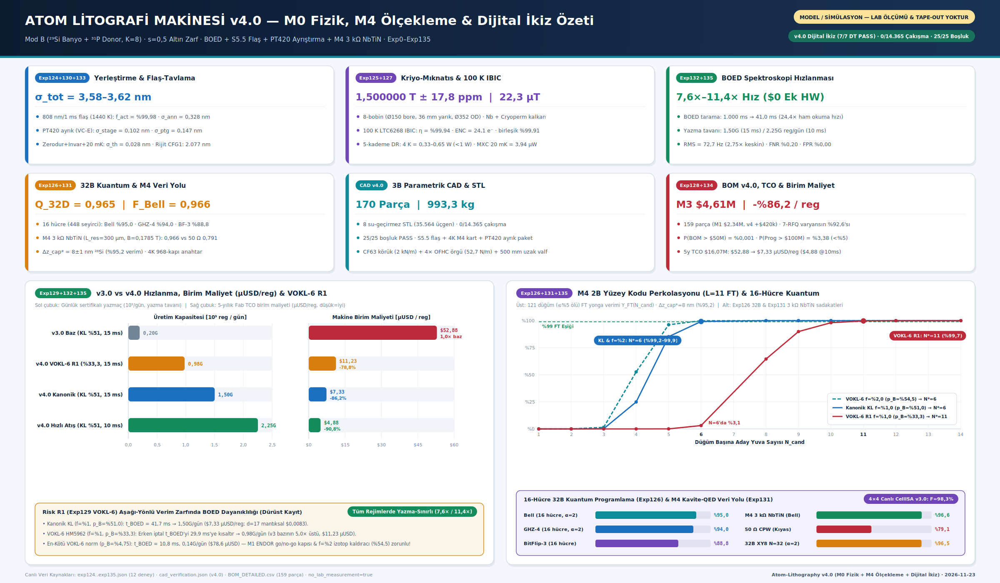
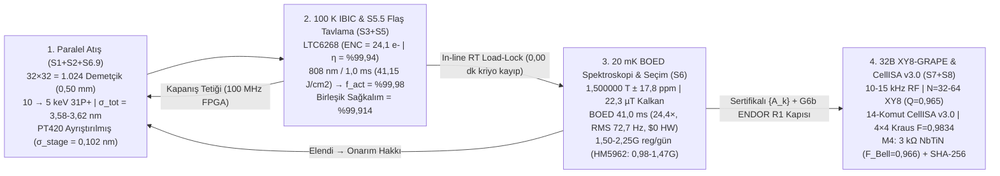
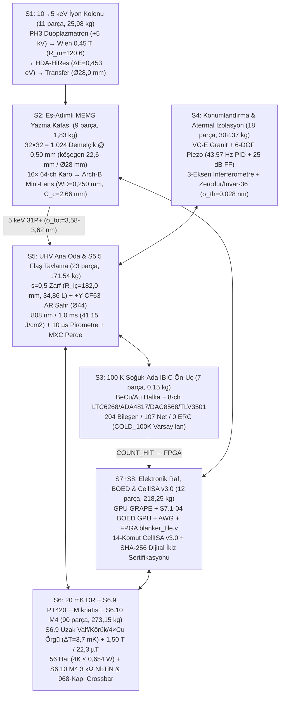
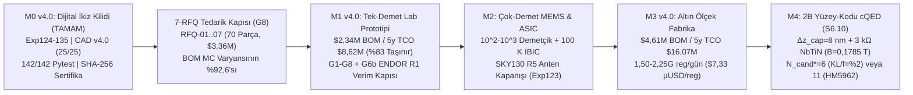
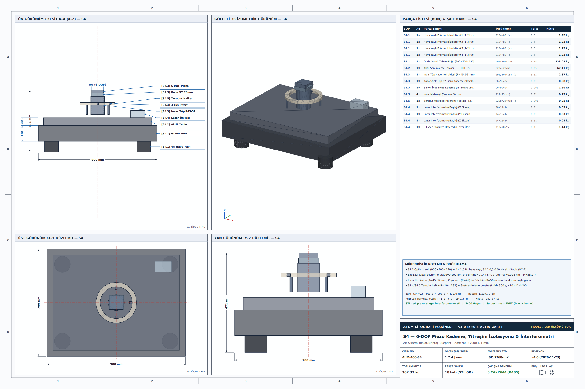
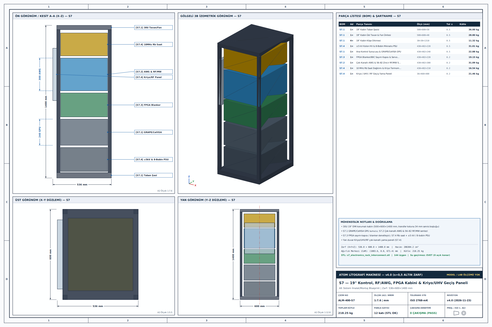
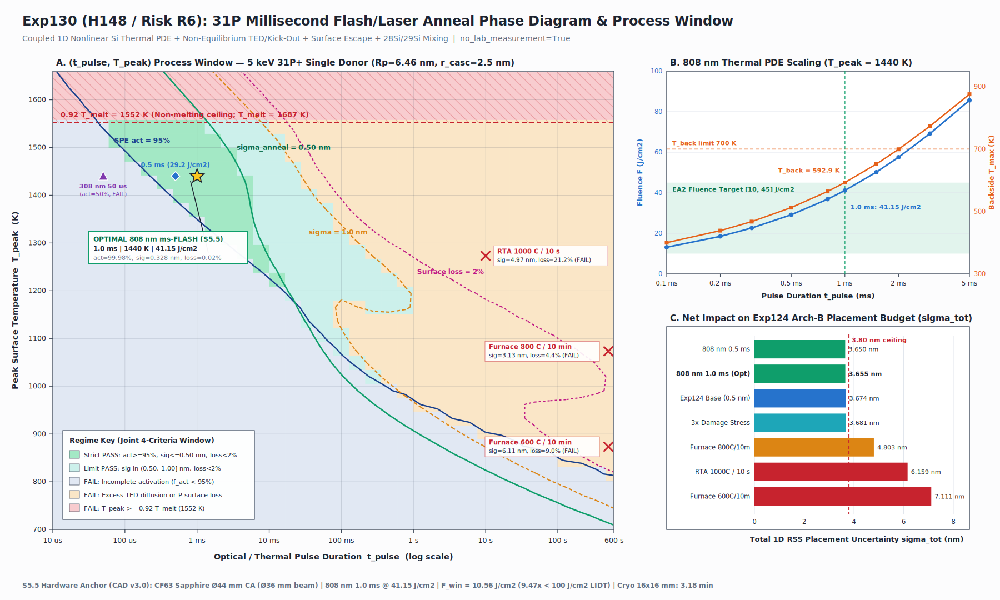
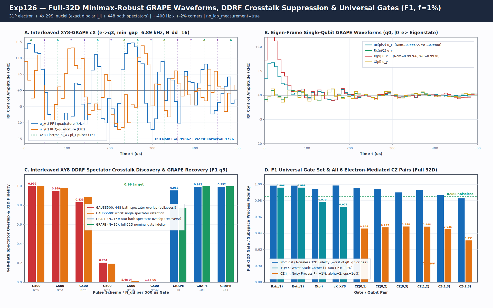
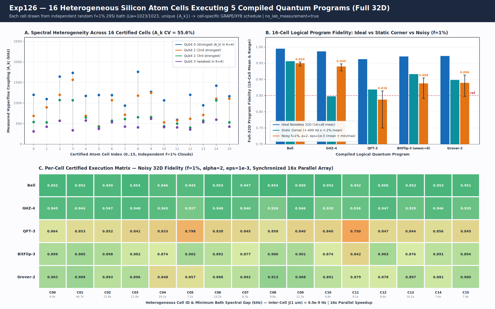
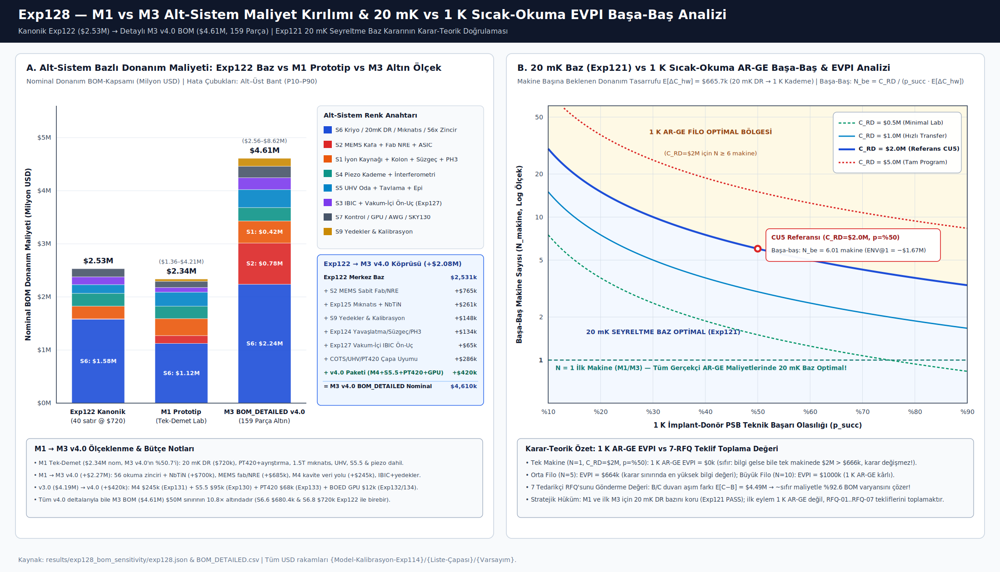

# Atom Litografi Makinesi (`v4.0`) — Silisyumda Programlanabilir Evrensel Atom Yazmacı Fabrikası & Birleşik Dijital İkiz

<p align="center">
  
  
  
  
  
  
</p>

> [!IMPORTANT]
> **Epistemik Durum Uyarısı (`M0` Tasarım, Birinci-İlkeler Fizik & Birleşik Dijital İkiz):** Bu depo, **kâğıt üzerinde tam mühendislik tasarımı, 12 birinci-ilkeler fizik/Hamiltonyen/ekonomi simülasyonu (`Exp124`–`Exp135`), parametrik 3B CAD (`v4.0`), `0`-ERC soğuk-ada IBIC devresi (`COLD_100K`), `BOED` + `CellISA v3.0` kontrol yazılımı ve `159`-parçalı BOM / `7-RFQ` paketi** sunar. **Fiziksel laboratuvar ölçümü, üretilmiş donanım, bağlayıcı tedarikçi teklifi ve silikon tape-out henüz YOKTUR** (`no_lab_measurement=true`, `no_supplier_quotes=true`, `tapeout_done=false`). Tüm deneylerde ön-kayıtlı tahminler hem `PASS` hem de dürüst `FAIL` hükümleriyle (`Exp124, 126, 127, 128, 129, 131, 134`) gizlenmeden raporlanmıştır.

---

### English Executive Abstract

**Atom Lithography Machine (`v4.0`)** is a complete `M0` first-principles engineering design, multiphysics simulation suite, parametric 3D CAD package, `0`-ERC cryogenic front-end, Bayesian adaptive spectroscopy + quantum-control compiler (`BOED` & `CellISA v3.0`), and SHA-256 verified **8-layer unified digital twin (`Exp135`)** for an integrated **single-cryostat atomic register factory** in isotopically engineered silicon (`³¹P` donor + `K = 8` selected `²⁹Si` nuclear spins in an `f = 1%` epitaxial bath, **Mode B baseline** — fully immune to 3D stochastic donor straggle).

Key `v4.0` breakthroughs building on `v3.0` (`Exp124`–`Exp128`) through the 7-experiment upgrade wave (`Exp129`–`Exp135`):
1. **Coupled Placement, Flash Anneal & Vibration Decoupling (`Exp124`, `Exp130`, `Exp133`):** `10 → 5 keV` `Arch-B` (`32×32 = 1,024` beamlets @ `0.50 mm`, `WD = 0.250 mm`) + `HDA-HiRes` (`ΔE = 0.453 eV`) + **`S6.9` `PT420` mechanical/active decoupling** (`500 mm` remote rotary valve, `600 mm` flex He, `k = 2,000 N/m` bellows, `4×` OFHC Cu braids `ΔT = 3.7 mK`, `43.57 Hz` PID + `25 dB` harmonic FF, `Zerodur/Invar-36`: `σ_stage = 0.1024 nm` vs rigid `2,052 nm` failure!) locks combined placement to **`σ_tot = 3.620 nm (15 ms) / 3.578 nm (10 ms)`**. **`S5.5` in-line RT `808 nm / 1.0 ms / 1440.3 K` (`41.15 J/cm²`) flash anneal** closes Risk `R6` in-model (`f_act = 99.98%`, `σ_anneal = 0.328 nm`, loss `0.022%`, combined `IBIC × flash` survival **`99.914%`**).
2. **`BOED` Adaptive Spectroscopy & `CellISA v3.0` (`Exp132`, `$0` extra HW):** 3-stage Bayesian optimal experimental design cuts spectroscopy time from `1,000 ms` to **`41.03 ms`** (`24.37×` raw speedup, `RMS = 72.67 Hz`, `FNR = 0.20%`, `FPR = 0.00%`), driving factory throughput to the write ceiling (**`1.502–2.253×10⁹` registers/day**, **`7.61×–11.42×`**) and slashing 5-year TCO unit cost by **`−86.15% / −90.77%`** (`$52.88 → $7.33 / $4.88 µUSD/register`, `Exp134`/`Exp135`). **`CellISA v3.0`** adds 4 wafer/bus/logical opcodes (`14` total), achieving `4×4` Kraus `F_joint = 0.983448` and `30.3×` logical error suppression (`p_L = 3.65×10⁻⁴`).
3. **Honest Risk `R1` (`VOKL-6`, `Exp129`) & Scalable `M4` cQED Architecture (`Exp131`):** 6-valley central-cell modeling (`VOKL-6`) reveals a real downward Mode B yield risk (**`KL 50.5% → HM5962 33.25%`**, legacy `2.981 MHz` scale `4.75%`), establishing **`M1` Gate `G6b` (`≥64`-donor experimental ENDOR)** as a mandatory go/no-go gate (`Exp135` shows `BOED` still delivers `0.979–1.469×10⁹/day` at `HM5962` `33.25%`, while `M4` `L=11` FT percolation shifts `N_cand* = 6 → 11` or recovers `6` at `f = 2%`). For `M4`, **`Δz_cap* = 8 ± 1 nm`** + **`3 kΩ NbTiN`** (`B_M4 = 0.1785 T`, `968` `4 K` crossbar gates) achieves **`F_Bell = 0.9655`** (`0.359 µs` vs `50 Ω` `0.7908` collapse), honestly requiring `S_ε ≤ 0.25–0.35 µeV/√Hz` or `1/f` echo for `≥0.99`.
4. **Full Verification:** `CAD v4.0` (**`170` parts, `993.27 kg`, `8/8` watertight STL [`35,564` tris, `483.84 L`], `0/14,365` clashes, `25/25` clearances**), `BOM_DETAILED v4.0` (**`159` parts**, `M3 = $4.61M`, `M1 = $2.34M` [`83%` portable, 5y Lab TCO `$8.62M`], `7-RFQ` capturing `92.57%` of `100k`-MC variance, `P(Program > $100M) = 3.38% < 5%`, 5y Fab TCO `$16.07M`), and **`142/142`** standalone Atom Lithography `pytest` tests (`17/17` suites) passing out of the box.

---

## Görsel Genel Bakış (`v4.0` Kapak Dashboard & 3B CAD Montajı)



| İzometrik 3B Makine Önizlemesi (`170` Parça) | Tam Kesit Görünümü (`25/25` Boşluk) | Patlatılmış Alt-Sistem Görünümü (`S1–S7`) |
|---|---|---|
| [](research/atom_lithography_machine/cad/preview_machine.png) | [](research/atom_lithography_machine/cad/drawings/09_atom_litho_cutaway.png) | [](research/atom_lithography_machine/cad/drawings/10_atom_litho_exploded.png) |

---

## Sistem Mimarisi & Mühendislik Diyagramları (`v4.0`)

### 1. 4-Aşamalı Kapalı-Çevrim Atom Yazmacı Fabrikası Döngüsü (`BOED` + `S5.5` + `S6.9`)



### 2. Fiziksel Alt-Sistem Mimarisi (`S1` → `S7`, `CAD v4.0` — `170` Parça, `993,27 kg`)



### 3. Mühendislik Yol Haritası & Risk Kapanış Akışı (`M0 v4.0` → `M4`)



---

## `v3.0 → v4.0` Birleşik Dijital İkiz Karşılaştırması (`Exp135`, `7/7 DT PASS`)

`Exp135` (`results/exp135_v4_digital_twin/v4_digital_twin_cert.json`, `11/11` JSON SHA-256 çapalı, ana özet `feffc1d4ba2b0698c3f61015c6684da47f57ea863a8b3e0da845cc9c71914b57`) 8 fiziksel/ekonomik katmanı tek bir uçtan uca dijital ikizde birleştirir:

| Katman | KPI / Metrik | `v3.0` Baz (`Exp124–128`) | `v4.0` Kilitli (`Exp129–135`) | Değişim / Dürüst Sınır (`no_lab_measurement=true`) |
|---|---|---|---|---|
| **L1 Yerleştirme** | Birleşik `σ_tot` (`15 ms / 10 ms`) | `3,7155 / 3,6740 nm` *(rijit `PT420` = `2.077 nm` RED!)* | **`3,6201 / 3,5776 nm`** (`≤ 3,80 nm`) | `S6.9` `CFG4` (`σ_stage=0,102 nm`, `σ_pointing=0,147 nm`, `σ_thermal=0,028 nm`) |
| **L2 Sağkalım** | `IBIC × S5.5` Flaş Aktivasyon | `IBIC %99,936` (`R6` açıktı) | **`%99,914`** (`f_act=%99,98`, `σ_anneal=0,328 nm`) | Risk `R6` model-içi KAPANDI (`808 nm / 1,0 ms`, `41,15 J/cm²`, kayıp `%0,022`) |
| **L3 Spektroskopi** | Ortalama Süre / Frekans `RMS` | `1.000 ms` / `±200 Hz` | **`41,03 ms` (`24,37×`)** / **`72,67 Hz`** | `BOED` (`$0` ek HW; `FNR=%0,20`, `FPR=%0,00`, `CRLB=58,19 Hz`) |
| **L4 Kapasite (`KL`)** | Sertifikalı Yazmaç/Gün (`f=%1`) | `1,973×10⁸` (okuma-sınırlı) | **`1,502×10⁹ (15 ms) / 2,253×10⁹ (10 ms)`** | **`7,61× / 11,42×`** artış — fabrika artık yazma tavanında |
| **L4 `R1` Dürüst (`VOKL-6`)** | `VOKL-6 HM5962 (%33,25)` / `norm (%4,75)` | Modellenmemişti | **`9,794×10⁸ – 1,469×10⁹`** (`HM5962`) / `1,399×10⁸` (`norm`) | **`HM5962`** `BOED` ile hâlâ `v3-KL`'nin **`4,96×–7,44×`** üstünde; **`M1 G6b`** şart! |
| **L5 & L6 `M4` cQED** | `F_Bell` (`3 kΩ NbTiN`) & `L=11` FT `N_cand*` | Tanımsız (`50 Ω` `0,7908` çöker) | **`F_Bell=0,9655`** (`0,359 µs`); `KL/f=%2 N*=6` | **`Exp131×Exp129`:** `HM5962 f=%1` `N=6`'da `%3,12` çöker → **`N*=11`** (`norm`: `86`); `≥0,99` için `S_ε≤0,25 µeV/√Hz` |
| **L7 5y TCO & Birim** | 5y Fab TCO / Birim Maliyet (`µUSD/reg`) | `$15,23M` / **`$52,88 µUSD/reg`** | `$16,07M` / **`$7,33 (15 ms) / $4,88 (10 ms)`** | **`−%86,15 / −%90,77`** (`HM5962: $11,24 [−%78,75]`; `d=17 = $0,0083 / $0,0055`); `CX4 FAIL`: `²⁸Si` yonga `%92,2` taban |
| **L8 Canlı `4×4` İkiz** | `CellISA v3.0` (`14` komut, Kraus) | `CellISA v2.0` (`10` komut, tek hücre) | **`40,82 ms/yuva`, `F_joint=0,983448`, `min_bus_cz=0,988923`** | `bitflip3_plus_ancilla` **`p_L=3,65×10⁻⁴` (`30,3×` bastırma)**, SHA-256 imzalı |

---

## 7 Alt-Sistem CAD v4.0 / STL / BOM v4.0 / `7-RFQ` Ana Tablosu

| Kod | Alt-Sistem (`CAD v4.0` + `BOM_DETAILED v4.0`) | CAD Parça / Kütle | `M3 v4.0` / `M1 v4.0` BOM (`USD`) | RFQ Paketi | 3B & 2B Artefakt Bağlantıları |
|---|---|---:|---:|---|---|
| **`S1`** | `10→5 keV` İyon Kaynağı, Wien & `HDA-HiRes` | `11` / `25,98 kg` | `$416.000` / `$319.750` | `RFQ-01` (`$398,0k`) | [`.scad`](research/atom_lithography_machine/cad/parts/s1_ion_source_column.scad) · [`.stl`](research/atom_lithography_machine/cad/stl/s1_ion_source_column.stl) · [Çizim `01`](research/atom_lithography_machine/cad/drawings/01_s1_ion_source_column.png) |
| **`S2`** | `32×32` (`0,50 mm`) MEMS Kafa & `Arch-B` | `9` / `1,83 kg` | `$775.500` / `$147.750` | `RFQ-02` (`$661,0k`) | [`.scad`](research/atom_lithography_machine/cad/parts/s2_mems_write_head.scad) · [`.stl`](research/atom_lithography_machine/cad/stl/s2_mems_write_head.stl) · [Çizim `02`](research/atom_lithography_machine/cad/drawings/02_s2_mems_write_head.png) |
| **`S3`** | `100 K` Soğuk-Ada IBIC Ön-Uç (`0` ERC) | `7` / `0,15 kg` | `$224.000` / `$88.550` | `Non-RFQ` / Özel PCB | [`.scad`](research/atom_lithography_machine/cad/parts/s3_ibic_detector_assembly.scad) · [`.stl`](research/atom_lithography_machine/cad/stl/s3_ibic_detector_assembly.stl) · [Çizim `03`](research/atom_lithography_machine/cad/drawings/03_s3_ibic_detector_assembly.png) · [`BOARD.md`](src/board/BOARD.md) |
| **`S4`** | Granit, 6-DOF Piezo, `Zerodur/Invar-36` & İnterf. | `18` / `302,37 kg` | `$253.000` / `$233.920` | `RFQ-03` (`$163,0k`) | [`.scad`](research/atom_lithography_machine/cad/parts/s4_piezo_stage_interferometry.scad) · [`.stl`](research/atom_lithography_machine/cad/stl/s4_piezo_stage_interferometry.stl) · [Çizim `04`](research/atom_lithography_machine/cad/drawings/04_s4_piezo_stage_interferometry.png) |
| **`S5`** | `s=0,5` UHV Oda (`34,86 L`) + **`S5.5` Flaş Tavlama** | **`23`** / **`171,54 kg`** | **`$338.000`** / **`$263.300`** | **`RFQ-07A`** (`S5.5 $95k`) | [`.scad`](research/atom_lithography_machine/cad/parts/s5_uhv_chamber_loadlock.scad) · [`.stl`](research/atom_lithography_machine/cad/stl/s5_uhv_chamber_loadlock.stl) · [Çizim `05`](research/atom_lithography_machine/cad/drawings/05_s5_uhv_chamber_loadlock.png) |
| **`S6`** | `20 mK` DR, `1,50 T / 22,3 µT`, **`S6.9` `PT420`** & **`S6.10` `M4`** | **`90`** / **`273,15 kg`** | **`$2.238.900`** / **`$1.124.300`** | `RFQ-04/05/06` + **`07B/C`** | [`.scad`](research/atom_lithography_machine/cad/parts/s6_cryo_dr_magnet_readout.scad) · [`.stl`](research/atom_lithography_machine/cad/stl/s6_cryo_dr_magnet_readout.stl) · [Çizim `06`](research/atom_lithography_machine/cad/drawings/06_s6_cryo_dr_magnet_readout.png) |
| **`S7–S9`** | Kontrol Rafı, **`BOED` GPU**, `CellISA v3.0` & Sarf | `12` / `218,25 kg` | **`$364.200`** / **`$158.700`** | `Non-RFQ` (`S8` `$0` HW) | [`.scad`](research/atom_lithography_machine/cad/parts/s7_electronics_rack_interconnect.scad) · [`.stl`](research/atom_lithography_machine/cad/stl/s7_electronics_rack_interconnect.stl) · [Çizim `07`](research/atom_lithography_machine/cad/drawings/07_s7_electronics_rack_interconnect.png) · [`src/README.md`](src/README.md) |
| **Toplam** | **Ana Montaj (`ALM-400-00`) & `159` Parça BOM v4.0** | **`170` / `993,27 kg`** | **`$4.609.600` / `$2.336.270`** | **`7-RFQ` (`$3,36M` = `%92,6` MC Var.)** | [Ana `.scad`](research/atom_lithography_machine/cad/atom_litho_machine.scad) · [Ana `.stl`](research/atom_lithography_machine/cad/stl/atom_litho_machine.stl) · [Montaj `08`](research/atom_lithography_machine/cad/drawings/08_atom_litho_assembly.png) · [`BOM_DETAILED.csv`](research/atom_lithography_machine/BOM_DETAILED.csv) |

---

## Dürüst Ön-Kayıtlı Doğrulama Karnesi (`Exp124`–`Exp135` — 12 Deney)

Her deneyde tahminler (`predictions_exp*.json`) hesaplamadan önce dondurulmuş ve başarısız olan (`FAIL`) hipotezler silinmeden kök-nedeniyle kaydedilmiştir:

| Deney | Konu | Ön-Kayıtlı Hükümler | Dürüst `FAIL` Bulguları & Öğretilen Fizik/Mühendislik | Özet & Test |
|---|---|---|---|---|
| **`Exp124`** | `10→5 keV` İyon Kolonu & 3B Donör Saçılması | **`6/8 PASS, 2/8 FAIL`** | **`CD3 FAIL`:** `κ_c ≥ 4,67` → eski `C_c ≤ 0,50 mm` imkânsız (`Arch-B` + `HDA-HiRes` kilitlendi). **`CD7 FAIL`:** `z>0` yüzey kesmesi Holmes verimini `%63,3→%69,5` artırdı. | [`summary_exp124.md`](results/exp124_ion_column_optics/summary_exp124.md) · [`test_exp124.py`](tests/test_exp124.py) (`6/6`) |
| **`Exp125`** | `1,50 T / 22,3 µT` Mıknatıs, Termal & `R8` | **`6/6 PASS, 0 FAIL`** | Tümü geçti (`CV1–CV6`); `R7` manyetik ayrıştırma kapatıldı (`22,3 µT`, `64,6 K` quench), `1 K` Mod B `3,40×` yavaş. | [`summary_exp125.md`](results/exp125_cryo_magnet_readout/summary_exp125.md) · [`test_exp125.py`](tests/test_exp125.py) (`11/11`) |
| **`Exp126`** | 32B CUDA `XY8`-GRAPE & 16-Hücre Program | **`5/8 PASS, 3/8 FAIL`** | **`P126_1,2,3 FAIL`:** `6,89 kHz` `q3` köşesi `0,9726`, `CZ(2,3) 0,9828`, `1/8` MC sapması `0,0592`. **Risk `R3` KAPANDI (`P126_4..8 PASS`)**; `N=128` DDRF duvarı keşfedildi. | [`summary_exp126.md`](results/exp126_atom_cell_programming/summary_exp126.md) · [`test_exp126.py`](tests/test_exp126.py) (`8/8`) |
| **`Exp127`** | `100 K` Soğuk-Ada IBIC & `CellISA v2.0` | **`4/6 PASS, 2/6 FAIL`** | **`CZ3,4 FAIL`:** Gerçek Lindhard `5 keV` yükü RT `200 ns`'yi çökertti (`η = %9,7`) → **`COLD_100K` (`1,2 µs / 1 GΩ`, `η = %99,94`)** zorunlu kılındı. | [`summary_exp127.md`](results/exp127_detector_frontend_sim/summary_exp127.md) · [`test_detector_frontend.py`](tests/test_detector_frontend.py) (`6/6`) |
| **`Exp128` (`v4.0`)** | `159` Parça BOM v4.0, `7-RFQ` & 100k MC / EVPI | **`5/6 PASS, 1/6 FAIL`** | **`CU4 FAIL`:** `7-RFQ` nominal payı `%72,9 < %75` (fakat MC varyansının **`%92,57`'sini** yakalar). `P(>100M) = %3,38 < %5`, `EVPI@N=1 = $0` (`N_be=6,01`). | [`summary_exp128.md`](results/exp128_bom_sensitivity/summary_exp128.md) · [`test_bom_detailed.py`](tests/test_bom_detailed.py) (`7/7`) |
| **`Exp129`** | `VOKL-6` 6-Vadi Merkez-Hücre (`R1`) | **`3/7 PASS, 4/7 FAIL`** | **`CE3,4,6,7 FAIL`:** `R331=%64,73` (Si `3d`/DFT gerekir); `f=%1` verim `KL %50,5 → HM5962 %33,25` (`norm %4,75`), `min_gap < 6,89 kHz` `%57,9–%73,7` → **`M1 G6b` şart!** | [`summary_exp129.md`](results/exp129_valley_orbital_hyperfine/summary_exp129.md) · [`test_exp129.py`](tests/test_exp129.py) (`6/6`) |
| **`Exp130`** | `S5.5` `808 nm / 1,0 ms` Flaş Tavlama (`R6`) | **`6/6 PASS, 0 FAIL`** | Tümü geçti (`EA1–EA6`); fırın/RTA yasaklandı, **`f_act=%99,98`, `σ_anneal=0,328 nm`, kayıp `%0,022`** ile Risk `R6` model-içi KAPANDI. | [`summary_exp130.md`](results/exp130_flash_anneal_diffusion/summary_exp130.md) · [`test_exp130.py`](tests/test_exp130.py) (`7/7`) |
| **`Exp131`** | `M4` `3 kΩ NbTiN` cQED & 2B Perkolasyon | **`4/7 PASS, 3/7 FAIL`** | **`CM3,4,6 FAIL`:** `3 kΩ NbTiN` `F_Bell=0,9655` (`Δz_cap*=8±1 nm`, `50 Ω` `0,7908` çöker), ancak `≥0,99` için **`S_ε ≤ 0,25–0,35 µeV/√Hz`** şart; Heavy-Hex `N=4` `%98,35` (2B Kare `−%40` aday ucuz). | [`summary_exp131.md`](results/exp131_scalable_m4_architecture/summary_exp131.md) · [`test_exp131.py`](tests/test_exp131.py) (`7/7`) |
| **`Exp132`** | `BOED` Spektroskopi & `CellISA v3.0` | **`6/6 PASS, 0 FAIL`** | Tümü geçti (`DA1–DA6`); **`41,03 ms` (`24,37×` ham, `RMS=72,67 Hz`, `$0` HW)** → `7,61×–11,42×` hız; `CellISA v3.0` (`14` komut) `4×4` Kraus `F_joint=0,9834`. | [`summary_exp132.md`](results/exp132_bayesian_spectroscopy_cellisa3/summary_exp132.md) · [`test_exp132.py`](tests/test_exp132.py) (`6/6`) |
| **`Exp133`** | `S6.9` `PT420` Titreşim/FEM/Termal Ayrıştırma | **`8/8 PASS, 0 FAIL`** | Tümü geçti (`CY1–CY8`); rijit `PT420` `2.052 nm` çöker → **`S6.9 CFG4`** + `Zerodur/Invar-36` ile **`σ_stage=0,102 nm`, `σ_pointing=0,147 nm`, `σ_thermal=0,028 nm`**. | [`summary_exp133.md`](results/exp133_coupled_vibration_thermal/summary_exp133.md) · [`test_exp133.py`](tests/test_exp133.py) (`12/12`) |
| **`Exp134`** | 5y TCO, Birim Ekonomi & Wright Öğrenme | **`5/6 PASS, 1/6 FAIL`** | **`CX4 FAIL`:** yoğun `M4` çipte makine payı `−%67` düşer, ancak `$2,40/çip` `²⁸Si` epi yonga `%92,2` taban koyar (`−%13,7 < %50`). Kapasite rejimi: **`−%86/89,5` birim maliyet**. | [`summary_exp134.md`](results/exp134_fab_economics_tco/summary_exp134.md) · [`test_exp134.py`](tests/test_exp134.py) (`7/7`) |
| **`Exp135`** | 8-Katmanlı Birleşik `v4.0` Dijital İkiz | **`7/7 PASS, 0 FAIL`** | Tümü geçti (`DT1–DT7`); `11/11` JSON SHA-256 bağlı (`feffc1d4...`), `Exp131 × Exp129` `N_cand*` (`6` vs `11` vs `86`) çarpışmasını nicelendirdi. | [`summary_exp135.md`](results/exp135_v4_digital_twin/summary_exp135.md) · [`test_exp135.py`](tests/test_exp135.py) (`6/6`) |

---

## Teknik Çizim & Fizik Grafik Galerisi (`8` CAD Paftası + `25` Fizik Grafiği)

<details>
<summary><strong>📐 7 Alt-Sistem Mühendislik Paftaları & Ana Montaj (`CAD v4.0` — 8 Adet 2400×1600 PNG + SVG)</strong></summary>

| `S1` İyon Kolonu (`ALM-400-S1`) | `S2` MEMS Yazma Kafası (`ALM-400-S2`) |
|---|---|
|  |  |
| **`S3` Soğuk-Ada IBIC (`ALM-400-S3`)** | **`S4` Piezo & İnterferometri (`ALM-400-S4`)** |
|  |  |
| **`S5` UHV + `S5.5` Flaş Tavlama (`ALM-400-S5`)** | **`S6` DR, `S6.9` `PT420`, Mıknatıs & `M4` (`ALM-400-S6`)** |
|  |  |
| **`S7` Elektronik Raf (`ALM-400-S7`)** | **Ana Montaj (`ALM-400-00`)** |
|  |  |

</details>

<details>
<summary><strong>🚀 v4.0 Gece Dalgası Fizik, `M4`, `BOED`, `PT420`, TCO & Dijital İkiz Grafikleri (13 Yeni Exp129–Exp135 PNG)</strong></summary>

| `Exp129` `VOKL-6` 6-Vadi ENDOR Kabukları (`R1`) | `Exp129` `VOKL-6` vs `KL` Mod B Verim & Aralık |
|---|---|
|  |  |
| **`Exp130` `S5.5` Ergimesiz Flaş Tavlama Penceresi (`R6`)** | **`Exp130` TED Difüzyon Profilleri & Kayıp Karşılaştırması** |
|  |  |
| **`Exp131` `M4` `3 kΩ NbTiN` vs `50 Ω` cQED Sadakati** | **`Exp131` 2B Kare vs Heavy-Hex Perkolasyon** |
|  |  |
| **`Exp132` `BOED` `24,4×` Uyarlamalı Spektroskopi Hızlanması** | **`Exp132` `4×4` Yonga Yönlendirme & `CellISA v3.0`** |
|  |  |
| **`Exp133` `PT420` Birleşik PSD & Kolon Titreşim Bütçesi** | **`Exp133` `CFG1` vs `CFG4` İzolasyon & Termal Sürüklenme** |
|  |  |
| **`Exp134` 5y TCO & Birim Kübit Ekonomisi** | **`Exp134` `v3.0` vs `v4.0` Ölçekleme & Wright Öğrenme** |
|  |  |

| **`Exp135` 8-Katmanlı Birleşik `v4.0` Dijital İkiz Panosu (SHA-256 Doğrulamalı)** |
|---|
|  |

</details>

<details>
<summary><strong>📊 v3.0 Temel Fizik, 32B GRAPE, IBIC & 100k MC Maliyet Grafikleri (12 Adet Exp124–Exp128 PNG)</strong></summary>

| `Exp124` Optik Zarf & Scherzer Sınırı | `Exp124` 3B Anizotropik & Stokastik Donör Verimi |
|---|---|
|  |  |
| **`Exp125` `1,50 T / 22,3 µT` Manyetik Alan Haritası** | **`Exp125` 5-Kademe Termal, RF SNR & `R8` Koiller** |
|  |  |
| **`Exp126` 32B GRAPE Darbeleri & DDRF Kurtarma** | **`Exp126` İç-İçe `XY8` vs `Exp63` & `CPMG`** |
|  |  |
| **`Exp126` 16 Heterojen Hücre × 5 Kuantum Programı** | **`Exp127` IBIC Blok Şeması (`COLD_100K`, `0` ERC)** |
|  |  |
| **`Exp127` Sonlu-GBP Bode & Zaman-Domeni Yanıtı** | **`Exp127` Lindhard ENC & 50k MC Algılama Verimi** |
|  |  |
| **`Exp128` `M1` vs `M3` Maliyet & `7-RFQ` Kırılımı** | **`Exp128` 100k MC Tornado & Kümülatif Dağılım (CDF)** |
|  |  |

</details>

---

## Hızlı Kurulum, Doğrulama (`142/142 pytest`) ve Okuma Sırası

### Kurulum & Tam Test Koşumu

```bash
git clone https://github.com/berkmec/Atom-Lithography.git
cd Atom-Lithography
python3 -m venv .venv && source .venv/bin/activate
pip install -r requirements.txt

# Tüm 17 Atom Litografi test paketi (142/142 PASS):
PYTHONPATH=src pytest -v
```

### İsteğe Bağlı Yeniden Üretim Komutları

```bash
# 1. CellISA v3.0 + BOED (--preset v400) fabrika & GRAPE program demosu:
PYTHONPATH=src python3 -m machine_control.sim --slots 4000 --preset v400 --program bell --program-mode grape

# 2. COLD_100K 0-ERC KiCad netlist & SPICE destesi doğrulaması:
python3 src/board/detector_frontend.py

# 3. Parametrik CAD v4.0 STL + doğrulama JSON + v4.0 dashboard yeniden üretimi:
python3 research/atom_lithography_machine/cad/gen_scad.py
python3 research/atom_lithography_machine/cad/gen_stl.py
python3 research/atom_lithography_machine/cad/gen_dashboard.py

# 4. 159-parçalı BOM v4.0 + Exp128 100k MC + Exp135 Birleşik Dijital İkiz doğrulaması:
python3 experiments/exp128_bom_sensitivity/build_bom_detailed.py
python3 experiments/exp128_bom_sensitivity/run_exp128.py
python3 experiments/exp135_v4_digital_twin/run_exp135.py
```

### Önerilen Dokümantasyon Okuma Sırası

1. **[`DESIGN.md`](research/atom_lithography_machine/DESIGN.md)** — Ana mimari tasarım belgesi (`v4.0`, Risk Kapanış Matrisi & sürüm günlüğü).
2. **[`TECHNICAL_MANUAL.md`](research/atom_lithography_machine/TECHNICAL_MANUAL.md)** — 9 bölümlü kapsamlı fizik, kriyo-mıknatıs, IBIC, `CellISA v3.0`/32B GRAPE, `CAD v4.0`, `BOM v4.0`/`7-RFQ`, `Exp129–135` ve EHS el kitabı.
3. **[`MODULAR.md`](research/atom_lithography_machine/MODULAR.md)** — `M1`–`M8` modüler arayüz kontrol belgesi (`v4.0-ICD`) ve dondurulmuş kontratlar.
4. **[`M1_PROTOTYPE_BLUEPRINT.md`](research/atom_lithography_machine/M1_PROTOTYPE_BLUEPRINT.md)** — `$2,34M` (`5y Lab TCO $8,62M`, `%83` `M3`'e taşınabilir) ilk laboratuvar prototipi ve **`G1`–`G8` + `G6b` `ENDOR` `R1`** kapıları.
5. **[`BOM_ENGINEERING.md`](research/atom_lithography_machine/BOM_ENGINEERING.md)** & **[`RFQ_SPECIFICATIONS.md`](research/atom_lithography_machine/RFQ_SPECIFICATIONS.md)** — `159` parçalı BOM mühendisliği ve `%92,57` MC varyansını kapsayan **7 tedarikçi RFQ** şartnamesi.
6. **[`PROJECT_DOSSIER.md`](research/atom_lithography_machine/PROJECT_DOSSIER.md)** — `Exp0`–`Exp135` uçtan uca proje arşivi, `Exp123` SKY130 erteli EDA borcu ve doğrulanmış nicel sicil.
7. **[`LITERATURE.md`](research/atom_lithography_machine/LITERATURE.md)** & **[`hypotheses.md`](research/hypotheses/hypotheses.md)** — Birincil literatür/patent çapaları ve **`H1`–`H153`** tam hipotez günlüğü.
