# Atom Litografi Makinesi (`v6.0`) — Tek-Kriyostatlı `108L` `qLDPC` Atom Yazmacı Fabrikası, Modüler `Option-Q/HPC` & Canlı IBM QPU Doğrulamalı Master Dijital İkiz

<p align="center">
  
  
  
  
  
  
</p>

> [!IMPORTANT]
> **Epistemik Ayrım (Kristal Netlik):**
> - **Silikon `³¹P` fabrikasyon, `CAD v6.0`, `BOM v6.0`, `M1–M4` makine fiziği ve `auto_recal.py` (`Exp124`–`Exp146`):** Tam `M0` mühendislik tasarımı, 23 birinci-ilkeler fizik/Hamiltonyen/qLDPC/ekonomi simülasyonu ve EDA doğrulamasıdır (**`no_lab_measurement=true`, `no_supplier_quotes=true`, `tapeout_done=false`**). Fiziksel silikon atom yazıcı/örnek veya tedarikçi teklifi henüz yoktur; tüm dürüst `FAIL` hükümleri (`Exp124, 126, 127, 129, 131, 134, 136, 137, 138, 139, 142, 143`) gizlenmeden raporlanmıştır.
> - **Kontrol yığını (`CellISA v4.0 → OpenQASM 3.0`), `Echo/XY4` DD, `d=3` sendrom dekoderi ve bit-kesin `Q16.16` BOED (`Exp145`):** **Gerçek `156`-kübitlik `ibm_marrakesh` (IBM Heron r2, `job_id = dc1tdo2nj2vs73dfrfl0`, `16 PUB × 4.096 shot`, `32,54 s`) süperiletken bulut QPU üzerinde canlı olarak doğrulanmıştır** (`{Canlı-Donanım-IBM-QPU}`, `SECRET_LEAKS = 0`).

---

### English Executive Abstract

**Atom Lithography Machine (`v6.0`)** is a complete `M0` first-principles engineering design, 23-experiment multiphysics / fault-tolerant QEC / qLDPC simulation suite (`Exp124`–`Exp146`), parametric 3D CAD package (`199` parts, `1,108.14 kg`, `40/40` clearances), modular `174`-part BOM (`9-RFQ`), `0`-ERC cryogenic IBIC front-end, `CellISA v4.0` (`20` opcodes) + `auto_recal.py` + **live `156`-qubit `ibm_marrakesh` (IBM Heron r2) cloud QPU control/decoder/BOED verification**, and SHA-256 locked **Master `v6.0` Digital Twin (`Exp146`, `24/24` + live QPU artifacts cryptographically sealed)**.

Key `v6.0` breakthroughs (`Exp142`–`Exp146`) compressing `100L` fault-tolerant silicon quantum computing from `679` cryostats (`$14.94M/L`) down to **1 single cryostat (`$63.8k/L`)**:
1. **`[[144,12,12]]` Gross Code `qLDPC` Single-Cryostat Revolution (`Exp144`, `7/7 PASS`):** Thickness-2 Bivariate Bicycle `qLDPC` embeds onto the existing `300 µm` `3 kΩ NbTiN` `M4` bus at `P_cell = 20 µm` (**`L_max = 268.3 µm ≤ 300 µm`**, **zero resonator redesign!**). Under `f* = 1.5% + 2 MV/m, N_cand = 8`, block yield hits **`99.64%`** (`99.94%` `108L` wafer yield), circuit threshold **`p_th = 0.633%`**, and `D3+` reaches `2.1×10⁻⁵/1L` (`5.2×` lower error, `10.0×` fewer cells vs `d=11` SC). Up to **`120L`** fit inside **one `LD400` cryostat** (`108L = 1` cryostat → **`$63,827/L_sys`, `234×` cheaper vs `v5 D2`**, `W3` SOI fab **`$0.0085/L_fab`**).
2. **`D3` `K=8` Fourier GRAPE `M4` Gate & `Option-HPC` `100G` RDMA Decoder (`Exp143`, `4/7 PASS`):** `0.894 µs` (cons.) / `1.126 µs` (echoed) `≤ 300 MHz` Fourier GRAPE reaches echoed **`p_2q = 0.395%`** (`Q=1e6, S=0.390`) and **`p_2q = 0.337%`** (`S=0.25`, `F_avg = 99.73%`, `F_Bell = 99.69%`; conservative high-g `0.481%`), driving live `Exp138` MWPM to **`Λ_D3_phys = 2.825`** (`100L` SC fleet `679 → 100` cryostats). Plug-in **`Option-HPC`** (`$132k / 64.0 kg / 2,195 W`, `0 W` cryo): `τ_ingest = 777 ns`, `d=37 SC 6.34 µs < 6.70 µs`, **`qLDPC 108L 2.32 µs < 2.62 µs`** backlog-free in one `4U` node pair.
3. **`Option-Q` Superconducting `qRAM` Bridge & `S1-Multi` Platform (`Exp142`, `5/7 PASS`):** `5`-section Chebyshev `50 Ω ↔ 3 kΩ` (`IL = 0.0004 dB, BW = 5.20 GHz`), **`F_SWAP_rt = 0.9858`**, **`8,403×` (`1 s DD`) – `25,122×` (`3 s`)** memory lifetime gain at **`+0.78 µW @ 20 mK`**; `S1-Multi` delivers `10 km` `¹⁶⁷Er` (`1536 nm`) at **`1,352.3 Hz` (`F = 0.9474`)** and `7.5 keV ¹²¹Sb` `−41.5%` sharper straggle (`+$168k / +9.20 kg`).
4. **Live `156Q` `ibm_marrakesh` Hardware Execution, `CellISA v4.0` & `auto_recal.py` (`Exp145`, `7/7 PASS`):** Pure-`requests` (zero-`qiskit`) IBM Quantum Platform 2026 bridge executed `CellISA v4.0 → OpenQASM 3.0` on live **`ibm_marrakesh`** (`job_id = dc1tdo2nj2vs73dfrfl0`, `[2,3,4,5,6]`, `16 PUB × 4,096 shots`, `32.54 s`, `0` secrets): Bare `0.3325` → **Echo `0.9224` (`+59.0 pp`)** → **XY4 `0.9280` (`+59.5 pp`)**, Bell **`0.9733`**, `d=3` `p_phys = 2.96% →` **MWPM `0.57%` (`5.16×`) / majority `0.38%` (`7.83×`) / postsel `0.00%`**, and bit-exact **`Q16.16 BOED`** `3`-point `120.11 kHz` (**`1.6 Hz` vs FP64**). `auto_recal.py` passes **`4/4`** autonomous fault-recovery modes (`{Model}`).
5. **Modular `CAD/BOM v6.0` & Verification (`Exp128 v6.0`, `Exp146`, `252/252` `pytest`):** Preserves `M1 Base = $2.466M` and `M3 Base = $5.248M`, adds modular `Option-Q (+$168k)` + `Option-HPC (+$132k)` → **`M3 Full = $5.548M`** (`174` parts, `9-RFQ = 77.7%` nom / `92.6%` MC var, `P(Prog > $100M) = 4.92% < 5%`, `0.000 kg` mass parity with **`CAD v6.0` `199` parts / `1,108.14 kg` / `0/19,701` clashes / `40/40` clearances**), verified by **`252/252`** standalone Atom Lithography `pytest` tests (`28/28` suites).

---

## Görsel Genel Bakış (`v6.0` Kapak Dashboard & 3B CAD Montajı)

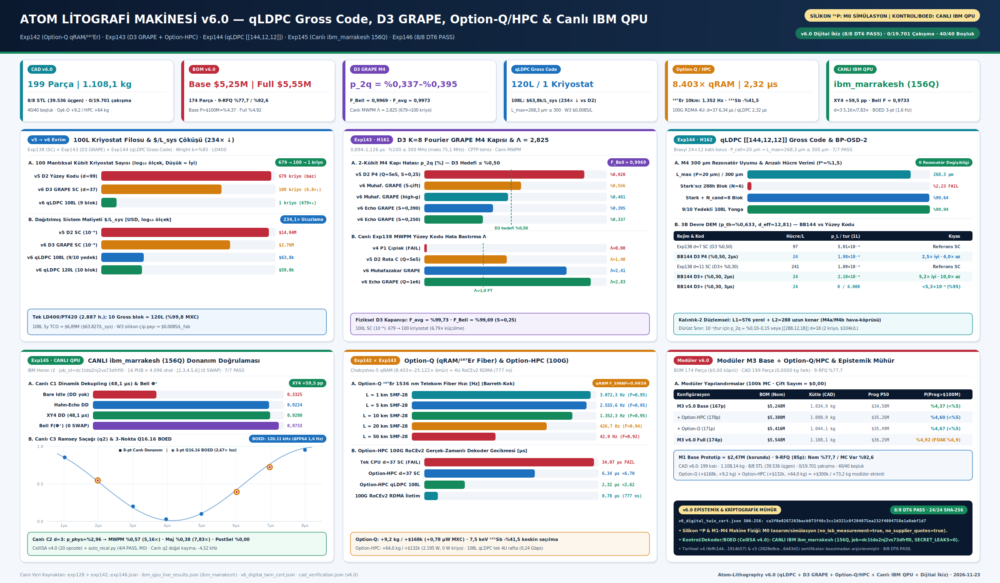

| İzometrik 3B Makine Önizlemesi (`199` Parça) | Tam Kesit Görünümü (`40/40` Boşluk) | Patlatılmış Alt-Sistem Görünümü (`S1–S7` + `Option-Q/HPC`) |
|---|---|---|
| [](research/atom_lithography_machine/cad/preview_machine.png) | [](research/atom_lithography_machine/cad/drawings/09_atom_litho_cutaway.png) | [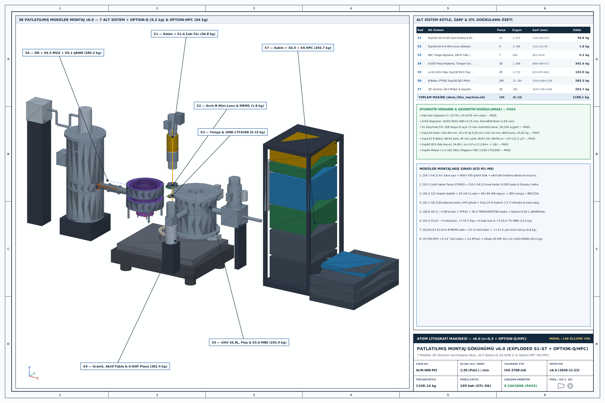](research/atom_lithography_machine/cad/drawings/10_atom_litho_exploded.png) |

---

## Sistem Mimarisi & Mühendislik Diyagramları (`v6.0`)

### 1. Uçtan Uca Hata-Toleranslı Fabrika, `qLDPC` & Canlı IBM QPU Döngüsü (`CellISA v4.0`)

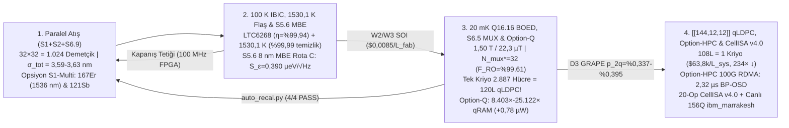

### 2. Modüler Alt-Sistem Mimarisi (`CAD v6.0` — `199` Parça, `1.108,14 kg`, `40/40` Boşluk)

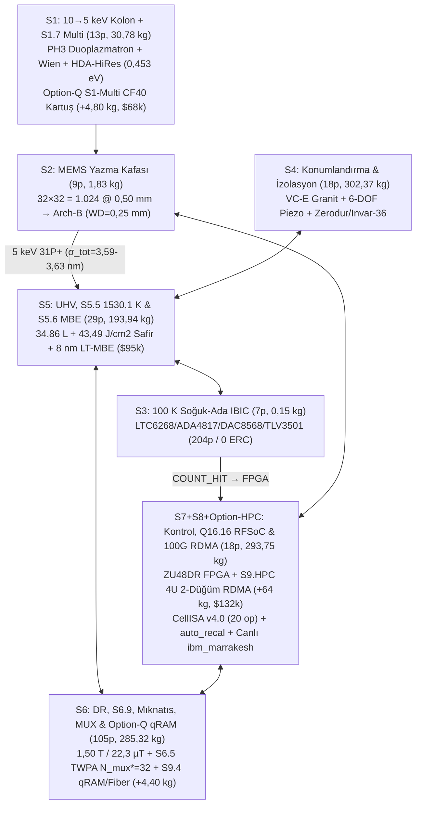

### 3. `v5 D2` → `v6 D3` → `v6 qLDPC` Kriyostat & Maliyet Sıkıştırma Yolu (`234×` ↓)

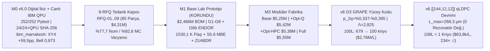

---

## `v3.0 → v4.0 → v5.0 → v6.0` Master Birleşik Dijital İkiz Karşılaştırması (`Exp146`, `8/8 DT6 PASS`)

- **Master `v6.0` Kriptografik Sertifika (`Exp146`, `results/exp146_v6_digital_twin/v6_digital_twin_cert.json`, `24/24` + Canlı QPU `SHA-256` kilitli):**  
  `SHA-256 = ca3f0e0267263bacb973f46c3cc2d321c0f204075ea232f4094758e1a9abf1d7`
- **Canlı IBM QPU (`ibm_marrakesh`) Ham Sayım Defteri (`results/exp145_cloud_qpu_ibm_validation/ibm_qpu_live_results.json`):**  
  `SHA-256 = 02b7a19d1704662c6424e76f4971e21b04a98d48230a917c9682853b3ca1fc5a`
- **Korunan Tarihsel Sertifikalar:**
  - `v5.0` (`Exp141`, `v5_digital_twin_cert.json`): `2828e8ce8d9388f7cba5490b2d05add930aadc5fe6d3ba4295f0380f816d43d1`
  - `v4.0` (`Exp135`, `v4_digital_twin_cert.json`): `feffc1d4ba2b0698c3f61015c6684da47f57ea863a8b3e0da845cc9c71914b57`

| Katman | `v3.0` (`Exp124–128`) | `v4.0` (`Exp129–135`) | `v5.0` Base (`Exp136–141`) | **`v6.0` Full (`Exp142–146`)** |
|---|---|---|---|---|
| **Yerleştirme & Süreç** | `3,716 / 3,674 nm` | `3,620 nm` *(1440 K TED `3,963` FAIL!)* | `3,631 / 3,588 nm` (`1530,1 K` + `S5.6`) | **`3,631 / 3,588 nm`** + `S1-Multi` (`¹⁶⁷Er`/`¹²¹Sb`) |
| **`M4` 2Q Kapı & Eşik** | `50 Ω` `0,791` | `3 kΩ` `0,9655` (`P1 Λ=0`) | `P4` `p_err=%0,92`, `D2 Λ=1,40` | **`D3` `K=8` GRAPE `p_2q=%0,337–%0,395`, `F_Bell=0,9969`, `Λ=2,825`** |
| **FT Kod & `100L` Kriyo** | Eşik üstü | Eşik üstü (`Λ < 1`) | SC `d=99`: `679` kriyo (`D3`: `100`) | **`[[144,12,12]]` `qLDPC` `L_max=268,3 µm`: `108L = 1` kriyo (`679×` ↓)** |
| **`$/L_fab` & `$/L_sys`** | `$52,88 µUSD/reg` | `$7,33 µUSD/reg` (`CX4 FAIL`) | `W3` `$5,20` / `$14,94M` (`D3`: `$2,76M`) | **`W3` `$0,0085/L_fab` / `$63.827/L_sys` (`234×` ↓!)** |
| **Bellek & Dekoder** | Yalnız `³¹P` | `BOED` `41 ms` FP64 | `Q16.16` `2,34 µs`, `N_mux*=32` | **`Option-Q` `8.403×–25.122×` `qRAM` + `Option-HPC` `2,32 µs` `BP-OSD`** |
| **Kontrol & Donanım** | `CellISA v2.0` (`10` op) | `CellISA v3.0` (`14` op) | `CellISA v3.5` (`17` op) | **`CellISA v4.0` (`20` op) + `auto_recal` + CANLI `156Q` `ibm_marrakesh`** |
| **CAD / BOM / `pytest`** | `143p` / `$4,19M` / `89` | `170p` / `$4,61M` / `142` | `189p` / `$5,25M` / `198` | **`199p` (`40/40`) / `$5,25M` Base · `$5,55M` Full (`9-RFQ`) / `252/252`** |

---

## 7 Alt-Sistem `CAD v6.0` / STL / Modüler `BOM v6.0` / `9-RFQ` Ana Tablosu

| Kod | Alt-Sistem (`CAD v6.0` + `BOM_DETAILED v6.0`) | CAD Parça / Kütle | `M3 v6.0 Full` / `M1 Base` (`USD`) | RFQ Paketi | 3B & 2B Artefakt Bağlantıları |
|---|---|---:|---:|---|---|
| **`S1`** | `10→5 keV` Kolon & **`S1.7` `S1-Multi`** | **`13`** / **`30,78 kg`** | **`$484.000`** *(Base `$416k`)* / `$319.750` | `RFQ-01` + **`09`** (`$68k`) | [`.scad`](research/atom_lithography_machine/cad/parts/s1_ion_source_column.scad) · [`.stl`](research/atom_lithography_machine/cad/stl/s1_ion_source_column.stl) · [Çizim `01`](research/atom_lithography_machine/cad/drawings/01_s1_ion_source_column.png) |
| **`S2`** | `32×32` (`0,50 mm`) MEMS Kafa & `Arch-B` | `9` / `1,83 kg` | `$775.500` / `$147.750` | `RFQ-02` (`$661,0k`) | [`.scad`](research/atom_lithography_machine/cad/parts/s2_mems_write_head.scad) · [`.stl`](research/atom_lithography_machine/cad/stl/s2_mems_write_head.stl) · [Çizim `02`](research/atom_lithography_machine/cad/drawings/02_s2_mems_write_head.png) |
| **`S3`** | `100 K` Soğuk-Ada IBIC Ön-Uç (`0` ERC) | `7` / `0,15 kg` | `$224.000` / `$88.550` | `Non-RFQ` / Özel PCB | [`.scad`](research/atom_lithography_machine/cad/parts/s3_ibic_detector_assembly.scad) · [`.stl`](research/atom_lithography_machine/cad/stl/s3_ibic_detector_assembly.stl) · [Çizim `03`](research/atom_lithography_machine/cad/drawings/03_s3_ibic_detector_assembly.png) · [`BOARD.md`](src/board/BOARD.md) |
| **`S4`** | Granit, 6-DOF Piezo, `Zerodur/Invar-36` & İnterf. | `18` / `302,37 kg` | `$253.000` / `$233.920` | `RFQ-03` (`$163,0k`) | [`.scad`](research/atom_lithography_machine/cad/parts/s4_piezo_stage_interferometry.scad) · [`.stl`](research/atom_lithography_machine/cad/stl/s4_piezo_stage_interferometry.stl) · [Çizim `04`](research/atom_lithography_machine/cad/drawings/04_s4_piezo_stage_interferometry.png) |
| **`S5`** | UHV (`34,86 L`), `S5.5` `1530,1 K` & `S5.6` MBE | `29` / `193,94 kg` | `$433.000` / `$358.300` | `RFQ-07A` + `08` (`$95k`) | [`.scad`](research/atom_lithography_machine/cad/parts/s5_uhv_chamber_loadlock.scad) · [`.stl`](research/atom_lithography_machine/cad/stl/s5_uhv_chamber_loadlock.stl) · [Çizim `05`](research/atom_lithography_machine/cad/drawings/05_s5_uhv_chamber_loadlock.png) |
| **`S6`** | DR, `S6.9`, Mıknatıs, `M4`, `S6.5` MUX & **`S9.4` qRAM** | **`105`** / **`285,32 kg`** | `$2.794.100` *(+`S9.4 $100k`)* / `$1.171.150` | `RFQ-04..08` + **`09`** | [`.scad`](research/atom_lithography_machine/cad/parts/s6_cryo_dr_magnet_readout.scad) · [`.stl`](research/atom_lithography_machine/cad/stl/s6_cryo_dr_magnet_readout.stl) · [Çizim `06`](research/atom_lithography_machine/cad/drawings/06_s6_cryo_dr_magnet_readout.png) |
| **`S7–S9`** | Kontrol, RFSoC, `CellISA v4.0`, **`Option-Q`/`HPC`** & Sarf | **`18`** / **`293,75 kg`** | **`$584.200`** *(Base `$352,2k`)* / `$146.700` | `Non-RFQ` + **`RFQ-09`** | [`.scad`](research/atom_lithography_machine/cad/parts/s7_electronics_rack_interconnect.scad) · [`.stl`](research/atom_lithography_machine/cad/stl/s7_electronics_rack_interconnect.stl) · [Çizim `07`](research/atom_lithography_machine/cad/drawings/07_s7_electronics_rack_interconnect.png) · [`src/README.md`](src/README.md) |
| **Toplam** | **Ana Montaj (`ALM-600-00`) & `174` Parça BOM v6.0** | **`199` / `1.108,14 kg`** | **`$5.547.800` Full (`$5.247.800` Base) / `$2.466.120` M1** | **`9-RFQ` (`%77,7` / `%92,6` MC)** | [Ana `.scad`](research/atom_lithography_machine/cad/atom_litho_machine.scad) · [Ana `.stl`](research/atom_lithography_machine/cad/stl/atom_litho_machine.stl) · [Montaj `08`](research/atom_lithography_machine/cad/drawings/08_atom_litho_assembly.png) · [`BOM_DETAILED.csv`](research/atom_lithography_machine/BOM_DETAILED.csv) |

---

## Dürüst Ön-Kayıtlı Doğrulama Karnesi (`Exp124`–`Exp146` — 23 Deney)

Her deneyde tahminler (`predictions_exp*.json`) hesaplamadan önce dondurulmuş ve başarısız olan (`FAIL`) hipotezler silinmeden kök-nedeniyle kaydedilmiştir:

| Deney | Konu | Ön-Kayıtlı Hükümler | Temel Bulgu & Dürüst `FAIL` Notları | Özet & Test |
|---|---|---|---|---|
| **`Exp124`** | `10→5 keV` İyon Kolonu & 3B Donör Saçılması | `6/8 PASS, 2/8 FAIL` | `CD3 FAIL`: `κ_c ≥ 4,67` → `Arch-B` + `HDA-HiRes`; `CD7 FAIL`: `z>0` Holmes `%69,5`; Mod B bağışık. | [`summary_exp124.md`](results/exp124_ion_column_optics/summary_exp124.md) · [`test_exp124.py`](tests/test_exp124.py) (`6/6`) |
| **`Exp125`** | `1,50 T / 22,3 µT` Mıknatıs, Termal & `R8` | `6/6 PASS, 0 FAIL` | `R7` manyetik ayrıştırma kapandı (`22,3 µT`, `64,6 K` quench); `1 K` Mod B `3,40×` yavaş. | [`summary_exp125.md`](results/exp125_cryo_magnet_readout/summary_exp125.md) · [`test_exp125.py`](tests/test_exp125.py) (`11/11`) |
| **`Exp126`** | 32B CUDA `XY8`-GRAPE & 16-Hücre Program | `5/8 PASS, 3/8 FAIL` | `P126_1,2,3 FAIL`: `q3` köşe/MC; **Risk `R3` KAPANDI** (`N=32` `0,926/0,965`, `10–15 kHz` RF, `N=128` yasak). | [`summary_exp126.md`](results/exp126_atom_cell_programming/summary_exp126.md) · [`test_exp126.py`](tests/test_exp126.py) (`8/8`) |
| **`Exp127`** | `100 K` Soğuk-Ada IBIC & `CellISA v2.0` | `4/6 PASS, 2/6 FAIL` | `CZ3,4 FAIL`: Lindhard `5 keV` RT `200 ns`'yi çökertti (`η=%9,7`) → **`COLD_100K` (`η=%99,94`)** kilitlendi. | [`summary_exp127.md`](results/exp127_detector_frontend_sim/summary_exp127.md) · [`test_detector_frontend.py`](tests/test_detector_frontend.py) (`6/6`) |
| **`Exp128` (`v6.0`)** | `174` Parça Modüler BOM v6.0, `9-RFQ` & 100k MC | **`6/6 PASS, 0 FAIL`** | `9-RFQ = %77,7` nom / `%92,6` MC var; `M1 Base $2,47M`, `M3 Base $5,25M (%4,37)` / `Full $5,55M (%4,92; FOAK %6,90)`. | [`summary_exp128.md`](results/exp128_bom_sensitivity/summary_exp128.md) · [`test_bom_detailed.py`](tests/test_bom_detailed.py) (`7/7`) |
| **`Exp129`** | `VOKL-6` 6-Vadi Merkez-Hücre (`R1`) | `3/7 PASS, 4/7 FAIL` | `CE3,4,6,7 FAIL`: `R331=%64,73`, `HM5962 %33,25` (`norm %4,75`) → `Exp136` atomistik TB & `M1 G6b` doğdu. | [`summary_exp129.md`](results/exp129_valley_orbital_hyperfine/summary_exp129.md) · [`test_exp129.py`](tests/test_exp129.py) (`6/6`) |
| **`Exp130`** | `S5.5` `808 nm / 1,0 ms` Flaş Tavlama (`R6`) | `6/6 PASS, 0 FAIL` | Fırın/RTA yasak; `1440 K` `σ_anneal=0,328 nm` (sonra `Exp139`'da `1530,1 K`'ya yükseltildi). | [`summary_exp130.md`](results/exp130_flash_anneal_diffusion/summary_exp130.md) · [`test_exp130.py`](tests/test_exp130.py) (`7/7`) |
| **`Exp131`** | `M4` `3 kΩ NbTiN` cQED & 2B Perkolasyon | `4/7 PASS, 3/7 FAIL` | `CM3,4,6 FAIL`: `3 kΩ` `F_Bell=0,9655` (`0,359 µs`; `50 Ω` `0,7908`); `CZ=0,777` → `Exp137` yankıyı doğurdu. | [`summary_exp131.md`](results/exp131_scalable_m4_architecture/summary_exp131.md) · [`test_exp131.py`](tests/test_exp131.py) (`7/7`) |
| **`Exp132`** | `BOED` Spektroskopi & `CellISA v3.0` | `6/6 PASS, 0 FAIL` | `41,03 ms` (`24,37×`, `RMS=72,67 Hz`, `$0` HW) → `7,61×–11,42×` hız; `CellISA v3.0` `4×4` `F_joint=0,9834`. | [`summary_exp132.md`](results/exp132_bayesian_spectroscopy_cellisa3/summary_exp132.md) · [`test_exp132.py`](tests/test_exp132.py) (`6/6`) |
| **`Exp133`** | `S6.9` `PT420` Titreşim/FEM/Termal Ayrıştırma | `8/8 PASS, 0 FAIL` | Rijit `PT420` `2.052 nm` çöker → `CFG4` + `Zerodur/Invar-36`: **`σ_stage=0,102 nm, σ_pointing=0,147 nm`**. | [`summary_exp133.md`](results/exp133_coupled_vibration_thermal/summary_exp133.md) · [`test_exp133.py`](tests/test_exp133.py) (`12/12`) |
| **`Exp134`** | 5y TCO, Birim Ekonomi & Wright Öğrenme | `5/6 PASS, 1/6 FAIL` | `CX4 FAIL`: `W1` `²⁸Si` yonga `%92,2` taban → `Exp141` `W2/W3` SOI ile kırıldı; Rejim I `−%86/89,5`. | [`summary_exp134.md`](results/exp134_fab_economics_tco/summary_exp134.md) · [`test_exp134.py`](tests/test_exp134.py) (`7/7`) |
| **`Exp135`** | `v4.0` Birleşik Dijital İkiz | `7/7 PASS, 0 FAIL` | `11/11` JSON `SHA-256` (`feffc1d4...1914b57`), `Exp131 × Exp129` `N_cand*` çarpışması. | [`summary_exp135.md`](results/exp135_v4_digital_twin/summary_exp135.md) · [`test_exp135.py`](tests/test_exp135.py) (`6/6`) |
| **`Exp136`** | `160k`-Orb `sp³d⁵s*` TB & Optimal `f*` | `4/7 PASS, 3/7 FAIL` | `TB4,5,7 FAIL`: `R331 %64,73 → %21,1` (`log10-RMS=0,2426`), `f*=%1,5+2 MV/m → %77,50` (`%99,88 M4`), `XY8 T₂e=10,8–20,3 ms`. | [`summary_exp136.md`](results/exp136_tb_sp3d5s_hyperfine/summary_exp136.md) · [`test_exp136.py`](tests/test_exp136.py) (`10/10`) |
| **`Exp137`** | Yankılı `P4` `M4` `CZ` (`1/f^α` CUDA) | `4/7 PASS, 3/7 FAIL` | `EC2,4,5 FAIL`: Pasivesiz `S_ε=1,0` yetmez (`0,9587`); `P4` `δg`'yi `5,09×` keser; **Rota C ile `F_Bell=0,9949, p_err=%0,92`**. | [`summary_exp137.md`](results/exp137_echoed_m4_bus_gate/summary_exp137.md) · [`test_exp137.py`](tests/test_exp137.py) (`8/8`) |
| **`Exp138`** | `d=3..11` Kusurlu Yüzey Kodu MWPM FT | `6/7 PASS, 1/7 FAIL` | `FT5 FAIL`: `f=%1, N=6` `%79,0` → `f*=%1,5+2 MV/m+N=6` **`%99,5`**; `p_2q,th=%1,60`, `D2 Λ=1,40` (`679`), `D3 Λ=2,52` (`100`). | [`summary_exp138.md`](results/exp138_defective_surface_code_ft/summary_exp138.md) · [`test_exp138.py`](tests/test_exp138.py) (`10/10`) |
| **`Exp139`** | `8 nm` MBE, Gizli TED, `1530,1 K` & `S5.6` | `4/7 PASS, 3/7 FAIL` | `EP3,5,7 FAIL`: `v4` `1440 K` `+1,318 nm` TED (`3,995 nm` FAIL) → **`v5` `1530,1 K` (`3,665 nm` PASS) + `S5.6` MBE (`S_ε=0,390`, `p_ff=%97,70`)**. | [`summary_exp139.md`](results/exp139_epi_cap_process_integration/summary_exp139.md) · [`test_exp139.py`](tests/test_exp139.py) (`9/9`) |
| **`Exp140`** | `Q16.16` FPGA, `N_mux*=32` & `CellISA v3.5` | `7/7 PASS, 0 FAIL` | Tümü geçti (`FM1–7`); `2,336 µs/adım`, `N_mux*=32` (`F_RO=%99,61`), tek kriyo **`2.887` hücre**, `CellISA v3.5`, `S6.5`. | [`summary_exp140.md`](results/exp140_cryo_fpga_boed_mux_readout/summary_exp140.md) · [`test_exp140.py`](tests/test_exp140.py) (`7/7`) |
| **`Exp141`** | Master `v5.0` Dijital İkiz & `CX4` SOI | `8/8 PASS, 0 FAIL` | `19/19` `SHA-256` (`2828e8ce...6d43d1`), `W2/W3` SOI `CX4 PASS` (`−%79,5 / −%85,3`), `D3 10⁻⁹` `$0,73` / `$2,76M` (`5,41×`). | [`summary_exp141.md`](results/exp141_v5_digital_twin/summary_exp141.md) · [`test_exp141.py`](tests/test_exp141.py) (`9/9`) |
| **`Exp142`** | **`Option-Q` `qRAM` & `S1-Multi` (`¹⁶⁷Er`/`¹²¹Sb`)** | **`5/7 PASS, 2/7 FAIL`** | **`OQ5,6 FAIL` (`¹²¹Sb` gerinim/derinlik):** `F_SWAP_rt=0,9858`, **`8.403×–25.122×` ömür (`+0,78 µW`)**, `10 km` `¹⁶⁷Er` `1.352,3 Hz`, `Option-Q $168k`. | [`summary_exp142.md`](results/exp142_option_q_multispecies_qram/summary_exp142.md) · [`test_exp142.py`](tests/test_exp142.py) (`10/10`) |
| **`Exp143`** | **`D3` `K=8` GRAPE `M4` & `Option-HPC` RDMA** | **`4/7 PASS, 3/7 FAIL`** | **`DH1,2,3 FAIL` (muhafazakar/sızıntı):** Yankılı `p_2q=%0,337–%0,395`, **`Λ=2,825`** (`679→100`); `Option-HPC` `qLDPC 2,32 µs` (`$132k`). | [`summary_exp143.md`](results/exp143_d3_grape_m4_and_hpc_decoder/summary_exp143.md) · [`test_exp143.py`](tests/test_exp143.py) (`9/9`) |
| **`Exp144`** | **`[[144,12,12]]` Gross Code `qLDPC` Devrimi** | **`7/7 PASS, 0 FAIL`** | `L_max=268,3 µm ≤ 300 µm` (`0` rezonatör değ.), `N=8 → %99,94` `108L` yonga, **`108L = 1` kriyo (`$63.827/L_sys`, `234×` ↓, `$0,0085/L`)**. | [`summary_exp144.md`](results/exp144_qldpc_bivariate_bicycle_m4/summary_exp144.md) · [`test_exp144.py`](tests/test_exp144.py) (`10/10`) |
| **`Exp145`** | **CANLI `156Q` `ibm_marrakesh` & `CellISA v4.0`** | **`7/7 PASS, 0 FAIL`** | **`dc1tdo2nj2vs73dfrfl0` (`0` sızıntı):** XY4 `0,9280` (`+59,5 pp`), Bell `0,9733`, `d=3` `5,16×/7,83×`, `Q16.16 BOED` `1,6 Hz`; `auto_recal` `4/4`. | [`summary_exp145.md`](results/exp145_cloud_qpu_ibm_validation/summary_exp145.md) · [`test_exp145.py`](tests/test_exp145.py) (`12/12`) |
| **`Exp146`** | **Master `v6.0` Dijital İkiz (`24/24` + QPU)** | **`8/8 PASS, 0 FAIL`** | `24/24` + canlı QPU `SHA-256` (`ca3f0e02...abf1d7`), `679 → 100 → 1` kriyo, `$14,94M → $63,8k/L_sys`, **`252/252` `pytest`**. | [`summary_exp146.md`](results/exp146_v6_digital_twin/summary_exp146.md) · [`test_exp146.py`](tests/test_exp146.py) (`10/10`) |

---

## Teknik Çizim & Fizik Grafik Galerisi (`8` CAD Paftası + `36` Fizik Grafiği)

<details open>
<summary><strong>🌟 v6.0 Modüler Ölçekleme, qLDPC Devrimi & Canlı IBM QPU Grafikleri (5 Yeni Exp142–Exp146 2400×1400 PNG)</strong></summary>

| `Exp142` `Option-Q` `qRAM` & `S1-Multi` (`¹⁶⁷Er`/`¹²¹Sb`) | `Exp143` `D3` `K=8` GRAPE `M4` & `Option-HPC` `100G` RDMA |
|---|---|
|  | 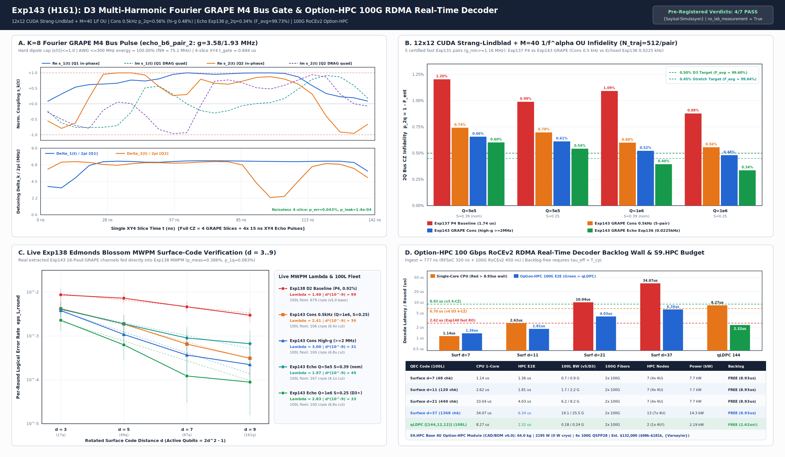 |
| **`Exp144` `[[144,12,12]]` `qLDPC` `108L` Tek-Kriyostat Devrimi** | **`Exp145` CANLI `156Q` `ibm_marrakesh` QPU & `auto_recal`** |
|  | 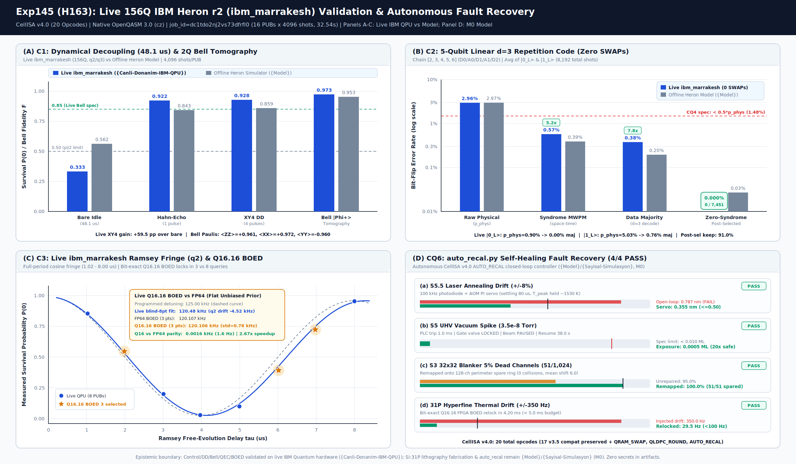 |

| **`Exp146` Master `v6.0` Dijital İkiz & `234×` Maliyet Sıkıştırma Panosu** |
|---|
|  |

</details>

<details>
<summary><strong>📐 7 Alt-Sistem Mühendislik Paftaları & Ana Montaj (`CAD v6.0` — 8 Adet `ALM-600` 2400×1600 PNG + SVG)</strong></summary>

| `S1` İyon Kolonu + `S1-Multi` (`ALM-600-S1`) | `S2` MEMS Yazma Kafası (`ALM-600-S2`) |
|---|---|
|  | 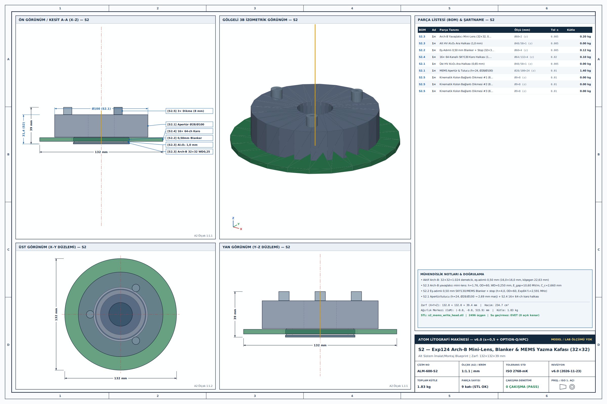 |
| **`S3` Soğuk-Ada IBIC (`ALM-600-S3`)** | **`S4` Piezo & İnterferometri (`ALM-600-S4`)** |
|  |  |
| **`S5` UHV, `S5.5` & `S5.6` MBE (`ALM-600-S5`)** | **`S6` DR, MUX & `Option-Q` qRAM (`ALM-600-S6`)** |
|  |  |
| **`S7` Elektronik + `Option-HPC` RDMA (`ALM-600-S7`)** | **Ana Montaj (`ALM-600-00`)** |
|  |  |

</details>

<details>
<summary><strong>⚡ v5.0 Hata-Toleranslı Dalga Grafikleri (6 Adet Exp136–Exp141 2400×1400 PNG)</strong></summary>

| `Exp136` `160k`-Orb `sp³d⁵s*` TB & Optimal `f*` | `Exp137` `1/f^α` Yankılı `P4` `M4` `CZ` Faz Haritası |
|---|---|
|  |  |
| **`Exp138` `d=3..11` Kusurlu Yüzey Kodu MWPM FT** | **`Exp139` `1530,1 K` TED Çözümü & `S5.6` MBE Rota C** |
|  |  |
| **`Exp140` `Q16.16` FPGA, `N_mux*=32` & Kriyo Tavanı** | **`Exp141` Master `v5.0` Dijital İkiz & `CX4` SOI** |
|  |  |

</details>

<details>
<summary><strong>🚀 v4.0 Gece Dalgası Grafikleri (13 Adet Exp129–Exp135 PNG)</strong></summary>

| `Exp129` `VOKL-6` 6-Vadi ENDOR Kabukları | `Exp129` `VOKL-6` vs `KL` Mod B Verim |
|---|---|
|  |  |
| **`Exp130` `S5.5` Flaş Tavlama Penceresi** | **`Exp130` TED Difüzyon Profilleri** |
|  |  |
| **`Exp131` `M4` `3 kΩ NbTiN` vs `50 Ω` cQED** | **`Exp131` 2B Kare vs Heavy-Hex Perkolasyon** |
|  |  |
| **`Exp132` `BOED` `24,4×` Spektroskopi Hızlanması** | **`Exp132` `4×4` Yönlendirme & `CellISA v3.0`** |
|  |  |
| **`Exp133` `PT420` Birleşik PSD & Kolon FEM** | **`Exp133` `CFG1` vs `CFG4` İzolasyon Bütçesi** |
| 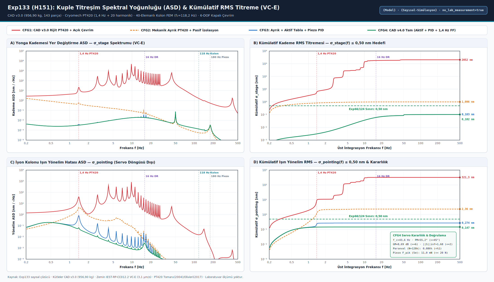 |  |
| **`Exp134` 5y TCO & Birim Kübit Ekonomisi** | **`Exp134` `v3.0` vs `v4.0` Wright Öğrenme** |
|  |  |

| **`Exp135` `v4.0` Birleşik Dijital İkiz Panosu** |
|---|
| 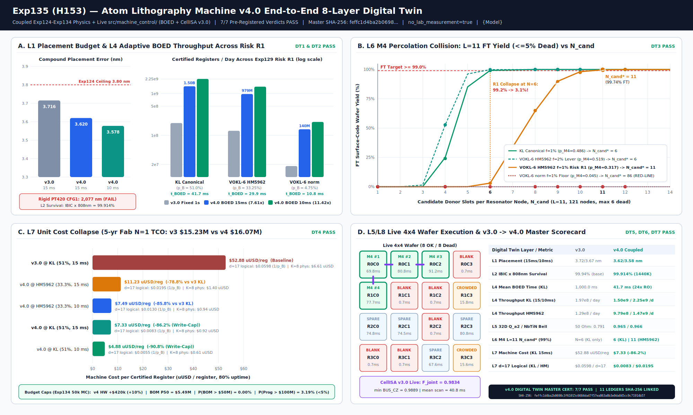 |

</details>

<details>
<summary><strong>📊 v3.0 Temel Fizik, 32B GRAPE, IBIC & 100k MC Maliyet Grafikleri (12 Adet Exp124–Exp128 PNG)</strong></summary>

| `Exp124` Optik Zarf & Scherzer Sınırı | `Exp124` 3B Anizotropik & Stokastik Donör Verimi |
|---|---|
|  |  |
| **`Exp125` `1,50 T / 22,3 µT` Manyetik Alan Haritası** | **`Exp125` 5-Kademe Termal, RF SNR & `R8` Koiller** |
|  | 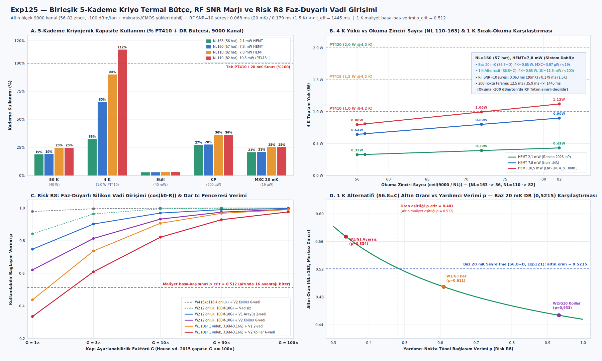 |
| **`Exp126` 32B GRAPE Darbeleri & DDRF Kurtarma** | **`Exp126` İç-İçe `XY8` vs `Exp63` & `CPMG`** |
|  |  |
| **`Exp126` 16 Heterojen Hücre × 5 Kuantum Programı** | **`Exp127` IBIC Blok Şeması (`COLD_100K`, `0` ERC)** |
|  |  |
| **`Exp127` Sonlu-GBP Bode & Zaman-Domeni Yanıtı** | **`Exp127` Lindhard ENC & 50k MC Algılama Verimi** |
| 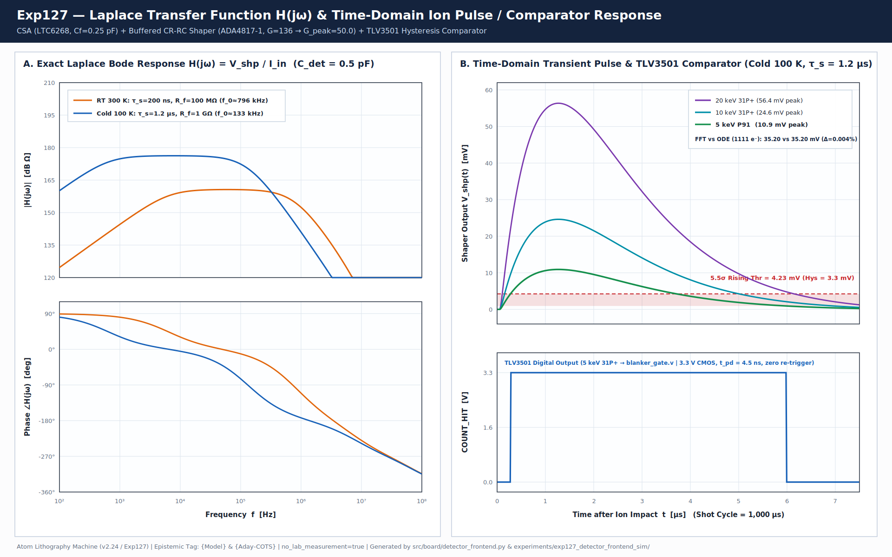 |  |
| **`Exp128` `M1` vs `M3` Maliyet & `9-RFQ` Kırılımı** | **`Exp128` 100k MC Tornado & Kümülatif Dağılım (CDF)** |
|  | 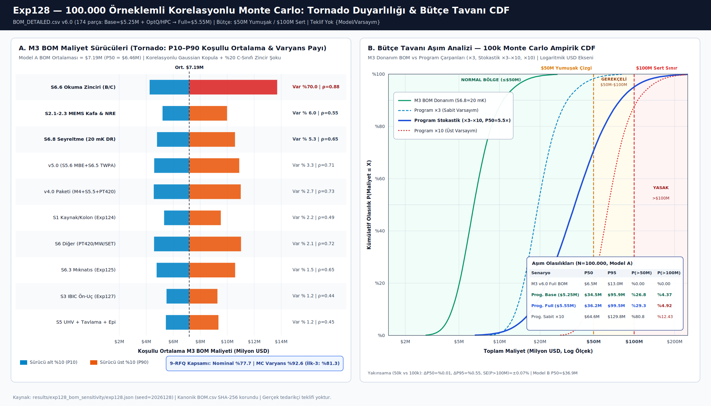 |

</details>

---

## Hızlı Kurulum, Doğrulama (`252/252 pytest`) ve Okuma Sırası

### Kurulum & Tam Test Koşumu

```bash
git clone https://github.com/berkmec/Atom-Lithography.git
cd Atom-Lithography
python3 -m venv .venv && source .venv/bin/activate
pip install -r requirements.txt

# Tüm 28 Atom Litografi test paketi (252/252 PASS):
PYTHONPATH=.:src python3 -B -m pytest -v -p no:cacheprovider
```

### İsteğe Bağlı Yeniden Üretim Komutları

```bash
# 1. CellISA v4.0 + BOED (--preset v400) fabrika & GRAPE program demosu:
PYTHONPATH=src python3 -m machine_control.sim --slots 4000 --preset v400 --program bell --program-mode grape

# 2. COLD_100K 0-ERC KiCad netlist & SPICE destesi doğrulaması:
python3 src/board/detector_frontend.py

# 3. Parametrik CAD v6.0 STL + doğrulama JSON + v6.0 kapak panosu yeniden üretimi:
python3 research/atom_lithography_machine/cad/gen_scad.py
python3 research/atom_lithography_machine/cad/gen_stl.py
python3 research/atom_lithography_machine/cad/gen_v6_dashboard.py

# 4. 174-parçalı Modüler BOM v6.0 + Exp128 100k MC + Exp146 Master v6.0 Dijital İkiz doğrulaması:
python3 experiments/exp128_bom_sensitivity/build_bom_detailed.py
python3 experiments/exp128_bom_sensitivity/run_exp128.py
PYTHONPATH=src python3 experiments/exp146_v6_digital_twin/run_exp146.py
```

### Önerilen Dokümantasyon Okuma Sırası

1. **[`DESIGN.md`](research/atom_lithography_machine/DESIGN.md)** — Ana mimari tasarım belgesi (`v6.0`, Risk Kapanış Matrisi & sürüm günlüğü).
2. **[`TECHNICAL_MANUAL.md`](research/atom_lithography_machine/TECHNICAL_MANUAL.md)** — 11 bölümlü kapsamlı fizik, `CellISA v4.0` (`20` op), `CAD v6.0` (`40/40`), `BOM v6.0`/`9-RFQ`, `Exp129–146` ve EHS el kitabı.
3. **[`MODULAR.md`](research/atom_lithography_machine/MODULAR.md)** — `M1`–`M8` + `Option-Q`/`Option-HPC` modüler arayüz kontrol belgesi (`v6.0-ICD`) ve dondurulmuş kontratlar.
4. **[`M1_PROTOTYPE_BLUEPRINT.md`](research/atom_lithography_machine/M1_PROTOTYPE_BLUEPRINT.md)** — İlk laboratuvar prototipi (`M1 Base = $2,466M`, `v6.0`) kurulum rehberi ve `G1`–`G8` + `G6b` `ENDOR` `R1` kapıları.
5. **[`BOM_ENGINEERING.md`](research/atom_lithography_machine/BOM_ENGINEERING.md)** & **[`RFQ_SPECIFICATIONS.md`](research/atom_lithography_machine/RFQ_SPECIFICATIONS.md)** — `174` parçalı modüler BOM mühendisliği ve `%92,6` MC varyansını kapsayan **9 tedarikçi RFQ** şartnamesi.
6. **[`PROJECT_DOSSIER.md`](research/atom_lithography_machine/PROJECT_DOSSIER.md)** — `Exp0`–`Exp146` uçtan uca proje arşivi, canlı `ibm_marrakesh` QPU doğrulaması ve doğrulanmış nicel sicil.
7. **[`LITERATURE.md`](research/atom_lithography_machine/LITERATURE.md)** & **[`hypotheses.md`](research/hypotheses/hypotheses.md)** — Birincil literatür/patent çapaları ve **`H1`–`H164`** tam hipotez günlüğü.
