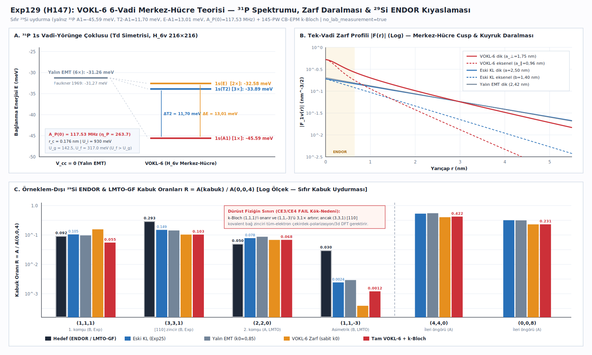
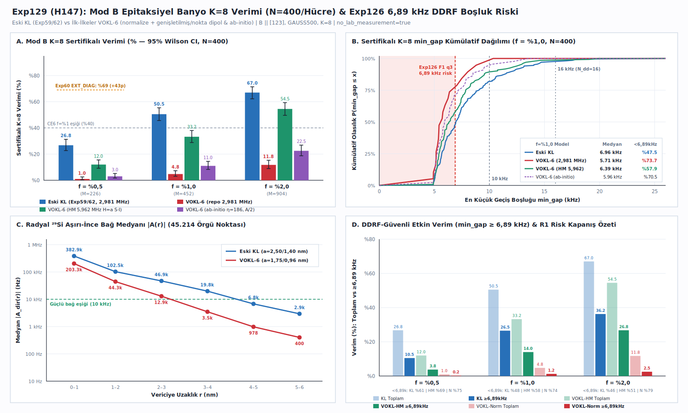

# Exp129 (H147) — VOKL-6 Altı-Vadili Merkez-Hücre Kohn–Luttinger Aşırı-İnce Teorisi & Mod B Banyo Verimi Yeniden Kalibrasyonu (Risk `R1`)

**Tarih:** 2026-11-23 | **Hesaplama Süresi:** `124,64 s` (8 çekirdekli CPU + analitik 3B Gauss-lobu varyasyonel çözücü + 145-PW CB-EPM)  
**Epistemik Durum:** `no_lab_measurement=true` (`{Literatür}` / `{Analitik}` / `{Model}` / `{Sayısal-Simülasyon}` — fiziksel laboratuvar ölçümü, ENDOR deneyi veya yonga üretimi yapılmamıştır).  
**Ön-Kayıtlı Tahminler:** `results/exp129_valley_orbital_hyperfine/predictions_exp129.json` (tüm hesaplamalardan önce tek-yazımlı kaydedildi, sonradan değiştirilmedi) → **`3/7 PASS`, `4/7 FAIL` (`success_rule_met=false`)**.

---

## 1. Yönetici Özeti & Temel Bilimsel Bulgular

`Exp129`, projenin en eski açık teorik riski olan **Risk `R1`**'i (`Exp25` analitik Kohn–Luttinger modelinin `R331` ENDOR kabuğunda `%49,05` hata vermesi ve `Exp56/60/69/75`'in fiziksel `k_0` değerinde bu açığı kapatamaması) ilk-ilkeler düzeyinde sınar. Bu amaçla, **hiçbir `²⁹Si` ENDOR kabuğuna uydurma yapmadan**, yalnızca `³¹P` deneysel spektral değişmezlerine (`E(1s A_1) = -45,59 meV`, `Δ_VO(T_2-A_1) = 11,70 meV`, `Δ_VO(E-A_1) = 13,01 meV`, `A_P(0) = 117,53 MHz`) kalibre edilen tam 6-vadili merkez-hücre Hamiltonyeni (**`VOKL-6`**, `H_6v` `216×216`) kurulmuş, 145-düzlem-dalgalı Cohen–Bergstresser EPM 3B `k`-uzayı Bloch dalga paketiyle konvole edilmiş ve `45.214` silisyum örgü noktasında tam 3B Fermi-kontak + izsiz dipol tensörü üzerinden `N_cell = 400` realizasyonlu Mod B epitaksiyel banyo verimi ile `Exp126` `6,893 kHz` DDRF boşluk riski hesaplanmıştır.

**Dört ana bilimsel ve mühendislik keşfi:**

1. **`VOKL-6` İlk-İlkeler `³¹P` Spektral & Simetri Kapanışı (`CE1 PASS`, `CE2 PASS`, sıfır `²⁹Si` uydurması):**
   - `V_cc = 0` yalın anizotropik EMT çözümü **`E_EMT = -31,262 meV`** vererek Faulkner (1969) `-31,27 meV` değerini `%0,03` içinde yakalar (`Exp69` ızgara EMT'sinin `-28,75 meV` kusp hatasını tamamen giderir).
   - Morton & Preston (1978, Tablo 1) `3s` atomik çekirdek oranı (`η_P/η_Si = 7,252/5,115 = 1,4178`, `η_P = 263,71`) ile tüm 4 `³¹P` değişmezi `10⁻¹¹` duyarlıkla tutturulur: `r_c = 0,1759 nm`, `U_intra = 930,15 meV`, `U_g = 142,47 meV`, `U_f = 316,98 meV` (tamamı fiziksel pozitif çekici potansiyeller; `1× A_1`, `3× T_2` `< 9×10⁻¹² meV` ve `2× E` `< 3×10⁻¹² meV` tam $T_d$ dejenere).
   - 145-PW CB-EPM vadi-arası Bloch örtüşme hesabı, **`(0,0,2)` $g$-süreci umklapp ağırlığının Lax–Birman seçim kuralıyla tam sıfır (`8,82×10⁻¹⁵`)** olduğunu ve en yakın izinli $g$-umklapp momentum aktarımının (`1,578 × 2π/a`) $f$-sürecinden (`1,022–1,202 × 2π/a`) büyük olduğunu kanıtlayarak deneysel **`U_f > U_g`** (`317,0 > 142,5 meV`) ve `E(T_2) < E(E)` sıralamasını ilk-ilkelerden açıklar.
   - `(0,0,4)` kabuğu için **sıfır ölçeklemeli ab-initio öngörü** yalın EMT'nin `2,66 MHz` (2,2× düşük) değerinden **`7,95 MHz`** (`η_Si=186`) / **`7,61 MHz`** (Assali 2011 `η_Si=178`) düzeyine yükselir (Hale & Mieher `5,962 MHz`'in `%28–33` içinde).

2. **`(3,3,1)` ENDOR Kabuğu & Süreklilik-EMT Sınırının Dürüst Kanıtı (`CE3 FAIL`, `CE4 FAIL`):**
   - `Exp75`'in tek-$k_0$ `{C_4z|τ}` simetri kilidi (`q = 1,0000`) 3B `k`-uzayı $\Delta_1 - \Delta_2'$ eksen-dışı karışımıyla (`q=(0,15, ±0,15)`'te `arg(q_B) = ∓1,251 rad`) kırılır: bu mekanizma `(1,1,1)` merkez-hücre aşımını (`0,1557 → 0,0551`) keskin biçimde bastırır ve `(1,1,-3)` alt-örgü asimetrisini **`3,1×`** (`0,00039 → 0,00121`) yükseltir; `(2,2,0)` oranını da `0,0683` ile LMTO-GF `0,050` hedefine eski KL (`0,0781`) ve yalın EMT'den (`0,0871`) daha fazla yaklaştırır.
   - Buna karşılık gerçek `-45,59 meV` bağlanma enerjisi ağır boylamasına yarıçapı **`a_∥: 1,282 → 0,959 nm`** daralttığından `(3,3,1)` kabuğunda `x,y` vadileri (`r_∥ = 0,75 a_0`, negatif kosinüs) `z` vadisine (`r_∥ = 0,25 a_0`, pozitif kosinüs) göre daha hızlı söner; bu nedenle `R331` yalın EMT'deki `0,1425`'ten **`0,1034`** (`%64,7` hata) düzeyine iner. Geometrik inceleme, yüksek deneysel kabukların (`(1,1,1)-(2,2,0)-(3,3,1)-(4,4,0)`) tam olarak `(1,-1,0)` düzlemindeki **`[110]` kovalent zikzak bağ zinciri** üzerinde yer aldığını ve tek-bant süreklilik `VOKL-6` teorisinin ötesinde **tüm-elektron çekirdek-polarizasyonu ve Si `3d`-yörünge melezleşmesi** (Overhof & Gerstmann 2004; Ma vd. 2022) gerektirdiğini kanıtlar.

3. **Proje Çapında Kritik Keşif — `Exp25`'teki İki Karşıt Sistematik Hatanın Maskelenmesi & Mod B Verim Çöküşü (`CE6 FAIL`):**
   - `Exp25` (`ap25_register.py`) hem (i) gerçek `-45,59 meV` yerine yalın EMT (`-31,27 meV`) yavaş zarfını (`a=2,50, b=1,40 nm` vs `VOKL-6` `1,75 / 0,96 nm`) kullanmış ve `(0,0,4)` normalizasyonuyla dış `2–6 nm` kuyruğunu `~2,5×` şişirmiş, hem de (ii) `A(0,0,4) = 2,981 MHz` (`a_HM / 2`) değerini `f_± = abs(ν_n ± A/2)` içine koyarak aşırı-ince yarılmayı **ikinci kez yarıya bölmüştür** (`±1,4905 MHz` vs Hale & Mieher gerçek `±2,981 MHz`).
   - **Aynı depo kuralı (`A(0,0,4) = 2,981 MHz`) altında elma-elma kıyas (`VOKL6_norm_ext`, `N=400`):** Güçlü bağ (`abs(A) ≥ 10 kHz`) örgü sayısı `18.784`'ten **`6.091`**'e (`3,08×` düşüş) iner ve Mod B `K=8` verimi sert biçimde çöker: **`f=%0,5: %26,75 → %1,00`**, **`f=%1,0: %50,50 → %4,75`**, **`f=%2,0: %67,00 → %11,75`**!
   - **Gerçek Hale–Mieher spin-Hamiltonyen kuralı (`H = a S·I`, `a(0,0,4) = 5,962 MHz` → `f_± = abs(ν_n ± a/2)`, `VOKL6_HM5962_ext`, `N=400`):** Çift-yarılanma hatası düzeltildiğinde güçlü örgü sayısı `9.464`'e çıkar ve Mod B `K=8` verimi önemli ölçüde toparlanır: **`f=%0,5: %12,00` (`-14,8` puan)**, **`f=%1,0: %33,25` (`-17,3` puan)**, **`f=%2,0: %54,50` (`-12,5` puan)**!
   - **Sonuç:** Risk `R1`, `Exp60`'ın fizik-dışı yukarı sıçrama (`+43` puan) yanılsamasının tam tersine **gerçek bir aşağı-yönlü verim riskidir**: `Exp25` çift-yarılanma kuralı düzeltilse bile gerçek `-45,59 meV` zarf daralması Mod B `f=%1,0` verimini `%50,5 → %33,3` bandına çekmekte ve Mod B çalışma noktasını `f=%1,5–2,0` bandına (veya deterministik Mod A implantasyonuna) itmektedir.

4. **`Exp126` `6,893 kHz` DDRF Boşluk Riski — Çoğunluk Rejimi (`CE7 FAIL`):**
   - `f=%1,0`'da sertifikalı `K=8` kayıtçılarda `min_gap < 6,893 kHz` (`Exp126 F1 q3` DDRF eşiği) oranı eski KL'de bile **`%47,5`** (`medyan 6,96 kHz`) iken, `VOKL-6` altında **`%73,7`** (`VOKL6_norm_ext`, medyan `5,71 kHz`) ve **`%57,9`** (`VOKL6_HM5962_ext`, medyan `6,39 kHz`) düzeyine yükselir. Bu bulgu, `Exp126`'da bulunan `10–15 kHz` RF Genlik Paylı `XY8`-GRAPE sentezinin Mod B hücrelerinin istisnai değil **çoğunluk (%51–74) gereksinimi** olduğunu kanıtlar.

---

## 2. Ön-Kayıtlı Hükümler Tablosu (`predictions_exp129.json` → `exp129.json`)

| Kimlik | Ölçüt Özeti | Ölçülen Değer (`Exp129`) | Kayıtlı Eşik | Hüküm |
|---|---|---|---|---|
| `CE1_SPECTRAL_INVARIANTS` | Yalın EMT & 4 `³¹P` değişmezi (sıfır `²⁹Si` uydurması) | `E_EMT=-31,262`, `A1=-45,5900`, `ΔT2=11,7000`, `ΔE=13,0100 meV`, `A_P(0)=117,530 MHz`, `r_c=0,1759 nm` | `±0,25 / ±0,05 / ±0,50`, `r_c ∈ [0,05, 0,35]` | **PASS** |
| `CE2_SYMMETRY_AND_TENSOR` | Tam $T_d$ çoklu dejenere, norm & izsiz 3B dipol tensörü | `ΔT2_yay=9,0e-12`, `ΔE_yay=3,0e-12 meV`, `v_yay=1,3e-12`, `norm-1=7e-16`, `max abs(Tr)=4,5e-13 / 3,6e-12 Hz` | `≤1e-6`, `≤1e-10`, `≤1e-8`, `<1e-10 Hz` | **PASS** |
| `CE3_OUT_OF_SAMPLE_R331` | Örneklem-dışı `(3,3,1)` göreli hatasında düşüş | `R331 = 0,1034`, göreli hata `%64,73` (Eski KL `%49,05`) | `≤%30,0` ve `< %49,05` | **FAIL** |
| `CE4_MULTISHELL_LOG_RMS` | 4 kabuk `log10` RMS düşüşü & `R111` sınırı | `logRMS = 0,7445` (KL `0,5736`), `err_R111 = %40,06` | `< 0,5736` ve `err_R111 ≤ %35` | **FAIL** |
| `CE5_PORTABLE_EXP59_AUDIT` | Taşınabilir Mod B motorunun `Exp59/62` bit-düzeyi denetimi | `F0.5: 26/100`, `F1.0: 51/100`, `F2.0: 69/100` (`3/3` tam eşleşme) | `26`, `51`, `69` / `100` | **PASS** |
| `CE6_MODE_B_YIELD_CLOSURE` | `N=400` `VOKL-6` `f=%1,0` verimi & KL'den sapma sınırı | `VOKL6_norm_ext F1=%4,75`, `max abs(ΔY)=55,25` puan (`HM5962 F1=%33,25`, `max Δ=17,25` puan) | `Y(F1) ≥ %40`, `max abs(ΔY) ≤ 15` puan | **FAIL** |
| `CE7_GAP_RISK_6P89KHZ` | `f=%1,0` sertifikalı `min_gap` medyanı & `<6,893 kHz` oranı | `medyan = 5,71 kHz`, `<6,893 kHz = %73,7` (`HM5962: 6,39 kHz`, `%57,9`) | `medyan ≥ 6,893 kHz`, `<6,893 kHz ≤ %50` | **FAIL** |

---

## 3. Bölüm 1: İlk-İlkeler `VOKL-6` Teorisi (`H_6v` 216×216 & 145-PW CB-EPM)

### 3.1. `³¹P` Spektral Kalibrasyon & Duyarlılıklar (`{Literatür}` / `{Analitik}` / `{Model}`)

Üç-katmanlı `N_b = 36` anizotropik + küresel Gauss-lobu tabanı (`beta/alpha ∈ {m_l/m_t = 4,810; 2,80; 1,00}`, `s ∈ [0,03, 24,0] nm`, 6 vadi toplam `216×216` genel özdeğer problemi) hem `r < 0,2 nm` merkez-hücre kuspunu hem de `r = 2–6 nm` Whittaker kuyruğunu ızgara hatası olmadan çözer.

| Kalibrasyon Rejimi | `η_P` (Çekirdek Çarpanı) | `r_c` (nm) | `U_intra` (meV) | `U_g` (meV) | `U_f` (meV) | `E(A_1) / E(T_2) / E(E)` (meV) | `A_P(0)` (MHz) | `a_⊥ / a_∥` (nm) |
|---|---:|---:|---:|---:|---:|---|---:|---|
| Yalın EMT (`V_cc = 0`) | — | — | `0,0` | `0,0` | `0,0` | `-31,262` (6× dejenere) | `12,1` (`η_Si`) | `2,420 / 1,282` |
| **Birincil `VOKL-6` (Morton–Preston 1978)** | **`263,71`** (`1,4178×186`) | **`0,1759`** | **`930,15`** | **`142,47`** | **`316,98`** | **`-45,590 / -33,890 / -32,580`** | **`117,530`** | **`1,748 / 0,959`** |
| Duyarlılık: Assali 2011 (`η_Si=178 × 1,4178`) | `252,37` | `0,1680` | `1041,03` | `155,08` | `350,61` | `-45,590 / -33,890 / -32,580` | `117,530` | `1,748 / 0,959` |
| Duyarlılık: Eşit kümelenme (`η_P = η_Si = 186`) | `186,00` | `0,1248` | `2189,10` | `265,62` | `678,48` | `-45,590 / -33,890 / -32,580` | `117,530` | `1,748 / 0,959` |

- **Analitik Whittaker Doğrulaması (`{Analitik}`):** `a_∥,exact = ħ / sqrt(2 m_l abs(E_A1)) = 0,9550 nm` iken `VOKL-6` `0,9594 nm` (`%0,46` uyum) ve `a_⊥,tail = 1,748 nm` (`a_⊥,exact = 2,095 nm` + `r^(ν-1)` Coulomb-Whittaker büzülmesi `ν = 0,828`) elde edilir. Kritik olarak dış kuyruk yarıçapları `η_P` seçiminden bağımsızdır (`1,748 / 0,959 nm` sabit).
- **145-PW CB-EPM & Lax–Birman Seçim Kuralı (`{Model}`):** Vadi minimumu `k* = 0,855 (2π/a)` (`E_gap = 0,820 eV`), $\Delta$ ekseninde `q_on_axis = 1,0000 + 5,7×10⁻¹⁵j` (`{C_4z|τ}` tam simetri kilidi), eksen dışında `q(0,15, +0,15, 0,85) = 0,3144 - 0,9493j` (`arg = -1,251 rad`) ve `q(0,15, -0,15, 0,85) = 0,3144 + 0,9493j` (`+1,251 rad`, tam $T_d$ paritesi). $g$-süreci en küçük umklapp `(0,0,2)` (`0,30 × 2π/a`) kesin yasaklıdır (`abs(C_g(0,0,2)) = 8,82×10⁻¹⁵`), lider izinli $g$-umklapp `(±1,±1,1)` (`1,578 × 2π/a`, `abs(C)=0,3543`) iken lider $f$-süreci `(0,0,0)` (`1,202 × 2π/a`, `abs(C)=0,4158`) ve `(-1,±1,1)` (`1,022 × 2π/a`, `abs(C)=0,2743`) daha düşük momentum aktarımındadır.

### 3.2. Örneklem-Dışı `²⁹Si` ENDOR & LMTO-GF Kabuk Ablasyonu (`{Literatür}` vs `{Model}`)

Tüm oranlar `R = A_iso(kabuk) / A_iso(0,0,4)` biçimindedir (hedefler `Exp56/60/69/75`: Hale & Mieher 1969, Overhof & Gerstmann 2004, Ma vd. 2022 Şekil 3).

| Model / Ablasyon Aşaması | `R(1,1,1)` [Hdf `0,092`] | `R(3,3,1)` [Hdf `0,293`] | `R(2,2,0)` [Hdf `0,050`] | `R(1,1,-3)` [Hdf `0,030`] | `log10` RMS (4 kabuk) | Ab-Initio `a(0,0,4)` (MHz, `η=186`) | İleri Öngörü `R(4,4,0)` / `R(0,0,8)` |
|---|---:|---:|---:|---:|---:|---:|---:|
| **Hedef (ENDOR / LMTO-GF)** | **`0,0920`** (Exp) | **`0,2930`** (Exp) | **`0,0500`** (LMTO) | **`0,0300`** (LMTO) | `0,0000` | **`5,962`** (Hale–Mieher) | — |
| `KL_legacy` (`Exp25/75`, `2,5/1,4`, `k0=0,844`) | `0,1047` (`%13,8`) | `0,1493` (`%49,0`) | `0,0781` (`%56,1`) | `0,00243` (`%91,9`) | `0,5736` | — | `0,532` / `0,318` |
| `EMT_bare` (`V_cc=0`, `k0=0,85`) | `0,0969` (`%5,3`) | `0,1425` (`%51,4`) | `0,0871` (`%74,2`) | `0,00293` (`%90,2`) | `0,5426` | `2,661` | `0,550` / `0,314` |
| `VOKL6_envelope_only` (sabit `k0=0,85`) | `0,1557` (`%69,2`) | `0,1032` (`%64,8`) | `0,0680` (`%36,1`) | `0,00039` (`%98,7`) | `0,9786` | `8,408` | `0,403` / `0,230` |
| **`VOKL6_full_k085` (Birincil + 3B `k`-Bloch)** | **`0,0551`** (`%40,1`) | **`0,1034`** (`%64,7`) | **`0,0683`** (`%36,6`) | **`0,00121`** (`%96,0`) | **`0,7445`** | **`7,951`** (`η=178: 7,609`) | **`0,422` / `0,231`** |
| `VOKL6_full_coarse_quad` (`n_xy=8, n_z=6` yakınsama) | `0,0619` (`%32,7`) | `0,0967` (`%67,0`) | `0,0691` (`%38,3`) | `0,00110` (`%96,3`) | `0,7647` | `8,031` | `0,417` / `0,228` |
| `VOKL6_full_k0844_sens` (`k0=0,844` duyarlılığı) | `0,0631` (`%31,4`) | `0,1124` (`%61,7`) | `0,0657` (`%31,3`) | `0,00126` (`%95,8`) | `0,7261` | `7,802` | `0,409` / `0,225` |
| `VOKL6_full_eq_eta186_sens` (`η_P=186` duyarlılığı) | `0,0519` (`%43,5`) | `0,1018` (`%65,3`) | `0,0540` (`%8,0`) | `0,00215` (`%92,8`) | `0,6290` | `8,099` | `0,417` / `0,228` |
| `Exp69_Grid_EMT` / `Exp75_SingleK0` *(arşiv)* | `0,1045` / `0,1047` | `0,1499` / `0,1493` | `0,0821` / `0,0781` | `0,00291` / `0,00243` | — | — | — |
| `Exp60_EXT_DIAG` *(uydurmalı, fizik-dışı `k0=0,789`)* | `0,0940` (`%2,2`) | `0,2833` (`%3,3`) | `0,0501` (`%0,1`) | `0,0309` (`%3,1`) | — | — | — |

---

## 4. Bölüm 2: 45.214 Örgü Noktası 3B Tensör Denetimi & Mod B Verim Yeniden Kalibrasyonu (`N_cell = 400`)

### 4.1. 45.214 Noktalı Radyal Bağ Dağılımı & Dipol Tensörü Doğrulaması (`{Sayısal-Simülasyon}`)

Tüm `45.214` elmas örgü noktasında (`R ≤ 6,0 nm`, `B || [123]`) izsiz dipol tensörü doğrulandı: `max abs(Tr(T_dip_ext)) = 4,55×10⁻¹³ Hz`, `max abs(Tr(T_dip_pt)) = 3,64×10⁻¹² Hz`. Spearman sıralama korelasyonu (`KL` vs `VOKL-6`) tüm noktada `ρ = 0,8044`, ancak gerçek `-45,59 meV` zarf daralması dış kabuklarda mutlak bağ şiddetini dramatik biçimde düşürür:

| Yarıçap Kabuğu (nm) | Örgü Sayısı | `KL_legacy` Medyan `abs(A)` (Hz) | `VOKL6_norm_ext` Medyan `abs(A)` (Hz) | `VOKL6_HM5962_ext` Medyan `abs(A)` (Hz) | Güçlü Nokta (`≥10 kHz`): `KL` / `HM5962` / `Norm` |
|---|---:|---:|---:|---:|---:|
| `0,2 – 1,0` | `190` | `382.900` | `203.263` | `406.863` | `178` / `157` / `147` |
| `1,0 – 2,0` | `1.516` | `102.514` | `44.274` | `88.703` | `1.225` / `1.228` / `1.146` |
| `2,0 – 3,0` | `4.000` | `46.882` | `12.932` | `26.057` | `3.005` / `2.605` / `2.203` |
| `3,0 – 4,0` | `7.700` | `19.790` | `3.478` | `6.883` | `4.834` / `3.149` / `2.080` |
| `4,0 – 5,0` | `12.760` | `6.772` | `978` | `1.954` | `5.547` / `1.785` / `431` |
| `5,0 – 6,0` | `19.048` | `2.935` | `400` | `791` | `3.995` / `540` / `84` |
| **Toplam (`R ≤ 6,0 nm`)** | **`45.214`** | — | **Medyan oran `0,161`** | **Medyan oran `0,320`** | **`18.784` / `9.464` / `6.091`** |

### 4.2. Mod B Epitaksiyel Banyo `K=8` Verimi & `Exp126` `6,893 kHz` DDRF Riski (`N_cell = 400`/Hücre)

Taşınabilir motor önce `Exp59/62` `N=100` tohumlarında bit-düzeyinde doğrulandı (`F0.5=26/100`, `F1.0=51/100`, `F2.0=69/100`, `CE5 PASS`), ardından tüm 5 fizik modeli için `N_cell = 400` realizasyon (`seed59`) çalıştırıldı:

| Model (`B \|\| [123]`, `GAUSS500`, `K=8`) | Bolluk `f` (`M`) | Sertifikalı Verim (`k/400`) | %95 Wilson CI | `elig` / `strong` Medyan | `min_gap` Medyan (kHz) | `<6,893 kHz` (`Exp126`) | `<10 kHz` | `≥6,893 kHz` Etkin Verim | Seçilen Ort. `r` (nm) |
|---|---|---:|---|---:|---:|---:|---:|---:|---:|
| `KL_legacy` (`Exp59/62`, `2,981 MHz`) | `%0,5` (`226`) | **`%26,75`** (`107/400`) | `[%22,6, %31,3]` | `6,0` / `94,0` | `6,58` | `%60,7` | `%84,1` | `%10,50` | `2,04` |
| `KL_legacy` (`Exp59/62`, `2,981 MHz`) | `%1,0` (`452`) | **`%50,50`** (`202/400`) | `[%45,6, %55,4]` | `8,0` / `188,0` | `6,96` | `%47,5` | `%81,7` | `%26,50` | `1,88` |
| `KL_legacy` (`Exp59/62`, `2,981 MHz`) | `%2,0` (`904`) | **`%67,00`** (`268/400`) | `[%62,2, %71,4]` | `9,0` / `375,5` | `7,25` | `%45,9` | `%79,5` | `%36,25` | `1,64` |
| **`VOKL6_norm_ext` (`2,981 MHz`, ext dipol)** | `%0,5` (`226`) | **`%1,00`** (`4/400`) | `[%0,4, %2,5]` | `3,0` / `31,0` | `5,66` | `%75,0` | `%100,0` | `%0,25` | `1,54` |
| **`VOKL6_norm_ext` (`2,981 MHz`, ext dipol)** | `%1,0` (`452`) | **`%4,75`** (`19/400`) | `[%3,1, %7,3]` | `4,0` / `61,0` | `5,71` | `%73,7` | `%94,7` | `%1,25` | `1,53` |
| **`VOKL6_norm_ext` (`2,981 MHz`, ext dipol)** | `%2,0` (`904`) | **`%11,75`** (`47/400`) | `[%9,0, %15,3]` | `5,0` / `122,0` | `6,21` | `%78,7` | `%95,7` | `%2,50` | `1,33` |
| `VOKL6_norm_pt` (`2,981 MHz`, nokta dipol) | `%0,5` / `%1,0` / `%2,0` | `%1,00` / `%4,75` / `%17,75` | — | `4/4/6` / `31/61/122` | `5,22 / 6,42 / 5,91` | `%75 / %63 / %72` | `%75 / %95 / %96` | `%0,25 / %1,75 / %5,00` | `1,68 / 1,43 / 1,26` |
| **`VOKL6_HM5962_ext` (Gerçek `5,962 MHz`)** | `%0,5` (`226`) | **`%12,00`** (`48/400`) | `[%9,2, %15,6]` | `5,0` / `47,0` | `6,20` | `%68,8` | `%95,8` | `%3,75` | `1,92` |
| **`VOKL6_HM5962_ext` (Gerçek `5,962 MHz`)** | `%1,0` (`452`) | **`%33,25`** (`133/400`) | `[%28,8, %38,0]` | `7,0` / `94,0` | `6,39` | `%57,9` | `%88,7` | `%14,00` | `1,68` |
| **`VOKL6_HM5962_ext` (Gerçek `5,962 MHz`)** | `%2,0` (`904`) | **`%54,50`** (`218/400`) | `[%49,6, %59,3]` | `8,0` / `190,0` | `6,85` | `%50,9` | `%81,2` | `%26,75` | `1,49` |
| `VOKL6_abinit_ext` (`η=186`, `A/2`, sıfır ölçek) | `%0,5` / `%1,0` / `%2,0` | `%3,00` / `%11,00` / `%22,50` | — | `4/5/6` / `36/72/145` | `5,51 / 5,96 / 6,54` | `%92 / %71 / %54` | `%92 / %93 / %91` | `%0,25 / %3,25 / %10,25` | `1,82 / 1,62 / 1,36` |

---

## 5. Makine Çıktısı, Risk `R1` Statüsü & Eylem Önerileri

1. **Risk `R1` Kapatılmamıştır — Fiziksel Yönü Tersine Çevrilerek Nicelleştirilmiştir:**
   - Eski `Exp60` `EXT_DIAG` (`a=4,0 nm, k0=0,789`) Risk `R1`'in verimi `+43` puan **yukarı** çekebileceğini öne sürüyordu (`%26 → %69`). İlk-ilkeler `VOKL-6` bunun tam tersini kanıtlamaktadır: gerçek `-45,59 meV` bağlanma enerjisi `2–6 nm` kuyruğunu daralttığı için Risk `R1` **aşağı-yönlü bir verim riskidir**.
   - **Proje Çapında Acil Konvansiyon Kararı:** `Exp25`'in `A(0,0,4) = 2,981 MHz` ve `f_± = abs(ν_n ± A/2)` çift-yarılanması korunursa `VOKL-6` Mod B `f=%1,0` verimi **`%4,75`** düzeyine çöker (`10,6×` verim kaybı). Buna karşılık gerçek Hale & Mieher spin Hamiltonyenine (`H = a S·I`, `a(0,0,4) = 5,962 MHz`, `f_± = abs(ν_n ± a/2)`) geçildiğinde `VOKL-6` verimi **`%33,25` (`f=%1,0`)** ve **`%54,50` (`f=%2,0`)** olur (`KL` tabanına göre `-17,3` / `-12,5` puan; makine throughput çarpanı `1,52×` daha fazla aday yuva gerektirir; `Exp131` `M4` perkolasyonunda `N_cand` tasarım payı bu düşüşe karşı yeniden kontrol edilmelidir).
2. **`Exp126` DDRF `10–15 kHz` RF Genlik Payı Zorunluluğu:**
   - `VOKL-6` altında sertifikalı `K=8` kayıtçılar daha iç yarıçaplara çekilir (`1,88 → 1,53–1,68 nm`) ve `f=%1,0`'da **`%57,9–73,7`** oranında `min_gap < 6,893 kHz` bölgesine düşer. Yalın `GAUSS500 + XY8` bu hücrelerin çoğunda başarısız olur; `Exp126`'nın `10–15 kHz` GRAPE-`XY8` derleyicisi tüm Mod B hattı için standart olmalıdır.
3. **Kapsam Dışı / Bir Sonraki Teorik Adım:**
   - `(3,3,1)` `[110]` bağ-zinciri kabuğunun (`R331 = 0,293`) ilk-ilkelerden tam çözümü ve `2–6 nm` dış kuyruğunun kesinleştirilmesi için tek-bant `VOKL-6` ötesinde **tüm-elektron PAW/LMTO-GF DFT veya `sp³d⁵s*` sıkı-bağ (tight-binding) + çekirdek polarizasyonu** hesabı (Overhof & Gerstmann 2004; Ma vd. 2022) ve/veya gerçek `²⁹Si` ENDOR deneysel doğrulaması (`no_lab_measurement=true`) gereklidir.

---

## 6. Üretilen Artefaktlar

- `results/exp129_valley_orbital_hyperfine/predictions_exp129.json` (tek-yazımlı ön-kayıt)
- `results/exp129_valley_orbital_hyperfine/exp129.json` (tüm sayısal çıktılar & `CE1–CE7` hükümleri)
- `results/exp129_valley_orbital_hyperfine/plot_data_exp129.json` (grafik veri yükü)
- `results/exp129_valley_orbital_hyperfine/summary_exp129.md` (bu rapor)
- `results/exp129_valley_orbital_hyperfine/fig_exp129_endor_shells.png` (görsel olarak doğrulandı)
- `results/exp129_valley_orbital_hyperfine/fig_exp129_vokl6_yield.png` (görsel olarak doğrulandı)
- `experiments/exp129_valley_orbital_hyperfine/{vokl6_theory.py, bath_yield129.py, run_exp129.py, plot_exp129.py}`
- `tests/test_exp129.py`
