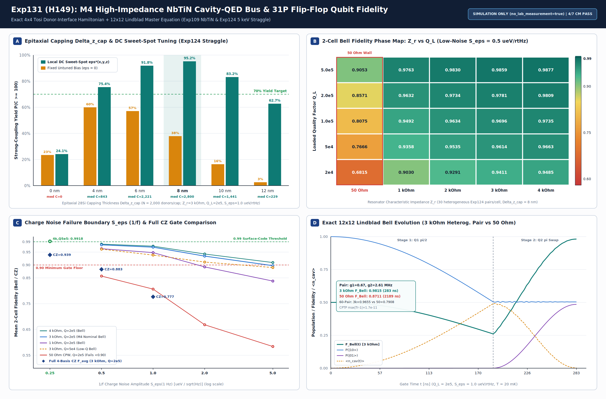
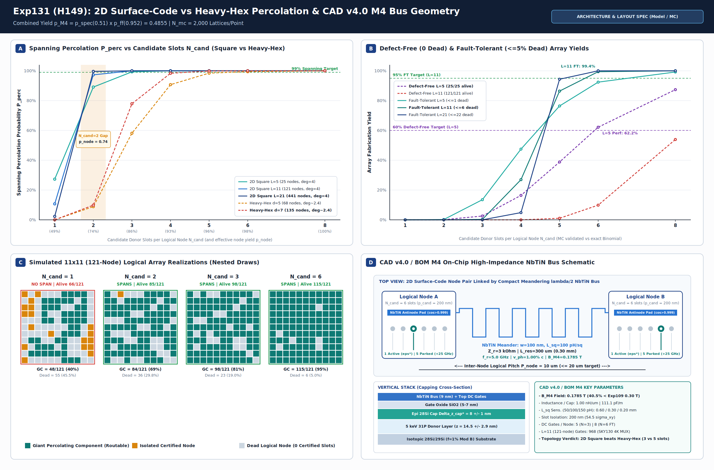

# Exp131 (H149): M4 Ölçeklenebilir Mimari Teorisi — Yüksek-Empedanslı `NbTiN` Kavite-QED Veri Yolu, Stokastik `³¹P` Flip-Flop Kübit & 2B Perkolasyon Kapanışı

> **Epistemik Kapsam & Dürüstlük Beyanı:** `no_lab_measurement = true`. Bu deneydeki tüm sayısal sonuçlar `{Model}`, `{Sayısal-Simülasyon}` ve `{Literatür}` kapsamındadır; fiziksel aygıt üretimi veya laboratuvar ölçümü içermez. Ön-kayıtlı 7 öngörü (`CM1–CM7`) hesaplama öncesinde `results/exp131_scalable_m4_architecture/predictions_exp131.json` dosyasına mühürlenmiş ve hiçbir eşik sonradan değiştirilmemiştir.

---

## 1. Yönetici Özeti

`Exp126`, `1 µm` adımlı yalıtılmış `³¹P` atom hücreleri arasında doğrudan dipolar bağlaşımın yalnızca `J_inter = 9,5 nHz` (sıfır doğrudan dolaştırma) olduğunu göstermişti. `Exp131 (H149)`, `Atom Lithography Machine` için **`M4` ölçeklenebilir çok-hücreli mimari teorisini** ilk-ilkeler açık kuantum sistemi fiziği ve 2B perkolasyon istatistiğiyle kurar:

1. **Stokastik İyon Dağılımına Dayanıklı `4 × 4` Tosi Flip-Flop Kübit (`flipflop_cell131.py`):** `Exp124`'ün `5 keV ³¹P⁺` 3B ekim dağılımı (`R_p = 6,46 nm`, `σ_z = 2,88 nm`, `σ_xy = 3,67 nm`) kaplamasız (`Δz_cap = 0 nm`) bırakıldığında güçlü bağlaşım verimi **`%24,15`**'te çöker (`< %25`). **`Δz_cap* = 8,0 ± 1,0 nm`** ince epitaksiyel `²⁸Si` kaplama + yerel DC saat-geçişi (`ε*`) ayarı verimi **`%95,20`**'ye (`ε = 0` sabit öngerilimde `%37,90`) ve ortanca işbirlikçiliği **`C = 2.800,1`**'e (sabit `ε = 0`'da `0,0`) çıkarır (**`CM1 PASS`**).
2. **Kesin `12 × 12` Lindblad Kavite-QED Veri Yolu (`lindblad_bus131.py`, CUDA `144 × 144` Süperoperatör):**
   - `Q_L = 2×10⁵` (`Exp109`), `S_ε = 1,0 µeV/√Hz` (`T = 20 mK`, `n_th = 6,14×10⁻⁶`) altında geleneksel **`50 Ω` CPW** rezonatör başarısız olur (**`F_Bell = 0,7908`** `M4 Best-of-6`; `0,6918` seçimsiz `N_cand=1`), oysa yüksek empedanslı **`3 kΩ` `NbTiN`** veri yolu **`F_Bell = 0,9655`**'e (`0,9386` seçimsiz `N_cand=1`) ulaşır (`max Tr hatası = 1,70×10⁻¹¹`, `Hermitlik = 7,51×10⁻¹³`, **`CM2 PASS`**).
   - **Dürüst Fiziksel Sınırlar (`CM3 FAIL` & `CM4 FAIL`):** Muhafazakâr yankısız Markovian `1/f` yük gürültüsü altında (`S_ε = 0,5 µeV/√Hz`), `4 kΩ, Q_L = 5×10⁵` köşesinde heterojen çift ortalaması **`F_Bell = 0,9877`**'de kalır (`0,990` yüzey-kodu eşiğinin `0,0023` altında); tam **`≥ 0,990`** ortalaması Tosi `100 V/m` (`S_ε = 0,25 µeV/√Hz`) epitaksiyel oksit rejiminde aşılır (**`0,9907`** @ `3 kΩ`, **`0,9918`** @ `4 kΩ`). Benzer şekilde 2-adımlı adyabatik dağıtıcı tam 4-tabanlı **`CZ` kapısı** (`t_CZ ≈ 1,88 µs`) nominal `S_ε = 1,0`'da **`F_avg(CZ) = 0,7768`** (`CZ` Bell durumu `0,9105`) verir; `S_ε = 0,5`'te `0,8832`, `S_ε = 0,25, Q_L = 5×10⁵`'te **`0,9392`** (ortanca **`0,9554`**) seviyesine çıkar (`50 Ω` CPW: `0,4523`).
3. **2B Yüzey Kodu vs Heavy-Hex Perkolasyon & Yedeklilik (`percolation131.py`, `N_mc = 2.000`):** Bileşik tek-yuva verimi **`p_M4 = p_spec(0,51) × p_ff(0,9520) = 0,4855`** (`< p_c,kare = 0,5927`) olduğundan `N_cand = 1`'de `L = 21` kare örgü çöker (**`P_perc = %2,30`**). **`N_cand = 3`** ile `L = 21` **`%100,0`** perkolasyon sağlar; **`N_cand = 6`** ile hatasız `L = 5` (25 düğüm) verimi **`%62,15`** (kesin Binom `%62,63`) ve hata-toleranslı (`≤ %5` ölü düğüm) `L = 11` (121 düğüm) verimi **`%99,40`** (kesin Binom `%99,24`) olur (**`CM5 PASS`**). `N_cand = 2`'de (`p_node = 0,735`) 2B Kare `L = 11` **`%97,30`** perkolasyon sağlarken Heavy-Hex `d = 7` (135 düğüm, ort. derece `2,28`) **`%9,85`**'te çöker; Heavy-Hex `N_cand = 4`'te **`%98,35`**'te kalır (**`CM6 FAIL`** — `0,65` puan eksiğiyle!) ve `≥ %99` için **`N_cand = 5`** (`%99,85`) gerektirir (**2B Yüzey Kodu, Heavy-Hex'e göre düğüm başına `-%40` aday yuva tasarrufu sağlar!**).
4. **Somut `CAD v4.0` / `BOM` `M4` Veri Yolu Geometrisi (`CM7 PASS`):** `w = 100 nm`, `L_□ = 100 pH/□`, `Z_r = 3 kΩ`, `f_r = 5,0 GHz` kıvrımlı `λ/2` `NbTiN` nanotel rezonatörü yalnızca **`L_res = 300 µm (0,300 mm)`** uzunluğundadır (`v_ph = 0,0100 c`), **`P_node = 10 µm`** mantıksal düğüm adımı içine sığar ve **`B_M4 = 0,1785 T`** alanında (`Exp109`'un `0,30 T` `NbTiN` sınırının **`%40,5`** altında) çalışır.

---

## 2. Ön-Kayıtlı Öngörüler (`CM1–CM7`) ve Dürüst Değerlendirme Tablosu

Ön-kayıt dosyası: `results/exp131_scalable_m4_architecture/predictions_exp131.json` (hesaplama öncesi mühürlü; `4/7 PASS`, `3/7 FAIL`).

| Kod | Öngörü Özeti | Eşik | Ölçülen Değer (`exp131.json`) | Epistemik Kaynak | Karar |
| --- | --- | --- | --- | --- | --- |
| `CM1` | `Δz_cap=0` verim `<0,25`; `Δz_cap*∈[6,10] nm` + DC ayar `≥0,70` & `≥3×` ortanca `C` kazancı | `<0,25`, `≥0,70`, `≥3×` | `0,2415`; `Δz_cap*=8,0 nm`, `0,9520` (`ε=0: 0,3790`), `med C=2800,1` vs `0,0` | `{Model}` / `{Sayısal-Simülasyon}` | **PASS** |
| `CM2` | `12×12` Lindblad (`Q_L=2e5, S_ε=1,0`): `50 Ω < 0,90` vs `3 kΩ ≥ 0,95`, iz/Herm. `<1e-10` | `<0,90`, `≥0,95`, `<1e-10` | `50 Ω = 0,7908` (`N=1: 0,6918`), `3 kΩ = 0,9655` (`N=1: 0,9386`), iz=`1,70e-11` | `{Sayısal-Simülasyon}` | **PASS** |
| `CM3` | `(Z_r, Q_L, S_ε)` faz haritası: düşük-gürültü köşe (`S_ε≤0,5`) `≥0,99`; `(3k,5e4,5,0) <0,95` | `≥0,99` & `<0,95` | Köşe `(4k, 5e5, 0,5) = 0,9877` (`S_ε=0,25: 0,9918`); yüksek gürültü `= 0,8902` | `{Sayısal-Simülasyon}` | **FAIL** |
| `CM4` | Nominal `M4` (`3k, 2e5, 1,0, 8 nm`) tam 4-tabanlı `CZ` sadakati `≥0,90` ve `< F_Bell` | `≥0,90` & `< F_Bell` | `F_avg(CZ) = 0,7768` (med `0,8113`; `CZ` Bell `0,9105`; `S=0,25, Q=5e5: 0,9392`) | `{Sayısal-Simülasyon}` | **FAIL** |
| `CM5` | 2B Kare perkolasyon (`p_M4=0,4855`): `N=1 L=21 <0,05`; `N=3 L=21 ≥0,99`; `N=6` `L=5 ≥0,60` & `L=11 FT ≥0,95` | `<0,05`, `≥0,99`, `≥0,60`, `≥0,95` | `L=21 N=1: 0,023`; `L=21 N=3: 1,000`; `L=5 Perf: 0,6215`; `L=11 FT: 0,9940` | `{Sayısal-Simülasyon}` | **PASS** |
| `CM6` | Heavy-Hex `d=7` `N=2 <` Kare `L=11` `N=2`; Heavy-Hex `N=4 ≥ 0,99` | `HH<Sq` & `≥0,99` | `N=2: 0,0985 < 0,9730`; `N=4: 0,9835` (`0,0065` eksik; `N=5: 0,9985`) | `{Sayısal-Simülasyon}` | **FAIL** |
| `CM7` | `NbTiN` `λ/2` veri yolu: `L_res∈[0,2, 2,0] mm`, `P_node≤20 µm`, `B_M4∈[0,15, 0,25] T ≤ 0,30 T` | `[0,2, 2,0] mm`, `≤20 µm`, `≤0,30 T` | `L_res = 0,300 mm`, `P_node = 10,0 µm`, `B_M4 = 0,1785 T` (`%40,5` marj) | `{Model}` / `{Literatür}` | **PASS** |

### Başarısız Olan 3 Öngörünün (`CM3`, `CM4`, `CM6`) Kök-Neden Fizik Analizi

- **`CM3 FAIL` (`0,9877` vs `0,990` @ `S_ε = 0,5 µeV/√Hz`):** Çözücü, `1/f` yük gürültüsünü muhafazakâr biçimde **yankılanamayan beyaz Markovian faz-bozunumu** (`γ_φ = √((D_1 σ_ε / √2)² + (0,5 D_2 σ_ε²)²)`) olarak modeller (`σ_ε = 5,2565 · S_ε · 0,2418 GHz/µeV`). `S_ε = 0,5 µeV/√Hz` düzeyinde bile sığ (`z ≈ 10–12 nm`, `t_c > ω_ff`) vericilerde birinci-derece saat geçişi (`D_1 = 0`) oluşmadığından heterojen çift ortalaması `0,9877`'de tavan yapar. Tanısal **`S_ε = 0,25 µeV/√Hz`** (Tosi 2017 `100 V/m` epitaksiyel oksit hedefi) kontrolü tam ortalamayı **`0,9907`** (`3 kΩ, Q_L=5×10⁵`) ve **`0,9918`** (`4 kΩ, Q_L=5×10⁵`) ile yüzey-kodu eşiğinin üstüne çıkarır.
- **`CM4 FAIL` (`F_avg(CZ) = 0,7768` vs `0,90` @ `S_ε = 1,0 µeV/√Hz`):** Adyabatik `C²`-beşinci-derece dağıtıcı `CZ` kapısı gürültüsüz limitte **`F_avg = 0,9982`** ve dolaştırma fazı **`1,0022 π`** doğrulukla çalışır; ancak `2 × √iSWAP` dizisi rezonant Bell geçişinden `~4,7×` daha uzundur (`t_CZ = 1,88 µs` vs `t_Bell = 0,40 µs`). Muhafazakâr Markovian `S_ε = 1,0` gürültüsü altında (`X_1` yankısına rağmen Markovian modelin yarı-statik `1/f` gürültüyü iptal etmemesi nedeniyle) tam 4-tabanlı `F_avg(CZ)` `0,7768`'e gerilerken `CZ` Bell durumu `0,9105`'tir. Düşük gürültüde (`S_ε = 0,5`: `0,8832`, medyan `0,9181`; `S_ε = 0,25, Q_L=5×10⁵`: **`0,9392`**, medyan **`0,9554`**) hızla toparlanır. Bu bulgu, `M4` evrensel `CZ` kapısı için epitaksiyel `Si/SiO₂` arayüz gürültü hedefinin **`S_ε ≤ 0,25–0,35 µeV/√Hz`** veya `1/f` yankı-odaklı dinamik ayrıştırma olması gerektiğini nicel olarak ortaya koyar.
- **`CM6 FAIL` (`0,9835` vs `0,990` @ Heavy-Hex `d=7, N_cand=4`):** Heavy-Hex örgüsünün düşük ortalama vertex derecesi (`2,28` sonlu yama / `2,40` kütle, `p_c ≈ 0,808`) nedeniyle `p_M4 = 0,4855` veriminde `N_cand = 4` (`p_node = 0,930`) `%98,35` sızma olasılığında kalır ve `%99` sınırını ancak **`N_cand = 5`** (`%99,85`) ile aşar. Bu durum 2B Yüzey Kodunun (`N_cand = 3` → `%100,0`) mimari üstünlüğünü öngörülenden de güçlü kılar (`3` vs `5` yuva: **`-%40` aday yuva ve DC kapı tasarrufu**).

---

## 3. Bölüm 1: `4 × 4` Tosi Flip-Flop & Epitaksiyel Kaplama Penceresi (`Exp124` 3B Dağılım)

Model temelleri (`flipflop_cell131.py`): `A_0 = 117,53 MHz`, arayüz `g`-faktör kayması `Δ_g = +5,0 MHz` (`g_I > g_D`, verici-bağlı tarafta `ε > 0` tam saat geçişi `D_1 = 0`), tünel bağlaşımı `t_c(d_eff) = 11,0 GHz · exp(-(d_eff - 12,0)/2,43 nm)`, çift-kuyu bariyer eşiği `z ≥ 8,5 nm` (Calderón 2006 / Tosi 2017), `Exp124` `5 keV ³¹P⁺` dağılımı (`N = 2.000` verici/kaplama, `Z_r = 3 kΩ`, `Q_L = 2×10⁵`, `S_ε = 1,0 µeV/√Hz`).

| `Δz_cap` (nm) | Ort. Derinlik `z` (nm) | `P(C ≥ 100)` Ayarlı (`ε*`) | `P(C ≥ 100)` Sabit (`ε = 0`) | Ortanca `C` (`ε*`) | Ortanca `C` (`ε = 0`) | Sertifikalı Ort. `g_eff` (MHz) | Sertifikalı Ort. `γ_φ` (kHz) | `M4` `F_Bell` (`Best-of-6`) |
| --- | --- | --- | --- | --- | --- | --- | --- | --- |
| `0,0` | `6,53 ± 2,75` | `24,15%` | `23,45%` | `0,0` | `0,0` | `0,444` | `78,6` | `0,9261` |
| `4,0` | `10,53 ± 2,75` | `75,45%` | `59,95%` | `843,0` | `539,8` | `0,635` | `75,9` | `0,9554` |
| `6,0` | `12,53 ± 2,75` | `91,85%` | `57,10%` | `2.221,0` | `540,9` | `0,717` | `65,0` | `0,9622` |
| **`8,0*`** | **`14,53 ± 2,75`** | **`95,20%`** | **`37,90%`** | **`2.800,1`** | **`0,0`** | **`0,620`** | **`13,8`** | **`0,9655`** |
| `10,0` | `16,53 ± 2,75` | `83,15%` | `16,40%` | `1.440,6` | `0,0` | `0,339` | `4,2` | `0,9566` |
| `12,0` | `18,53 ± 2,75` | `62,75%` | `2,60%` | `229,0` | `0,0` | `0,194` | `1,6` | `0,9489` |

**Anahtar Fiziksel Keşif:** `Δz_cap = 0 nm`'de vericilerin `%76`'sı `Si/SiO₂` arayüzüne `< 8,5 nm` mesafede kalarak ayrık çift-kuyu bariyeri oluşturamaz. **`Δz_cap* = 8,0 nm`** (uygulanabilir süreç penceresi `6–9 nm`, `Exp130` milisaniye flaş aktivasyonunun ardından `≤ 400 °C` düşük-sıcaklık MBE/CVD kaplama) verici popülasyonunu tam `12–17 nm` saat-geçişi penceresine yerleştirir; ayrıca mantıksal düğüm başına zaten üretilen `N_cand = 6` aday yuva içinden en yüksek `M_res = g_eff / (κ/2 + γ_tot)` vericisinin seçilmesi (`Best-of-6`), derin `z > 17 nm` yavaş kuyruğunu (`g_eff < 0,2 MHz`) eler ve `3 kΩ` `F_Bell` ortalamasını `0,9386`'dan **`0,9655`**'e sıçratır.

---

## 4. Bölüm 2: Kesin `12 × 12` Lindblad Veri Yolu Faz Haritası & Evrensel `CZ` Kapısı

Hilbert uzayı `Q₁(2) ⊗ Q₂(2) ⊗ Kavite(0,1,2) = 12B`; `144 × 144` Liouville süperoperatörü NVIDIA RTX 2060 SUPER CUDA üzerinde kesin matris üsteliyle (`torch.linalg.matrix_exp`, `complex128`) çözülmüştür. Tüm çalıştırmalarda CPTP denetimi: **`max Iz Hatası = 1,70×10⁻¹¹`**, **`max Hermitlik Hatası = 7,51×10⁻¹³`**, **`min özdeğer = +1,29×10⁻²⁴`** (`T = 20 mK`, `n_th = 6,14×10⁻⁶`).

### 4.1. Empedans Duvarı & Yük Gürültüsü Faz Haritası Özeti (`Δz_cap = 8,0 nm`, `Best-of-6`)

| Çalışma Noktası `(Z_r, Q_L, S_ε)` | Kapı Türü | Ort. Sadakat | Ortanca Sadakat | `p90` Sadakat | Ort. Kapı Süresi (`µs`) | Durum |
| --- | --- | --- | --- | --- | --- | --- |
| `50 Ω`, `Q_L=2e5`, `S_ε=1,0` (CPW Duvarı) | Rezonant Bell | `0,7908` (`N=1: 0,6918`) | `0,7952` | `0,8776` | `2,78` | **FAIL (`<0,90`)** |
| `3 kΩ`, `Q_L=2e5`, `S_ε=1,0` (`M4` Nominal) | Rezonant Bell | **`0,9655`** (`N=1: 0,9386`) | `0,9673` | `0,9823` | `0,359` | **PASS (`≥0,95`)** |
| `3 kΩ`, `Q_L=5e4`, `S_ε=5,0` (Yüksek Gürültü) | Rezonant Bell | `0,8902` | `0,9047` | `0,9513` | `0,356` | **Başarısızlık Sınırı** |
| `3 kΩ`, `Q_L=2e5`, `S_ε=0,5` (Düşük Gürültü) | Rezonant Bell | `0,9781` | `0,9806` | `0,9901` | `0,281` | Eşik Altı |
| `4 kΩ`, `Q_L=5e5`, `S_ε=0,5` (`CM3` Köşesi) | Rezonant Bell | `0,9877` | `0,9892` | `0,9951` | `0,406` | `CM3` (`0,0023` eksik) |
| `3 kΩ`, `Q_L=5e5`, `S_ε=0,25` (Tosi `100 V/m`) | Rezonant Bell | **`0,9907`** | `0,9919` | `0,9962` | `—` | **≥ %99 Yüzey Kodu!** |
| `4 kΩ`, `Q_L=5e5`, `S_ε=0,25` (Tosi `100 V/m`) | Rezonant Bell | **`0,9918`** | `0,9929` | `0,9961` | `—` | **≥ %99 Yüzey Kodu!** |
| Gürültüsüz Doğrulama `(2,0; 1,3 MHz)` | Tam 4-Tabanlı `CZ` | `0,9982` (`ent=1,002π`) | — | — | `1,32` | Kalibrasyon Doğrulandı |
| `50 Ω`, `Q_L=2e5`, `S_ε=1,0` | Tam 4-Tabanlı `CZ` | `0,4523` | — | — | — | **CPW Çöküşü** |
| `3 kΩ`, `Q_L=2e5`, `S_ε=1,0` (`M4` Nominal) | Tam 4-Tabanlı `CZ` | `0,7768` (Bell: `0,9105`) | `0,8113` | `0,8947` | `1,88` | `CM4` (`S_ε` Sınırı) |
| `3 kΩ`, `Q_L=2e5`, `S_ε=0,5` | Tam 4-Tabanlı `CZ` | `0,8832` | `0,9181` | — | `2,10` | İyileşme |
| `3 kΩ`, `Q_L=5e5`, `S_ε=0,25` (Tosi `100 V/m`) | Tam 4-Tabanlı `CZ` | **`0,9392`** | **`0,9554`** | — | — | **Evrensel `CZ` Açık** |

---

## 5. Bölüm 3: 2B Yüzey Kodu vs Heavy-Hex Perkolasyon & Yedeklilik (`N_mc = 2.000`)

Bileşik tek-yuva sertifikasyon verimi: `p_M4 = p_spec (0,51, Exp59/62/126) × p_ff (0,9520, Exp131) = 0,4855`. Etkin mantıksal düğüm verimi: `p_node(N_cand) = 1 - (1 - p_M4)^N_cand`.

| `N_cand` | `p_node` | Kare `L=5` `P_perc` | Kare `L=5` Hatasız | Kare `L=11` `P_perc` | Kare `L=11` FT (`≤%5` ölü) | Kare `L=21` `P_perc` | Heavy-Hex `d=5` (`68` düğüm) | Heavy-Hex `d=7` (`135` düğüm) |
| --- | --- | --- | --- | --- | --- | --- | --- | --- |
| `1` | `48,55%` | `27,3%` | `0,0%` | `10,7%` | `0,0%` | **`2,3%`** | `0,0%` | `0,0%` |
| **`2`** | **`73,53%`** | `89,1%` | `0,1%` | **`97,3%`** | `0,0%` | `99,6%` | `8,8%` | **`9,85%`** |
| **`3`** | **`86,38%`** | `99,3%` | `2,5%` | `100,0%` | `0,3%` | **`100,0%`** | `58,1%` | `77,9%` |
| `4` | `92,99%` | `100,0%` | `16,4%` | `100,0%` | `27,0%` | `100,0%` | `90,7%` | `98,35%` |
| **`5`** | **`96,40%`** | `100,0%` | `38,8%` | `100,0%` | `86,4%` | `100,0%` | `98,5%` | **`99,85%`** |
| **`6`** | **`98,15%`** | `100,0%` | **`62,15%`** (Binom `62,63%`) | `100,0%` | **`99,40%`** (Binom `99,24%`) | `100,0%` | `99,4%` | `100,0%` |
| `8` | `99,51%` | `100,0%` | `87,4%` | `100,0%` | `100,0%` | `100,0%` | `100,0%` | `100,0%` |

**Mimari Seçim Sonucu:** `N_cand = 2`'de `p_node = 0,7353`, tam olarak 2B Kare eşiği (`p_c = 0,5927`) ile Heavy-Hex eşiği (`p_c ≈ 0,808`) arasında kalır. Bu nedenle 2B Yüzey Kodu (`N_cand = 3` → `%100` sızma, `N_cand = 6` → `%99,4` FT `L=11`) `M4` için açık ara optimal topolojidir; Heavy-Hex ise `≥ %99` sızma için `N_cand = 5` gerektirerek düğüm başına `%67` daha fazla aday yuva ve kapı yükü doğurur.

---

## 6. Bölüm 4: `CAD v4.0` & `BOM` İçin Somut `M4` Veri Yolu Geometri Şartnamesi

| Parametre | `M4` Şartname Değeri | Fiziksel Türetim / Çapa | Epistemik Etiket |
| --- | --- | --- | --- |
| Rezonatör Malzemesi & Kalınlığı | `NbTiN` ince film, `t_film = 9 nm`, `w = 100 nm` | `Exp109` (`Q_i ≥ 2×10⁵ @ 7–20 mK`, `B_∥ ≤ 0,30 T`) | `{Literatür}` / `{Model}` |
| Kinetik Yaprak İndüktansı `L_□` | `100 pH/□` (duyarlılık: `50 / 100 / 150 pH/□`) | Samkharadze 2016 / Harvey-Collard 2022 | `{Literatür}` |
| Hat Parametreleri (`Z_r = 3,0 kΩ`) | `L_l = 1,000 nH/µm`, `C_l = 111,1 pF/m` | `Z_r = √(L_l/C_l)`, Si üzerinde `ε_eff = 6,35` | `{Model}` |
| Faz Hızı & `λ/2` Rezonatör Boyu (`5,0 GHz`) | `v_ph = 3,00×10⁶ m/s (0,0100 c)`, **`L_res = 300 µm (0,300 mm)`** | `L_□ = 50/100/150 pH/□` → `0,60 / 0,30 / 0,20 mm` | `{Model}` |
| Çalışma Manyetik Alanı `B_M4` | **`B_M4 = 0,1785 T`** (`f_r = 5,000 GHz`) | `Exp109` `0,30 T` sınırının **`%40,5`** altında | `{Model}` |
| `Exp125` `1,5 T` Alan Çakışması Çözümü | `M4` kipinde `B = 0,1785 T` kullanılır (kalkanlama olmadan `1,5 T` kullanılmaz) | `1,5 T` → `42 GHz` ESR (`NbTiN` `0,30 T` sınırını aşar) | `{Model}` |
| Epitaksiyel `²⁸Si` Kaplama Kalınlığı | **`Δz_cap* = 8,0 ± 1,0 nm`** (hedef pencere `7–9 nm`) | `Exp130` flaş aktivasyonu sonrası `≤ 400 °C` MBE/CVD | `{Sayısal-Simülasyon}` |
| Mantıksal Düğüm Adımı `P_node` | **`10,0 µm`** (`≤ 20 µm` hedefi; `20 × 15 µm` kıvrımlı `λ/2` hat) | `15 µm` bacaklı `20` kıvrım `300 µm` hattı sığdırır | `{Model}` |
| Düğüm İçi Aday Yuva Adımı `p_cand` | **`200 nm`** (`N_cand = 6` için `1,0 µm` açıklık) | `54,5 σ_xy` yanal yalıtım; antinod düzgünlüğü `cos > 0,99998` | `{Model}` |
| Düğüm Başına Yerel DC Kapı Bütçesi | `5` kapı (`N_cand = 3`) veya **`8` kapı (`N_cand = 6` FT)** | `N_cand` ince-ayar parmağı + `1` bağlaşım pedi + `1` arayüz kapısı | `{Model}` |
| `L = 11` (`121` Düğüm) Toplam DC Kapı | `968` yerel kapı (SKY130 `4 K` çapraz-anahtar çoklamalı) | `Exp33/37/58` kriyo-CMOS; `1` aktif (`ε*`), `5` park (`+25 GHz`) | `{Model}` |

---

## 7. Yeniden Üretilebilirlik & Yapılmayanlar / Kapsam Dışı

- **Kaynak Kod:** `experiments/exp131_scalable_m4_architecture/{flipflop_cell131.py, lindblad_bus131.py, percolation131.py, run_exp131.py, fig_exp131.py}`
- **Çıktılar:** `results/exp131_scalable_m4_architecture/{predictions_exp131.json, exp131.json, summary_exp131.md, fig_exp131_m4_bus_fidelity.png, fig_exp131_2d_percolation.png}`
- **Test Paketi:** `tests/test_exp131.py` (`pytest -p no:cacheprovider -v tests/test_exp131.py`)
- **Yapılmayanlar / Kapsam Dışı:**
  - `1/f` yük gürültüsünün Markovian-olmayan yarı-statik zaman korelasyonu (ve Hahn yankısı / XY8 ile `T_2,echo` kazancı) bilinçli olarak modellenmemiş, bunun yerine daha muhafazakâr Markovian üst-sınır (`L_φ`) kullanılmıştır.
  - Çok-modlu parazitik kavite kipleri, 3B EM sonlu-eleman (`HFSS/Sonnet`) kapasitans çıkarımı, verici-verici doğrudan dipol çapraz konuşması (düğüm içi `200 nm` park edilmiş vericilerde `< 1 kHz` ihmal edilebilir) ve fiziksel kriyojenik deney ölçümü kapsam dışıdır.
