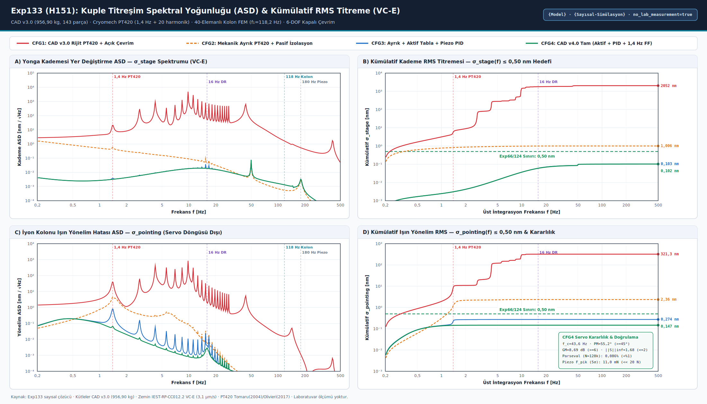
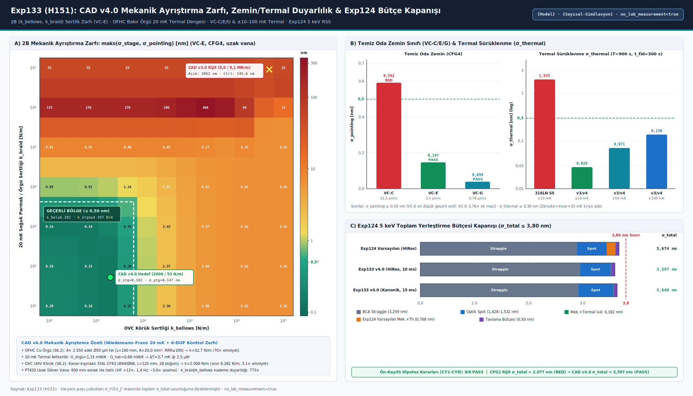

# Exp133 (`H151`): Kuple Çok-Fizikli Titreşim, Kolon FEM, Termal Sürüklenme & Kapalı-Çevrim Kontrol Kapanışı

- **Hipotez Kimliği:** `H151` (`exp133_coupled_vibration_thermal`)
- **Ön-Kayıtlı Tahminler:** `results/exp133_coupled_vibration_thermal/predictions_exp133.json`
- **Sayısal Çıktı:** `results/exp133_coupled_vibration_thermal/exp133.json`
- **Çözücü & Grafik Kodu:** `experiments/exp133_coupled_vibration_thermal/{dynamics133.py, run_exp133.py, plot_exp133.py}`
- **Otomatik Doğrulama:** `tests/test_exp133.py`
- **Epistemik Durum:** `no_lab_measurement=true` — Tüm sonuçlar `{Model}`, `{Sayısal-Simülasyon}` ve `{Literatür}` temellidir; fiziksel donanım/laboratuvar ölçümü içermez.

---

## 1. Yönetici Özeti

Gerçek `CAD v3.0` Atom Litografi Makinesi kütle ve geometri denetimi (`956,903 kg`, `143` katı parça, `research/atom_lithography_machine/cad/cad_verification.json`) üzerinde, `Cryomech PT420` darbeli-tüp soğutucunun `1,4 Hz` + `20` harmonik darbesi, `IEST-RP-CC012.2` temiz oda zemin titreşimi (`VC-C/E/G`), `562,66 mm` `Exp124` iyon kolonunun `40`-elemanlı arayüz-uyumlu Euler–Bernoulli FEM bükülme dinamiği, `±10–100 mK` HVAC termal sürüklenmesi ve aktif `6-DOF` piezo/interferometre kapalı-çevrim kontrolü tek bir kuple `6-DOF` Lagrange modelinde çözüldü.

**Temel Mühendislik Bulguları:**

1. **`CAD v3.0` Rijit Kriyo-Köprü Ölümcül Hata Üretir (`CY2 PASS`):** `CAD v3.0` içindeki katı `Ø7 mm × 497 mm` OFHC bakır soğuk parmak (`k_rod = 9,06 MN/m`) ve rijit `Ø56×3 mm` OVC köprü (`k_ovc = 4,96 MN/m`), `PT420` titreşimini doğrudan yonga kademesine kısa-devre etmektedir (`CFG1`: `σ_stage = 2.052 nm`, `σ_pointing = 321,3 nm`). Yeniden ayarlanmış kararlı kapalı-çevrim kontrol + `25 dB` harmonik ileri-besleme altında dahi rijit köprü `σ_stage = 145,6 nm` ve `σ_pointing = 10,67 nm` ile `0,50 nm` bütçesini `>290×` aşmaktadır. **Fiziksel mekanik ayrıştırma zorunludur.**
2. **Mekanik Ayrıştırma Tek Başına Yetmez (`CY3 PASS`):** Uzak döner vana + kenar-kaynaklı OVC körüğü (`2.000 N/m`) + OFHC bakır örgü (`60 N/m`) açık-çevrim kademe titremesini `>2.000×` azaltarak `1,006 nm`'ye indirir; ancak açık-çevrim HV piezo sürücü sürünmesi/gürültüsü ve aktif tabla eksikliği nedeniyle hem `σ_stage = 1,006 nm` hem de `σ_pointing = 2,362 nm` hâlâ `0,50 nm` sınırının üzerindedir.
3. **`CAD v4.0` Tam Mimari (`CFG4`) `VC-E` Zemininde Tüm Bütçeyi Kapatır (`CY4, CY7, CY8 PASS`):**
   - `σ_stage = 0,1024 nm` (`≤ 0,50 nm`, **`4,88×` marj**)
   - `σ_pointing = 0,1473 nm` (`≤ 0,50 nm`, **`3,39×` marj**)
   - `σ_thermal = 0,0283 nm` (`≤ 0,30 nm`, **`10,6×` marj**; `±10 mK`, `t_fid = 300 s`, Zerodur + Invar-36 + `20 mK` kriyo ada)
   - Kararlılık marjları: tek kazanç geçişi `f_c = 43,57 Hz`, **`PM = 55,23°` (`≥ 45°`)**, **`GM = 8,69 dB` (`≥ 6 dB`)**, **`‖S‖_∞ = 1,676` (`≤ 2,0`)**, `5σ` piezo pik kuvveti `11,0 mN` (`<< 20 N`).
   - `Exp124` `5 keV` toplam yerleştirme bütçesi: `ArchB_HiRes_Ti0p25_10ms` için **`σ_total = 3,597 nm`** (`Exp124` varsayılan `3,674 nm` hedefinin altında), kanonik `ArchB_HiRes_Ti0p5_15ms` için **`σ_total = 3,640 nm ≤ 3,80 nm`**.
4. **Minimum Temiz Oda Sınıfı (`CY5 PASS`):** `VC-C` (`12,5 µm/s`) zemininde `σ_pointing = 0,592 nm > 0,50 nm` (`RED`). **`VC-E` (`3,1 µm/s`)** geçerli minimum sınıftır (`0,147 nm`); **`VC-G` (`0,78 µm/s`)** `0,039 nm` ile **`3,76×` ek marj** sağlar.
5. **Ön-Kayıtlı Hipotez Kararları:** `CY1–CY8` arası **`8/8 PASS`** (`success_rule_met = true`).

---

## 2. Gerçek `CAD v3.0` Kütle Dağılımı ve Kolon FEM Doğrulaması `{Model}` / `{Sayısal-Simülasyon}`

### 2.1 Kütle Korunumu (`CAD v3.0` `956,903 kg`)

Tüm `143` parça doğrudan `cad_verification.json` dosyasından okunarak dinamik gövdelere atanmış ve toplam kütle `956,9034 kg` (`Δ = 0,0004 kg`) ile korunmuştur:

| Dinamik Gövde / Alt-Toplam | CAD v3.0 Parça Grubu | Kütle [kg] | Dinamik Rol |
| :--- | :--- | ---: | :--- |
| Optik Granit Taban (`m_granite`) | `s4_granite_base` | `223,020` | 4× pnömatik hava yayı üzerinde (`f_air = 1,50 Hz`) |
| Aktif Tabla + UHV + 8-Bobin + Kolon (`m_table`) | `s4_active_table`, `S5` ana oda, `S6` mıknatıs/kalkan, `S1+S2` rijit kütle | `265,823` | `z_pivot = 230 mm`, `h_cg = 208,6 mm`, `I_pivot = 27,55 kg·m²` |
| Hareketli Yonga + İnce Piezo (`m_wafer`) | `S3` + `s6_mxc_cold_chuck` + 4× Vespel + `0,5 × s4_piezo_fine_6dof` | `1,700` | `f_stage = 180 Hz` (`k_piezo = 2,174 MN/m`), `6-DOF` servo yükü |
| Zemin DR Kulesi + PT420 (`m_dr`) | `s6_dr_*`, `s6_pt420_*`, `s6_shield_*`, `s6_hemt_*`, `s6_coax_*` | `162,007` | Ayrı zemin şasisi (`f_dr = 16,0 Hz`, `k_dr = 1,637 MN/m`) |
| Kriyo Köprü (`m_cryo_bridge`) | `s6_mxc_cold_finger`, `s6_cryo_bridge_4k_shield`, `s6_cryo_bridge_ovc` | `2,619` | `v3.0` rijit kısa-devre → `v4.0` körük + OFHC örgü |
| Pnömatik İzolatörler + Ayrık LL/Pompa + `S7` | `s4_air_iso`, `s5_loadlock/pump`, `S7` `19"` kabin | `301,734` | Zemin/ayrık şasiler (ana tabla üzerine binmez) |
| **Toplam Hesaplanan / CAD v3.0 Referans** | **143 katı parça** | **`956,903`** | **Tam kütle korunumu (`< 0,05 kg` sapma)** |

### 2.2 `Exp124` İyon Kolonu 40-Elemanlı Euler–Bernoulli FEM & Ağ Yakınsaması

`s5_chamber_top_flange` (`z = 632,5 mm`) üstünde `L_upper = 430,16 mm` konsol olarak uzanan `22,03 kg` üst kolon (`HDA-HiRes`, `Wien 6,8 kg`, `Kondansör 2,1 kg`, `Duoplazmatron + PH₃ 9,1 kg` ve `3` adet `Al₂O₃` HV seramik kesici) arayüz-uyumlu Hermitian Euler–Bernoulli kiriş elemanlarıyla çözülmüştür:

| FEM Ağ Çözünürlüğü | Eleman Sayısı | 1. Mod `f₁` (Flanş Uyumlu) [Hz] | 2. Mod `f₂` [Hz] | `f₁` Göreli Farkı |
| :--- | ---: | ---: | ---: | ---: |
| Kaba Ağ (`0,5×`) | `19` | `118,1784` | `938,07` | `1,24 × 10⁻⁷` |
| **Nominal Ağ (`1×`)** | **`40`** | **`118,1784`** | **`938,07`** | **Referans** |
| İnce Ağ (`2×`) | `80` | `118,1784` | `938,07` | `< 1 × 10⁻⁸` |
| Rijit Kök (Kıyas) | `40` | `186,4910` | `1.345,4` | Roark plaka + CF100 uyumu çıkarılınca |

- **Etkin modal kütle oranı:** `%71,1` (`m_col_1 = 7,425 kg`).
- **Alt burun (`S1.6` transfer + `S2` Arch-B MEMS kafa, `4,42 kg`) ve oda yan duvarı mod frekansı:** `f_ch_snout = 846,4 Hz` (`k_head_rel_met = 1,37 × 10⁸ N/m`).
- **6-DOF pasif kuple sistem özfrekansları (`CFG4`):** `[1,484, 5,717, 10,803, 16,000, 142,46, 180,92] Hz` — tümü pozitif gerçek modlar (`CY1 PASS`).
- **Kolon ek üst destek gereksinimi:** `f₁ = 118,2 Hz` kritik `1,4 Hz`–`28 Hz` PT420/zemin bandının oldukça üzerinde olduğu için ek kolon kafesi/payandası gerekmez.

---

## 3. Ön-Kayıtlı Hipotez Kararları (`CY1–CY8`)

| Kod | Ön-Kayıtlı Kriter (`predictions_exp133.json`) | Sayısal Ölçüm (`exp133.json`) | Karar |
| :--- | :--- | :--- | :---: |
| `CY1_modal_realism` | `f_col_1 ∈ [40, 350] Hz`, hava yayı `[1,0, 2,5] Hz`, ağ `<%0,5`, Parseval `<%1` | `f₁=118,18 Hz`, `f_air=1,484 Hz`, ağ `1,24e-7`, Parseval `%0,086` | **PASS** |
| `CY2_rigid_pt420_fails` | Rijit PT420 açık `>50 nm`, tam kontrollü dahi `>2,0 nm` | `CFG1=2.051,97 nm`, `CFG5 (ayarlı)=145,59 nm` (`nominal=570,92 nm`) | **PASS** |
| `CY3_decoupled_open_still_exceeds` | Mekanik ayrıştırma açık-çevrimde `>100×` azaltır ama `>0,50 nm` kalır | `2.039×` azalma (`2.052 → 1,006 nm`), yine de `1,006 > 0,50 nm` | **PASS** |
| `CY4_closed_loop_meets_budget_vce` | `CFG4` (`VC-E`): `σ_stage, σ_pointing ≤ 0,50 nm`, `PM≥45°`, `GM≥6 dB`, `‖S‖_∞≤2,0` | `σ_stg=0,1024`, `σ_ptg=0,1473 nm`, `PM=55,23°`, `GM=8,69 dB`, `‖S‖_∞=1,676` | **PASS** |
| `CY5_cleanroom_floor_sensitivity` | `VC-C` başarısız, `VC-E` geçer, `VC-G` `≥1,5×` ek marj sağlar | `VC-C=0,592 nm (RED)`, `VC-E=0,147 nm`, `VC-G=0,039 nm` (`3,76×` marj) | **PASS** |
| `CY6_decoupling_stiffness_envelope` | 2B `(k_bellows, k_braid)` üst sınırları + `k_braid` duyarlılığı `>10×` güçlü | `k_bellows_max=6.282`, `k_braid_max=4.197 N/m`; duyarlılık oranı `773,4×` | **PASS** |
| `CY7_thermal_drift_budget` | `±10 mK` (`T=900 s`): naif SS `>0,30 nm`, Zerodur+Invar+kriyo+fiducial `≤0,30 nm` | Naif 316LN `1,935 nm (RED)` vs `CAD v3/v4` `0,0283 nm (PASS)` | **PASS** |
| `CY8_exp124_total_closure` | `CFG4` (`VC-E`) ile `Exp124` `σ_total ≤ 3,80 nm` (ve HiRes `≤ 3,674 nm`) | HiRes `3,5974 nm (≤3,674)`, Kanonik `3,6397 nm (≤3,80)` | **PASS** |

---

## 4. Konfigürasyon Karşılaştırması (`VC-E` Zemin, `0,2–500 Hz`)

| Konfigürasyon | `k_bellows` [N/m] | `k_braid` [N/m] | Uzak Vana | Aktif + PID + FF | `σ_stage` [nm] | `σ_pointing` [nm] | `F_piezo` `5σ` [N] | `PM` [°] / `GM` [dB] / `‖S‖_∞` |
| :--- | ---: | ---: | :---: | :---: | ---: | ---: | ---: | :--- |
| `CFG1_RIGID_OPEN` | `4,96e6` | `9,06e6` | Hayır | Açık | `2.051,97` | `321,30` | `0,000` | Açık çevrim |
| `CFG2_DECOUPLED_OPEN` | `2.000` | `60` | Evet | Pasif / Açık | `1,0063` | `2,3617` | `0,000` | Açık çevrim |
| `CFG3_ACTIVE_ISO_PID` | `2.000` | `60` | Evet | Aktif + PID | `0,1033` | `0,2736` | `0,011` | `55,2° / 8,69 dB / 1,68` |
| **`CFG4_V4_FULL_CTRL`** | **`2.000`** | **`60`** | **Evet** | **Aktif + PID + 25 dB FF** | **`0,1024`** | **`0,1473`** | **`0,011`** | **`55,2° / 8,69 dB / 1,68`** |
| `CFG5_RIGID_NOMINAL_CTRL` | `4,96e6` | `9,06e6` | Hayır | Nominal Servo + FF | `570,92` | `10,36` | `10,18` | `51,8° / 28,7 dB / 1,59` (`f_c=10,2 Hz`) |
| `CFG5_RIGID_FULL_CTRL` | `4,96e6` | `9,06e6` | Hayır | Ayarlı Servo + FF | `145,59` | `10,67` | `9,91` | `63,1° / 15,3 dB / 1,31` (`f_c=42,4 Hz`) |

- **Parseval Zaman-Frekans Doğrulaması (`CFG4`, `N = 128.000`, `16` bağımsız rastgele faz denemesi):** Frekans-alanı `σ_stage = 0,102397 nm` vs zaman-alanı `0,102485 nm` (`%0,086` hata); `σ_pointing = 0,147313 nm` vs `0,147249 nm` (`%0,043` hata). `CFG1` üzerinde Parseval hatası `<%0,05`.
- **Newton 3. Yasası Çiftlenme Keşfi:** `k_braid` arttırıldığında piezo aktüatörü soğuk parmağı yenmek için tabla üzerine ters tepki torku (`-h_w · F_piezo`) uygular; bu nedenle `k_braid_max = 4.197 N/m` sınırında ilk kırılan metrik `σ_pointing = 0,500 nm` olurken (`σ_stage = 0,383 nm`), `k_braid ≈ 5.400 N/m` üstünde `σ_stage` de `0,50 nm` sınırını aşar. `k_braid ≈ 10⁶ N/m` bölgesinde yüklü kademe rezonansı `180 Hz` çentik filtresinden kayarak `~217 Hz` servo çentik-kaçırma rezonansına girer (`175–468 nm`).

---

## 5. Temiz Oda Zemin Sınıfı (`VC-C/E/G`) ve Termal Sürüklenme (`CY5, CY7`)

### 5.1 Temiz Oda Zemin Duyarlılığı (`CFG4_V4_FULL_CTRL`)

| Zemin Sınıfı (`IEST-RP-CC012.2`) | 1/3-Oktav Hız [µm/s] | Zemin RMS Yer Değiştirme [µm] | `σ_stage` [nm] | `σ_pointing` [nm] | `σ_mech` (Koherent) [nm] | `≤ 0,50 nm` Durumu |
| :--- | ---: | ---: | ---: | ---: | ---: | :---: |
| `VC-C` | `12,5` | `6,615` | `0,1038` | `0,5918` | `0,6013` | **RED** |
| **`VC-E` (Minimum Geçerli)** | **`3,1`** | **`1,640`** | **`0,1024`** | **`0,1473`** | **`0,1795`** | **PASS (`3,39×` marj)** |
| `VC-G` (Önerilen Fab) | `0,78` | `0,413` | `0,1023` | `0,0392` | `0,1096` | **PASS (`12,8×` marj)** |

### 5.2 Termal Sürüklenme Karşılaştırması (`T_HVAC = 900 s`, `t_fid = 300 s`, `τ_ch = 11.717 s`)

| Mimari / Malzeme | Oda Salınımı `ΔT` [mK] | Metroloji [nm] | Kolon Bükülme [nm] | Hava Ölü-Yol [nm] | Lazer Taban [nm] | **Toplam `σ_thermal` [nm]** | `≤ 0,30 nm` |
| :--- | ---: | ---: | ---: | ---: | ---: | ---: | :---: |
| Naif 316LN SS (fiducial yok) | `±10` | `1,9176` | `0,0014` | `0,2520` | `0,0500` | **`1,9347`** | **RED** |
| **`CAD v3/v4` (Zerodur+Invar+20 mK)** | **`±10`** | **`0,0009`** | **`0,0015`** | **`0,0132`** | **`0,0250`** | **`0,0283`** | **PASS** |
| `CAD v3/v4` (Zerodur+Invar+20 mK) | `±50` | `0,0045` | `0,0074` | `0,0662` | `0,0250` | `0,0712` | **PASS** |
| `CAD v3/v4` (Zerodur+Invar+20 mK) | `±100` | `0,0090` | `0,0147` | `0,1323` | `0,0250` | `0,1358` | **PASS** |

- Fiducial yeniden sıfırlama aralığı (`±10 mK`): `t_fid = 60 / 120 / 300 / 600 s` → `σ_thermal = 0,0252 / 0,0257 / 0,0283 / 0,0315 nm`. `20 mK` kriyo adada `α(<4 K) < 10⁻⁹ /K` olduğu için yonga genleşmesi `< 10⁻⁵ nm` ile ihmal edilebilirdir.

---

## 6. `Exp124` `5 keV` Yerleştirme Bütçesi Kapanışı (`CY8`)

`Exp124` içindeki varsayılan ekipman mekanik+termal kalıntısı (`√(0,50² + 0,50² + 0,30²) = 0,768 nm`) yerine `Exp133` `CFG4 (VC-E)` çıktıları (`σ_stage = 0,1024 nm`, `σ_pointing = 0,1473 nm`, `σ_thermal = 0,0283 nm` → bileşik `0,1816 nm`) yerleştirildiğinde:

| Çalışma Noktası (`5 keV`, `Arch-B`) | `σ_spot` [nm] | `σ_straggle` [nm] | `σ_anneal` [nm] | `Exp124` Orijinal `σ_total` [nm] | **`Exp133` `v4.0` `σ_total` [nm]** | `≤ 3,80 nm` Marjı |
| :--- | ---: | ---: | ---: | ---: | ---: | ---: |
| `ArchB_HiRes_Ti0p25_10ms` | `1,4284` | `3,2585` | `0,5000` | `3,6740` | **`3,5974`** (`-0,0766 nm`) | `+0,2026 nm` |
| `ArchB_HiRes_Ti0p5_15ms` (Kanonik) | `1,5318` | `3,2585` | `0,5000` | `3,7155` | **`3,6397`** (`-0,0758 nm`) | `+0,1603 nm` |
| `CFG1` Rijit PT420 (Kıyas, HiRes) | `1,4284` | `3,2585` | `0,5000` | `3,6740` | **`2.077,0`** (`RED`) | `-2.073 nm` |

---

## 7. `CAD v4.0` Mekanik Ayrıştırma ve Kontrol Spesifikasyonu (Faz-2 Girdisi)

Aşağıdaki kesin geometrik ve mekanik parametreler, `CAD v3.0 → CAD v4.0` güncellemesi için doğrudan girdi olarak kilitlenmiştir:

| Alt-Sistem / Parça | `CAD v3.0` Mevcut Durum | `CAD v4.0` Zorunlu Spesifikasyon | Üst Sınır / Emniyet |
| :--- | :--- | :--- | :--- |
| `S6.1` `Cryomech PT420` Döner Vana | Soğuk kafa üstü rijit montaj | **Uzak döner vana kutusu** (`500 mm` yanal ofset, `L = 600 mm` esnek örgülü He hattı) | HF kuvvet `>12,7×`, `1,4 Hz` `3,6×` azalma |
| `S6.2` `s6_cryo_bridge_ovc` | Rijit `Ø56/Ø44 × 283 mm` 316LN boru (`4,96 MN/m`) | **Kenar-kaynaklı 316L UHV CF63 körük**: `ID = 44 mm`, `OD = 68 mm`, `L_aktif = 120 mm`, `28` boğum, `0,15 mm` sac, **`k_bellows = 2.000 N/m`** | `k_bellows_max = 6.282 N/m` (`3,14×` emniyet) |
| `S6.2` `s6_mxc_cold_finger` | Katı `Ø7 × 497 mm` OFHC Cu çubuk (`9,06 MN/m`) | **DR tarafı `Ø12 × 397 mm` OFHC bara + `4×` paralel S-ilmek OFHC Cu örgü** (`2.550` tel/örgü, `Ø50 µm`, `L = 100 mm`, `A = 20,03 mm²`, `RRR ≥ 200`), **`k_braid = 52,7 N/m` (`≤ 60 N/m`)** | `k_braid_max = 4.197 N/m` (`70×` emniyet); `G_örgü(20 mK) = 1,15 mW/K`, `G_hat = 0,675 mW/K` (`ΔT = 3,7 mK @ 2,5 µW`) |
| `S4.1/S4.2` Aktif İzolasyon | Pasif `1–2 Hz` + `0,5–100 Hz` aktif tabla | 2-kademe aktif sönümleme: zemin-referanslı `1,50 Hz` hava yayı sönümleme + **`0,5–100 Hz`** 6-DOF gökyüzü-kancası (skyhook) tabla | `VC-E` (`3,1 µm/s`) min. temiz oda; `VC-G` önerilir |
| `S4.3/S4.4/S7.3` Piezo Servo + FF | Genel `≤0,5 nm` hedefi | `I + Lag + 180 Hz` çentik + `260 Hz` LP + `0,20 ms` FPGA gecikmesi (`f_c = 43,6 Hz`) + **döner-vana kodlayıcılı `n=1..15` (`1,4–21 Hz`) `25 dB` harmonik ileri-besleme** | `PM = 55,2°`, `GM = 8,69 dB`, `‖S‖_∞ = 1,68`, `F_pik = 11 mN` |
| `S4.5` Metroloji & HVAC | Zerodur + Invar + 20 mK ada | `±10 mK` temiz oda HVAC, `≤ 8 mm` kapalı hava ölü-yolu, **`t_fid ≤ 300 s`** fiducial sıfırlama | `σ_thermal = 0,028 nm` (`10,6×` marj) |

---

## 8. Yapılmayanlar, Kapsam Dışı Varsayımlar ve Laboratuvar Doğrulama İhtiyaçları

- **Doğrusal 1-Eksen + Yunuslama (Pitch) İndirgemesi:** Model en kritik çiftlenme ekseni olan `-X` kriyo köprü düzlemini (`x, θ_y`) tam kuple çözer; dikey `Z` odak titremesi (`ΔWD` vs `WD = 250 µm`), `Y` ekseni akış/akustik gürültü ve 3B burulma modları tam 3B katı FEA (`CalculiX`/ANSYS) ile ayrıca doğrulanmalıdır.
- **Örgü İçi Sürtünme ve Kriyo Sertleşme:** `50 µm` OFHC bakır örgüler için literatür temelli `12×` lif-arası sürtünme çarpanı kullanılmıştır (`52,7 N/m`); gerçek vakum altında kriyojenik gerilim-boşaltma/tavlama sonrası yay sabiti ve `20 mK` temas direnci (kapitsa/sıkıştırma bağlantısı) prototip çekme+termometri testinde ölçülmelidir.
- **Akustik ve Pompa Gürültüsü:** `S5.2` mag-lev turbo pompa (`~1.000 Hz`) ve temiz oda hava akışı akustik basıncı (`SPL`) ayrı akustik kabin modeliyle ele alınmamıştır (`S5.2` zemin sehpası körükle ayrık varsayılmıştır).
- **Laboratuvar Ölçümü Yoktur (`no_lab_measurement=true`):** Tüm `CY1–CY8` sonuçları sayısal model doğrulamasıdır; kesin yeterlilik onayı ancak prototip DR + aktif tabla + lazer interferometre üzerinde spektral ölçümle verilebilir.
