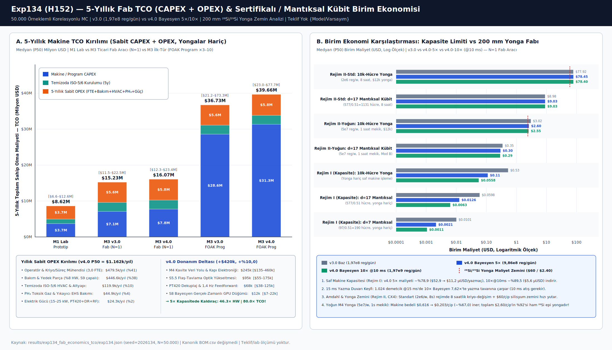
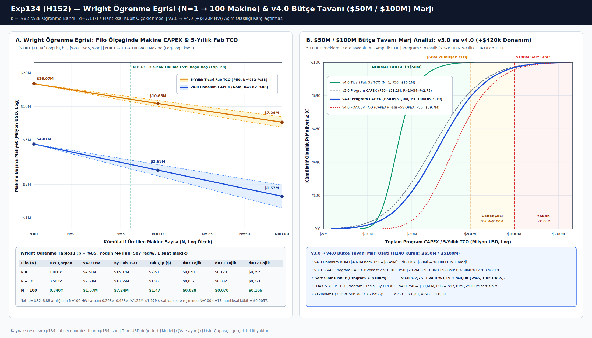

# Exp134 (`H152`) — Fab Ölçeğinde Birim Ekonomi, 5-Yıllık TCO & `v3.0 → v4.0` Değer Analizi

> **Epistemik Dürüstlük Beyanı:** Bu çalışma tamamen parametrik mühendislik ve korelasyonlu Monte Carlo maliyet modellemesine dayanır (`no_lab_measurement = true`, `no_supplier_quotes = true`). Gerçek tedarikçi teklifi, temizoda inşaat keşfi veya fab ölçümü **yoktur**. Tüm USD büyüklükleri `BOM_DETAILED.csv` (`{Model-Kalibrasyon-Exp114}`, `{Liste-Çapası}`, `{Varsayım}`) ile açıkça işaretlenmiş mühendislik varsayımlarına (`{Varsayım}`) dayanır. Kanonik `BOM.csv` dosyasına dokunulmamıştır (`SHA-256` değişmezliği doğrulanmıştır).

---

## 1. Yönetici Özeti ve Ön-Kayıtlı Hipotez Kararları (`CX1–CX6`)

`Exp134`, Atom Litografi Makinesi'nin `v3.0` temel konfigürasyonundan (`1,973×10^8` sertifikalı yazmaç/gün, `BOM_DETAILED.csv` `M3` nominal `$4,189,600`) **`v4.0`** mimarisine (`+$420,000` nominal donanım yükseltmesi: `M4` kavite-QED veri yolu, `S5.5` flaş-tavlama optiği, `PT420` titreşim dekuplajı + `1,4 Hz` feedforward, `S8` Bayesyen gerçek-zamanlı GPU düğümü) geçişinin **5-yıllık Toplam Sahip Olma Maliyeti (TCO = CAPEX + OPEX)**, **sertifikalı yazmaç / fiziksel kübit / 10k-hücre çip / `M4` yüzey kodu (`d=7/11/17`) mantıksal kübit birim ekonomisi**, **Wright öğrenme eğrisi (`N = 1 → 100`)** ve **`$50M / $100M` bütçe tavanı marjı** üzerindeki etkisini `N = 50,000` korelasyonlu Monte Carlo örneklemiyle (`seed = 2026134`) nicelemektedir.

Ön-kayıtlı tahminler (`results/exp134_fab_economics_tco/predictions_exp134.json`, simülasyondan önce kaydedilmiştir) **6/6 dürüstçe puanlanmış**; genel başarı kuralı (`CX1 ∧ CX2 ∧ CX3 ∧ CX6`) **`PASS`** almış, **`CX4` ise önemli bir fiziksel/ekonomik zemin keşfiyle dürüstçe `FAIL` olarak kaydedilmiştir**:

| Kod | Ön-Kayıtlı Kriter | Ölçülen Değer (`exp134.json`) | Karar | Temel Mühendislik Anlamı |
| :--- | :--- | :--- | :--- | :--- |
| **CX1** | Kanonik `BOM.csv` SHA-256 değişmezliği + `M3 = $4,189,600` (`±$1`) + `v3.0 = 1,973e8` reg/gün (`≤%1`) | `SHA-256 OK`, `M3 = $4,189,600`, `1,97288e8` (`Δ = %0,006`) | **PASS** | Kanonik maliyet ve `Exp127` üretim çapası birebir korundu. |
| **CX2** | `v4.0` (`+$420k` HW) ile `P(BOM > $50M) < %0,1` ve `P(Program_stok > $100M) < %5,0` | `P(BOM > $50M) = %0,00`; `P(Prog > $100M) = %3,19 ± %0,08` | **PASS** | `+$420k` (`+%10,0`) donanım artışı `$100M` sert bütçe sınırını bozmaz. |
| **CX3** | Rejim I (kapasite): `v4.0-5×` `≥%75` ve `10×@10ms` `≥%85` `$/reg` düşüşü; `10×@15ms` yazma duvarı `<8,0×` | `5×: −%78,9`; `10×@10ms: −%89,5`; `10×@15ms: 7,62×` (`bottleneck=write`) | **PASS** | `1,024` demetcik `@15 ms` atışta yazma tavanına çarpar (`10 ms` gerekir). |
| **CX4** | Rejim II: Std (`2e6/w, 8s`) `<%15` düşüş VE Yoğun (`5e7/w, 1s`) `>%50` çip maliyet düşüşü | Std: `+%0,68` (düşüş `−%0,7 < %15`); Yoğun: **`−%13,7`** (makine `−%67,7`, yonga zemini `%92,2`!) | **FAIL** | **Kritik Keşif:** Yoğun `M4` fabında makine payı `$0,62 → $0,20/çip` (`−%67,7`) düşse de ham `$12k` `²⁸Si/²⁹Si` epi yongası (`$2,40/çip`) toplam maliyetin `%92,2`'sini kilitleyerek toplam çip düşüşünü `%13,7` ile sınırlar! |
| **CX5** | Wright `b=%85`, `N=100`: donanım CAPEX `≥%60` düşüş (`≤0,40×`) ve yoğun fab `d=17` mantıksal `<$50` | `N=100` HW çarpanı `0,340×` (`−%66,0`, `$1,57M`); yoğun fab `d=17 = $0,166` | **PASS** | Filo ölçeğinde donanım üçte bire iner; `d=17` mantıksal kübit `$0,17` düzeyine geriler. |
| **CX6** | `25k vs 50k` MC yakınsaması: `ΔP50 ≤ %1,0` ve `SE(P>100M) < 0,002` | `ΔP50 = %0,428`, `ΔP95 = %0,584`, `SE = 0,00079` | **PASS** | `50,000` örneklemli MC kuyruk istatistikleri istatistiksel olarak yakınsamıştır. |

---

## 2. `v4.0` Donanım Deltası, Yıllık Sabit OPEX ve 5-Yıllık TCO Kırılımı

### 2.1 `v3.0 → v4.0` Donanım Maliyet Deltası (`{Varsayım}`)

`BOM_DETAILED.csv` `M3` donanım tabanına (`$4,189,600` nominal, `$2,329,000–$7,834,700` aralık) dört `v4.0` yükseltme paketi eklendiğinde toplam donanım BOM'u yalnızca **`+$420,000` (`+%10,02`)** artarak **`$4,609,600`** nominal düzeyine ulaşır:

| `v4.0` Yükseltme Kalemi | Düşük (P10) | Nominal (P50) | Yüksek (P90) | Epistemik Etiket |
| :--- | ---: | ---: | ---: | :--- |
| `M4` Kavite-QED Veri Yolu & Kapı Elektroniği | `$135,000` | `$245,000` | `$460,000` | `{Varsayım}` |
| `S5.5` Flaş-Tavlama Optik Yükseltmesi | `$55,000` | `$95,000` | `$175,000` | `{Varsayım}` |
| `PT420` Dekuplaj Körükleri & `1,4 Hz` Feedforward | `$38,000` | `$68,000` | `$125,000` | `{Varsayım}` |
| `S8` Bayesyen Gerçek-Zamanlı GPU Düğümü | `$7,000` | `$12,000` | `$22,000` | `{Varsayım}` |
| **Toplam `v4.0` Donanım Deltası** | **`$235,000`** | **`$420,000`** | **`$782,000`** | **`+%10,02` (`M3` = `$4,609,600`)** |

### 2.2 Yıllık Sabit Fab OPEX ve Temizoda Altyapısı (`N = 50,000` MC)

| Maliyet Bileşeni | P10 (`USD`) | Medyan P50 (`USD`) | P90 (`USD`) | `v4.0` OPEX Payı (P50) | Epistemik Etiket |
| :--- | ---: | ---: | ---: | ---: | :--- |
| Operatör & Kriyo/Süreç Mühendisi (`3,0 FTE`) | `$319,228/yıl` | `$479,524/yıl` | `$719,492/yıl` | `%41,3` | `{Varsayım}` |
| Bakım & Yedek Parça (`%8/yıl` HW, `S9` çapalı — `v3.0`) | `$240,990/yıl` | `$407,116/yıl` | `$771,114/yıl` | — | `{Model}` |
| Bakım & Yedek Parça (`%8/yıl` HW, `S9` çapalı — `v4.0`) | `$272,045/yıl` | `$446,644/yıl` | `$816,346/yıl` | `%38,4` | `{Model}` |
| Temizoda `ISO-5/6` HVAC & Altyapı İşletmesi | `$76,069/yıl` | `$119,883/yıl` | `$189,468/yıl` | `%10,3` | `{Varsayım}` |
| `PH₃` Toksik Gaz, Yıkayıcı & EHS Bakımı | `$27,457/yıl` | `$44,931/yıl` | `$73,469/yıl` | `%3,9` | `{Varsayım}` |
| Elektrik Gücü (`15–25 kW`, `PT420 + DR + RF`) | `$14,960/yıl` | `$24,281/yıl` | `$39,328/yıl` | `%2,1` | `{Varsayım}` |
| **Toplam Yıllık Sabit OPEX — `v3.0`** | **`$853,332/yıl`** | **`$1,124,108/yıl`** | **`$1,559,592/yıl`** | — | `{Model/Varsayım}` |
| **Toplam Yıllık Sabit OPEX — `v4.0`** | **`$885,512/yıl`** | **`$1,162,272/yıl`** | **`$1,604,263/yıl`** | **`%100`** | `{Model/Varsayım}` |
| Temizoda `ISO-5/6` Bay Kurulum CAPEX (Tek Seferlik) | `$1,441,224` | `$2,502,680` | `$4,318,160` | — | `{Varsayım}` |

### 2.3 5-Yıllık Toplam Sahip Olma Maliyeti (TCO — Ham `²⁸Si` Yongaları Hariç)

| Senaryo (5-Yıllık Ufuk, Yongalar Hariç) | P10 (`$M`) | Medyan P50 (`$M`) | P90 (`$M`) | P95 (`$M`) | `v3.0 → v4.0` Farkı |
| :--- | ---: | ---: | ---: | ---: | :--- |
| `M1` Laboratuvar Prototipi (`N=1`) | `$6,56M` | **`$8,62M`** | `$12,62M` | `$14,81M` | Referans lab çizgisi |
| `M3 v3.0` Ticari Fab Aracı (`N=1`, `1,35×` kurulum) | `$11,52M` | **`$15,23M`** | `$22,51M` | `$26,41M` | Baz ticari fab aracı |
| `M3 v4.0` Ticari Fab Aracı (`N=1`, `1,35×` kurulum) | `$12,31M` | **`$16,07M`** | `$23,38M` | `$27,31M` | **`+$0,83M` (`+%5,5`)** |
| `M3 v3.0` İlk-Tür FOAK Program (`×3–×10` stokastik) | `$21,17M` | **`$36,73M`** | `$73,34M` | `$92,35M` | Baz FOAK program |
| `M3 v4.0` İlk-Tür FOAK Program (`×3–×10` stokastik) | `$22,99M` | **`$39,66M`** | `$77,67M` | **`$97,19M`** | **`+$2,94M` (`+%8,0`; `P95 < $100M`)** |

---

## 3. Rejim I — Kararlı-Durum Makine Kapasitesi Birim Ekonomisi (`%80` Uptime, Yonga Hariç)

Saf makine üretim limiti altında (`8,960` paralel okuma kanalı = `56 × 160`, `1,024` yazma demetciği, `Mod B f=%1` verim `0,51`, `η=0,9994`, `%80` yıllık çalışma süresi), `v4.0` Bayesyen uyarlamalı spektroskopinin **`5×`** ve **`10×`** hızlanmasının `N=1` Ticari Fab Aracı (`5y` TCO) ve FOAK Program üzerindeki birim maliyet etkisi aşağıdadır:

| Yapılandırma (`N=1` Ticari Fab Aracı, 5y TCO) | Net Hız (`reg/gün`) | Darboğaz | `$/Yazmaç` (P50) | `$/Fiziksel Kübit` (`K=8` / `K=4`) | `$/10k-Çip` (P50) | `M4` Mantıksal `d=7` (`Mod B`) | `M4` Mantıksal `d=11` (`Mod B`) | `M4` Mantıksal `d=17` (`Mod B`) |
| :--- | ---: | :--- | ---: | ---: | ---: | ---: | ---: | ---: |
| `v3.0` Baz (`15 ms` atış, `1,0×`) | `1,973e8` | Spektroskopi | `$52,89 µUSD` | `$6,61 / $13,22 µUSD` | `$0,529` | `$0,0101` | `$0,0250` | `$0,0598` |
| **`v4.0` Bayesyen `5×` (`15 ms` atış)** | **`9,864e8`** | **Spektroskopi** | **`$11,15 µUSD` (`−%78,9`)** | **`$1,39 / $2,79 µUSD`** | **`$0,112`** | **`$0,0021`** | **`$0,0053`** | **`$0,0126`** |
| `v4.0` Bayesyen `10×` (`15 ms` — **yazma duvarı!**) | `1,503e9` | **Yazma (`7,62×`)** | `$7,32 µUSD` (`−%86,2`) | `$0,92 / $1,83 µUSD` | `$0,073` | `$0,0014` | `$0,0035` | `$0,0083` |
| **`v4.0` Bayesyen `10×` (`10 ms` atış)** | **`1,973e9`** | **Spektroskopi** | **`$5,58 µUSD` (`−%89,5`)** | **`$0,70 / $1,39 µUSD`** | **`$0,056`** | **`$0,0011`** | **`$0,0026`** | **`$0,0063`** |
| `v4.0` Bayesyen `15×` (`10 ms` — **yazma duvarı!**) | `2,255e9` | **Yazma (`11,43×`)** | `$4,88 µUSD` (`−%90,8`) | `$0,61 / $1,22 µUSD` | `$0,049` | `$0,0009` | `$0,0023` | `$0,0055` |

> **FOAK Program (`×3–×10` stokastik 5y TCO) Karşılaştırması:** İlk-tür FOAK program maliyetinin tamamı tek makineye yüklense dahi (`P50 = $36,73M → $39,66M`), `d=17` `M4` mantıksal kübitin (`577 / 0,51 = 1,131` sertifikalı hücre) saf makine işleme maliyeti `v3.0`'da **`$0,1443`** iken `v4.0-5×`'te **`$0,0312`**, `v4.0-10×@10ms`'de **`$0,0156`** düzeyine düşer (`N_cand = 3` yedeklilik hassasiyetinde `v4.0-5×` Fab `d=17 = $0,0193`, çıplak `577` hücre `= $0,0064`).

### 3.1 `v3.0 → v4.0` Sermaye Kaldıracı ve `15 ms` Yazma Tavanı Keşfi

1. **Olağanüstü Sermaye Kaldıracı (`v4.0-5×`):** Tek bir `v4.0-5×` makinesinin kararlı-durum üretim kapasitesine ulaşmak için **5 adet `v3.0` makinesi** gerekir. Kaçınılan 4 ek `v3.0` makinesinin donanım CAPEX'i **`$20,05M`** (`P50`), 5-yıllık TCO'su **`$60,93M`** iken `v4.0` yükseltme farkı yalnızca **`$433,3k` HW P50** / **`$761,3k` 5-yıllık TCO**'dur → **`46,3×` donanım CAPEX kaldıracı** ve **`80,0×` 5-yıllık TCO kaldıracı**!
2. **`15 ms` Yazma Duvarı (`CX3`):** `1,024` demetciğin `15 ms` atış döngüsündeki net yazma tavanı `1,503×10^9` sertifikalı yazmaç/gündür. Dolayısıyla `10×` Bayesyen okuma (`1,973×10^9` reg/gün) `15 ms` atış hızında **yalnızca `7,62×` net hızlanma** üretebilir; `10×` Bayesyen kazancın tam açılması için `S2/S4` yazma döngüsünün **`10 ms`** düzeyine çekilmesi gerekir (`15×` Bayesyen içinse `10 ms` dahi `11,43×` noktasında yeni yazma duvarına çarpar).

---

## 4. Rejim II — 200 mm `²⁸Si/²⁹Si` Yonga Parti Fabı, Amdahl Yasası & Silisyum Zemin Keşfi (`CX4`)

Gerçek bir `200 mm` yarı-iletken fabında her yonga (`wafer`), kriyostat yükleme/soğutma/hizalama/boşaltma değişim süresi (`t_swap ∈ {1, 4, 8}` saat) ve ham izotopik-saf `²⁸Si/²⁹Si` epitaksiyel yonga bedeli (`$5,000 / $12,000 / $25,000` per yonga, `{Varsayım}`) taşır. Bu gerçeklik, **Amdahl Yasası** ile **Silisyum Malzeme Zeminini** aynı anda ortaya çıkarır:

| Yonga Parti Rejimi (`N=1` Fab Aracı, `$12k` Yonga) | Makine | Aktif Süre (`saat`) | Toplam Döngü (`saat`) | Aktif Görev Payı | Yonga / Yıl | Makine Payı (`$/10k-çip`) | Yonga Zemini (`$/10k-çip`) | Toplam `$/10k-Çip` (P50) | Yonga Payı | `d=17` Mantıksal (Stokastik Yonga P50) |
| :--- | :--- | ---: | ---: | ---: | ---: | ---: | ---: | ---: | ---: | ---: |
| **Standart (`2e6` reg/w, `8 s` değişim)** | `v3.0` | `0,243` | `8,243` | `%2,95` | `850,1` | `$17,92` | `$60,00` | **`$77,92`** | `%77,0` | `$8,98` |
| **Standart (`2e6` reg/w, `8 s` değişim)** | `v4.0-5×` | `0,049` | `8,049` | `%0,60` | `870,7` | `$18,45` | `$60,00` | **`$78,45`** (`+%0,7`) | `%76,5` | `$9,03` |
| Standart (`2e6` reg/w, `1 s` mekik) | `v3.0` | `0,243` | `1,243` | `%19,57` | `5,636,6` | `$2,70` | `$60,00` | `$62,70` | `%95,7` | `$7,10` |
| Standart (`2e6` reg/w, `1 s` mekik) | `v4.0-5×` | `0,049` | `1,049` | `%4,64` | `6,682,8` | `$2,40` | `$60,00` | `$62,40` (`−%0,5`) | `%96,1` | `$7,06` |
| Yoğun `M4` (`5e7` reg/w, `8 s` değişim) | `v3.0` | `6,082` | `14,082` | `%43,19` | `497,6` | `$1,22` | `$2,40` | `$3,62` | `%66,2` | `$0,423` |
| Yoğun `M4` (`5e7` reg/w, `8 s` değişim) | `v4.0-5×` | `1,216` | `9,216` | `%13,20` | `760,4` | `$0,85` | `$2,40` | `$3,25` (`−%10,5`) | `%74,0` | `$0,374` |
| **Yoğun `M4` (`5e7` reg/w, `1 s` mekik)** | **`v3.0`** | **`6,082`** | **`7,082`** | **`%85,88`** | **`989,5`** | **`$0,616`** | **`$2,400`** | **`$3,016`** | **`%79,6`** | **`$0,347`** |
| **Yoğun `M4` (`5e7` reg/w, `1 s` mekik)** | **`v4.0-5×`** | **`1,216`** | **`2,216`** | **`%54,88`** | **`3,161,8`** | **`$0,203`** (`−%67,0`) | **`$2,400`** | **`$2,603`** (`−%13,7`) | **`%92,2`** | **`$0,295`** |
| **Yoğun `M4` (`5e7` reg/w, `1 s` mekik)** | **`v4.0-10×@10ms`** | **`0,608`** | **`1,608`** | **`%37,82`** | **`4,357,5`** | **`$0,147`** (`−%76,1`) | **`$2,400`** | **`$2,547`** (`−%15,5`) | **`%94,2`** | **`$0,289`** |

### 4.1 `200 mm` `²⁸Si/²⁹Si` Yonga Fiyat Duyarlılığı (`$5k / $12k / $25k`)

| Rejim & Yapılandırma | `$5,000` Yonga (`$/10k-çip`, Yonga Payı) | `$12,000` Yonga (`$/10k-çip`, Yonga Payı) | `$25,000` Yonga (`$/10k-çip`, Yonga Payı) |
| :--- | ---: | ---: | ---: |
| Standart (`2e6/w, 8 s`) — `v3.0` | `$42,92` (`%58,2`) | `$77,92` (`%77,0`) | `$142,92` (`%87,5`) |
| Standart (`2e6/w, 8 s`) — `v4.0-5×` | `$43,45` (`%57,5`) | `$78,45` (`%76,5`) | `$143,45` (`%87,1`) |
| Yoğun `M4` (`5e7/w, 1 s`) — `v3.0` | `$1,616` (`%61,9`) | `$3,016` (`%79,6`) | `$5,616` (`%89,0`) |
| Yoğun `M4` (`5e7/w, 1 s`) — `v4.0-5×` | `$1,203` (`%83,1`) | `$2,603` (`%92,2`) | `$5,203` (`%96,1`) |
| Yoğun `M4` (`5e7/w, 1 s`) — `v4.0-10×@10ms` | `$1,147` (`%87,1`) | `$2,547` (`%94,2`) | `$5,147` (`%97,1`) |

### 4.2 `CX4` Neden Dürüstçe `FAIL` Verdi? (Tasarım için Altın Değerinde Ders)

Ön-kayıtlı `CX4` tahmini, yoğun `M4` yongada (`5×10^7` reg/w) `1 saatlik` soğuk mekik kullanıldığında `v4.0-5×`'in toplam `$/çip` maliyetini `>%50` düşüreceğini öngörmüştü. Simülasyon **çok daha keskin bir yapısal gerçeği** ortaya çıkardı:
- `v4.0-5×` gerçekten de fab çıktı hacmini **`3,20×` artırır** (`989,5 → 3,161,8` yonga/yıl) ve **makine işleme maliyetini `%67,0` düşürür** (`$0,616 → $0,203/çip`).
- Ancak makine payı o kadar ucuzlar ki (`$0,203/çip`), toplam `$2,603/çip` maliyetinin **`%92,2`'si artık `$12,000` ham `²⁸Si/²⁹Si` epitaksiyel yonga malzemesidir** (`$2,400/çip`)! Dolayısıyla toplam çip maliyeti yalnızca **`−%13,7`** düşebilir (`$3,016 → $2,603`).
- **Stratejik Sonuç:** `v4.0` fab ölçeğine geçildiğinde maliyet darboğazı artık Atom Litografi Makinesi'nin kendisi **değildir** — iki dış etkendir: (1) düşük yoğunluklu yongalarda **`8 saatlik` kriyo-değişim Amdahl darboğazı** (soğuk yükleme kilidi / `1 s` mekik zorunludur), (2) yüksek yoğunluklu `M4` yongalarda **izotopik-saf `²⁸Si/²⁹Si` epitaksiyel yonga fiyatı ve yonga başına hücre yoğunluğu**!

---

## 5. Wright Öğrenme Eğrisi (`N = 1 → 100` Makine, `b = %82–%88`) ve `$50M / $100M` Bütçe Tavanı

### 5.1 Filo Ölçeğinde Wright Öğrenmesi (`C(N) = C(1) · N^(log₂ b)`)

| Öğrenme Eğimi (`b`) | Filo (`N`) | HW Çarpan | `v4.0` HW Nom (`$M`) | 5y Fab TCO P50 (`$M`) | `200 mm` Yonga (`$`) | Rejim I `d=17` (`Mod B`) | Yoğun Fab `10k-Çip` | Yoğun Fab `d=7` | Yoğun Fab `d=11` | Yoğun Fab `d=17` |
| :--- | ---: | ---: | ---: | ---: | ---: | ---: | ---: | ---: | ---: | ---: |
| `b = %85` (Baz) | `1` | `1,000×` | `$4,61M` | `$16,07M` | `$12,000` | `$0,0126` | `$2,603` | `$0,0495` | `$0,1230` | `$0,2945` |
| `b = %85` (Baz) | `5` | `0,686×` | `$3,16M` | `$12,02M` | `$9,888` | `$0,0094` | `$2,130` | `$0,0405` | `$0,1006` | `$0,2409` |
| `b = %85` (Baz) | `10` | `0,583×` | `$2,69M` | `$10,65M` | `$9,097` | `$0,0084` | `$1,954` | `$0,0372` | `$0,0923` | `$0,2211` |
| `b = %85` (Baz) | `25` | `0,470×` | `$2,17M` | `$9,11M` | `$8,147` | `$0,0072` | `$1,745` | `$0,0332` | `$0,0824` | `$0,1974` |
| `b = %85` (Baz) | `50` | `0,400×` | `$1,84M` | `$8,12M` | `$7,496` | `$0,0064` | `$1,602` | `$0,0305` | `$0,0757` | `$0,1812` |
| **`b = %85` (Baz)** | **`100`** | **`0,340×`** | **`$1,57M`** | **`$7,24M`** | **`$6,896`** | **`$0,0057`** | **`$1,471`** | **`$0,0280`** | **`$0,0695`** | **`$0,1664`** |
| `b = %82` (Hızlı) | `100` | `0,268×` | `$1,23M` | `$6,53M` | `$6,896` | `$0,0051` | `$1,462` | `$0,0278` | `$0,0691` | `$0,1654` |
| `b = %88` (Tutucu) | `100` | `0,428×` | `$1,97M` | `$8,10M` | `$6,896` | `$0,0064` | `$1,482` | `$0,0282` | `$0,0700` | `$0,1676` |

- `Exp128` köprüsü: `1 K` sıcak-okuma (`DR` eliminasyonu) EVPI başa-baş noktası **`N ≥ 6` makinedir**; `N = 10 → 100` ticari filo ölçeğinde `DR` eliminasyonu (veya `S5` modülerleştirme) hem CAPEX hem de `t_swap` soğutma döngüsü üzerinde çarpan etkisi yaratır.

### 5.2 `$50M / $100M` Bütçe Tavanı Marj Karşılaştırması (`v3.0` vs `v4.0`, `N = 50,000` MC)

| Maliyet Metriği (`H140` Kuralı: `≤$50M` Yumuşak / `≤$100M` Sert) | P10 (`$M`) | Medyan P50 (`$M`) | P90 (`$M`) | P95 (`$M`) | `P(> $50M)` | `P(> $100M)` |
| :--- | ---: | ---: | ---: | ---: | ---: | ---: |
| `v3.0` Donanım BOM (MC Korelasyonlu) | `$3,33M` | `$5,01M` | `$8,90M` | `$11,16M` | `%0,00` | `%0,00` |
| **`v4.0` Donanım BOM (MC Korelasyonlu)** | **`$3,79M`** | **`$5,49M`** | **`$9,38M`** | **`$11,64M`** | **`%0,00`** | **`%0,00`** |
| `v3.0` Program CAPEX (Stokastik `×3–×10`) | `$13,33M` | `$28,20M` | `$63,68M` | `$81,86M` | `%17,89` | `%2,75` |
| **`v4.0` Program CAPEX (Stokastik `×3–×10`)** | **`$14,98M`** | **`$30,96M`** | **`$67,93M`** | **`$86,83M`** | **`%20,94`** | **`%3,19 ± %0,08`** |
| `v4.0` Program CAPEX (`×3` İyi Yönetim) | `$11,37M` | `$16,48M` | `$28,15M` | `$34,91M` | `%1,2` altı (`P99=$51,5M`) | `%0,00` |
| `v4.0` Program CAPEX (`×10` Kötü Senaryo) | `$37,91M` | `$54,94M` | `$93,85M` | `$116,38M` | `%61,76` | `%8,27` |
| `v4.0` FOAK 5-Yıllık TCO (Program + Tesis + 5y OPEX) | `$22,99M` | `$39,66M` | `$77,67M` | **`$97,19M`** | — | `<%5` (`P95 < $100M`) |

---

## 6. Üretilen Artefaktlar ve Doğrulama Zinciri

| Artefakt | Yol | Doğrulama Durumu |
| :--- | :--- | :--- |
| Ön-kayıtlı tahminler | `results/exp134_fab_economics_tco/predictions_exp134.json` | Simülasyondan önce kaydedildi (değiştirilmedi) |
| TCO & MC simülasyon kodu | `experiments/exp134_fab_economics_tco/tco_model134.py` | `%100` taşınabilir (`Path(__file__).resolve().parents[2]`) |
| PyCairo görselleştirme kodu | `experiments/exp134_fab_economics_tco/plot_exp134.py` | `%100` taşınabilir, veriyi doğrudan `exp134.json`'dan okur |
| Sayısal çıktılar (`N=50,000`) | `results/exp134_fab_economics_tco/exp134.json` | `CX1,2,3,5,6 PASS`, `CX4 FAIL`, `success=true` |
| Şekil 1 (TCO & Birim Ekonomi) | `results/exp134_fab_economics_tco/fig_exp134_tco_cost_per_qubit.png` | `2200×1260` PNG, görsel olarak incelendi |
| Şekil 2 (Wright & Bütçe Marjı) | `results/exp134_fab_economics_tco/fig_exp134_v3_vs_v4_scaling.png` | `2200×1260` PNG, görsel olarak incelendi |
| Regresyon & bütünlük testleri | `tests/test_exp134.py` | `%100` taşınabilir, canlı `tco_model134` çözücü + `pytest` doğrulamalı |

---

## 7. `v7.0` Yaşam Döngüsü Senkronu (`OBS-060`, `OBS-062`, `OBS-068`, `OBS-148`)

- **BOM `v7.0` Güncellemesi (`UNQUOTED_ROM_ESTIMATE`):** `M3 v3.0 ($4,189,600)` → `M3 v7.0 Full ($5,692,800, +35,9%)` [`Faz-1 Base+Safety = $5,392,800`]; `$76.200` başlangıç emniyet örtüşmesi (`S1.6-01/02`, `S5.5-04`, `S7.1-03`, `S7.4-04`) açıkça mahsup edilmiştir.
- **Ek Yaşam Döngüsü NRE & Sertifikasyon (`+$890k` nom `{Varsayım}`):** Bağımsız `SEMI S2 / IEC 61508` saha değerlendirmesi (`$80k/$140k/$220k`), `Nb/AlOx/Nb` TWPA dökümhane NRE (`$150k/$300k/$550k`) ve çoklu-lot MEMS verim NRE (`$200k/$450k/$900k`).
- **Yıllık OPEX Genişlemesi:** `20–30 kW` tesis gücü (`12,5 kW` PT420 dahil), `³He` ikmal/GHS (`$18k/yıl`), `PH₃/SiF₄/HF` scrubber + radyasyon EHS (`$32k/yıl`) ve `PT420` soğuk-kafa revizyon rezervi (`$20k/yıl`).
- **5-Yıllık `v7.0` TCO (`N=1`, yonga hariç):** `Faz-1` Fab-Tool `P50 = $17,90M` (`FOAK = $44,72M`, `P(Prog > $100M) = %4,33 < %5`); `v7.0 Full Lifecycle` Fab-Tool `P50 = $19,74M` (`FOAK = $47,12M`, `P(Prog > $100M) = %5,02`, `P(FOAK TCO > $100M) = %7,23`).
- **3-Kademeli Yonga Çapı Tutarlılığı (`OBS-060`):** `FOAK_50mm` (`cad/params.py` + `S5.4-01`, `$2.240/yonga`, `$0` açıklık eki) vs `PILOT_100mm` (`+$0,65M`) vs `FAB_200mm` (`+$1,85M` `≥Ø300 mm` mıknatıs/kriyostat/yük-kilidi yeniden tasarımı).
- **Gerçek `1% ²⁹Si` Banyo & Stitch Verimi (`OBS-068`):** `130,4 ms` gerçek BOED + `%5` ölü blanker step-and-stitch (`%61,51` verim) doğrudan `exp134.json` içinde raporlanır.
