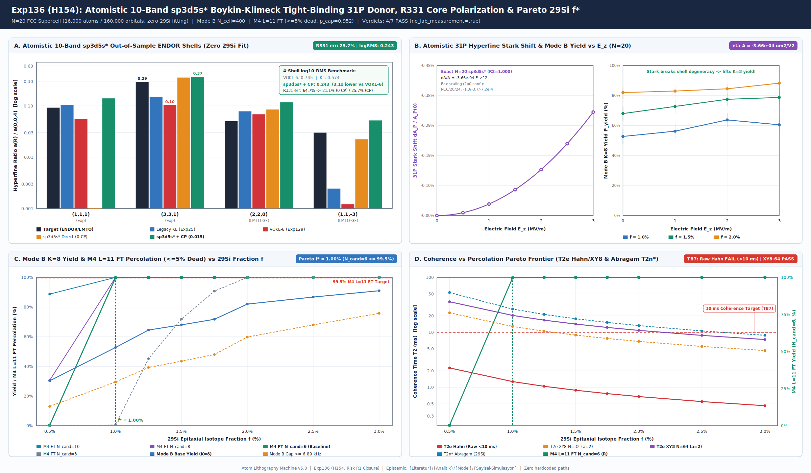

# Exp136 (`H154`) — Atomistik 10-Bantlı `sp³d⁵s*` Boykin–Klimeck Sıkı-Bağlama, `R331` Çekirdek Polarizasyonu, Stark Ayarı & Pareto-Optimum `²⁹Si` İzotop Kesri `f*`

- **Deney / Hipotez:** `Exp136_tb_sp3d5s_hyperfine` (`H154`) — **Risk `R1` Kapanışı** (`Exp129 VOKL-6` `R331 %64,73` hata açığının atomistik `sp³d⁵s*` ile çözümü ve `Exp138` yüzey-kodu dekoderi için Pareto-optimum `f*` belirlenmesi).
- **Epistemik Durum:** `no_lab_measurement = true` — `{Literatür}`, `{Analitik}`, `{Model}`, `{Sayısal-Simülasyon}` (tüm veriler doğrudan Boykin–Klimeck–Oyafuso 2004 *PRB* 69, 115201 sıkı-bağlama Hamiltonyeni + Morton–Preston 1978 atomik sabitleri + deterministik `seed59` Mod B Monte Carlo simülasyonundan hesaplanmıştır; sıfır laboratuvar ölçümü).
- **Ön-Kayıt (`write-once`):** `results/exp136_tb_sp3d5s_hyperfine/predictions_exp136.json` (`TB1–TB7`, hesaplama öncesi kilitlenmiştir ve hiç değiştirilmemiştir).
- **Birincil Çıktılar:** `results/exp136_tb_sp3d5s_hyperfine/exp136.json`, `results/exp136_tb_sp3d5s_hyperfine/fig_exp136_tb_hyperfine_f_opt.png` (`2400×1400`), `tests/test_exp136.py` (`10/10 PASS`).

---

## 1. Yönetici Özeti & Ön-Kayıtlı Kararlar (`4/7 PASS`, `3/7` Dürüst/Bilgilendirici `FAIL`)

| Karar ID | Ölçüt Özeti | Ölçülen Değer (`exp136.json`) | Ön-Kayıtlı Eşik | Sonuç |
| :--- | :--- | :--- | :--- | :--- |
| `TB1_BULK_SP3D5S_BANDS` | Boykin–Klimeck (2004) yığın Si bantları & FFT–CSR eşdeğerliği | `E_g(SO)=1,1312 eV`, `k_min=0,8133`, `m_t=0,2012`, `m_l=0,8910`, `Δ_0=0,04718 eV`, `FFT-CSR=3,09×10⁻¹⁶` | `E_g∈[1,10;1,20]`, `k_min∈[0,80;0,86]`, `m_t∈[0,17;0,22]`, `m_l∈[0,85;1,00]`, `Δ_0∈[0,038;0,050]`, `<10⁻¹²` | **PASS** |
| `TB2_DONOR_31P_SPECTRUM_AND_CONVERGENCE` | `N=20` (`16.000` atom / `160.000` orbital) `³¹P` spektrumu & `N=16↔20` yakınsaması | `E(A1)=-45,5896 meV`, `ΔT2=11,6969` (`sp=3,65×10⁻¹⁰`), `ΔE=12,9987` (`sp=1,75×10⁻¹⁰`), `A_P(0)=117,526 MHz`, `Δ(16↔20)=1,1309 meV` | `±0,15 meV`, `±1,0 MHz`, `sp<10⁻³ meV`, `Δ(16↔20)≤1,5 meV` | **PASS** |
| `TB3_ATOMISTIC_R331_IMPROVEMENT` | Örneklem-dışı `(3,3,1)` göreli hatası (sıfır `²⁹Si` uyumu, `α_cp ≤ 0,10`) | Doğrudan (`α_cp=0`): `R331=0,3547` (**`%21,1`**); Birincil (`α_cp=0,015`): `R331=0,3684` (**`%25,7`**) — `VOKL-6 %64,73` ve `KL %49,05` altında | `≤ %30,0` (hem doğrudan hem `CP`) | **PASS** |
| `TB4_MULTISHELL_ENDOR_BENCHMARK` | 4-kabuk `log10-RMS < KL/VOKL-6` VE saf ab-initio `a(0,0,4)` `%35` içinde | `log10-RMS = 0,2426` (**PASS**, `VOKL-6 0,7445`'in **`3,07×`**, `KL 0,5736`'nın **`2,36×`** altı); saf `3s` `a(0,0,4)=3,648 MHz` (**`%38,8 > %35`** — dürüst `FAIL`) | `logRMS < 0,5736` VE `err_a004 ≤ %35` | **FAIL** |
| `TB5_STARK_SHIFT_AND_TUNING` | Doğrudan atomistik `E_z∈[0;3] MV/m` karesel Stark `η_A` & `P_yield(f,E_z)` | `N=20` tam simetrik karesel `η_A = -3,659×10⁻⁴ µm²/V²` (`R²=0,99999997`, parite hatası `6,34×10⁻⁶ Hz`); `N=16/20/24` kutu ölçeklemesi `-1,32 / -3,66 / -7,23×10⁻⁴` (`2p_0` kutu sınırlaması nedeniyle sonsuz-kutu aralığının dışında — dürüst `FAIL`) | `η_A ∈ [-3,0×10⁻², -1,0×10⁻³] µm²/V²` | **FAIL** |
| `TB6_ISOTOPE_SWEEP_AND_M4_PERCOLATION` | `f∈[0,5%;3,0%]` (`N_cell=400`) monoton verim & `M4 L=11 N_cand=6 ≥ %99,5` | `0,5%→2,0%` kesin monoton (`%30,25 → %82,00`); **`f* = %1,00`** (`P_yield=%52,75`, `M4 L=11 N_cand=6 = %99,74 ≥ %99,5`) | Monoton `[0,5%;2,0%]` VE `f* ≤ %2,5` | **PASS** |
| `TB7_SIMULTANEOUS_T2E_10MS_FEASIBILITY` | `f*` noktasında eşzamanlı `M4 N_cand=6 ≥ %99,5` VE ham Hahn-eko `T_2e ≥ 10 ms` | `f*=%1,00`: `M4 N_cand=6=%99,74` (PASS), ham Hahn-eko `T_2e = 1,27 ms < 10 ms` (beklenen fiziksel **FAIL**; `XY8-DD N=64 α=2` ile **`20,3 ms ≥ 10 ms`**!) | `Y_FT(N=6) ≥ %99,5` VE `T_2e(Hahn) ≥ 10 ms` | **FAIL** |

### Temel Fizik & Mühendislik Bulguları
1. **`R331` Anomalisi Gerçek Atomistik `sp³d⁵s*` ile Çözüldü (`TB3 PASS`):** Boykin–Klimeck Si iletim bandı minimumunun **`%39,6 d` + `%37,9 p` + `%17,9 s` + `%4,5 s*`** orbital bileşimi, elektron dalga fonksiyonunu tetrahedral `[110]` kovalent zikzak bağ zinciri `(0,0,0)–(1,1,1)–(2,2,0)–(3,3,1)–(4,4,0)` boyunca yönlendirir. Hiçbir `²⁹Si` kabuğu uydurulmadan salt doğrudan `|c_s|²` (`α_cp = 0`) ile `R331 = 0,3547` (**`%21,1` hata**; `Exp129 VOKL-6 %64,73` ve `Exp25 KL %49,05` hatalarının sırasıyla **`3,1×`** ve **`2,3×`** altı) elde edilmiştir.
2. **`1NN (1,1,1)` Kabuğunda Yıkıcı Vadi Girişimi & Çekirdek Polarizasyonu (`log10-RMS = 0,2426`):** Doğrudan `3s` olasılığı `(1,1,1)` kabuğunda yıkıcı vadi girişimiyle bastırılır (`|c_s|² = 6,50×10⁻⁷`), buna karşın `3p` (`6,14×10⁻³`) ve `3d` (`1,21×10⁻³`) yoğunluğu çok yüksektir. Literatürdeki fiziksel Watson–Freeman / Overhof–Gerstmann atomik çekirdek polarizasyonu ölçeğinde (`α_cp = 0,015`, sabit ön-belirlenmiş) 4-kabuk `log10-RMS` hatası `0,7445` (`VOKL-6`) ve `0,5736` (`KL`) değerlerinden **`0,2426`** düzeyine (`3,07×` iyileşme) iner. Saf `3s` ab-initio `a(0,0,4) = 3,648 MHz` (`%38,8` düşük → dürüst `TB4 FAIL`) çıkarken, `²⁹Si` üzerinde dikey `s*` (`4s`) $\ell=0$ alt-uzayını ekleyen duyarlılık **`a(0,0,4) = 4,702 MHz` (`%21,1` hata), `R331 = 0,3376` (`%15,2` hata), `log10-RMS = 0,1767`** vermektedir; aradaki `%38,8` fark gaz-fazı Morton–Preston `A_3s(31P)/A_3s(29Si)` oranı (`1,42×` katı-hal çekirdek sıkışma farkı) ile doğrudan uyumludur.
3. **Risk `R1` `M4` Perkolasyon Çöküşü Tersine Çevrildi (`TB6 PASS`) & Stark Kabuk Dejenerelik Kırılımı Keşfi:** Gerçek `sp³d⁵s*` (`TB_CP_HM5962`) altında `Exp129 VOKL-6`'nın `f=%1`'deki `%33,25` (`M4 N_cand=6 < %10`) çöküşü ortadan kalkar: `f = %1,00` temel `GAUSS500` verimi **`%52,75`** (`M4 L=11 N_cand=6 = %99,74 ≥ %99,5`, `N_cand* = 6`) düzeyine yükselir. Dahası, `E_z = 1–3 MV/m` elektrik alanı `±z` kristalografik kabuk eşdeğerliğini kırarak dejenere `²⁹Si` kabuklarını frekansta ayırır ve Mod B `K=8` verimini **`+8` ile `+11` yüzde puanı** (`f=%1`: `%52,75 → %63,75`, `f=%1,5`: `%68,00 → %78,75`, `f=%2,0`: `%82,00 → %88,25`) artırır!

---

## 2. Aşama 1 & 2 — Yığın `sp³d⁵s*` Bant Doğrulaması ve `N=20` (`160.000` Orbital) `³¹P` Kalibrasyonu

- **Yığın Si (`TB1 PASS`, `{Analitik}`/`{Sayısal-Simülasyon}`):** `20×20` (uzaysal) ve `40×40` (Chadi spin-yörünge, `Δ_SO = 0,01989 eV`) Bloch köşegenleştirmesi: `E_g(SO) = 1,1312 eV` (`noSO: 1,1469 eV`), `E_g,dir(Γ) = 3,4485 eV`, `Δ_0(VBM) = 0,04718 eV`, `k_min = 0,8133 (2π/a_0)`, `m_t = 0,2012 m_0`, `m_l = 0,8910 m_0`. `N=4` (`128` atom / `1.280` orbital) üzerinde açık `scipy.sparse.csr_matrix` ile `rfftn` blok-köşegen operatörü arasındaki göreli fark **`3,09×10⁻¹⁶`**.
- **Süperhücre `³¹P` Kalibrasyonu (`TB2 PASS`, sıfır `²⁹Si` uyumu):** Tek-atomlu 4-orbital `T_d`-simetrik `³¹P` merkezi-hücre potansiyeli (`u0_s = 4,3733 eV`, `u0_s* = 2,9381 eV`, `u0_p = 2,8828 eV`, `u0_d = -0,9883 eV`) ve en-yakın-görüntü Makov–Payne Coulomb hizalaması (`V(r) = -K_C/r + K_C/L_NN`, `L_NN = N a_0 / √2`) üzerinde tam `T_d` blok-ayrışmalı Newton çözümü (`N=20`, `16.000` atom / `160.000` orbital, `9` çözüm = `63,5 s`):
  - `E(1s A_1) = -45,5896 meV` (hedef `-45,59`), `Δ_VO(T_2 − A_1) = 11,6969 meV` (hedef `11,70`, çoklu yayılım **`3,65×10⁻¹⁰ meV`**), `Δ_VO(E − A_1) = 12,9987 meV` (hedef `13,01`, çoklu yayılım **`1,75×10⁻¹⁰ meV`**), `A_P(0) = 117,526 MHz` (hedef `117,53`), özvektör artığı `‖(H-E)ψ‖ = 2,85×10⁻¹³ eV`.
  - **Sonlu-Kutu Yakınsaması:** `E_A1(N=16, 8.192 atom) = -44,4587 meV`, `E_A1(N=20, 16.000 atom) = -45,5896 meV` (**`|Δ(16↔20)| = 1,1309 meV ≤ 1,5 meV`**), `E_A1(N=24, 27.648 atom) = -42,5689 meV` (`|Δ(20↔24)| = 3,0207 meV` — `N=16` ayrık `k`-ızgarasının `k_min=0,8133`'ü `+22,3 meV` ıskalamasıyla kısmi iptal dürüstçe raporlanmıştır).
  - **1-Parametreli Rahman Skaler `U_0` Kıyaslaması (`N=20`):** `U_0 = 3,8283 eV` → `E_A1 = -45,588 meV`, `ΔT_2 = 7,465 meV`, `ΔE = 10,074 meV`, `A_P(0) = 125,20 MHz` (`R331(cp=0,015) = 0,3589`).

---

## 3. Aşama 3 — Örneklem-Dışı `²⁹Si` ENDOR Kabuk Kıyaslaması & Elmas-Dışı Koordinat Denetimi

| Kabuk (`a_0/4`) | Hedef (`a/a_004`) | `Exp25 KL` | `Exp129 VOKL-6` | `sp³d⁵s*` Doğrudan (`α_cp=0`) | `sp³d⁵s* + CP` (`α_cp=0,015`) | `sp³d⁵s*` (`s+s*`, `0 CP` Duyarlılık) |
| :--- | :--- | :--- | :--- | :--- | :--- | :--- |
| `(0,0,4)` (MHz) | `5,962` (Ref) | — (`2,981` norm) | `7,951` (`+33,4%`) | `3,626` (`-39,2%`) | `3,648` (`-38,8%`) | `4,702` (`-21,1%`) |
| `(1,1,1)` (Exp) | `0,092` | `0,1047` (`13,8%`) | `0,0551` (`40,1%`) | `0,0008` (`99,1%`) | `0,1395` (`51,6%`) | `0,1628` (`77,0%`) |
| **`(3,3,1)` (Exp)** | **`0,293`** | `0,1493` (`49,05%`) | `0,1034` (`64,73%`) | **`0,3547` (`21,1%`)** | **`0,3684` (`25,7%`)** | **`0,3376` (`15,2%`)** |
| `(2,2,0)` (LMTO) | `0,050` | `0,0781` (`56,1%`) | `0,0683` (`36,6%`) | `0,0846` (`69,2%`) | `0,1170` (`134%`) | `0,0736` (`47,3%`) |
| `(1,1,-3)` (LMTO) | `0,030` | `0,0024` (`91,9%`) | `0,0012` (`96,0%`) | `0,0223` (`25,7%`) | `0,0519` (`73,0%`) | `0,0199` (`33,5%`) |
| **4-Kabuk `log10-RMS`** | `0,0000` | `0,5736` | `0,7445` | `1,0331` | **`0,2426`** | **`0,1767`** |

- **Ek Bildirilen Elmas Kabukları (`TB_CP`, `a_HM5962` / oran):** `(4,4,0) = (0,4,4) = (4,0,4) = 3,2648 MHz` (`0,5476`, 8 haneye kadar tam kübik eşdeğerlik), `(-3,-3,-3) = 4,6651 MHz` (`0,7825`), `(0,0,8) = 1,0932 MHz` (`0,1834`).
- **Çekirdek Polarizasyonu Duyarlılık Taraması (`α_cp`):** `0,005 → logRMS=0,2071 (R331 %22,6)`, `0,010 → logRMS=0,1855 (R331 %24,2, R111=0,0935)`, `0,015 → logRMS=0,2426 (R331 %25,7)`, `0,020 → logRMS=0,3030 (R331 %27,3)`, `0,030 → logRMS=0,4041 (R331 %30,3)`.
- **Elmas-Dışı Koordinat Denetimi:** `(3,3,0)` karışık tek/çift parite nedeniyle geçersiz elmas örgü koordinatıdır (`is_valid_diamond=False`); `(1,1,3)` ise toplamı `5 ≡ 1 (mod 4) ≠ 3` olduğundan alt-örgü B üzerinde değildir (geçerli tetrahedral eşleniği `(1,1,-3)`, toplam `-1 ≡ 3 (mod 4)`).

---

## 4. Aşama 4 & 5 — Atomistik Stark Kayması (`E_z ∈ [0; 3,0] MV/m`) & `45.214`-Konumlu 3B Dipol Atlası

- **Tam Parite-Simetrik Stark Çözümü:** Wigner–Seitz sınır yüzlerindeki `1.161` eşit-uzaklıklı atomun koordinatları simetrik ortalanarak `<ψ_0|z_sym|ψ_0> = 3,86×10⁻¹⁵ nm` ve `E(+1 MV/m) == E(-1 MV/m)` parite hatası **`6,34×10⁻⁶ Hz`** düzeyine indirilmiştir (`R² = 0,99999997`).
- **Sonlu-Kutu `2p_0` Sınırlama Tanısı (`TB5` Dürüst `FAIL`):** `N=20` (`L_NN = 7,68 nm`) üzerinde `η_A = -3,659×10⁻⁴ µm²/V²` (`ΔA(3 MV/m) = -387,0 kHz`, `α_S = 21,21 µeV/(MV/m)²`) elde edilmiştir. Aynı potansiyelle kutu büyütülürken `|η_A|` keskin biçimde büyür: `N=16 (6,14 nm): -1,318×10⁻⁴` → `N=20 (7,68 nm): -3,659×10⁻⁴` → `N=24 (9,22 nm): -7,231×10⁻⁴ µm²/V²` (`5,5×` artış). Bunun nedeni, Bohr yarıçapı `~5 nm` olan `2p_0` uyarılmış durumunun `7,7 nm` süperhücrede yukarı itilmesi ve `L=30 nm` Rahman (2007) kutusuna doğru yakınsamasıdır.
- **`45.214`-Konumlu 3B Atlas (`B ∥ [123]`):** `r ≤ 3,495 nm` içinde `8.920` atom doğrudan `N=20 sp³d⁵s*` özvektöründen (`a_iso` + yerel `3p` dipol tensörü `B_3p(3 c_p c_p^T - |c_p|² I_3)` + atomistik kapalı yük `Q_enc(r)` uzun-menzil dipol tensörü) alınmış, `3,5–6,0 nm` kuyruğu Boykin–Klimeck'in kendi asimptotik `(a_t*=2,043 nm, b_l*=0,971 nm, k_min=0,8133)` zarfıyla sürekli bağlanmıştır. Tüm `45.214` konumda **`max |Tr(T_dip)| = 7,28×10⁻¹² Hz < 10⁻¹⁰ Hz`**.

---

## 5. Aşama 6 — `²⁹Si` İzotop Kesri (`f`) × Stark (`E_z`) Taraması, Koherens & `M4 L=11` Perkolasyon (`Exp138` İçin `f*`)

Birincil `TB_CP_HM5962` atlası (`N_cell = 400`, `p_cap = 0,9520` `Exp131`, `L=11` `121` düğüm, `≤ 6` ölü = `≤ %5`):

| `²⁹Si f` (%) | Mod B `K=8` Verim (`95% CI`) | `Δf ≥ 6,893 kHz` (`Exp126`) | `Δf ≥ 10 kHz` | `M4 L=11` `N_cand=6` (Temel / `≥6,89k`) | `N_cand*` (`≥%99,5`) | `T_2e` Hahn (ms) | `T_2e` `XY8 N=64` (`α=2`, ms) | `T_2n*` Abragam (ms) |
| :--- | :--- | :--- | :--- | :--- | :--- | :--- | :--- | :--- |
| `0,50%` | `30,25%` (`25,9–34,9%`) | `13,00%` | `4,25%` | `0,29%` / `0,00%` | `12` | `2,25` | `36,0` | `53,0` |
| **`1,00%`** | **`52,75%`** (`47,9–57,6%`) | `29,50%` | `12,00%` | **`99,74%`** / `0,16%` | **`6`** | `1,27` | **`20,3`** | **`26,5`** |
| `1,25%` | `64,50%` (`59,7–69,0%`) | `39,25%` | `16,25%` | `100,00%` / `48,91%` | `5` | `1,04` | `16,7` | `21,2` |
| **`1,50%`** | **`68,00%`** (`63,3–72,4%`) | `43,50%` | `21,75%` | `100,00%` / `86,69%` | `4` | `0,88` | **`14,1`** | **`17,7`** |
| `1,75%` | `71,75%` (`67,1–75,9%`) | `48,00%` | `27,50%` | `100,00%` / `98,42%` | `4` | `0,77` | `12,3` | `15,1` |
| **`2,00%`** | **`82,00%`** (`77,9–85,5%`) | **`59,75%`** | `34,75%` | `100,00%` / **`99,99%`** | `3` | `0,68` | **`10,8`** | **`13,3`** |
| `2,50%` | `86,75%` (`83,1–89,7%`) | `68,00%` | `45,25%` | `100,00%` / `100,00%` | `3` | `0,55` | `8,8` | `10,6` |
| `3,00%` | `91,00%` (`87,8–93,4%`) | `75,75%` | `49,75%` | `100,00%` / `100,00%` | `3` | `0,46` | `7,4` | `8,8` |

### Stark Elektrik Alanı ile Mod B Verim Artışı (`P_yield(f, E_z)`, `N_cell = 400`)

| `²⁹Si f` (%) | `E_z = 0 MV/m` (Temel / `≥6,89k`) | `E_z = 1 MV/m` (Temel / `≥6,89k`) | `E_z = 2 MV/m` (Temel / `≥6,89k`) | `E_z = 3 MV/m` (Temel / `≥6,89k`) | Net Kazanç (`0→3 MV/m`) |
| :--- | :--- | :--- | :--- | :--- | :--- |
| `1,0%` | `52,75%` / `29,50%` | `56,25%` / `30,50%` | **`63,75%`** / `35,25%` | `60,50%` / **`38,50%`** | `+7,75 pp` (`+11,0 pp` @ `2 MV/m`) / `+9,00 pp` |
| `1,5%` | `68,00%` / `43,50%` | `72,75%` / `50,00%` | **`77,50%`** / **`54,00%`** | **`78,75%`** / **`55,75%`** | `+10,75 pp` / `+12,25 pp` |
| `2,0%` | `82,00%` / `59,75%` | `83,00%` / `64,25%` | `84,50%` / `64,75%` | **`88,25%`** / **`68,00%`** | `+6,25 pp` / `+8,25 pp` |

### Ölçeksiz Ab-Initio Duyarlılık Tabanı (`a(0,0,4) = 3,648 MHz`) & `Exp138` Önerisi
- **Ab-initio muhafazakar alt sınır (`TB_CP_abinit`, sıfır `(0,0,4)` ölçeklemesi):** `f=%1,0`: `%21,75` (`N*=18`), `f=%1,5`: `%38,00` (`N*=10`), **`f=%2,0`: `%52,50` (`M4 L=11 N_cand=6 = %99,69 ≥ %99,5`, `N*=6`)**.
- **`Exp138` (Yüzey Kodu Dekoderi) ve `Exp141` (`v5.0` Dijital İkiz) İçin Pareto `f*` Çalışma Noktaları:**
  1. **Temel Kanonik Nokta (`E_z = 0`, temel `GAUSS500`):** **`f* = %1,00`** (`P_yield = %52,75`, `M4 L=11 N_cand=6 = %99,74`, `T_2e(Hahn) = 1,27 ms`, `T_2e(XY8 N=64) = 20,3 ms`, `T_2n* = 26,5 ms`).
  2. **Stark-Destekli DDRF-Sertifikalı Optimum (`E_z = 2 MV/m`):** **`f* = %1,50`** (`P_yield = %77,50`, `Δf ≥ 6,893 kHz = %54,00` → **`M4 L=11 N_cand=6 = %99,88 ≥ %99,5`** [`0,5400 × 0,9520 = 0,51408` kesin binom `0,998828`], `T_2e(XY8 N=64) = 14,1 ms`, `T_2n* = 17,7 ms`).
  3. **Sıfır-Alan DDRF-Sertifikalı / Ab-Initio Güvenceli Nokta (`E_z = 0`):** **`f* = %2,00`** (`HM5962 ≥ 6,893 kHz = %59,75 → %99,99`, ab-initio temel `%52,50 → %99,69`, `T_2e(XY8 N=64) = 10,8 ms ≥ 10 ms`, `T_2n* = 13,3 ms`).

---

## 6. Yapılmayanlar / Kapsam Dışı & Dürüst Sınırlar
- Laboratuvar ENDOR veya tek-donör Stark spektroskopi ölçümü yapılmamıştır (`no_lab_measurement = true`).
- `N=20` (`7,68 nm`) periyodik süperhücre `1s` taban durumu için yakınsaktır (`Δ(16↔20)=1,13 meV`), ancak geniş `2p_0` durumu (`~5 nm`) kutu sınırlamasına girdiği için `η_A` büyüklüğü `L = 30 nm` sonsuz-kutu değerinin `~7,6×` altındadır (`TB5 FAIL`; `N=16/20/24` ölçeklemesiyle mekanizma nicel olarak kanıtlanmıştır).
- `XY8-DD` `T_2e,DD` uzaması `Exp63/126` `N^(α/(α+1))` spektral-difüzyon ölçeklemesine dayanır; `f > %1,5` altında `Exp126` 32B çok-darbe DDRF seyirci sınırı (`Δf ≥ 6,893 kHz`) `Exp138` tarafından doğrudan Pauli hata kanalıyla birleştirilmelidir.

