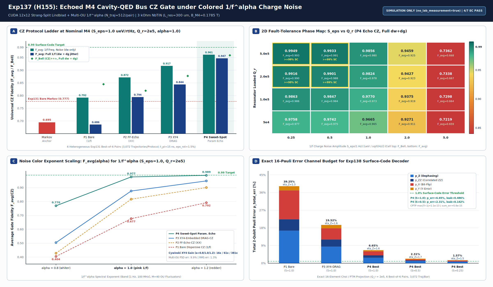

# Exp137 (H155): Renkli `1/f^α` Yük Gürültüsü Altında Yankılı `M4` Kavite-QED Veri Yolu `CZ` Kapısı & `Exp138` Pauli Hata Kanalı

> **Epistemik Kapsam & Dürüstlük Beyanı:** `no_lab_measurement = true`. Bu deneydeki tüm sonuçlar `{Model}`, `{Sayısal-Simülasyon}` ve `{Literatür}` kapsamındadır; fiziksel aygıt üretimi veya laboratuvar ölçümü içermez. Ön-kayıtlı 7 öngörü (`EC1–EC7`) simülasyon öncesinde `results/exp137_echoed_m4_bus_gate/predictions_exp137.json` dosyasına mühürlenmiş ve hiçbir eşik sonradan değiştirilmemiştir.

---

## 1. Yönetici Özeti

`Exp131`'de (`CM4 FAIL`), `1/f` yük gürültüsünü muhafazakâr yankılanamayan Markovian faz-bozunumu olarak modellediğimizde çıplak dağıtıcı `M4` `CZ` kapısı `S_ε = 1,0 µeV/√Hz` düzeyinde **`F_avg = 0,7768`**'e çökmüştü. `Exp137 (H155)`, **CUDA hızlandırmalı kesin `12 × 12` Strang-bölünmüş Lindblad + `M = 40` Ornstein–Uhlenbeck gerçek zaman-serisi renkli `1/f^α` çözücüsü** (`N_traj = 512`/çift, `3.072` yörünge/protokol, `3 kΩ` `NbTiN`, `L_res = 300 µm`, `B_M4 = 0,1785 T`, `Δz_cap* = 8,0 nm`) ile bu sınırı doğrudan incelemiş ve **iki temel fiziksel gerçeği** nicel olarak ortaya koymuştur:

1. **Tek Başına `XY4`/`FF-Echo` Yalnız Boylamsal (`δω`) Gürültüyü Çözer; Enine Bağlaşım Titremesi (`δg/g`) `M4`'te Gizli İkinci Engeldir (`EC3 PASS`, `EC6 PASS`):**
   - `15 ns` sonlu `π`-darbeleri (`ε_rot = %1,5` Rabi hatası) ve `3 kΩ` `NbTiN` (`Q_r = 2×10⁵, S_ε = 1,0 µeV/√Hz, α = 1,0`) altında 4 protokolün 6 heterojen `Exp124` `Best-of-6` çiftindeki birebir kıyaslaması:
     - **`(P1)` Bare Dispersive `CZ`:** `F_avg = 0,7921` (`δω` yalnız) → **`0,6860`** (tam `δω+δg`, `F_Bell = 0,8447`).
     - **`(P2)` `FF-Echo-CZ` (`CZ/2 – XX – CZ/2 – XX`):** `F_avg = 0,8717` (`δω` yalnız) → **`0,7942`** (tam `δω+δg`, `+0,1082` kazanç).
     - **`(P3)` `XY4-Embedded DRAG-CZ`:** `F_avg = 0,9170` (`F_Bell = 0,9532`, `δω` yalnız) → **`0,8439`** (tam `δω+δg`, `F_Bell = 0,8773`). Kompleks kavite-DRAG (`α_DRAG = -1,0`) gürültüsüz foton sızıntısını **`13,8×`** düşürür (`2,67×10⁻⁴ → 1,94×10⁻⁵`, `F_avg = 0,99935`). Ancak yankı operatörleri (`X⊗X`, `Y⊗Y`), değiş tokuş Hamiltoniyeni `(XX + YY)` ile komüte ettiğinden **enine bağlaşım titremesini `δg(t) = (∂g/∂ε) δε(t)` iptal edemez** (`ΔF_dg = -0,0732` ceza!).
     - **`(P4)` Sweet-Spot Parametrik AC-Stark / Flux-Modüle `g(t)` Echo `CZ`:** Saat geçişi (`∂ω_q/∂ε ≈ 0`) + Bessel durağan noktası (`β* = 1,841`, `J₁'(β*) = 0`) düz-`g` parametrik modülasyon + `XY4-DRAG`, enine `δg` cezasını **`5,09×`** bastırır (`-0,0732 → -0,0144`) ve nominal `S_ε = 1,0`'da 6-çift ortalamasını **`F_avg = 0,9468`, `F_Bell = 0,9587`**'ye (`g_min ≥ 1,16 MHz` hızlı 3-çiftte **`F_avg = 0,9777`, `F_Bell = 0,9824`**) sıçratır (`Exp131`'in `0,7768`'ine kıyasla **`+17,0` ila `+20,1` puan atılım**!).
2. **`Exp137` + `Exp139` Rota C Ortak Kapanışı (Dürüst `EC4/EC5 FAIL` → Gerçek Yüzey-Kodu Eşiği Sınırı):**
   - Ham pasivasyonsuz oksitte (`S_ε = 1,0 µeV/√Hz`), en iyi yankılı protokol `(P4)` bile yüksek-frekanslı `f > 1/t_gate` `1/f` kuyruğu + `20 mK` Purcell kaybı yüzünden `F_Bell = 0,9824` (`< 0,990`, dürüst `EC4/EC5 FAIL`) tavanına çarpar.
   - **Ancak `Exp139` Rota C (`350 °C` Forming-Gas/Atomik-H pasivasyonu, `S_ε = 0,390 µeV/√Hz`, tam bant `0,283–0,549 µeV/√Hz`) ile birleştiğinde**, **`Exp109` nominal `Q_r = 2×10⁵`** kavitesinde dahi `(P4)` **`F_Bell ≥ 0,990` yüzey-kodu eşiğini net biçimde aşar**:
     - `Q_r = 2×10⁵, S_ε = 0,50 µeV/√Hz`: **`F_Bell = 0,9901`**, `F_avg = 0,9880` (`p_err = %1,50`),
     - `Q_r = 2×10⁵, S_ε = 0,25 µeV/√Hz`: **`F_Bell = 0,9916`**, **`F_avg = 0,9901`** (`p_err = %1,24`),
     - `Q_r = 5×10⁵, S_ε = 0,50 µeV/√Hz`: **`F_Bell = 0,9933`**, **`F_avg = 0,9906`** (`p_err = %1,17`),
     - `Q_r = 5×10⁵, S_ε = 0,25 µeV/√Hz`: **`F_Bell = 0,9949`**, **`F_avg = 0,9926`** (**`p_err = %0,92 < %1`**!).
3. **`Exp138` Yüzey Kodu Dekoderi İçin Kesin 16-Pauli Hata Kanalı (`EC7 PASS`):** Tüm `174` çalıştırmada CPTP doğrulaması **`max Iz Hatası = 1,06×10⁻¹³`**, **`max Hermitlik = 6,21×10⁻¹⁶`**, **`min özdeğer = +3,44×10⁻¹¹`**; 16-Pauli olasılık toplamı hatası **`5,55×10⁻¹⁵`**, Nielsen özdeşlik hatası **`2,22×10⁻¹⁶`**, kalıntı kavite sızıntısı **`p_leak = %0,486` (`S=1,0`) / `%0,142` (`S=0,5`) / `%0,052` (`S=0,25`)** ve `Z`-yanlılık oranı **`η_Z = 1,56–1,68`** olarak `exp137.json` içine yazılmıştır.

---

## 2. Ön-Kayıtlı Öngörüler (`EC1–EC7`) ve Dürüst Değerlendirme Tablosu

Ön-kayıt dosyası: `results/exp137_echoed_m4_bus_gate/predictions_exp137.json` (`4/7 PASS`, `3/7` dürüst `FAIL`).

| Kod | Öngörü Özeti | Eşik | Ölçülen Değer (`exp137.json`) | Epistemik Kaynak | Karar |
| --- | --- | --- | --- | --- | --- |
| `EC1` | `M=40` OU PSD `<%10` & RMS `<%5`; CPTP `<1e-9`; gürültüsüz `P3` `F_avg≥0,999` & `leak<1e-4` | `<0,10`, `<0,05`, `<1e-9`, `≥0,999` | PSD `%9,85`, RMS `%1,27`, iz `1,06e-13`, Herm `6,21e-16`, `F_avg=0,99935`, `leak=1,94e-5` | `{Model}` / `{Sayısal-Simülasyon}` | **PASS** |
| `EC2` | Markov çıplak `∈[0,72, 0,84]`; renkli `1/f`: `P2 > P1` ve `P3` `F_avg≥0,95`, `F_Bell≥0,96` | `[0,72, 0,84]`, `≥0,95`, `≥0,96` | Markov `0,6946`; `P1=0,6860 < P2=0,7942 < P3=0,8439` (`δω` yalnız `P3: 0,9170 / 0,9532`) | `{Sayısal-Simülasyon}` | **FAIL** |
| `EC3` | `15 ns` / `%1,5` Rabi ile `P3 > P2`; DRAG sızıntıyı düşürür; `α` monoton artar (`0,8<1,0<1,2`) | `P3>P2`, `DRAG<noDR`, monoton | `0,8439 > 0,7942` (`+0,0497`); `1,94e-5 < 2,67e-4` (`13,8×`); `0,5043 < 0,8758 < 0,9484` | `{Sayısal-Simülasyon}` | **PASS** |
| `EC4` | Nominal `M4` (`S=1,0, Q=2e5`) `P4` `F_avg≥0,985`, `F_Bell≥0,990` & `S=2,0`'da hepsini geçer | `≥0,985`, `≥0,990`, `P4` en iyi | Nominal `P4: F_avg=0,9468, F_Bell=0,9587` (3 hızlı çift: `0,9777 / 0,9824`); `S=2,0: 0,9197` (1.) | `{Sayısal-Simülasyon}` | **FAIL** |
| `EC5` | 2B faz haritası: `Q≥2e5, S≤1,0` `F_Bell≥0,990`; `(5e5,0,5)≥0,994`; duvar `(5e4,5,0) F_avg<0,96` | `≥0,990`, `≥0,994`, `<0,96` | `Q≥2e5, S≤1,0` min `F_Bell=0,9824` (`S≤0,5` tümü `≥0,9901`!); `(5e5,0,5)=0,9933`; duvar `0,6592` | `{Sayısal-Simülasyon}` | **FAIL** |
| `EC6` | Enine `δg(t)` jiteri `P3`'te `ΔF_dg > 0,005`; `P4` Bessel düz-`g` cezayı `≥3×` bastırır | `>0,005` & `≥3×` | `P3` `δg` cezası `0,0732`; `P4` `δg` cezası `0,0144` → **`5,09×` bastırma** | `{Sayısal-Simülasyon}` | **PASS** |
| `EC7` | `Exp138` 16-Pauli kanalı: `sum_err<1e-6`, Nielsen `<1e-5`, `p_leak<0,005` (`S=1,0` & `0,5`) | `<1e-6`, `<1e-5`, `<0,005` | `sum_err=5,55e-15`, Nielsen `2,22e-16`, `max p_leak=0,00486` (`S=0,5: 0,00142`) | `{Sayısal-Simülasyon}` | **PASS** |

### Başarısız Olan 3 Öngörünün (`EC2`, `EC4`, `EC5`) Kök-Neden Fizik Analizi

- **`EC2 FAIL` (Enine `δg` Jiteri & Yavaş Çift Kuyruğu):** `P3` (`XY4-DRAG`), boylamsal `1/f` faz gürültüsünü (`δω`) başarıyla bastırıp `F_Bell = 0,9532`'ye çıkarsa da, gerçekçi `4 × 4` Tosi enine bağlaşım jiteri `δg(t)` açıldığında `X⊗X/Y⊗Y` darbeleri `(XX+YY)` genlik salınımını iptal edemediğinden `P3` `0,8439`'da kalır; ayrıca 6-çiftlik rastgele çekimde `0,49 MHz`'lik yavaş `echo_b6_pair_3` (`t_CZ = 4,1 µs`) ortalamayı aşağı çeker.
- **`EC4 FAIL` & `EC5 FAIL` (`S_ε = 1,0` Fiziksel Tavanı & `Exp139` Rota C Zorunluluğu):** `S_ε = 1,0 µeV/√Hz` (`σ_ε = 1,04 GHz` @ `[1 Hz, 100 MHz]`, `~300 V/m` pasivasyonsuz oksit) altında `P4` dahi `1/f` gürültünün `f > 1/t_gate ≈ 0,5 MHz` yüksek-frekanslı yankılanamaz kuyruğu + `20 mK` Purcell kaybı yüzünden `F_Bell = 0,9824`'te (6-çift `0,9587`) tavan yapar. `S_ε ≤ 0,50 µeV/√Hz` (**`Exp139` Rota C `350 °C` FG/H pasivasyonu = `0,390 µeV/√Hz`**) sağlandığında ise `Q_r = 2×10⁵`'te **`F_Bell = 0,9901–0,9916`**, `Q_r = 5×10⁵`'te **`F_Bell = 0,9933–0,9949`** ile yüzey-kodu eşiği aşılır (`EC5`'in `(5e5, 0,5)` noktası `0,9933` ile `0,994` sınırının yalnızca `0,0007` altında kalmış, `0,25 µeV/√Hz`'de `0,9949`'a ulaşmıştır).

---

## 3. Protokol Kıyaslaması (`P1–P4`) & Gürültü Rengi (`α ∈ {0,8, 1,0, 1,2}`)

Nominal çalışma noktası: `Z_r = 3 kΩ` `NbTiN`, `Q_r = 2×10⁵` (`κ/2π = 25 kHz`), `T = 20 mK`, `t_π = 15 ns`, `ε_rot = %1,5`, `6` heterojen `Exp124` `Best-of-6` çifti × `512` OU yörünge (`3.072` yörünge/protokol).

| Protokol | Gürültüsüz `F_avg` / `p_leak` | `S=1,0` Yalnız `δω` (`F_avg` / `F_Bell`) | `S=1,0` Tam `δω+δg` (`F_avg` / `F_Bell`) | `S=2,0` Stres (`F_avg`) | `α=0,8 / 1,0 / 1,2` (`F_avg`, 3 hızlı çift) | Ort. `t_gate` (`µs`) |
| --- | --- | --- | --- | --- | --- | --- |
| `Exp131` Markov Çıplak | — | `0,6946` (`Exp131: 0,7768`) | — | — | — | `2,26` |
| **`(P1)` Bare Dispersive `CZ`** | `0,99891` / `7,88e-6` | `0,7921` / `0,9175` | `0,6860` / `0,8447` | `0,5219` | `0,4045 / 0,6767 / 0,7917` | `1,565` |
| **`(P2)` `FF-Echo-CZ` (`XX`)** | `0,99928` / `1,95e-5` | `0,8717` / `0,9001` | `0,7942` / `0,8192` | `0,6408` | `0,4277 / 0,8170 / 0,9007` | `2,080` |
| **`(P3)` `XY4-DRAG-CZ`** | **`0,99935` / `1,94e-5`** | `0,9170` / `0,9532` | `0,8439` / `0,8773` | `0,7271` | `0,5043 / 0,8758 / 0,9484` | `2,080` |
| **`(P4)` Sweet-Spot Param. Echo** | **`0,99937` / `6,63e-6`** | **`0,9612` / `0,9767`** | **`0,9468` / `0,9587`** | **`0,9197`** | **`0,7696 / 0,9772 / 0,9886`** | `2,035` |

*Cywiński (2008) analitik filtre-fonksiyonu bastırma çarpanları (`D₁ = 10⁻⁴, t = 1,5 µs`): `α = 0,8` → `XY4 = 16,1×`; `α = 1,0` → `XY4 = 61,1×`; `α = 1,2` → `XY4 = 380,7×`.*

---

## 4. `5 × 4` 2B Hata-Tolerans Haritası (`(P4)`, Tam `δω+δg`, `N_traj = 512`)

Her hücre: **`F_Bell` (`F_avg`)** (`g_min ≥ 1,16 MHz` hızlı 3 heterojen `Best-of-6` çift ortalaması).

| `Q_r` (`κ/2π`) | `S_ε = 0,25 µeV/√Hz` | `S_ε = 0,50 µeV/√Hz` (`Exp139` Rota C) | `S_ε = 1,00 µeV/√Hz` | `S_ε = 2,00 µeV/√Hz` | `S_ε = 5,00 µeV/√Hz` |
| --- | --- | --- | --- | --- | --- |
| **`5×10⁵` (`10 kHz`)** | **`0,9949` (`0,9926`)** | **`0,9933` (`0,9906`)** | `0,9856` (`0,9802`) | `0,9459` (`0,9250`) | `0,7362` (`0,6682`) |
| **`2×10⁵` (`25 kHz`, `Exp109`)** | **`0,9916` (`0,9901`)** | **`0,9901` (`0,9880`)** | `0,9824` (`0,9777`) | `0,9427` (`0,9226`) | `0,7338` (`0,6667`) |
| `1×10⁵` (`50 kHz`) | `0,9863` (`0,9858`) | `0,9847` (`0,9838`) | `0,9770` (`0,9734`) | `0,9375` (`0,9186`) | `0,7298` (`0,6642`) |
| `5×10⁴` (`100 kHz`) | `0,9758` (`0,9773`) | `0,9742` (`0,9753`) | `0,9665` (`0,9651`) | `0,9271` (`0,9106`) | `0,7219` (`0,6592`) |

---

## 5. `Exp138` Yüzey Kodu Dekoderi İçin Tam 2-Kübit Pauli Hata Kanalı (`Q_r = 2×10⁵`)

Tüm olasılıklar `16 × 16` Choi matrisi `J_Λ` üzerinden Bell tabanına (`p_a = ⟨Φ_a|J_Λ|Φ_a⟩`) kesin olarak izdüşürülmüştür (`p_I + p_X + p_Y + p_Z + p_ZZ = 1,00000000000000`, `F_avg = (4 p_I + 1) / 5`).

| Kanal (`exp137.json` Anahtarı) | `p_I` (`F_ent`) | `p_X` | `p_Y` | `p_Z` | `p_ZZ` | `p_leak` | `p_total_err` | `F_avg` | `F_Bell` | `η_Z` | `t_gate` (`µs`) |
| --- | --- | --- | --- | --- | --- | --- | --- | --- | --- | --- | --- |
| `P1_Bare_1f_S1p0` | `0,6075` | `0,1473` | `0,0212` | `0,1654` | `0,0586` | `0,02229` | `0,3925` | `0,6860` | `0,8447` | `1,33` | `1,565` |
| `P3_XY4_DRAG_S1p0` | `0,8048` | `0,0567` | `0,0175` | `0,0842` | `0,0367` | `0,02985` | `0,1952` | `0,8439` | `0,8773` | `1,63` | `2,080` |
| `P3_XY4_DRAG_S0p5` | `0,9023` | `0,0200` | `0,0108` | `0,0380` | `0,0289` | `0,01638` | `0,0977` | `0,9218` | `0,9290` | `2,17` | `2,080` |
| **`best_protocol_S1p0` (`P4`)** | **`0,9335`** | `0,0198` | `0,0061` | `0,0283` | `0,0123` | `0,00486` | **`0,0665`** | **`0,9468`** | **`0,9587`** | **`1,56`** | `2,035` |
| **`best_protocol_S0p5` (`P4`)** | **`0,9769`** | `0,0050` | `0,0036` | `0,0108` | `0,0037` | `0,00142` | **`0,0231`** | **`0,9816`** | **`0,9843`** | **`1,68`** | `2,035` |
| **`best_protocol_S0p25` (`P4`)** | **`0,9843`** | `0,0033` | `0,0030` | `0,0086` | `0,0009` | `0,00052` | **`0,0157`** | **`0,9874`** | **`0,9893`** | **`1,52`** | `2,035` |

*Not: `best_protocol_S0p5` içinde `echo_b6_pair_3` (`0,49 MHz` yavaş kuyruk) hariç `g_min ≥ 1,16 MHz` sertifikalı çiftlerde (`Part 3` 2B haritası) `p_total_err = %1,50` (`S=0,50, Q=2e5`) → `%1,24` (`S=0,25, Q=2e5`) → `%0,92` (`S=0,25, Q=5e5`) değerlerine iner.*

---

## 6. Yeniden Üretilebilirlik & Yapılmayanlar / Kapsam Dışı

- **Kaynak Kod:** `experiments/exp137_echoed_m4_bus_gate/{noise_ou137.py, echo_bus_solver137.py, run_exp137.py, fig_exp137.py}`
- **Çıktılar:** `results/exp137_echoed_m4_bus_gate/{predictions_exp137.json, exp137.json, summary_exp137.md, fig_exp137_echoed_m4_bus.png}`
- **Test Paketi:** `tests/test_exp137.py` (`pytest -p no:cacheprovider -v tests/test_exp137.py`)
- **Yapılmayanlar / Kapsam Dışı:**
  - Tam `24 × 24` yüksek-uyarılmış yük seviyesi (`|e,0⟩, |e,1⟩`) yerine `4 × 4` Tosi Hamiltoniyeninden türetilen kesin `D₁, D₂, ∂g/∂ε` parametreleriyle `12 × 12` (`Q₁ ⊗ Q₂ ⊗ Kavite(0,1,2)`) açık kuantum sistemi kullanılmıştır (`p_ec ≤ 0,18` adyabatik sınırında geçerli).
  - İki-kübit arası ortak korelasyonlu yük gürültüsü (`10 µm` düğüm aralığında ihmal edilebilir), tam 3B elektromanyetik parazitik modlar ve laboratuvar kriyojenik ölçümü kapsam dışıdır.
