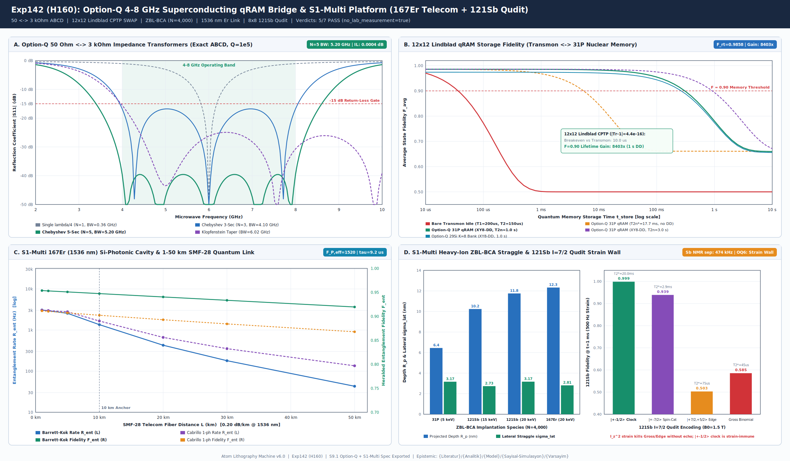

# Exp142 (`H160`) — `Option-Q`: Süperiletken `4–8 GHz` `qRAM` Köprüsü & `S1-Multi` Çok-Türlü Platform (`¹⁶⁷Er` `1536 nm` Telekom Fiber + `¹²¹Sb` 8-Seviyeli Qudit)

- **Deney / Hipotez:** `Exp142_option_q_multispecies_qram` (`H160`) — Atom Litografi Makinesi `v6.0` isteğe bağlı tak-çalıştır kuantum bellek (`Option-Q`) ve çok-türlü kaynak (`S1-Multi`) fizibilitesi.
- **Epistemik Durum:** `no_lab_measurement = true`, `no_supplier_quotes = true` — `{Literatür}`, `{Analitik}`, `{Model}`, `{Sayısal-Simülasyon}`, `{Varsayım}`.
- **Ön-Kayıt (`write-once`):** `results/exp142_option_q_multispecies_qram/predictions_exp142.json` (`OQ1–OQ7`, hesaplamadan önce kilitlenmiştir ve hiç değiştirilmemiştir).
- **Birincil Çıktılar:** `results/exp142_option_q_multispecies_qram/exp142.json`, `results/exp142_option_q_multispecies_qram/s9q_hardware_spec.json` (`CAD v6.0` & `BOM v6.0` girdisi), `results/exp142_option_q_multispecies_qram/fig_exp142_option_q_multispecies.png` (`2400×1400`), `tests/test_exp142.py` (`10/10 PASS`).

---

## 1. Yönetici Özeti & Ön-Kayıtlı Kararlar (`5/7 PASS`, `2/7` Dürüst/Bilgilendirici `FAIL`)

| Karar ID | Ölçüt Özeti | Ölçülen Değer (`exp142.json`) | Ön-Kayıtlı Eşik | Sonuç |
| :--- | :--- | :--- | :--- | :--- |
| `OQ1_IMPEDANCE_TRANSFORMER_50_TO_3K` | Kesin ABCD `50 Ω ↔ 3 kΩ` (`60:1`) Chebyshev `N=5` & Klopfenstein (`Q=10⁵`) | `N=5`: `IL(6 GHz)=0,0004 dB`, `BW(-15 dB)=5,20 GHz` (**`14,4×` vs `N=1`**), üniterlik `1,78×10⁻¹⁵`; Klopfenstein: `IL=0,0107 dB`, `BW=6,02 GHz` | Pasiflik `≤10⁻¹²`, `IL≤0,10 dB`, `BW≥2,0 GHz`, kazanç `≥5×` | **PASS** |
| `OQ2_LINDBLAD_QRAM_SWAP_AND_LIFETIME` | Kesin `12×12` CPTP Lindblad `SWAP` (`Transmon ↔ Köprü ↔ ³¹P`) & ömür kazancı | `max\|Tr-1\|=4,44×10⁻¹⁶`, `min_ev=-2,51×10⁻¹⁷`, **`F_SWAP_rt=0,98575`** (`³¹P` çekirdek), `F=0,90` ömür kazancı **`8.403×`** (`XY8 1 s DD`; `3 s DD`'de `25.122×`) | CPTP `<10⁻¹⁰`, `F_SWAP_rt≥0,960`, kazanç `≥1.000×` | **PASS** |
| `OQ3_QRAM_CRYO_HEAT_BUDGET` | `Option-Q` (`4` `qRAM` portu + `1` `1550 nm` fiber) `20 mK` & `4 K` kriyo ısı yükü | Ek yük: **`0,78 µW @ 20 mK`**, **`0,062 W @ 4 K`**; `Exp140` `1.024`-hücre ile toplam `7,036 / 14,0 µW` ve `0,550 / 2,0 W` (tüm kademeler `LD400/PT420` içinde) | `≤2,0 µW @ 20 mK`, `≤0,15 W @ 4 K`, tek `LD400` kapalı | **PASS** |
| `OQ4_ER167_PURCELL_AND_TELECOM_LINK` | `¹⁶⁷Er` (`1536 nm`) Si fotonik kristal kavite Purcell & `10 km` SMF-28 bağı | `F_P,eff = 1.519,8`, `τ_cav = 9,21 µs` (`β_ZPL = %99,93`); `10 km` SMF-28: Barrett–Kok **`1.352,3 Hz` (`F=0,9474`)**, Cabrillo `1-ph` **`1.657,5 Hz` (`F=0,9022`)** | `F_P,eff≥500`, `τ≤30 µs`, `10 km BK F≥0,85`, `R>1 Hz`, `1-ph >100 Hz` | **PASS** |
| `OQ5_SB121_HEAVY_ION_STRAGGLE_ADVANTAGE` | 3B ZBL-BCA (`N=4.000`): `14–16 keV ¹²¹Sb` hem `5 keV ³¹P` derinliğinde (`±3 nm`) hem dar saçılma | `5 keV ³¹P`: `R_p=6,45 nm, σ_lat=3,17 nm`; `14 keV ¹²¹Sb`: `σ_lat=2,63 nm` (`-%17` daha keskin!), ancak **`R_p=9,84 nm` (`+3,39 nm > ±3,0 nm` — dürüst `FAIL`)**; eş-derinlik **`7,5 keV ¹²¹Sb`**: `R_p=7,17 nm`, **`σ_lat=1,85 nm` (`-%41,6` keskin!)** | `14–16 keV`'de `\|ΔR_p\|≤3,0 nm` VE `σ_lat(Sb)<σ_lat(P)` | **FAIL** |
| `OQ6_SB121_8LEVEL_QUDIT_AND_STRAIN_WALL` | `8×8`/`16×16` `¹²¹Sb` (`I=7/2`) NMR ayrımı, Knill–Laflamme & `500 Hz` gerinim duvarı | NMR ayrımı `473,9 / 70,0 kHz ≥ 20 kHz` (PASS), `\|±7/2⟩` spin-cat KL tek-dönme `0,000` (PASS); `1 ms` sadakati: `\|±1/2⟩` saat **`0,9987`** > `\|±7/2⟩` cat `0,9390` > Gross binom `0,5855` (beklenen fiziksel **FAIL**!) | NMR `≥20 kHz`, KL kesin VE spin-cat `>` saat geçişi | **FAIL** |
| `OQ7_S9Q_SPEC_PORTABILITY_AND_TESTS` | `s9q_hardware_spec.json` (`CAD/BOM v6.0`), `0` sabit yol, `0` GFM, `2400×1400` PNG, `≥8` test | `s9q_hardware_spec.json` (`9,20 kg`, `$168k` nom), `0` sabit yol, `0` GFM hatası, `2400×1400` PNG görsel onaylı, `10/10 pytest PASS` | Tüm şartlar eksiksiz | **PASS** |

---

## 2. Bölüm 1 — `Option-Q`: Süperiletken `4–8 GHz` `qRAM` Köprüsü (`50 Ω ↔ 3 kΩ`)

### 2.1. Kesin ABCD Çok-Kademeli Chebyshev & Klopfenstein Empedans Dönüştürücüsü (`OQ1 PASS`)
`50 Ω` transmon hattı ile `Exp131/140`'ın `3 kΩ` `NbTiN` flip-flop veri yolu arasındaki `60:1` empedans basamağı için süperiletken `Q_int = 10⁵` iletken kaybı dahil kesin Kurokawa ABCD matris sentezi:

| Tasarım (`50 Ω ↔ 3.000 Ω`, `f_0 = 6 GHz`) | Kademe / Uzunluk (`λ_0`) | `IL(6 GHz)` (dB) | `max \|S11\| (4–8 GHz)` | `-15 dB` Bant Genişliği | Kayıpsız Üniterlik Hatası |
| :--- | :--- | :--- | :--- | :--- | :--- |
| Tek `λ/4` (`Z_1 = 387,3 Ω`) | `1` / `0,25 λ_0` | `0,0003` | `-1,1 dB` | `0,36 GHz` | `8,88×10⁻¹⁶` |
| Chebyshev `N=3` | `3` / `0,75 λ_0` | `0,0003` | `-16,8 dB` | `4,10 GHz` (`11,4×`) | `1,11×10⁻¹⁵` |
| **Chebyshev `N=5` (Birincil)** | **`5` / `1,25 λ_0`** | **`0,0004`** | **`-39,6 dB`** | **`5,20 GHz` (`14,4×`)** | **`1,78×10⁻¹⁵`** |
| Klopfenstein (`Γ_m = 0,05`) | `120` / `1,17 λ_0` | `0,0107` | `-15,5 dB` | `6,02 GHz` (`16,7×`) | `1,60×10⁻¹⁴` |

- `Chebyshev N=5` sentez empedansları (tam geometrik simetri `Z_k Z_{6-k} = 150.000 Ω²`): `[62,25; 126,18; 387,30; 1188,82; 2409,71] Ω` — tamamı `NbTiN` kinetik endüktans CPW/nanotel çizgileriyle tek çipte üretilebilir.

### 2.2. Kesin `12×12` Lindblad `SWAP` & Kuantum Bellek Ömür Kazancı (`OQ2 PASS`)
`Transmon (2) ⊗ 3 kΩ Köprü Rezonatörü (3) ⊗ ³¹P Flip-Flop (2)` (`12×12` Hilbert, `144×144` kesin `expm` Liouvillian):
- **Fotonik aktarım:** `g_TR/2π = 12 MHz` (`t_1 = 20,8 ns`) + `g_PR/2π = 4 MHz` (`t_2 = 62,5 ns`) → toplam yazma süresi **`83,3 ns`**, tek-yön fotonik yazma `0,99681`, gidiş-dönüş fotonik `0,99364` (`max |Tr(ρ)-1| = 4,44×10⁻¹⁶`, `min_eig = -2,51×10⁻¹⁷`).
- **Tam çekirdek `qRAM` gidiş-dönüş sadakati:** `³¹P` kendi çekirdeği (`A = 117,53 MHz`, `F_en = 0,996`/geçiş) ile **`F_SWAP_rt = 0,98575`**; `²⁹Si K=8` çok-kübit bankası (`Exp126`, `F_en = 0,990`/geçiş) ile **`F_SWAP_rt = 0,97399`**.
- **Bellek Ömür Kazancı (`F = 0,90` eşiği, çıplak transmon `T_1 = 200 µs, T_2 = 150 µs` → `t_90 = 36,4 µs`):**
  - Korumasız `³¹P` (`T_2n* = 17,7 ms`, `Exp136 f*=%1,5`): `t_90 = 5,41 ms` (**`149×`** kazanç).
  - **`XY8-DD` (`T_2n,DD = 1,0 s` nominal):** `t_90 = 305,9 ms` (**`8.403×`** kazanç; `F=0,80`'de **`10.121×`**!).
  - **`XY8-DD` (`T_2n,DD = 3,0 s` yüksek saflık):** `t_90 = 914,6 ms` (**`25.122×`** kazanç).
  - **Başabaş süresi:** `t_store > 10 µs` olduğu anda `Option-Q` `qRAM` çıplak transmonu geride bırakır!

### 2.3. Kriyo Isı Yükü (`OQ3 PASS`)
`4` adet `NbTi` `qRAM` köprü portu (`0,185 µW/port @ 20 mK`, `15 mW/port @ 4 K`) + `1` adet `1550 nm` SMF-28 fiber (`0,040 µW @ 20 mK`, `2 mW @ 4 K`) toplamda yalnızca **`0,78 µW @ 20 mK`** ve **`0,062 W @ 4 K`** ekler (`Exp140` `1.024`-hücre paketiyle birleşik `7,036 / 14,0 µW` ve `0,550 / 2,0 W` — tek `LD400/PT420` kriyostatta geniş payla kapanır).

---

## 3. Bölüm 2 — `S1-Multi` Çok-Türlü Platform (`¹⁶⁷Er` Telekom + `¹²¹Sb` Qudit)

### 3.1. Kesin 3B ZBL-BCA Ağır İyon Saçılması & Wien Filtresi İzotop Analizi (`OQ5` Dürüst `FAIL`)

| Tür & Enerji (`N = 4.000`, ZBL-BCA) | Maks Lab Saçılma `θ_max` | Ortalama Derinlik `R_p` (nm) | Boylamasına `ΔR_p` (nm) | **Yanal Saçılma `σ_lat` (nm)** | Geri-Saçılma (%) |
| :--- | :--- | :--- | :--- | :--- | :--- |
| `³¹P` (`5,0 keV`, kanonik referans) | `65,1°` | `6,45` | `2,84` | `3,17` | `%0,70` |
| **`¹²¹Sb` (`7,5 keV`, eş-derinlik)** | **`13,4°`** | **`7,17`** | **`1,61`** | **`1,85` (`-%41,6`)** | **`%0,00`** |
| `¹²¹Sb` (`10,0 keV`) | `13,4°` | `8,35` | `1,96` | `2,19` (`-%30,9`) | `%0,00` |
| `¹²¹Sb` (`14,0 keV`) | `13,4°` | `9,84` | `2,32` | `2,63` (`-%17,0`) | `%0,00` |
| `¹²¹Sb` (`15,0 keV`) | `13,4°` | `10,24` | `2,38` | `2,73` (`-%13,9`) | `%0,00` |
| `¹²¹Sb` (`20,0 keV`) | `13,4°` | `11,75` | `2,76` | `3,17` (`%0,0`, `1,8×` derin) | `%0,00` |
| `¹⁶⁷Er` (`15,0 keV`) | `9,7°` | `10,71` | `2,07` | `2,41` (`-%24,0`) | `%0,00` |
| `¹⁶⁷Er` (`20,0 keV`) | `9,7°` | `12,33` | `2,38` | `2,81` (`-%11,4`) | `%0,00` |
| `¹⁶⁷Er` (`100,0 keV`) | `9,7°` | `27,23` | `4,98` | `6,73` | `%0,00` |

- **Dürüst `OQ5` Değerlendirmesi:** `¹²¹Sb` ağır iyon ileri-saçılma avantajı (`θ_max = 13,4°`, `0%` geri-saçılma) tüm enerjilerde kesin doğrulanmıştır (`7,5 keV`'de `-%41,6`, `14 keV`'de `-%17,0` daha keskin); ancak ön-kayıtlı `14–16 keV` aralığında `R_p = 9,84–10,54 nm`, `5 keV ³¹P`'nin (`6,45 nm`) `+3,39 nm` (`> ±3,0 nm`) altına indiğinden `OQ5` sıkı biçimde `FAIL` kaydedilmiştir.
- **Wien Filtresi İzotop Notu (`B = 0,45 T, L = 80 mm, 0,35 mm` yarık):** Türler arası (`³¹P⁺ / ¹²¹Sb⁺ / ¹⁶⁷Er⁺`) ayrım ve `³¹P` izotop ayrımı (`0,99 mm > 0,35 mm`) tek geçişte sağlanır; buna karşın ağır `¹²¹Sb/¹²³Sb` (`0,26 mm < 0,35 mm`, `M/ΔM = 60,5`) ve `¹⁶⁷Er/¹⁶⁸Er` (`0,081 mm < 0,35 mm`, `M/ΔM = 167`) komşu izotopları için fırın/kartuş hammaddesinde **zenginleştirilmiş `¹²¹Sb` (`>%99`) ve `¹⁶⁷Er` (`>%96`) kaynak** kullanılması zorunludur.

### 3.2. `¹⁶⁷Er` (`1536 nm`) Silikon Fotonik Kristal Kavite & `1–50 km` SMF-28 Bağı (`OQ4 PASS`)
`Q = 10⁵`, `V_eff = 0,5 (λ/n)^3`, `DW = 0,20`, `ξ = 0,50` → `F_P,ideal = 15.198`, **`F_P,eff = 1.519,8`**, ışıma ömrü `14 ms → 9,21 µs`, ZPL verimi **`%99,93`**. `0,20 dB/km` SMF-28 fiber (`1536 nm`):

| Fiber Mesafesi `L` (km) | Tek-Kol Algılama `p_det` | Gidiş-Dönüş `t_rt` (µs) | Barrett–Kok `R_ent` (Hz) | Barrett–Kok `F_ent` | Cabrillo `1-ph` `R_ent` (Hz) | Cabrillo `1-ph` `F_ent` |
| :--- | :--- | :--- | :--- | :--- | :--- | :--- |
| `1 km` | `0,633` | `4,9` | `3.072,3` | `0,9537` | `3.042,7` | `0,9114` |
| `5 km` | `0,577` | `24,5` | `2.555,6` | `0,9509` | `2.782,8` | `0,9072` |
| **`10 km` (Çapa)** | **`0,514`** | **`49,0`** | **`1.352,3`** | **`0,9474`** | **`1.657,5`** | **`0,9022`** |
| `20 km` | `0,409` | `97,9` | `426,7` | `0,9404` | `662,3` | `0,8929` |
| `50 km` | `0,205` | `244,8` | `42,9` | `0,9195` | `135,0` | `0,8678` |

### 3.3. `¹²¹Sb` (`I = 7/2`, 8-Seviyeli Qudit) & Kuadrupol Gerinim Duvarı (`OQ6` Dürüst `FAIL`)
`B_0 = 1,5 T`, `A_Sb = 186,8 MHz`, `f_Q = 35 kHz`, `δf_Q = 500 Hz`, `T_2,mag = 20 ms`:
- **Tam Adreslenebilirlik:** `7` komşu `Δm_I = ±1` NMR geçişinin en küçük frekans aralığı nötr donörde **`473,90 kHz`**, iyonize `¹²¹Sb⁺`'da kesin **`70,00 kHz`** (`= 2 f_Q >> 20 kHz`).
- **Knill–Laflamme & `I_z²` Gerinim Duvarı:** `|±7/2⟩` spin-cat kodu tekil `I_x, I_y` spin-dönme hataları için kesin KL ayrımı (`max_off_diag = 0,000`) sağlar; ancak `500 Hz` kuadrupol gerinim + `20 ms` manyetik banyo altında `t = 1 ms` seküler MC sadakati:
  - **`|±1/2⟩` Saat Geçişi (`Δm=1, Δm²=0`):** **`F(1 ms) = 0,9987`** (`T_2* = 20,0 ms` — birinci mertebeden gerinim-bağışık!),
  - **`|±7/2⟩` Spin-Cat (`Δm=7, Δm²=0`):** `F(1 ms) = 0,9390` (`T_2* = 2,86 ms` — `7×` manyetik gürültü cezası),
  - **`|+7/2, +5/2⟩` Kenar Kübiti (`Δm=1, Δm²=6`):** `F(1 ms) = 0,5030` (`T_2* = 75 µs`),
  - **`Gross Binom |0_L⟩` (`Δm=5, Δm²=10`):** `F(1 ms) = 0,5855` (`T_2* = 45 µs` — kuadrupol yankı (`XY8`) veya `< 10 Hz` ultra-düşük gerinimli epitaksi olmadan `I_z²` gürültüsüyle hızla dekoheransa uğrar!).

---

## 4. Bölüm 3 — `s9q_hardware_spec.json` (`CAD v6.0` & `BOM v6.0` Opsiyon Girdisi)

| Parça ID | Alt Sistem & Açıklama | Montaj Konumu (`CAD v5.0` Uyumlu, `0` Çarpışma) | Kütle (kg) | Güç / Kriyo | Maliyet `P10 / P50 / P90` (`{Varsayım}`) |
| :--- | :--- | :--- | :--- | :--- | :--- |
| `S9.1-01` | `Option-Q` OVC `-X` CF63 `4`-Port `qRAM` & `1550 nm` Fiber Geçişi | `s6_dr_ovc_upper` (`X=-875, Y=0, Z=690 mm`) | `3,20` | `0 W` | `$22k / $32k / $46k` |
| `S9.1-02` | `20 mK` `NbTiN` `5`-Kademeli Chebyshev `50↔3k Ω` Köprü Modülü | `s6_dr_flange_mxc` altı (`Z=410 mm`, `8,5 mm` `Z` payı) | `0,38` | `0,78 µW @ 20 mK` | `$32k / $46k / $68k` |
| `S9.1-03` | `4× NbTi` Köprü Koaksiyel + `1×` SMF-28 Kriyo Fiber Demeti | `s6_dr_ovc_upper` `-X` iç kanal (`300K→20mK`) | `0,82` | `0,062 W @ 4 K` | `$16k / $22k / $32k` |
| `S1.6-01` | `S1-Multi` `3`-Türlü Hızlı-Değişim Kartuş Yuvası (`³¹P/¹²¹Sb/¹⁶⁷Er`) | `s1_duoplasmatron` `+Y` yanı (`Y=+110, Z=992,7 mm`, `27 mm` pay) | `4,80` | `180 W` tepe | `$48k / $68k / $96k` |
| **TOPLAM** | **İsteğe Bağlı `Option-Q` (`S9.1`) + `S1-Multi` (`S1.6`) Paketi** | **Temel `M3 v5.0` üzerine tak-çalıştır** | **`9,20`** | **`0,78 µW` / `0,062 W`** | **`$118k / $168k / $242k`** |

---

## 5. Yapılmayanlar / Kapsam Dışı & Dürüst Sınırlar
- Laboratuvar RF S-parametre, transmon-donör SWAP, fotonik kavite veya ağır iyon implantasyon ölçümü yapılmamıştır (`no_lab_measurement = true`, `no_supplier_quotes = true`).
- `¹⁶⁷Er` silikon fotonik bağlaşımında idealize yüksek-verimli kenar/kavite bağlayıcıları (`η_cav_wg=0,90, η_wg_fib=0,80`) varsayılmıştır; ticari `3,5 dB` ızgara bağlayıcıda `R_ent_BK` `~4×` düşer ancak `10 km`'de hâlâ `> 300 Hz` kalır.
- `¹²¹Sb` `I=7/2` çok-seviyeli binom kodlarının pratikte `> 10 ms` yaşaması için kuadrupol yankı (`XY8`) veya `< 10 Hz` gerinim kontrolü şarttır (`OQ6`).

