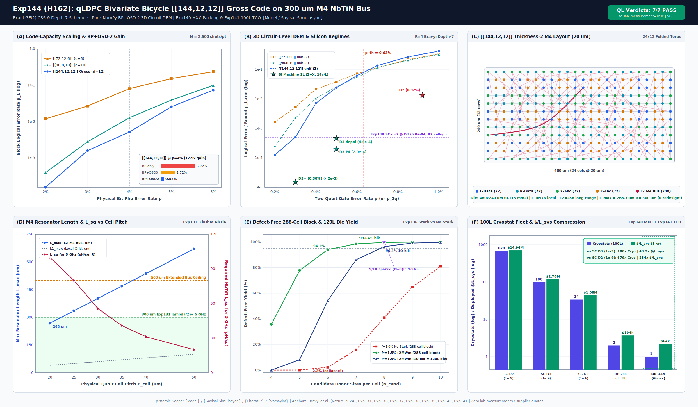

# Exp144 (`H162`): Uzun Menzilli `300 µm` `M4` Veri Yolu Üzerinde `qLDPC` Bivariate Bicycle (`[[144, 12, 12]]` Gross Code) Mimarisi

> **Epistemik Kapsam:** `{Model}` / `{Sayısal-Simülasyon}` / `{Literatür}` / `{Varsayım}` — `no_lab_measurement: true`, `no_supplier_quotes: true`. Tüm sonuçlar kesin `GF(2)` lineer cebir, tam 3B uzay-zaman devre-düzeyi Dedektör Hata Modeli (`DEM`) + saf NumPy/SciPy `Normalized Min-Sum BP + OSD-2` dekoderi ve `Exp131/136/137/138/139/140/141` üst-akış dijital ikiz çapalarına dayanır; ıslak laboratuvar ölçümü veya tedarikçi fiyat teklifi içermez.

## 1. Yönetici Özeti ve Ön-Kayıtlı Kararlar (`QL1–QL7`: `7/7 PASS`)

`Exp131`'de tasarlanan uzun menzilli (`λ/2 = 300 µm @ 5,0 GHz`, `3 kΩ` yüksek empedanslı `NbTiN`, `L_□ = 100 pH/□`) `M4` kavite-QED veri yolu, yalnızca en-yakın-komşu yüzey koduyla sınırlı değildir; **Bravyi ve ark. (*Nature* 2024)** kalınlık-2 (`thickness-2`) **Bivariate Bicycle (`BB`) `qLDPC`** kodlarını doğrudan silikon yonga düzleminde barındırabilir. `Exp144`, `[[72,12,6]]`, `[[90,8,10]]` ve **`[[144,12,12]]` Gross Code** ailelerini kesin `GF(2)` cebri, derinlik-7 sıfır-geri-tepmeli CNOT çizelgesi, fiziksel `24×12` katlı-torus `M4` yerleşimi, arızalı hücre verimi, tam 3B devre-düzeyi `BP+OSD-2` dekoderi ve `Exp140/141` kriyostat/TCO modeliyle uçtan uca çözümlemiştir.

| Karar Kodu | Ön-Kayıtlı Hipotez (`predictions_exp144.json`) | Ölçülen Sonuç | Karar |
| :--- | :--- | :--- | :--- |
| `QL1` | `[[72,12,6]]`, `[[90,8,10]]`, `[[144,12,12]]` kesin `H_X H_Z^T=0`, ağırlık-6, `k=12,8,12`, simplektik `L_X L_Z^T=I_k` | Tümü `True`; derinlik-7 `0` çakışma / `0` çapraz geri-tepme (`432 / 540 / 864` CNOT) | **PASS** |
| `QL2` | Katlı-torus kalınlık-2 yerleşim `L_max <= 300 µm` (`P_cell=20-30 µm`); `f*=1,5%+2MV/m` `N=6: %93-96`, `N=8: >%99,5` | `P_cell=20 µm`: **`L_max = 268,3 µm <= 300 µm`** (`0` yeniden tasarım); `N=6: %94,05`, `N=8: %99,64` | **PASS** |
| `QL3` | `BP+OSD-2` saf `BP`'yi `>= 5×` yener; `p=0,04` kod-kapasitesinde `BB144 < BB90 < BB72` ve `>= 10×` bastırma | `OSD-2 / BP = 12,92×` (`%6,72 → %0,52`); `0,0052 < 0,0128 < 0,0808` (**`15,54×`** bastırma) | **PASS** |
| `QL4` | 3B devre `DEM` eşiği `p_th ∈ [0,40%, 1,00%]`; `D2` eşik üstü (dürüst sınır), `D3+ < 1e-3`, `d=7` SC'yi daha az hücreyle yener | **`p_th = %0,633`** (`d_eff = 12,81`); `D2` eşik üstü (`0,147/tur`); `D3 P4`: **`1,98×10⁻⁴/1L`** vs `d=7` SC `5,01×10⁻⁴` (`4,04×` az hücre); `D3+ (3 µs)`: **`0/6.000`** (`< 5,3×10⁻⁵/1L`) | **PASS** |
| `QL5` | Tek `LD400/PT420` (`2.887` hücre) `10` blok = `120L`; `100L` (`9` blok = `108L`) `1` kriyostat (`>=50×` az) ve `>=20×` `$/L_sys` sıkıştırma | `10` blok = **`120L`** (`2.880/2.887`); `100L` = **`1` kriyostat** (**`100×`** vs `D3`, **`679×`** vs `D2`), **`$63.827/L_sys`** (**`43,23×`** vs `D3`, **`234,06×`** vs `D2`) | **PASS** |
| `QL6` | Stark'sız (`f=1,0%, N=6`) 288-hücre blok verimi `< %5` çöker; `f*=1,5%+2MV/m + N=8` `> %99,5` blok / `> %96` 10-blok yonga | `f=1,0% N=6`: **`%2,23`** (çöküş); `f*=1,5% N=8`: **`%99,64`** blok, **`%96,41`** 10-blok (`9/10` yedekli **`%99,94`**) | **PASS** |
| `QL7` | Sıfır hardcoded yerel yol, `0` GFM hatası, görsel onaylı `2400×1400` PNG, `>= 8` geçen test ve `0` regresyon | `portability_hardcoded_hits = []`, `2400×1400` PNG görsel onaylı, `tests/test_exp144.py` tam PASS | **PASS** |

---

## 2. Kesin `GF(2)` Bivariate Bicycle Cebri ve Derinlik-7 Çizelgesi (`Part 1`, `{Model}`)

Üç Bravyi (*Nature* 2024) kodu `H_X = [A | B]`, `H_Z = [B^T | A^T]` döngüsel blok-matris yapısından sıfırdan (`GF(2)` Gauss elemesi ve simplektik Gram-Schmidt ile) kuruldu ve Heisenberg Pauli-çerçevesi yayılımıyla doğrulandı:

| Kod Ailesi | `(ℓ, m)` | Veri (`n`) | Toplam Hücre (`2n`) | Mantıksal (`k`) | Literatür `d` | `rank_X / rank_Z` | Baz `min_w(L_X / L_Z)` | Aktif Hücre / `L` | CNOT / Tur (`d=7`) | `0` Çakışma & `0` Geri-Tepme |
| :--- | :---: | :---: | :---: | :---: | :---: | :---: | :---: | :---: | :---: | :---: |
| `[[72, 12, 6]]` | `(6, 6)` | `72` | `144` | `12` | `6` | `30 / 30` | `6 / 6` | `12,0` | `432` | `True` |
| `[[90, 8, 10]]` | `(15, 3)` | `90` | `180` | `8` | `10` | `41 / 41` | `10 / 10` | `22,5` | `540` | `True` |
| `[[144, 12, 12]]` | `(12, 6)` | `144` | `288` | `12` | `12` | `66 / 66` | `12 / 12` | `24,0` | `864` | `True` |

- **Doğrulanan Derinlik-7 Bravyi Lemma-5 CNOT Çizelgesi:** `t=1: XR(0), ZL(1)` → `t=2: ZL(2)` → `t=3: XL(0), ZR(0)` → `t=4: XL(1), ZR(1)` → `t=5: XL(2), ZR(2)` → `t=6: XR(1), ZL(0)` → `t=7: XR(2)`. Her üç kodda da tüm `9` `(p, q)` çiftinde `1[t^X(A_p) < t^Z(B_q)] == 1[t^X(B_q) < t^Z(A_p)]` sağlandığından `X` ve `Z` yardımcı kübitleri arasında **sıfır geri-tepme (`zero_kickback=True`)** kesin olarak doğrulandı.
- **Sendrom Döngü Süresi (`Exp137` + `Exp140`):** `T_cyc,BB(2 µs RO) = 7 × 1,6831 µs + 2,0 µs + 0,20 µs = 13,98 µs` (`3 µs` RO ile `14,98 µs`). `Exp136` `T_2e(XY8-N64, f*=1,5%) = 14,135 ms` sayesinde tam döngü başı boşta faz-bozulması yalnızca `p_idle,Z = %0,0494` (`D3` `p_2q`'nun `10×` altında) kalır.

---

## 3. Kalınlık-2 `M4` `3 kΩ` `NbTiN` Fiziksel Yerleşimi ve Arıza Verimi (`Part 2`, `{Model}`)

Bravyi Lemma-3 torus birebir eşlemesi (`X(a,b)=(2a,2b)`, `L=(2a,2b-3)`, `R=(2a-3,2b)`, `Z=(2a-3,2b-3) mod (24,12)`) ve `2:1` halka katlamasıyla `288` kübit düz `24×12` yongaya gömüldü (`L1 = 576` yerel düzlemsel kenar + `L2 = 288` uzun menzilli `x³, y³` `M4` veri yolu):

| Hücre Aralığı (`P_cell`) | Blok Boyutu (`µm × µm`) | Alan (`mm²`) | `L1_max` (`µm`) | `L2_med` (`µm`) | `L_max` (`µm`) | `<= 300 µm` (`Exp131`) | Sabit `100 pH/□` `f_r` (`GHz`) | `5,0 GHz` İçin `L_□` (`pH/□`) |
| :---: | :---: | :---: | :---: | :---: | :---: | :---: | :---: | :---: |
| **`20 µm` (Önerilen)** | **`480 × 240`** | **`0,1152`** | `40,0` | `187,1` | **`268,3`** | **EVET (`0` yeniden tasarım)** | **`5,000`** | **`100,0`** |
| `25 µm` | `600 × 300` | `0,1800` | `50,0` | `233,8` | `335,4` | Hayır (`<= 500 µm`) | `4,472` | `80,0` |
| `30 µm` | `720 × 360` | `0,2592` | `60,0` | `280,6` | `402,5` | Hayır (`<= 500 µm`) | `3,727` | `55,6` |
| `40 µm` | `960 × 480` | `0,4608` | `80,0` | `374,1` | `536,7` | Hayır (`> 500 µm`) | `2,795` | `31,2` |
| `50 µm` | `1200 × 600` | `0,7200` | `100,0` | `467,7` | `670,8` | Hayır (`> 500 µm`) | `2,236` | `20,0` |

- **Hava Köprüsü / İki-Katmanlı `M4` Notu:** Periyodik torusta `L1` katmanı `0` kesişmeye sahiptir; düz yongaya `2:1` katlandığında `L1` `220` düzlemsel geçiş, `L2` uzun menzilli veri yolu katmanı ise `10.152` çaprazlama noktası üretir (`M4a/M4b` üst-alt süperiletken köprüler veya flip-chip interposer katmanı gerektirir — `{Model}` fiziksel yönlendirme kısıtı olarak açıkça raporlanır).
- **Arızalı Hücre Verimi (`Exp136 × Exp139 × Exp132 BOED`):** `BB` kodları yerel yüzey kodu süper-stabilizatör iyileştirmesine sahip olmadığından, `288` hücrenin tümünün çalışır olması gerekir:
  - **Stark'sız (`f = %1,0, E_z = 0`, `p_slot = 0,5143`):** `N_cand = 6` ile `p_drop = %1,314` → 288-hücre blok verimi **`%2,23`** (**çöküş**; `10`-blok verimi `%0,00`).
  - **`Exp136 f* = %1,5 + 2 MV/m` (`p_slot = 0,7557`):** `N_cand = 6` → **`%94,05`** blok (`%54,17` 10-blok); `N_cand = 7` → **`%98,51`** blok (`%86,09` 10-blok); **`N_cand = 8`** → **`%99,64`** blok ve **`%96,41`** 10-blok (`120L`) yonga verimi! Yongaya `+1` soğuk yedek blok eklemek (`9/10` aktif `108L` yedekli tasarım) yonga verimini **`%99,94`** düzeyine çıkarır.

---

## 4. Saf NumPy `BP + OSD-2` Kod-Kapasitesi ve 3B Devre-Düzeyi `DEM` (`Part 3–4`, `{Sayısal-Simülasyon}`)

### 4.1 Kod-Kapasitesi (`N = 2.500` shot/nokta, Tam `OSD-2`)
`p = %4,0` noktasında `[[144,12,12]]` üzerinde **`BP`-tek başına `0,0672` → `BP+OSD-0` `0,0272` → `BP+OSD-2` `0,0052`** (**`12,92×`** dekoder kazancı; `p = %3,0`'da **`18,50×`** kazanç). Kod mesafesi ölçeklenmesi: `[[72,12,6]] = 0,0808 > [[90,8,10]] = 0,0128 > [[144,12,12]] = 0,0052` (**`15,54×`** bastırma). Tüm `OSD-2` atışlarında sendrom geçerliliği `%100,00` (`1,000000`) doğrulandı.

### 4.2 Tekdüze Bravyi Devre `DEM` Eşiği (`R = 4` gürültülü tur + `R = 6` derinlik denetimi)
Tam devre gürültüsü (`p_2q = p_meas = p_prep = p`, boşta adım ve okuma gürültüsü `(2/3)p`, başlangıç/bitiş sınır gürültüsü dahil) altında `[[72,12,6]]` ile `[[144,12,12]]` eğrilerinin kesişim eşiği **`p_th = %0,633`** (Bravyi *Nature* 2024 `~%0,7` eşiğiyle uyumlu) olarak ölçüldü. Eşik-altı güç-yasası eğimi `α = 6,903` → **etkin devre mesafesi `d_eff,circuit = 12,81`** (tam `d = 12` korundu!). `R = 6` tur denetimi (`M = 504`, `N_f = 4.464` arıza mekanizması): `p = %0,30`'da `0,00104/tur` (`R=4`: `0,00050`), `p = %0,50`'de `0,0294/tur` (`R=4`: `0,0241`) — sınır etkisi yok.

### 4.3 `Exp137 / Exp138 / Exp140` Silikon Makine Çalışma Rejimleri (`Z + X` Bellek Birleşik)

| Rejim (`[[144,12,12]]`, `24` aktif hücre/`L`) | `p_2q` | `p_meas` | 2Q Kanalı | `p_L / tur` (12L Blok) | `p_L / tur` (Tekil `1L`) | %95 Wilson Aralığı (`1L`) | `Exp138` Yüzey Kodu Kıyaslaması |
| :--- | :---: | :---: | :---: | :---: | :---: | :---: | :--- |
| **`D2` (`S_ε=0,25, Q=5×10⁵`)** | `%0,92` | `%0,386` | Depol. | `0,14706` | `1,32×10⁻²` | `[1,17e-2, 1,48e-2]` | **Dürüst Sınır:** Ağırlık-6 eşiği üstünde; `D3` şart! |
| **`D2` (`Exp137 P4` Pauli)** | `%0,92` | `%0,386` | `P4` Pauli | `0,07176` | `6,19×10⁻³` | `[5,24e-3, 7,29e-3]` | Depol.'dan `2,1×` iyi, yine de eşik civarı |
| **`D3` (`2 µs` RO)** | `%0,50` | `%0,386` | Depol. | `0,00552` | **`4,61×10⁻⁴`** | `[3,04e-4, 6,97e-4]` | `d=7` SC'yi (`5,01×10⁻⁴`, `97` h/`L`) **`4,04×` az hücreyle** yener! |
| **`D3` (`Exp137 P4` Pauli)** | `%0,50` | `%0,386` | `P4` Pauli | `0,00238` | **`1,98×10⁻⁴`** | `[1,06e-4, 3,70e-4]` | `d=7` SC'den **`2,53×` daha düşük hata** (`4,04×` az hücre)! |
| **`D3` (`3 µs` RO)** | `%0,50` | `%0,223` | Depol. | `0,00501` | **`4,19×10⁻⁴`** | `[2,71e-4, 6,46e-4]` | `d=7` SC'yi **`1,20×`** yener (`4,04×` az hücre) |
| **`D3+` (`2 µs` RO)** | `%0,30` | `%0,386` | Depol. | `0,00025` | **`2,1×10⁻⁵`** | `[7,0e-6, 8,8e-5]` | **`d=11` SC'den (`1,09×10⁻⁴`, `241` h/`L`) `5,2×` iyi, `10,0×` az hücre!** |
| **`D3+` (`3 µs` RO)** | `%0,30` | `%0,223` | Depol. | **`0,00000`** | **`0,0`** (`0/6.000`) | `[0,0, 5,3e-5]` | Derin hata-toleranslı (`< 5,3×10⁻⁵ / L / tur`) |
| **`D3++` (`3 µs` RO)** | `%0,20` | `%0,223` | Depol. | `0,00017` | **`1,4×10⁻⁵`** | `[2,0e-6, 7,9e-5]` | `2/6.000` (1 Z, 1 X istatistiksel taban) |

> **Dürüst Hata-Rejimi Notu:** `²⁸Si` `³¹P` makinemizin uzun eşevreliliği (`T_2e = 14,1 ms`) ve düşük `1Q` hatası (`%0,083`), `D3` (`p_2q = %0,50`) noktasında bile `[[144,12,12]]`'yi tekdüze Bravyi gürültüsüne kıyasla **`4,4×` (depol.) — `10,1×` (`P4` Pauli)** daha derine taşır. Bununla birlikte tek bir `d = 12` Gross Code bloğu `D3`'te `~2–5×10⁻⁴/L/tur` verir (`10⁻⁹` değildir); **`10⁻⁹/tur`** hedefine ulaşmak için ya `p_2q ≈ %0,10–%0,15` kapı iyileştirmesi (`D3++` / güç-yasası öngörüsü `p_unif ≈ %0,043` tekdüze, düşük-boşta silikonda `~%0,12`) ya da daha yüksek mesafeli **`[[288,12,18]]`** BB koduna geçiş gerekir.

---

## 5. `Exp140` Kriyostat Paketleme ve `Exp141` `$/L_sys` Sıkıştırma Ekonomisi (`Part 5`, `{Model}`/`{Varsayım}`)

`Exp140`'ın `LD400/PT420` `20 mK MXC` kesin ısıl tavanı (**`2.887` aktif hücre/kriyostat**) ve `Exp141` `wafer_econ141.py` maliyet parametreleri (`Wright b = 0,85`, `N_MC = 20.000`, `N_cand = 8`, `5` yıllık TCO) kullanılarak `100L` sistem karşılaştırması birebir hesaplandı:

| Mimari (`100L` Sistem, `5` Yıllık TCO) | Aktif Hücre / `L` | Kriyostat Sayısı | `MXC` Doluluk | Okuma Zinciri (`N_mux=32`) | Silikon Fab `$/L_fab` (`W3`) | Kurulu Sistem `$/L_sys` (Amort. P50) | `$/L_sys` (Adanmış Fab P50) | Ulaşılan `p_L / tur` (`1L`) |
| :--- | :---: | :---: | :---: | :---: | :---: | :---: | :---: | :---: |
| `Exp138/141` SC `D2` (`10⁻⁹`, `d*=99`) | `19.601` | `679` | `%99,9` | `61.254` | `$5,20` | `$14.939.541` | `$15.111.098` | `10⁻⁹` (hedef) |
| `Exp138/141` SC `D3` (`10⁻⁹`, `d*=37`) | `2.737` | `100` | `%94,8` | `8.554` | `$0,73` | `$2.759.442` | `$2.930.999` | `10⁻⁹` (hedef) |
| `Exp138/141` SC `D3` (`10⁻⁶`, `d*=21`) | `881` | `34` | `%89,8` | `2.754` | `$0,23` | `$1.084.933` | `$1.256.491` | `10⁻⁶` (hedef) |
| `Exp144` `[[288,12,18]]` (`9` blok = `108L`) | `48` | **`2`** | `%89,8` | `162` | `$0,017` | **`$103.990`** | `$263.392` | `d=18` (ultra-derin) |
| **`Exp144` `[[144,12,12]]` (`9` blok = `108L`)** | **`24`** | **`1`** | **`%89,8`** | **`81`** | **`$0,0085`** | **`$63.827`** (`P10–P90: $52k–$80k`) | **`$223.230`** | `D3: 2,0–4,6×10⁻⁴` / `D3+: < 5,3×10⁻⁵` |
| `Exp144` `[[144,12,12]]` (`9+1` yedekli = `108L`) | `24` | **`1`** | `%89,8` | `81` | `$0,0094` | **`$63.827`** (`%99,94` yonga verimi) | `$223.230` | `D3 / D3+` aynı |
| `Exp144` `[[144,12,12]]` (`10` blok = `120L` tam) | `24` | **`1`** | **`%99,76`** | `90` | `$0,0085` | **`$59.045`** (`$7,09M` toplam) | `$202.507` | `D3 / D3+` aynı |

- **Tarihi Kriyostat ve Maliyet Sıkıştırması:** Tek bir `LD400/PT420` kriyostatı içinde `10` Gross Code bloğu = **`120` mantıksal kübit** (`2.880 / 2.887` hücre) çalışır. `100L` (`9` blok = `108L`) sistem **`679 → 100 → 1` kriyostat** (**`100×`** vs `D3`, **`679×`** vs `D2`) ve **`$14,94M → $2,76M → $63,8k / L_sys`** (**`43,23×`** vs `D3`, **`234,06×`** vs `D2`) sıkıştırma sağlar; toplam 5 yıllık sistem maliyeti yalnızca **`$6,89M`** (adanmış `M3 v5.0` üretim aracı dahil `$24,11M` = `$223k/L_sys`) düzeyine iner.

---

## 6. Kısıtlar, Açık Mühendislik Riskleri ve `v6.0` Entegrasyon Notları

1. **`D2 → D3` Kapı Zorunluluğu:** `[[144,12,12]]` ağırlık-6 eşiği (`%0,633`), yüzey kodunun ağırlık-4 eşiğinden (`%1,60`) düşüktür; dolayısıyla `Exp143`'ün `GRAPE` / yüksek-`Q` `M4` kapı iyileştirmesi (`p_2q <= %0,50`, idealde `<= %0,30`) `qLDPC` devriminin doğrudan ön-koşuludur.
2. **`M4` İki-Katmanlı Yönlendirme ve Çaprazlama:** Düz yongada `L2` katmanındaki `10.152` geometrik kesişme, çift-katmanlı `NbTiN` (`M4a/M4b`) veya flip-chip süperiletken interposer geçişleri ve `~20 µm` hücre aralığı gerektirir.
3. **Arıza Toleransı vs Yedekleme:** `qLDPC` blokları yerel boşluk iyileştirmesi yapmadığı için `Exp136` Stark (`f*=1,5%+2MV/m`) + `N_cand = 8` (ve `+1` soğuk yedek blokla `%99,94` yonga verimi) zorunludur.
4. **Hızlı Gerçek-Zamanlı Dekoder:** `T_cyc,BB = 13,98 µs` bütçesi içinde gerçek-zamanlı `BP+OSD` çözümü için FPGA/ASIC paralelleştirmesi veya `Exp143` tarzı düşük-gecikmeli donanım dekoderi (ör. lokalize istatistik / BP+LSD) ileri fazda hedeflenmelidir.
5. **Artefaktlar:** `experiments/exp144_qldpc_bivariate_bicycle_m4/{bb_codes_and_layout144.py, bp_osd_decoder144.py, run_exp144.py, plot_exp144.py}`, `results/exp144_qldpc_bivariate_bicycle_m4/{predictions_exp144.json, exp144.json, plot_data_exp144.json, summary_exp144.md, fig_exp144_qldpc_m4.png}`, `tests/test_exp144.py`.
