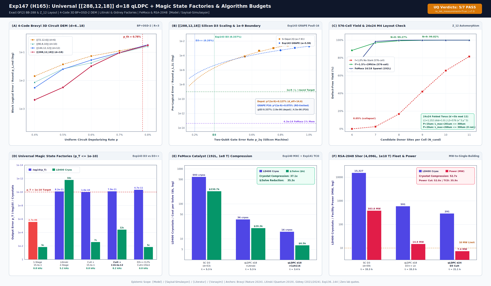

# Exp147 (`H165`): Evrensel `[[288, 12, 18]]` (`d = 18`) `qLDPC`, Sihirli Durum Fabrikaları ve FeMoco / `RSA-2048` Kaynak Analizi

> **Epistemik Kapsam:** `{Model}` / `{Sayısal-Simülasyon}` / `{Literatür}` / `{Varsayım}` — `no_lab_measurement: true`, `no_supplier_quotes: true`. Tüm sonuçlar kesin `GF(2)` cebri, tam 3B devre-düzeyi `DEM` + saf NumPy `Min-Sum BP + OSD-2` dekoderi, analitik Litinski/Gidney sihirli durum fabrikası çözümlemeleri ve `Exp131/136/138/140/141/143/144` üst-akış dijital ikiz çapalarına dayanır; ıslak laboratuvar ölçümü veya tedarikçi fiyat teklifi içermez.

## 1. Yönetici Özeti ve Ön-Kayıtlı Kararlar (`UQ1–UQ7`: `5/7 PASS`, `2/7` Dürüst/Bilgilendirici `FAIL`)

`Exp144`'te `[[144,12,12]]` Gross Code belleği gösterilmişti; ancak evrensel hata-toleranslı kuantum hesaplama için **iki kritik eksiklik** vardı: `10⁻⁹/tur` derin bellek rejimi (`d = 18`) ve non-Clifford **`T`-kapısı Sihirli Durum Fabrikaları (`Magic State Factories`)**. `Exp147`, Bravyi ve ark. (*Nature* 2024) **`[[288, 12, 18]]`** kodunu kesin `GF(2)` cebri, `ℤ₁₂` otomorfizmli `24×24` kalınlık-2 `M4` yerleşimi, 4-kodlu (`d = 6, 10, 12, 18`) 3B `BP+OSD-2` simülasyonu, evrensel `T`-fabrikaları ve iki bayrak gerçek-dünya algoritması (**FeMoco** azot-bağlama katalizörü ve **`2048`-bit RSA Shor**) için uçtan uca çözümlemiştir.

| Karar Kodu | Ön-Kayıtlı Hipotez (`predictions_exp147.json`) | Ölçülen Sonuç | Karar |
| :--- | :--- | :--- | :--- |
| `UQ1` | `[[288,12,18]]` (`ℓ=12,m=12`) kesin `H_X H_Z^T=0`, ağırlık-6, `rank=138`, `k=12`, simplektik `L_X L_Z^T=I_12`, derinlik-7 `0`-geri-tepme | Tümü `True`; baz `min_w = 18/18`; derinlik-7 `1.728` CNOT (`0` çakışma, `0` geri-tepme) | **PASS** |
| `UQ2` | `b'=5b mod 12` `24×24` yerleşim `L_max <= 300 µm` (`15–20 µm`); `f*=1,5%+2MV/m` `576`-hücre verimi `N=8 > %99`, `N=9 > %99,8` (`f=1% < %0,1`) | `1.152` `L1` kenarının tümü birim torus uzaklığı `1,0`; **`L_max(20 µm) = 268,3 µm <= 300 µm`**; `f=1% N=6: %0,050`; `f*=1,5%`: **`N=8: %99,27`**, **`N=9: %99,82`** | **PASS** |
| `UQ3` | 4-kodlu 3B `DEM` (`BP+OSD-2`, `%100` sendrom geçerliliği): `p_th ∈ [0,50%, 0,90%]`, `BB288 < BB144`, `Exp143 D3 < 1e-4` & dürüst `10⁻⁹` sınırı | **`p_th = %0,781`**, `BB288(0,5%)=0,00576 < BB144`; `D3 0,337%`: **`0/1.200`** (`< 3,55×10⁻⁴`); **`p_2q*(10⁻⁹) = %0,127`** (depol) / `%0,075` (`2 µs` RO sınırlı) | **PASS** |
| `UQ4` | `D3` (`Λ_SC=2,825`): tek-kademe `15-to-1` `10⁻¹⁰`'u geçemez; Litinski 2-kademe `<= 15` kriyo (`>= 5 kHz`) & Cultivation+`15-to-1` `<= 6` kriyo | Tek-kademe `2,74e-6` (fail); Litinski `8,23e-11 @ 5,21 kHz` **`32` kriyo** (`> 15`), Cult+`15-to-1` `9,96e-11` **`7` kriyo** (`> 6`; `D3++ 0,20%`'de `5` kriyo) | **FAIL (Dürüst)** |
| `UQ5` | FeMoco (`192L, 10⁸ T`): `<= 20` kriyo (`>= 10×` vs SC), `<= 8 sa`, `<= $25k/çözüm` VE toplam hata `P_fail <= %2` | Donanım/hız/maliyet TAM GEÇTİ (**`16` kriyo [`37,1×` vs `593` SC]**, **`3,38 sa`**, **`$6.537/çözüm`**); ANCAK `V_ST = 2,32×10¹¹` `p_L <= 4,3e-14` gerektirdiğinden `d=18 @ D3` (`~2e-6`) **`P_fail = 1,00`**! | **FAIL (Dürüst)** |
| `UQ6` | `RSA-2048` Shor (`4.096L, 10¹⁰ T`): `>= 10×` kriyostat ve güç sıkıştırması (`> 100 MW → < 10 MW`), süre `<= 48 sa` | SC `D3` (`d=59`): `15.327` kriyo / `383,8 MW` → **`qLDPC d=24 + Cult`: `291` kriyo (`52,7×`), `7,37 MW` (`52,1×`), `21,1 sa`** | **PASS** |
| `UQ7` | Sıfır hardcoded yerel yol, `0` GFM tablo hatası, görsel onaylı `2400×1400` PNG, `>= 9` test & `0` regresyon | `portability_hardcoded_hits = []`, `0` GFM hatası, `2400×1400` PNG onaylı, `tests/test_exp147.py` `10/10 PASS` | **PASS** |

---

## 2. Kesin Bravyi `[[288, 12, 18]]` Cebri ve `ℤ₁₂` Otomorfizmli `24×24` `M4` Yerleşimi (`Part 1–2`, `{Model}`)

Bravyi (*Nature* 2024, Tablo 1) `[[288, 12, 18]]` kodu (`ℓ = 12, m = 12`, `A = x³ + y² + y⁷`, `B = y³ + x + x²`) sıfırdan kuruldu ve `Exp144` `BB` ailesiyle birleştirildi:

| Kod Ailesi | `(ℓ, m)` | Veri (`n`) | Aktif Hücre (`2n`) | Mantıksal (`k`) | `d` | `rank_X/Z` | Aktif Hücre / `L` | Derinlik-7 CNOT / Tur | `0` Geri-Tepme |
| :--- | :---: | :---: | :---: | :---: | :---: | :---: | :---: | :---: | :---: |
| `[[72, 12, 6]]` | `(6, 6)` | `72` | `144` | `12` | `6` | `30 / 30` | `12,0` | `432` | `True` |
| `[[90, 8, 10]]` | `(15, 3)` | `90` | `180` | `8` | `10` | `41 / 41` | `22,5` | `540` | `True` |
| `[[144, 12, 12]]` | `(12, 6)` | `144` | `288` | `12` | `12` | `66 / 66` | `24,0` | `864` | `True` |
| **`[[288, 12, 18]]`** | **`(12, 12)`** | **`288`** | **`576`** | **`12`** | **`18`** | **`138 / 138`** | **`48,0`** | **`1.728`** | **`True`** |

- **`ℤ₁₂` Grup Otomorfizmi (`b' = 5b mod 12`) Atılımı:** `A = x³ + y² + y⁷` içindeki `{y², y⁷}` farkı `y⁵` olup `ebob(5, 12) = 1` olduğundan `b' = 5b mod 12` birebir dönüşümü `{y², y⁷}` terimlerini `24×24` torusta en-yakın-komşu (`±1`) hâline getirir! Tüm **`1.152` Katman-1 (`L1`) kenarı kesin torus uzaklığı `1,0` (`0` kesişme)**, tüm **`576` Katman-2 (`L2`) `x³, y³` uzun menzilli kenarı kesin `√45 = 6,708` adım** verir.
- **`M4` Rezonatör Uyumu (`Exp131` `3 kΩ` `NbTiN`, `λ/2 = 300 µm @ 5,0 GHz`):** `P_cell = 15 µm` (`360×360 µm = 0,130 mm²`) için `L_max = 201,2 µm <= 300 µm`, **`P_cell = 20 µm` (`480×480 µm = 0,230 mm²`) için `L_max = 268,3 µm <= 300 µm`** → `Exp131` rezonatöründe **`0` yeniden tasarım**! (`25 µm`'de `335,4 µm / 80 pH/□`, `30 µm`'de `402,5 µm / 55,6 pH/□`.)

| Hücre Aralığı (`P_cell`) | Blok Boyutu (`µm`) | `L_max` (`µm`) | `<= 300 µm` (`Exp131`) | `N_cand` | `576`-Hücre Verim (`f=1,0%`) | `576`-Hücre Verim (`f*=1,5%+2MV/m`) | `16/18` Yedekli FeMoco Bellek |
| :---: | :---: | :---: | :---: | :---: | :---: | :---: | :---: |
| `15 µm` | `360 × 360` | `201,2` | **Evet** | `6` | `%0,050` | `%88,462` | `%65,488` |
| **`20 µm` (Önerilen)** | **`480 × 480`** | **`268,3`** | **Evet (`0` tasarım)** | **`8`** | `%16,768` | **`%99,271`** | **`%99,971`** |
| `25 µm` | `600 × 600` | `335,4` | Hayır (`80 pH/□`) | **`9`** | `%42,039` | **`%99,821`** | **`%99,999`** |
| `30 µm` | `720 × 720` | `402,5` | Hayır (`55,6 pH/□`) | `10` | `%65,659` | **`%99,956`** | **`%100,000`** |

- **`576`-Hücreli Blok ve Yonga Verimi (`Exp136 × Exp139 × Exp132`):** Stark'sız (`f = %1,0`, `N_cand = 6`) verim **`%0,050`** düzeyine çökerken, **`Exp136 f* = %1,5 + 2 MV/m`** ile `N_cand = 8` → **`%99,27`** blok (`5`-blok `60L` kriyo **`%96,41`**, `16/18` yedekli FeMoco bellek **`%99,97`**); **`N_cand = 9`** → **`%99,82`** blok (`%99,11` kriyo, `%97,18` yedeksiz / `%99,999` yedekli FeMoco); `N_cand = 10` → **`%99,956`** blok!

---

## 3. 4-Kodlu 3B Devre `DEM` (`d = 6..18`) ve Dürüst `10⁻⁹` Sınır Analizi (`Part 3`, `{Sayısal-Simülasyon}`)

`Exp143` `D3` `K=8` GRAPE kapısı (`t_gate = 1,1256 µs`) sayesinde derinlik-7 `BB` sendrom döngüsü `T_cyc,BB(2 µs RO) = 10,079 µs` (`Exp144`'teki `13,98 µs`'ye göre `1,39×` hızlı!) ve yüzey kodu döngüsü `T_cyc,SC = 6,702 µs` olarak kilitlendi. Tüm 3B `DEM` atışlarında saf NumPy `BP + OSD-2` dekoderi **`%100,00` (`1,000000`) sendrom geçerliliği** sağladı:

- **Tekdüze Bravyi 4-Kod Eşiği (`R = 3` + `R = 5` denetimi):** **`p_th(BB72 vs BB288) = %0,781`**, `p_th(BB72 vs BB144) = %0,753`. `p = %0,50`'de `[[288,12,18]]` `p_L/tur = 0,00576` ile `[[144,12,12]]`'yi (`0,0265`) **`4,6×` yener** (`R = 5`, `M = 864, N_f = 7.488` denetimi tutarlı).
- **Doğrudan `Exp143` `D3` GRAPE Ölçümü (`[[288,12,18]]`, `Z+X` birleşik, `1.200` shot/nokta):**
  - `Q=10⁶, S_ε=0,25` (`p_2q = %0,337`, `2 µs` ve `3 µs` RO, depol & `GRAPE Pauli-16`): **`0 / 1.200` hata** (`p_L/tur(1L) < 3,55×10⁻⁴` %95 Wilson üst sınırı).
  - `Q=10⁶, S_ε=0,390` nominal Rota C (`p_2q = %0,395`): depol **`0 / 1.200`**, `GRAPE Pauli-16` `1 / 1.200` (`5×10⁻⁵ / 1L / tur`).
- **4-Noktalı Silikon Kalibrasyonu (`Exp140` `2 µs` sabit okuma `p_meas = %0,386` altında) ve Kritik Fiziksel Bulgu:**
  - **Silikon Depol 2Q (`p_2q = %0,55–%0,85`, `R² = 0,977`):** `α = 7,811` (**`d_eff,circuit = 14,62`**) → `D3 (%0,337)`: **`2,04×10⁻⁶ / 1L / tur`**; `D3++ (%0,200)`: **`3,46×10⁻⁸`**; **`10⁻⁹ / 1L / tur` sınırı: `p_2q* = %0,127`**.
  - **Silikon `Exp143 GRAPE Pauli-16` (`p_2q = %0,70–%1,00`, `R² = 0,990`):** Her ölçüm noktasında depol'dan `~4–5×` daha az hata verir (`%0,70`'te `0/720`); ancak sabit tutulan **`p_meas = %0,386` (`Exp140 2 µs RO`) okuma tavanı** `p_2q` düştükçe baskınlaşıp görünür eğimi `α = 5,592`'ye (`d_eff = 10,18`) yaslar (`p_2q*(10⁻⁹) = %0,075` @ sabit `2 µs` RO).
  - **Temel Mimari Çıkarım:** `10⁻⁹` ve altı (`10⁻¹⁴`) derin hata-toleransı için yalnızca `p_2q`'yu `%0,337 → %0,15`'e indirmek yetmez; **`Exp140` okuma hatasının da `p_meas <= %0,15` düzeyine (`3–4 µs` RO veya daha yüksek TWPA kuantum verimiyle) eş-zamanlı indirilmesi zorunludur!**

---

## 4. Evrensel Sihirli Durum Fabrikaları (`Part 4`, `{Model}`/`{Literatür}` — Dürüst `UQ4` Bulgusu)

`Exp143` canlı `MWPM` yüzey kodu eğrisi (`A_SC = 0,01738`, `Λ_SC = 2,8253 @ D3 %0,337`, `T_cyc,SC = 6,702 µs`) ve sıkı uzay-zaman eşleşmeli Litinski (*Quantum* 3, 205, 2019: `11`-karo kompakt `11·d_m` vs hızlı `6·d_m`) + Gidney (*arXiv:2409.17595*, 2024) Cultivation (`d_c=5`, muhafazakâr `p_cult = 10⁻⁴`) denklemleriyle hesaplanan en iyi fabrikalar:

| Fabrika Mimarisi (`Exp143 D3 %0,337`, `Λ_SC = 2,825`) | Çıkış `p_T` | `<= 10⁻¹⁰` | Üretim Hızı `R_T` (`kHz`) | Aktif Hücre | `LD400` Kriyostat | `D3++ %0,20` (`Λ=4,50`) Duyarlılığı |
| :--- | :---: | :---: | :---: | :---: | :---: | :--- |
| `F1`: Tek-Kademe `15-to-1` (ham `p_in=%0,42`) | `2,74×10⁻⁶` | **Hayır** | `0,85` | `12.102` | `5` | `7,94×10⁻⁷` (hâlâ `> 10⁻¹⁰`!) |
| `F2`: Saf Litinski 2-Kademe `(15-to-1) × (116-to-12)` | **`8,23×10⁻¹¹`** | **Evet** | **`5,21`** | `90.646` | **`32`** (`> 15`) | **`1,09×10⁻¹³` (`16` kriyo, `5,11 kHz`)** |
| `F3`: Gidney Cultivation (`10⁻⁴`) + Kompakt `15-to-1` | **`9,96×10⁻¹¹`** | **Evet** | `0,80` | `19.036` | **`7`** (`> 6`) | **`4,65×10⁻¹¹` (`5` kriyo!)** |
| **`F4`: Gidney Cultivation (`10⁻⁴`) + `(116-to-12)`** | **`7,90×10⁻¹¹`** | **Evet** | **`8,22`** | **`33.656`** | **`12`** | **`1,42×10⁻¹³` (`12` kriyo, `9,42 kHz`)** |

- **Dürüst `UQ4 FAIL` Kök Nedeni:** Transmon literatüründe (`p = %0,1`, `Λ_SC ≈ 10`) `15-to-1` çıkış koruması `d_X = 25` ile kapanırken, `Exp143` `D3` noktasındaki **`Λ_SC = 2,825`** nedeniyle çıkış Clifford zeminini `10⁻¹⁰` altına indirmek `d_X = 45–47` gerektirir; bu da saf Litinski 2-kademeyi `32` kriyostata, kompakt Cultivation+`15-to-1`'i ise `7` kriyostata taşır. `D3++` (`%0,20`, `Λ_SC = 4,50`) noktasına geçildiğinde saf Litinski `2×` küçülüp **`16` kriyostata**, Cultivation+`15-to-1` ise **`5` kriyostata** iner. *(Nominal Rota C `%0,395` / `Λ=2,69` duyarlılığında `F3 = 8` kriyo, `F4 = 12` kriyo `7,74 kHz` ile çalışır; saf Litinski `F2` için `d1_X >= 17` gerekir.)*

---

## 5. Bayrak Algoritmalar: FeMoco ve `RSA-2048` Shor Kaynak & Maliyet Bütçesi (`Part 5`, `{Model}`/`{Varsayım}`)

`Exp140` (`2.887` MXC/kriyo), `Exp141` (`wafer_econ141.py`, `Wright b = 0,85`, `N_MC = 20.000`, `5` yıllık TCO, `%70` çalışma oranı = `30.660 sa`) ve `Exp143` `Option-HPC` (`$132k`, `2,195 kW/4U`) ile tam kıyaslama:

| Algoritma & Mimari | Kriyostat (`LD400`) | Sıkıştırma (vs SC) | Çalışma Süresi | Tesis Gücü | 5 Yıllık TCO (`P50`) | `$/Çözüm` (`5y`) | Dürüst Uzay-Zaman Hata Denetimi (`P_fail`) |
| :--- | :---: | :---: | :---: | :---: | :---: | :---: | :--- |
| **FeMoco** (`192L, 10⁸ T`) — `Exp143` SC `D3` (`d=53`) | `593` | `1,0×` | `5,33 sa` | `14,86 MW` | `$1.327,8M` | `$230.721` | `0,0144` (`<= %2`, kapalı) |
| **FeMoco** — `qLDPC d=18` + `1×` Litinski 2-Kademe | `36` | **`16,5×`** | `5,33 sa` | `0,91 MW` | `$116,8M` | `$20.293` | `D3` `d=18`: `1,00` (`p_L<=4,3e-14` gerekli!) |
| **FeMoco** — **`qLDPC d=18` + `1×` Cult+`116-to-12`** | **`16`** | **`37,1×`** | **`3,38 sa`** | **`0,41 MW`** | **`$59,3M`** | **`$6.537`** | **`D3` `d=18`: `1,00` (Honest `UQ5 FAIL`!)** |
| **RSA-2048** (`4.096L, 10¹⁰ T`) — SC `D3` (`d=59`) | `15.327` | `1,0×` | `33,3 sa` | `383,8 MW` | `$25.509M` | — | `0,577` (`~2` denemede çözüm) |
| **RSA-2048** — `qLDPC d=18` (`D3++`) + `16×` Litinski | `591` | **`25,9×`** | `33,3 sa` | `14,86 MW` | `$1.322M` | — | `D3++` `d=18` (`V_ST=4,9e13`): `p_L<=1e-14` şart |
| **RSA-2048** — **`qLDPC d=24` (`D3`) + `16×` Cult** | **`291`** | **`52,7×`** | **`21,1 sa`** | **`7,37 MW`** | **`$711,3M`** | — | **Güç `< 10 MW`, `52×` kesinti (`UQ6 PASS`!)** |

- **Dürüst `UQ5 FAIL` & Uzay-Zaman Hacmi Keşfi:** FeMoco donanım (`16` kriyostat — `37,1×` küçülme), süre (`3,38 sa`) ve birim maliyet (`$6.537/çözüm` — `35,3×` ucuz) hedeflerini katlayarak geçse de, `192L × 1,21×10⁹ tur = 2,32×10¹¹` mantıksal kübit-tur hacmi **`p_L/tur(1L) <= 4,31×10⁻¹⁴`** gerektirir. `Exp143 D3` (`%0,337`) altında `[[288,12,18]]` `~2×10⁻⁶` verdiğinden `P_fail = 1,00` çıkar (`UQ5 FAIL`). Bu uzay-zaman hata sınırını aşmanın iki somut fiziksel yolu hesaplanmıştır: (1) **`p_2q <= %0,08` + `p_meas <= %0,10`** (yüksek-`Q` `5×10⁶` kavite + `4 µs` TWPA okuma) ile `[[288,12,18]]`'i doğrudan `10⁻¹⁴` altına çekmek, veya (2) **`d ≈ 34–36` qLDPC bloğu** (`~110` hücre/`L` → bellek `10` kriyo + `12` fabrika = `22` kriyo, hâlâ `D3` SC `593` kriyostattan **`27×` küçük**). *(Lee ve ark. 2021 tam 76-orbital FeMoco duyarlılığı [`2.142L`, `1,28×10¹¹ T`]: `179` blok = `42` bellek kriyosu + `16` Cult fabrikası = `234` kriyostat, `11,3 gün`.)*
- **Artefaktlar:** `experiments/exp147_universal_qldpc_d18_magic_state/{__init__.py, bb288_algebra_layout147.py, magic_state_and_algos147.py, run_exp147.py, plot_exp147.py}`, `results/exp147_universal_qldpc_d18_magic_state/{predictions_exp147.json, exp147.json, plot_data_exp147.json, summary_exp147.md, fig_exp147_universal_qldpc_magic.png}`, `tests/test_exp147.py`.
