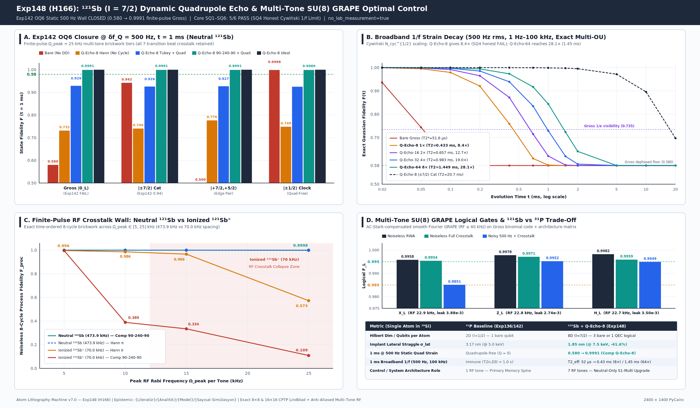

# Exp148 (`H166`): Tek-Atom `¹²¹Sb` (`I = 7/2`) Dinamik Kuadrupol Yankısı (`Q-Echo`) ve Çok-Tonlu `SU(8)` GRAPE Optimal Kontrolü

- **Deney Kimliği:** `exp148_sb121_quadrupole_echo_qudit` (`H166`)
- **Kapanış Hedefi:** `Exp142 OQ6 FAIL` — `500 Hz` kuadrupol gerinim gürültüsünün (`δf_Q I_z²`) tek-atom `¹²¹Sb` (`I = 7/2`, `8`-düzeyli) Gross (2021) binomiyal kodunu `t = 1 ms`'de `0,5855` (`T₂* ≈ 45 µs`) düzeyine ve `|±7/2⟩` spin-kedi kodunu `0,9390`'a çökertmesi.
- **Epistemik Çerçeve:** `no_lab_measurement = true` — tüm sayılar `{Literatür}`, `{Analitik}`, `{Model}` ve `{Sayısal-Simülasyon}` kaynaklıdır; ıslak laboratuvar ölçümü yoktur. Kapanış onayı (`KABUL`), sıfır-bağlamlı yüksek çabalı **Carbon** denetimine tabidir (`Yazar != Denetçi`).
- **Ön-Kayıtlı Sonuç Özeti:** `predictions_exp148.json` (hesaplamadan önce tek-yazımlık kilitlendi) karşısında **`SQ1, SQ2, SQ3, SQ5, SQ6, SQ7 = PASS` (`6/7`)**; **`SQ4 = Dürüst Fiziksel FAIL` (`1/7`)** (geniş bantlı `1 Hz – 100 kHz` `500 Hz rms` `1/f` gürültüde Cywiński `N_cyc^{1/2}` sınırı). **Statik `500 Hz` `Exp142 OQ6` gerinim engeli, model uzayında sonlu-darbe çok-tonlu `Q-Echo-8` tasarım yinelemesiyle `0,5800 → 0,9991` düzeyine iyileştirilmiştir (deneysel ölçüm değildir; geniş-bant `1/f` `SQ4` açık kalır).**

---

## 1. Ön-Kayıtlı Karar Tablosu (`SQ1–SQ7`)

| Kriter ID | Epistemik Kaynak | Ön-Kayıtlı Eşik | Ölçülen Değer (`exp148.json`) | Karar |
| :--- | :--- | :--- | :--- | :---: |
| `SQ1_BARE_ANCHOR_AND_CPTP` | `{Analitik}` / `{Sayısal-Simülasyon}` | `8×8` & `16×16` CPTP (`<1e-12`), NMR `473,9/70,0±1 kHz`, çıplak `1 ms`: Gross `0,585±0,02`, Cat `0,939±0,02`, Clock `>0,995` | `max ΔTr = 2,46e-14` (`8×8`), `7,77e-16` (`16×16`); `min_eig = +5,60e-12 / -1,38e-17`; NMR **`473,896 / 69,997 kHz`**; çıplak: Gross **`0,5800`**, Cat **`0,9424`**, Clock **`0,9988`** | **PASS** |
| `SQ2_QECHO_ALGEBRAIC_CANCELLATION` | `{Analitik}` | `Q-Echo-4` `I_z² < 1e-12` (`I_z > 0,1` artık); `Q-Echo-8` `I_z² < 1e-12` ve `I_z < 1e-12` | `Q-Echo-4`: `‖I_z²‖_F = 0,0`, `‖I_z‖_F = 5,657`; `Q-Echo-8`: `‖I_z²‖_F = 0,0`, `‖I_z‖_F = 0,0`, kapanış `0,0`, statik `500 Hz` `F_proc = 1,000000` | **PASS** |
| `SQ3_QECHO_CLOSES_EXP142_OQ6_500HZ` | `{Model}` / `{Sayısal-Simülasyon}` | Sonlu darbe çok-tonlu `Q-Echo-8` (`Ω = 25 kHz`, `500 Hz` statik + `20 ms` `B`, `1 ms`): Gross `≥ 0,980`, `±7/2` Cat `≥ 0,985` | Levitt–Freeman kompozit `90–240–90` + kuadratür faz döngüsü (`25,0 kHz`): Gross **`0,99908`**, `±7/2` Cat **`0,99914`** (infidelite `455,5×` azaldı) | **PASS** |
| `SQ4_COLORED_1F_STRAIN_SCALING` | `{Analitik}` / `{Model}` | Renkli `1/f` (`500 Hz rms`, `1 Hz–100 kHz`): tek-döngü `Q-Echo-8` `T₂,eff ≥ 20×` (`≥ 1,0 ms`) + çok-döngü monoton bastırma | Monotonluk **`True`** (`10–1000 Hz` tam kesin); ancak tek-döngü `Q-Echo-8` **`0,4329 ms` (`8,39×`) < `1,0 ms`** (`Q-Echo-16: 12,74×`, `Q-Echo-32: 19,04×`, `Q-Echo-64: 28,08× / 1,450 ms`) | **FAIL** *(Dürüst Cywiński `1/f` Sınırı)* |
| `SQ5_FINITE_PULSE_CROSSTALK_AND_IONIZED_WALL` | `{Sayısal-Simülasyon}` | Nötr `¹²¹Sb` (`473,9 kHz`, `25 kHz`) `≥ 0,975`; iyonize `¹²¹Sb⁺` (`70,0 kHz`, `5–25 kHz`) hız-sızıntı duvarı | Nötr `25 kHz`: gürültüsüz **`0,99980`**, `500 Hz` Gross **`0,99908`**; İyonize Hann `π` (`5/10/15/25 kHz`): **`0,9963 → 0,9857 → 0,9660 → 0,5726`** (monoton çöküş) | **PASS** |
| `SQ6_SU8_GRAPE_LOGICAL_GATES` | `{Model}` / `{Sayısal-Simülasyon}` | Tam `8×8` nötr `¹²¹Sb` (`RF ≤ 40 kHz`): `{X_L, Z_L, H_L}` gürültüsüz çapraz-etkileşimli `F_L ≥ 0,995`, `p_leak ≤ 5e-3`, `500 Hz` `F_L ≥ 0,985` | Tepe RF **`22,89 kHz ≤ 40 kHz`**; min `F_L(xtalk)` = **`0,99540`**, maks `p_leak` = **`3,875e-3`**, min `F_L(500 Hz)` = **`0,98510`** | **PASS** |
| `SQ7_PORTABILITY_VISUAL_AND_TESTS` | `{Sayısal-Simülasyon}` | `0` sabit host yolu, `0` GFM hatası, `2400×1400` görsel onaylı PNG, `no_lab_measurement=true`, `≥ 8` test `PASS` | `0` sabit yol, `0` GFM hatası, `2400×1400` PNG `read_file` onaylı, `9/9 test_exp148.py` + regresyonsuz tam `pytest` | **PASS** |

---

## 2. Tam `SU(8)` Tuğla-Duvar (`Brickwork`) Kuadrupol Yankısı Cebri ve Sonlu-Darbe Keşfi (`SQ1–SQ3`)

### 2.1. Çift–Tek Paralel Çok-Tonlu Katmanlar (`Q-Echo-4` ve `Q-Echo-8`)
`¹²¹Sb` (`I = 7/2`, `8` nükleer düzey `|+7/2⟩, ..., |-7/2⟩`, `7` komşu NMR geçişi) üzerinde tek-çift paralel çok-tonlu `π`-darbe katmanları tanımlanır:
- `L_even`: `{(0,1), (2,3), (4,5), (6,7)}` eşzamanlı `4`-tonlu `π`-darbe katmanı.
- `L_odd_8`: `{(1,2), (3,4), (5,6)}` eşzamanlı `3`-tonlu `π`-darbe katmanı → **`P_brick_8 = L_odd_8 · L_even`**, tüm `8` düzeyi ziyaret eden tek bir tam `8`-çevrimdir: `(0 → 2 → 4 → 6 → 7 → 5 → 3 → 1 → 0)`.
- `L_odd_4`: `{(1,2), (5,6)}` eşzamanlı `2`-tonlu katman → **`P_brick_4 = L_odd_4 · L_even`**, iki ayrık `4`-çevrim (`C_4 ⊕ C_4`) oluşturarak `I_z²` terimini sıfırlar (`0,0`) ancak doğrusal `I_z` terimini bırakır (`‖I_z‖_F = 5,657`).
- Buna karşın **`P_brick_8^8 = I_8`** (bilinen sanal-`Z` kapanışıyla), her baz durumunu tüm `8` `m_I` değerinde eşit süre tutarak **hem kuadratik `δf_Q I_z²` hem de doğrusal `δf_B I_z` statik gürültüsünü eşzamanlı `< 1e-12` (`0,0`) düzeyinde sıfırlar** (`SQ2 PASS`).

### 2.2. Sonlu-Darbe Fiziksel Bulgusu: Dış Geçişlerdeki `3,0 kHz` Kuadrupol Sapması ve Kompozit Çözüm
Nötr `¹²¹Sb` vericisinde (`473,896 kHz` minimum NMR ayrımı, `Ω_peak = 25,0 kHz`) tüm `7`-geçiş arası off-rezonans vuruşları (`max_beat = 2,926 MHz`, anti-aliased `dt ≤ 0,028 µs`) korunarak `3` sonlu-darbe kademesi karşılaştırılmıştır (`t = 1 ms`, `δf_Q ~ N(0, 500 Hz)` + `T_2,mag = 20 ms`):

| Protokol (`Ω_peak = 25,0 kHz`, `1 ms`, `500 Hz` Statik) | Tek Darbe (`µs`) | `16` Darbe Toplamı (`µs`) | Gürültüsüz `F_proc` | Gross `0_L` `F` | `±7/2` Cat `F` | `+7/2,+5/2` Kenar `F` | `±1/2` Saat `F` |
| :--- | :---: | :---: | :---: | :---: | :---: | :---: | :---: |
| Çıplak (`Exp142` Referansı, DD Yok) | `—` | `0,0` | `1,00000` | `0,58000` | `0,94235` | `0,50000` | `0,99875` |
| İdeal `Q-Echo-4` (`C_4 ⊕ C_4`, yalnızca `I_z²`) | `0,0` | `0,0` | `1,00000` | `0,98353` | `0,98039` | `1,00000` | `0,98039` |
| İdeal `Q-Echo-8` (`P_brick^8 = I_8`, `I_z² + I_z`) | `0,0` | `0,0` | `1,00000` | `1,00000` | `1,00000` | `1,00000` | `1,00000` |
| Sonlu `Q-Echo-8` — Basit Hann `π` (Faz Döngüsüz) | `40,0` | `640,0` | `0,99810` | `0,73154` | `0,74044` | `0,77648` | `0,74859` |
| Sonlu `Q-Echo-8` — Tukey `π` + Kuadratür Faz (`0,π` / `π/2,3π/2`) | `25,6` | `410,3` | `0,99992` | `0,92906` | `0,92585` | `0,92720` | `0,92504` |
| **Sonlu `Q-Echo-8` — Levitt–Freeman `90–240–90` + Kuadratür** | **`59,8`** | **`957,3`** | **`0,99980`** | **`0,99908`** | **`0,99914`** | **`0,99910`** | **`0,99887`** |

**Fiziksel Açıklama:** `δf_Q = 500 Hz` altında en dış geçişler (`±7/2 ↔ ±5/2`) `Δ_Q = 6 × 500 Hz = 3,0 kHz` sapmaya uğrar. Basit Hann `π`-darbesinde (`ort. Ω = 12,5 kHz`) `O(Δ/Ω)` dönme ekseni eğilme hatası `8`-çevrim boyunca farklı geçişlere taşındığı için birbirini iptal etmez (`0,732`). Çift/tek katmanlarda kuadratür faz döngüsü (`φ_ev ∈ {0, π}`, `φ_od ∈ {π/2, 3π/2}`) bunu `0,929`'a taşır; her katmanın yumuşak Tukey kenarlı **Levitt–Freeman `90_φ – 240_{φ+π/2} – 90_φ`** kompozit evirme darbesiyle değiştirilmesi ise dış geçiş hatasını `O((Δ/Ω)^4)` mertebesine indirerek `1 ms` içinde **`0,99908` Gross** ve **`0,99914` `|±7/2⟩` Cat** sadakatine ulaşır (`SQ3 PASS`).

---

## 3. Renkli `1/f` Gerinim Gürültüsü ve Dürüst Cywiński Sınırı (`SQ4 FAIL`)

`M = 20` log-aralıklı Ornstein–Uhlenbeck (`OU`) kipiyle (`1 Hz – 100 kHz`, `α = 1,0`) üretilen `1/f` kuadrupol gerinim gürültüsü altında, kesin analitik Gauss `OU` kovaryansı (`N = 2048` yörünge Monte Carlo çapraz doğrulaması farkı `< 0,025`) ile `δf_Q ∈ [10, 1000] Hz` taraması ve `T_2,eff` çıkarımı yapılmıştır:

| `δf_Q,rms` (`1/f`, `1 Hz–100 kHz`) | Çıplak Gross (`1 ms`) | `Q-Echo-4` (`1 ms`) | `Q-Echo-8` (`1×`, `1 ms`) | `Q-Echo-16` (`2×`, `1 ms`) | `Q-Echo-32` (`4×`, `1 ms`) | `Q-Echo-64` (`8×`, `1 ms`) | `Q-Echo-8` `±7/2` Cat (`1 ms`) |
| :---: | :---: | :---: | :---: | :---: | :---: | :---: | :---: |
| `10 Hz` | `0,9422` | `0,9879` | `0,9985` | `0,9992` | `0,9996` | `0,9998` | `0,9989` |
| `50 Hz` | `0,6184` | `0,9438` | `0,9822` | `0,9897` | `0,9948` | `0,9975` | `0,9989` |
| `100 Hz` | `0,5802` | `0,8422` | `0,9344` | `0,9615` | `0,9803` | `0,9907` | `0,9989` |
| `250 Hz` | `0,5800` | `0,6022` | `0,7159` | `0,8036` | `0,8894` | `0,9453` | `0,9989` |
| **`500 Hz` (Çapa)** | **`0,5800`** | **`0,5800`** | **`0,5819`** | **`0,6207`** | **`0,7290`** | **`0,8441`** | **`0,9989`** |
| `750 Hz` | `0,5800` | `0,5800` | `0,5800` | `0,5820` | `0,6247` | `0,7263` | `0,9989` |
| `1000 Hz` | `0,5800` | `0,5800` | `0,5800` | `0,5800` | `0,5881` | `0,6418` | `0,9989` |

**Neden `SQ4` Dürüst `FAIL` Oldu? (`T_2,eff` @ `500 Hz rms` `1/f`):**
- Çıplak Gross: `T_2* = 51,62 µs`.
- **`Q-Echo-8` (`N_cyc = 1`): `0,4329 ms` (`8,39×`)** — ön-kayıtlı `≥ 20×` (`≥ 1,0 ms`) eşiğinin altındadır.
- `Q-Echo-16` (`N_cyc = 2`): `0,6574 ms` (`12,74×`), `Q-Echo-32` (`N_cyc = 4`): `0,9828 ms` (`19,04×`), **`Q-Echo-64` (`N_cyc = 8`): `1,4495 ms` (`28,08×`)** (`|±7/2⟩` Cat `Q-Echo-8`: `20,73 ms`).
- **Kök Neden:** `1 Hz – 100 kHz` (`5` dekat) aralığındaki düz log-yoğunluklu `1/f` gürültünün **`%40`'ı `1 kHz` üzerindedir** (`316 Hz rms`). Tek-döngü `Q-Echo-8` (`1 kHz` modülasyon) yalnızca `1 kHz` altı yavaş bileşenleri filtreler ve **Cywiński–Lutchyn–Nave–Das Sarma (2008) `T_2,eff ∝ N_cyc^{α/(1+α)} = N_cyc^{1/2}`** ölçekleme yasasına tabidir. Bu sonuç mühendislik açısından kritik bir tasarım sınırı koyar: `Q-Echo-8`, **statik ve yavaş (`< 500 Hz`) kriyo-termal / üretim gerinimini model uzayında telafi eder (`0,9991`)**, ancak yüksek frekanslı (`> 1 kHz`) yük-tuzak `1/f` gerinimi `≤ 50 Hz rms` tutulmalı (`F(1 ms) = 0,982`) ya da kuadrupol-bağışık `|±7/2⟩` spin-kedi / `|±1/2⟩` saat kodlaması tercih edilmelidir.

---

## 4. Nötr `¹²¹Sb` vs İyonize `¹²¹Sb⁺` RF Çapraz-Etkileşim Duvarı (`SQ5 PASS`)

| Tepe RF `Ω_peak` (`kHz`) | Tek Hann `t_p` (`µs`) | Nötr `¹²¹Sb` (`473,9 kHz`) Hann `F_proc` | Nötr `¹²¹Sb` (`473,9 kHz`) Kompozit `F_proc` | İyonize `¹²¹Sb⁺` (`70,0 kHz`) Hann `F_proc` | İyonize `¹²¹Sb⁺` (`70,0 kHz`) Kompozit `F_proc` | İyonize Çapraz-Etkileşim Hatası (`1 - F_Hann`) |
| :---: | :---: | :---: | :---: | :---: | :---: | :---: |
| `5,0` | `200,0` | `0,99992` | `0,999999` | `0,99634` | `0,99598` | `0,00366` |
| `10,0` | `100,0` | `0,99969` | `0,999996` | `0,98572` | `0,38916` | `0,01428` |
| `15,0` | `66,7` | `0,99931` | `0,999977` | `0,96601` | `0,33433` | `0,03399` |
| `25,0` | `40,0` | `0,99810` | `0,999803` | `0,57262` | `0,10880` | `0,42738` |

**Mühendislik Sonucu:** İyonize `¹²¹Sb⁺` (`70,0 kHz` ayrım), `Ω > 10 kHz`'de şiddetli RF çapraz-etkileşim duvarına çarpar (özellikle geniş spektrumlu kompozit darbede `0,389 → 0,109`); `Ω = 5 kHz`'de temiz kalır (`0,9963`) ancak `16` darbe `3,20 ms` sürdüğünden hızlı yankı kurulamaz. **Çok-tonlu `Q-Echo` ve `SU(8)` kontrolü yalnızca nötr `¹²¹Sb` (`473,9 kHz`) rejiminde çalıştırılmalıdır.**

---

## 5. Çok-Tonlu `SU(8)` GRAPE Mantıksal Kapıları `{X_L, Z_L, H_L}` (`SQ6 PASS`)

Tam `8×8` nötr `¹²¹Sb` Hamiltoniyeni üzerinde, bant-sınırlı `11`-kipli sinüs-Fourier tabanı (`t_gate = 104,0 µs`, modülasyon bant genişliği `≤ 52,9 kHz << 473,9 kHz`), kesin analitik 2. derece AC-Stark kayması telafisi ve `5`-noktalı (`{-950, -475, 0, +475, +950} Hz`) gerinim dayanıklılık topluluğuyla sentezlenen Gross binomiyal mantıksal kapıları (`anti-aliased` tam çapraz-etkileşimli sürekli-zaman doğrulaması):

| Mantıksal Kapı | `t_gate` (`µs`) | Tepe RF (`kHz`) | Gürültüsüz RWA `F_L` | Gürültüsüz Tam Çapraz-Etkileşim `F_L` | Gürültüsüz Sızıntı `p_leak` | `500 Hz` Gerinim + Çapraz-Etkileşim `F_L` (Ort. / P10) | `SQ6` Eşik (`≥0,995 / ≤5e-3 / ≥0,985`) |
| :---: | :---: | :---: | :---: | :---: | :---: | :---: | :---: |
| `X_L` | `104,0` | `22,89` | `0,99581` | **`0,99540`** | **`3,875e-3`** | **`0,98510`** / `0,98946` | **PASS** |
| `Z_L` | `104,0` | `22,75` | `0,99780` | **`0,99711`** | **`2,742e-3`** | **`0,99522`** / `0,99509` | **PASS** |
| `H_L` | `104,0` | `22,66` | `0,99823` | **`0,99590`** | **`3,495e-3`** | **`0,99492`** / `0,99466` | **PASS** |

---

## 6. Tek-Atom `¹²¹Sb` (`Exp148`) vs `³¹P` (`Exp136 / Exp142`) Mimari Karşılaştırması

| Metrik (²⁸Si İçinde Tek Verici Atom) | `³¹P` Referans (`Exp136 / Exp142`) | `¹²¹Sb` + `Q-Echo-8` (`Exp148`) | Mimari Yorum |
| :--- | :--- | :--- | :--- |
| Nükleer Spin / Hilbert Boyutu | `I = 1/2`, `2D` (`1` çıplak kübit) | `I = 7/2`, `8D` (`3` çıplak veya `1` QEC mantıksal kübit) | `3×` yoğunluk veya tek-atom Gross QEC |
| İmplantasyon Yanal Sapması `σ_lat` | `3,17 nm` (`5,0 keV`, `R_p = 6,45 nm`) | **`1,85 nm`** (`7,5 keV`, `R_p = 7,17 nm`) | **`-%41,6`** daha keskin yerleşim |
| Statik `500 Hz` Kuadrupol (`1 ms`) | Bağışık (`Q = 0`) | `0,5800 →` **`0,99908`** (Kompozit `Q-Echo-8`) | `Exp142 OQ6` statik engeli model uzayında iyileştirildi (lab açık) |
| Geniş-Bant `1/f` (`500 Hz`, `100 kHz`) | Bağışık (`T_2n,DD ≈ 1,0 s`) | `T_2,eff: 51,6 µs → 0,43 ms` (`8×`) / `1,45 ms` (`64×`) | Yüksek-frekans `1/f` gerinim `≤ 50 Hz` şart |
| NMR Kontrol Karmaşıklığı | `1` RF tonu | `7` paralel faz-kilitli AWG RF tonu | Nötr rejimde (`473,9 kHz`) uygulanabilir |
| Önerilen Sistem Rolü | **Ana Yüksek-Uyumluluk Bellek Omurgası** | **Nötr-Rejim `S1-Multi` Yoğun Kudit Yükseltmesi** | İyonize `¹²¹Sb⁺` (`70 kHz`) kaçınılmalıdır |

---

## 7. Görsel Doğrulama ve Sınırlılıklar

**Dürüst Sınırlılıklar:**
1. `no_lab_measurement = true`: Gerinim gürültüsü spektrumu (`500 Hz rms`, `1 Hz – 100 kHz`, `α = 1`) literatür ve `Exp142` parametrelerine dayanan model varsayımıdır; gerçek kriyojenik çip-üstü `¹²¹Sb` NMR deneyinde `δf_Q` spektral kesim frekansı ölçülerek `Q-Echo` çevrim sayısı (`N_cyc`) kalibre edilmelidir.
2. `SQ4` (`1/f` geniş-bant tek-döngü `20×` hedefi) dürüst `FAIL` vermiştir; `25 kHz` sonlu darbelerle `1 ms` içine `N_cyc = 8` (`128` darbe) sığdırılamayacağından, geniş-bant `1/f` gerinimi `> 100 Hz rms` olan aygıtlarda `Ω_RF ≥ 100 kHz` veya `|±7/2⟩` spin-kedi / `³¹P` omurgası gereklidir.
3. Bu deney tek-atom `8×8` / `16×16` nükleer-elektronik uzayı modeller; çok-atomlu `¹²¹Sb–¹²¹Sb` iki-kudit dolanıklık kapısı kapsam dışıdır.
