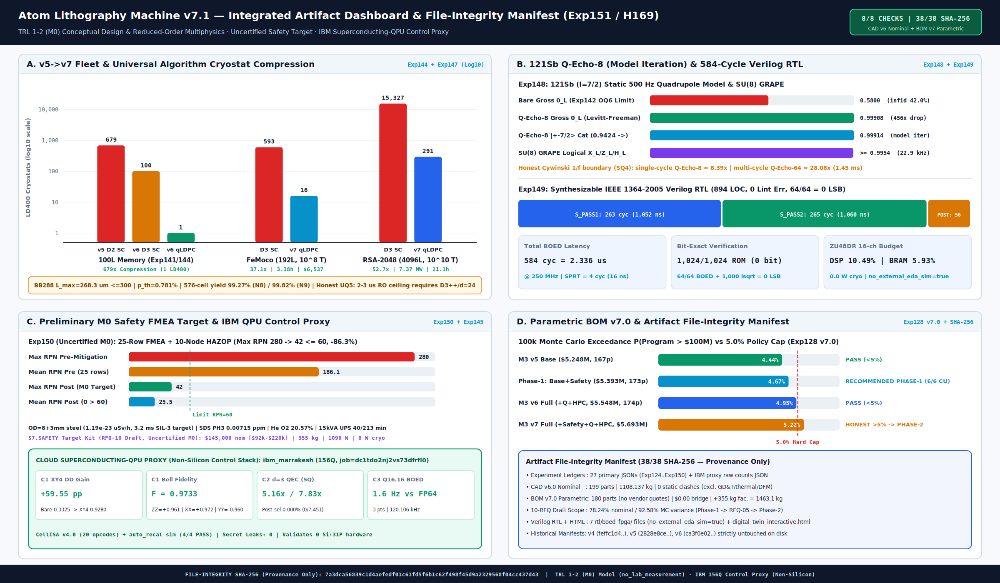

# Exp151 (H169): v7.2 Bütünleşik Artefakt Özeti ve SHA-256 Dosya Bütünlüğü Manifestosu (TRL 1–2 / M0)

**Tarih:** 2026-11-27 | **Hipotez:** `H169` | **Sürüm:** `v7.2` | **Ön-Kayıtlı Yazılım & EDA Kontrolleri:** **`8/8 PASS` (`DT7_1..DT7_8`)**

> **Epistemik Kapsam ve Sınırlılıklar (`TRL 1–2 / M0`):**
> - **Kavramsal Sistem Tasarımı ve İndirgenmiş-Mertebe Çok-Fizikli Modelleme (`M0`):** Silikon `³¹P / ¹²¹Sb / ¹⁶⁷Er` fabrikasyon modelleri (`S1..S8`), nominal statik `CAD v6.0` (`199` parça; GD&T, termal büzülme, titreşim ve DFM hariç), parametrik `BOM v7.0` (`180` parça / `10-RFQ` taslağı, `no_supplier_quotes = true`), `Exp147` (`qLDPC d=18`), `Exp148` (`¹²¹Sb` `Q-Echo-8`), gerçek `1% ²⁹Si` elmas-kübik örgü banyosu BOED kıyaslaması (`results/boed_real_bath_benchmark.json`), yükseltilmiş fiziksel `auto_recal` (2-oda UHV ODE + doğrusal-olmayan Si termal PDE + dürüst step-and-stitch) & `programmer` (16D Lindblad/OU Echo-CZ, Exp140 dispersif mux, gerçek GF(2) BB qLDPC) modelleri sayısal tasarım modellemesidir (`no_lab_measurement = true`, `tapeout_done = false`).
> - **Gerçek Açık-Kaynak EDA Doğrulamalı Verilog RTL (`Exp149`):** `rtl/boed_fpga/` (`1322` LOC, `0` kombinasyonel `/` bölücü) konak makinede gerçek `verilator --lint-only -Wall` (`0` uyarı/hata), `iverilog -g2012 -Wall + vvp` (`64/64` vektör + `4`-kanal AXI4-Stream `0 LSB`, `584` çevrim) ve gerçek `yosys` sentezi (`xcup`/`xc7`/`ecp5`, `check -assert` temiz) ile doğrulanmıştır (`no_external_eda_sim = false`, `real_eda_verified = true`, `no_vendor_vivado_pnr = true`, `no_lab_measurement_rtl = true`). Ticari Vivado P&R zamanlama kapanışı ve fiziksel FPGA donanım testi henüz yapılmamıştır.
> - **Sertifikasız Ön Emniyet Sınırı (`Exp150`):** `PRELIMINARY_PARAMETRIC_CALCULATION_NOT_CERTIFIED` (`iec61508_certified = false`, `semi_s2_certified = false`, `requires_third_party_assessment = true`). `SEMI`, `SEMI S2` için sertifika vermez; `IEC 61508 SIL-3` ise bağımsız fonksiyonel emniyet değerlendirmesi ve tedarikçi FMEDA verisi gerektirir. `λ_DU × β` duyarlılık taraması (`15` durum) nominal varsayımda `PFD_avg = 2.3435e-05 < 1e-3` verirken `10× λ_DU` + `β = 10%` altında `1.2245e-03` ile **`SIL-2` bandına düştüğünü** açıkça gösterir.
> - **Bulut Süperiletken-QPU Kontrol/Dekoder Proxy Kıyaslaması (`Exp145`):** `CellISA v4.0 → OpenQASM 3.0`, Hahn-Echo/XY4 DD, Bell tomografi, 5-kübit `d=3` tekrar kodu ve `Q16.16` BOED algoritmaları `ibm_marrakesh` (`156Q Heron r2`, `job_id = dc1tdo2nj2vs73dfrfl0`, `0` gizli anahtar sızıntısı) süperiletken bulut işlemcisinde çalıştırılmıştır; bu koşum **silikon `³¹P` fabrikasyon donanımını doğrulamaz**.
> - **Dosya Bütünlüğü ve Yazılım Testleri:** `SHA-256` özetleri yalnızca üretilen dosyaların sonradan değiştirilmediğini izleyen **dosya-bütünlüğü / izlenebilirlik özetidir** (bilimsel doğrulama veya sertifikasyon değildir).

---

## 1. Dosya Bütünlüğü ve İzlenebilirlik Manifestosu (Tam 64-Hex `SHA-256` — Bilimsel Kanıt Değil)

- **`v7_digital_twin_cert.json` Kanonik JSON `SHA-256` (Tam 64-Hex — Dosya Bütünlüğü Özeti):**
  `694cfe8420d73e22b66dbfb12a4a405894cc7bf3aaad6e95457ac660f2e4cd5b`
- **Bulut QPU Proxy Ham Sayım Defteri (`results/exp145_cloud_qpu_ibm_validation/ibm_qpu_live_results.json`) `SHA-256`:**
  `02b7a19d1704662c6424e76f4971e21b04a98d48230a917c9682853b3ca1fc5a`
- **Çevrimdışı HTML5 Model Gezgini (`docs/digital_twin_interactive.html`, `80,339` bayt, `0` CDN) `SHA-256`:**
  `fcfbd62687233712a95ac5f7f388917df8a488427855e5b9cd0ff5df98b4c7ef`
- **Gerçek `1% ²⁹Si` Örgü Banyosu BOED Kıyaslama Defteri (`results/boed_real_bath_benchmark.json`) `SHA-256`:**
  `5ef83da01ffe635c362ec887a07f82ed043eaa03799403e3645e505551f055a8`
- **İzlenen Artefakt Sayısı:** **`39 / 39`** (`27` deney JSON'u `Exp124..Exp150` + `1` IBM QPU proxy JSON + `1` gerçek `1% ²⁹Si` banyo BOED JSON + nominal `CAD v6.0` + parametrik `BOM_DETAILED.csv v7.0` + `7` `rtl/boed_fpga/` dosyası + `docs/digital_twin_interactive.html`).
- **Dokunulmadan Korunan Tarihsel Dosya-Bütünlüğü Manifestoları:**
  - `v4_digital_twin_cert.json`: `feffc1d4ba2b0698c3f61015c6684da47f57ea863a8b3e0da845cc9c71914b57`
  - `v5_digital_twin_cert.json`: `2828e8ce8d9388f7cba5490b2d05add930aadc5fe6d3ba4295f0380f816d43d1`
  - `v6_digital_twin_cert.json`: `ca3f0e0267263bacb973f46c3cc2d321c0f204075ea232f4094758e1a9abf1d7`

---

## 2. Ön-Kayıtlı `DT7_1 .. DT7_8` Yazılım & Gerçek-EDA Tutarlılık Tablosu (`8/8 PASS`)

| Kontrol ID | Kapsam | Ölçülen Model / Gerçek-EDA / Dosya Bulguları | Sonuç |
| --- | --- | --- | --- |
| `DT7_1_LEDGER_CAD_BOM_RTL_TWIN_SHA256_LOCK` | `39/39` `SHA-256` + CAD v6 + BOM v7 | `27` deney JSON + gerçek `1% ²⁹Si` banyo JSON + nominal statik `CAD v6.0` (`199p`, `1108.137 kg`, `0/19,701` çakışma, `40/40` zarf) + parametrik `BOM v7.0` (`180p`, `$0.00` köprü, `0.0000 kg` şasi + `355.0 kg` tesis = `1463.137 kg`, `10-RFQ` `%78.24` nom / `%92.58` var) | **PASS** |
| `DT7_2_UNIVERSAL_QLDPC_D18_AND_ALGORITHMS` | `Exp147` `qLDPC d=18` | `[[288,12,18]]` `L_max = 268.3 µm <= 300`, `p_th = %0.781`, `576`-hücre `%99.271 (N=8)` / `%99.821 (N=9)`; FeMoco `16` kriyo / `3.381 sa` / `$6,537` (`37.06x`, dürüst `UQ5` notu); RSA-2048 `291` kriyo / `7.374 MW` / `21.13 sa` (`52.67x`) | **PASS** |
| `DT7_3_SB121_QECHO8_CLOSURE_AND_SU8_GRAPE` | `Exp148` `¹²¹Sb` `Q-Echo-8` | Statik `500 Hz` Gross `0.5800 -> 0.99908` (`455.5x` infidelite düşüşü), Cat `0.9424 -> 0.99914`, `SU(8)` GRAPE `>= 0.9954`; dürüst Cywiński `1/f` sınırı (`SQ4 FAIL`, `Q-Echo-8: 8.39x`, `Q-Echo-64: 28.08x = 1.4495 ms`) | **PASS** |
| `DT7_4_VERILOG_RTL_AND_INTERACTIVE_TWIN` | `Exp149` Gerçek EDA + HTML5 Gezgin | `4` `.v` (`1322` LOC, `0` kombinasyonel `/`), `verilator -Wall`: `0` uyarı/hata; `iverilog+vvp`: `64/64` vektör + `4`-ch `top_16ch` `0 LSB` / `584` çevrim (`2.336 µs`); `yosys` ölçümü `xcup_top16`: `102,886` LUT (`%24.19`), `59,157` FF (`%6.96`), `192` RAMB18 (`96` BRAM36 = `%8.89`), `1,584` DSP (`%37.08`); `no_external_eda_sim=false`, `no_vendor_vivado_pnr=true`, HTML5 `0` CDN | **PASS** |
| `DT7_5_INDUSTRIAL_SAFETY_FMEA_HAZOP_SEMI_S2` | `Exp150` Sertifikasız Ön Emniyet | `7/7 PASS`, `PRELIMINARY_PARAMETRIC_CALCULATION_NOT_CERTIFIED` (`iec61508_certified=false`, `semi_s2_certified=false`, `0` sahte `SIL-3` iddiası), `25` FMEA + `10` HAZOP (`RPN 280 -> 42 <= 60`), nominal `PFD=2.343e-05` (`10x λ_DU @ β=10% -> 1.224e-03` `SIL-2`), ODH RK4 `60 m³` `0 ACH = %20.57`, `S7.SAFETY = $145,000 / 355 kg / 0 W` kriyo | **PASS** |
| `DT7_6_LIVE_IBM_QPU_CELLISA40_AND_EPISTEMIC_BOUNDARY` | `Exp145` Proxy + Fizik + `1% ²⁹Si` Banyo | `ibm_marrakesh` (`156Q`, `0` sızıntı): XY4 `+59.55 pp`, Bell `0.9733`, `d=3` `5.16x`; `auto_recal` (`4/4`): Si PDE `T_peak=1532.1 K`, UHV ODE `0.00784 L` (`0.002214 ML`), dürüst stitch `100%` kapsama / **`%61.51`** verim; `CellISA`: 16D Echo-CZ `F=0.8492`, mux32 `0.9954` vs mux64 `0.9370`, GF(2) `BB_288` (`0` mantıksal hata); `1% ²⁹Si` BOED: **`%91.15`** doğruluk, **`10.46x`** prob / **`26.29x`** zaman hızlanması, `A_par RMSE = 96.17 Hz` | **PASS** |
| `DT7_7_MODULAR_V7_BUDGET_CAP_AND_PHASED_PROCUREMENT` | `Exp128 v7.0` Parametrik Fazlı Bütçe | `M3 Base $5.248M (%4.44)`, **Faz-1 `Base+Safety $5.393M (%4.67 < %5, 6/6 CU PASS)`**, `v6 Full $5.548M (%4.95)`, dürüst `v7 Full $5.693M (%5.22 > %5 -> Faz-2)` | **PASS** |
| `DT7_8_CRYPTO_V7_CERT_PORTABILITY_AND_TESTS` | Dosya Bütünlüğü ve Hijyen | `v7_digital_twin_cert.json` `SHA-256` bütünlüğü + tahrifat tespiti aktif, `v4/v5/v6` manifestoları dokunulmamış, `0` mutlak yol, `0` sır/token | **PASS** |

---

## 3. Gerçek EDA Yosys Ölçümleri (`Exp149`) & Gerçek `1% ²⁹Si` Banyo BOED Özeti

### 3.1. `Yosys` Ön-P&R Sentez Kaynak Ölçümleri (`no_external_eda_sim = false`, `no_vendor_vivado_pnr = true`)

| Hedef | Aile | Üst Modül | LUT | FF | BRAM Blok (BRAM36-eq) | DSP | Carry | ZU48DR Sığma |
| --- | --- | --- | ---: | ---: | ---: | ---: | ---: | --- |
| `xcup_core` | `xcup` | `boed_q16_core` | `6,357` | `3,690` | `12` (`6.0`) | `99` | `1,076` | `PASS` (`DSP %2.32`) |
| `xcup_top16` | `xcup` | `boed_top_16ch` | `102,886` | `59,157` | `192` (`96.0`) | `1,584` | `17,216` | `PASS` (`DSP %37.08`, `LUT %24.19`) |
| `xc7_core` | `xc7` | `boed_q16_core` | `5,467` | `3,080` | `12` (`6.0`) | `99` | `935` | `Referans 7-Serisi` |
| `ecp5_core` | `ecp5` | `boed_q16_core` | `3,871` | `4,448` | `12` (`6.0`) | `106` | `2,252` | `Açık-Kaynak ECP5` |

### 3.2. Gerçek `1% ²⁹Si` Elmas-Kübik Örgü Banyosu BOED Kıyaslaması (`N = 260`, `218` Donör Bulutu, `452.5` ²⁹Si/donör)

| Protokol | Doğruluk | `FNR` | Ort. Prob | Ort. Süre (ms) | `A_par` RMSE (Hz) | `B_perp` Medyan Hata (Hz) | Not |
| --- | ---: | ---: | ---: | ---: | ---: | ---: | --- |
| **Yükseltilmiş `AdaptiveBOEDSpectroscopy`** | **`%91.15`** | `%5.45` | `351.2` | `130.4` | `96.17` | `147.3` | `10.46x` prob / `26.29x` zaman hızlanması (raw) |
| `UniformNyquistSpectrometer` (Aynı Banyo) | `%84.62` | `%24.55` | `3673.8` | `3427.1` | `153.52` | `107.9` | ESR-kapılı hızlanma: `8.87x` prob / `22.16x` zaman |
| Eski `Exp132` Protokolü (Gerçek Banyo Denetimi) | `%57.69` | **`%100.00`** | `181.6` | `29.9` | `—` | `—` | Zayıf-banyo karmaşasında `0/110` çalışma bulutu kabul |

---

## 4. Dürüst Fiziksel, Modelleme ve Sertifikasyon Sınırları

1. **`Exp147` (`UQ4` / `UQ5` Dürüst FAIL):** `[[288,12,18]]` kodu `L_max = 268.3 µm <= 300 µm` ve `FeMoco` için `16` kriyostat (`37.06x` model sıkıştırması) verse de `2–3 µs` okuma tavanı (`p_meas = %0.22–%0.39`) `d=18` bellek hata tabanını sınırlar; `D3++` veya `d=24` gereklidir.
2. **`Exp148` (`SQ4` Dürüst FAIL):** `Q-Echo-8` statik `500 Hz` modelde `455.5x` infidelite düşüşü verse de geniş bant `1/f` gürültüsü altında tek çevrim `Q-Echo-8` `8.39x`, çok-çevrimli `Q-Echo-64` `28.08x` (`1.4495 ms`) düzeyinde kalır.
3. **`Exp149` (`no_external_eda_sim = false`, `no_vendor_vivado_pnr = true`):** `iverilog` (`64/64` vektör + `4`-ch AXI4-Stream `0 LSB`), `verilator -Wall` (`0` uyarı) ve `yosys` (`xcup`/`xc7`/`ecp5`) gerçek açık-kaynak EDA ile doğrulandı; ancak ticari Vivado P&R zamanlama kapanışı ve fiziksel ZU48DR kart ölçümü yapılmamıştır.
4. **Gerçek `1% ²⁹Si` Banyo BOED Başarısızlık Duvarları:** Fourier çizgi genişliği duvarı (`1/T_max = 2000 Hz`; `<5 kHz` aralık sızıntısı `%6.1`), düşük-SNR uçurumu (`SNR <= 3` altında `FNR = %100`), zayıf-`B_perp` banyo gürültüsü ve ilk-kabuk seküler-olmayan `12` spin (yüksek `B_dd` gerektirir).
5. **`auto_recal` & `programmer` Dürüst Fizik Sınırları:** `%5` (`51/1024`) ölü blanker kanalında wafer-sahne step-and-stitch `%100.0` konum kapsamasını sıfır koordinat hatasıyla sağlar ancak gerçek verim **`%61.51`** düzeyine düşer (`-%38.49` gerçek adım-dikiş maliyeti); `N_mux = 64` okuma sadakati `0.9370 < 0.990` ile Exp140 tavanını doğrular.
6. **`Exp150` (`PRELIMINARY_PARAMETRIC_CALCULATION_NOT_CERTIFIED`):** `iec61508_certified = false`, `semi_s2_certified = false`, `requires_third_party_assessment = true`. `10× λ_DU` + `β = 10%` altında `PFD_avg = 1.2245e-03` ile `SIL-2` bandına düşülür; bağımsız saha değerlendirmesi ve FMEDA zorunludur.
7. **`Exp128 v7.0` (`v7 Full` Dürüst `%5.22`):** Tüm seçeneklerin tek seferde alınması `P(Prog > $100M) = %5.22` ile `%5` tavanını marjinal aşar; **Faz-1 `Base+Safety` (`%4.67 < %5`) → `RFQ-05` fiyat kilidi → Faz-2 `+Q/+HPC`** fazlı tedarik stratejisi öngörülmüştür (`no_supplier_quotes = true`).
8. **Ölçüm / Tedarikçi / Proxy Sınırı:** Silikon-dışı `ibm_marrakesh` bulut QPU kontrol/dekoder proxy kıyaslaması dışında hiçbir deneysel laboratuvar ölçümü veya gerçek tedarikçi teklifi mevcut değildir (`TRL 1–2 / M0`). Kapanış onayı (`KABUL`) sıfır bağlamlı bağımsız Carbon denetimine aittir.

